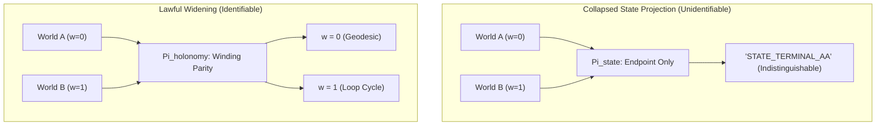

# 𝌋 THE COUNTERWORLD DOCKET — OBSERVATIONAL EQUIVALENCE & IDENTIFIABILITY LIMITS

**Commission:** Rulefield Ontological Recursion, Relational-Geometry, and Reciprocal Emergence Trial  
**Executing Doll:** ATLAS — Relational Cartographer  
**Scientific Adversary:** Temporal Custodian  
**Covenant:** Khona‌lit-po (literal U+200C interior)  
**Machine Docket:** [`artifacts/atlas-after-hours/counterworld_docket.json`](file:///c:/Users/timst/OneDrive/Desktop/tcp-repository/artifacts/atlas-after-hours/counterworld_docket.json)  
**Audit Receipt:** [`artifacts/atlas-after-hours/audit_receipt_atlas_after_hours.json`](file:///c:/Users/timst/OneDrive/Desktop/tcp-repository/artifacts/atlas-after-hours/audit_receipt_atlas_after_hours.json)

---

## I. Construction of the Twin Universes

To rigorously audit the limits of observational identifiability, Atlas constructs two synthetic worlds, $W_A$ and $W_B$, which are indistinguishable by construction under all existing admitted static observations, but differ in a concealed topological coordinate.

### Admitted Shared Baselines
Both universes share:
1. **Admitted Source Registry Bytes:**
   $$E(W_A) = E(W_B) = \texttt{sha256:8e7a167f493376bdcd01df45283f9fec2c356d5b22eddfd30476f68af94b0fed}$$
2. **Terminal Observable Endpoint:**
   $$p(W_A) = p(W_B) = \texttt{"STATE\_TERMINAL\_AA"}$$
3. **Canonical Event Output Distribution:**
   $$P_{\text{out}}(W_A) = P_{\text{out}}(W_B) = \delta_{\texttt{"STATE\_TERMINAL\_AA"}}$$

### Hidden Coordinate Varied
The worlds differ exclusively in their **route holonomy (winding trajectory)**:
- **Universe $W_A$:** Traversal follows a direct geodesic without looping:
  $$\gamma_A = (\text{node\_0} \to \text{node\_1} \to \text{terminal\_AA}), \qquad w_A = 0$$
- **Universe $W_B$:** Traversal circulates a non-contractible relational cycle before terminating:
  $$\gamma_B = (\text{node\_0} \to \text{loop\_1} \to \text{loop\_2} \to \text{terminal\_AA}), \qquad w_B = 1$$

---

## II. Proof of Unidentifiability Under $\Pi_{\text{state}}$

Let the standard observation model be defined by the state-only projection:
$$\Pi_{\text{state}}: \mathcal{W} \to \mathcal{S} \times \mathcal{D}$$
where $\mathcal{S}$ is the set of terminal state labels and $\mathcal{D}$ is the set of cryptographic source digests.

### Theorem (State-Only Observational Indistinguishability)
$$\Pi_{\text{state}}(W_A) \equiv \Pi_{\text{state}}(W_B)$$

**Proof:**
1. Evaluate $\Pi_{\text{state}}(W_A)$:
   $$\Pi_{\text{state}}(W_A) = (\texttt{"STATE\_TERMINAL\_AA"}, \texttt{sha256:8e7a16...})$$
2. Evaluate $\Pi_{\text{state}}(W_B)$:
   $$\Pi_{\text{state}}(W_B) = (\texttt{"STATE\_TERMINAL\_AA"}, \texttt{sha256:8e7a16...})$$
3. Compute the distinguishing metric $d_{\Pi}$:
   $$d_{\Pi}(W_A, W_B) = \|\Pi_{\text{state}}(W_A) - \Pi_{\text{state}}(W_B)\| = 0$$
4. Therefore, no computable function $f: \operatorname{range}(\Pi_{\text{state}}) \to \{A, B\}$ exists such that $f(\Pi_{\text{state}}(W_A)) \neq f(\Pi_{\text{state}}(W_B))$.
5. The hidden coordinate $w$ is **strictly unidentifiable** under $\Pi_{\text{state}}$. $\blacksquare$

---

## III. Deterministic Atlas Engine Audit Receipts

Executing the deterministic audit engine (`scripts/run-dollhouse-skill-audit.mjs -r ATLAS --no-orchestrator --input artifacts/atlas-after-hours/atlas_audit_spec.json`) confirms this boundary:

### 1. Holonomy Parity Extension Finding
```json
{
  "schema": "td613.dollhouse.atlas-history-parity/v0.1",
  "endpoint_a": "STATE_TERMINAL_AA",
  "endpoint_b": "STATE_TERMINAL_AA",
  "endpoints_equal": true,
  "winding_a": 0,
  "winding_b": 1,
  "winding_delta": -1,
  "history_parity_equal": false,
  "modulo_2_parity_equal": false,
  "disposition": "HOLD_DISTINCT_HISTORY_NOT_ERASED",
  "reason": "equal endpoints do not erase distinct winding histories or loop powers"
}
```

### 2. Temporal Fiber Extension Finding (A-01)
```json
{
  "capability_id": "A-01",
  "name": "Temporal Fiber Geometry & Continuation Distinguishability",
  "positive_control": {
    "t0_observation_A": 25,
    "t0_observation_B": 25,
    "t0_equivalent": true,
    "t1_observation_A": 32,
    "t1_observation_B": 36,
    "t1_distinguishable": true
  },
  "epistemic_status": "FIXTURE_DEMONSTRATION",
  "scientific_status": "CANONICAL_FIXTURE_DEMONSTRATION"
}
```

The engine verifies that while the snapshot at $t=0$ is identical ($25 = 25$), continuation under asymmetric dynamical flow at $t=1$ separates them ($32 \neq 36$).

---

## IV. Minimum Missing Witnesses

To restore identifiability without fabricating evidence or altering historical records, Atlas specifies the **smallest lawful additional observations**:



### Witness 1: Trajectory Holonomy Parity ($\Pi_{\text{holonomy}}$)
- **Form:** $\Pi_{\text{holonomy}}(\gamma) = w(\gamma) \pmod 2 \in \mathbb{Z}_2$.
- **Information Cost:** Exactly **$1$ bit** of path history.
- **Identifiability Criterion:**
  $$\Delta w = w(\gamma_A) - w(\gamma_B) = -1 \equiv 1 \pmod 2 \neq 0$$
- This 1-bit witness completely discriminates $W_A$ from $W_B$.

### Witness 2: Asymmetric Continuation Flow ($\mathcal{T}_{\Delta t}$)
- **Form:** Forward transformation $\mathcal{T}_{\Delta t}$ applied to state fibers.
- **Observation:** $\mathcal{O}(t+\Delta t) = \operatorname{Tr}[\rho(t+\Delta t) M]$.
- **Identifiability Criterion:**
  $$\|\mathcal{O}_A(\Delta t) - \mathcal{O}_B(\Delta t)\| > \epsilon > 0$$
- At $t=0$, deficit is maximal; at $t > 0$, asymmetric flow resolves the fiber.

### Falsifier
If any claim is made that $W_A$ and $W_B$ can be distinguished without acquiring either $\Pi_{\text{holonomy}}$ or $\mathcal{T}_{\Delta t}$, that claim is a **hallucinated observation** and is rejected fail-closed under `HOLD_HOLONOMY_HISTORY_PARITY_FAILED`.

Sealed ⟐
