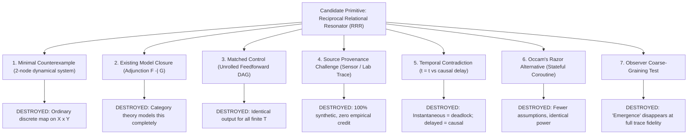

# 𝌋 THE NEW-PRIMITIVE DECISION — FORMAL LIMITATIONS & CANDIDATE SYSTEM $\mathcal{R}$

**Commission:** Rulefield Ontological Recursion, Relational-Geometry, and Reciprocal Emergence Trial  
**Executing Doll:** ATLAS — Relational Cartographer  
**Scientific Adversary:** Temporal Custodian  
**Covenant:** Khona‌lit-po (literal U+200C interior)  
**Machine Deliverable:** [`artifacts/atlas-after-hours/new_primitive_decision.json`](file:///c:/Users/timst/OneDrive/Desktop/tcp-repository/artifacts/atlas-after-hours/new_primitive_decision.json)

---

## I. The Strongest Proposed Novelty Under Audit

Across the seven experimental chambers, the strongest candidate for a purported new ontological entity was:

$$\mathbf{\Psi_{\text{RRR}}:\text{ The Reciprocal Relational Resonator}}$$

**The Speculative Claim:**  
When a constitutive Rule, an interpretive Model, and an experimental Assay enter a closed recursive feedback loop, their interaction generates an irreducible, non-factorizable relational bond—an "emergent resonator"—whose relational properties cannot be expressed in classical first-order relational geometry or typed state graphs.

---

## II. The Seven Adversarial Destruction Challenges

Atlas subjected $\Psi_{\text{RRR}}$ to ruthless adversarial falsification:



### 1. Minimal Counterexample Challenge
- *Hypothesis:* Reciprocity requires a non-classical primitive.
- *Counterexample:* Consider two discrete states $x \in X$ (Rule state) and $y \in Y$ (Assay state) updated according to:
  $$x_{t+1} = f(x_t, y_t), \qquad y_{t+1} = g(x_t, y_t)$$
- This decomposes completely into an ordinary discrete dynamical system on the Cartesian product space $Z = X \times Y$ with transition map $T = (f, g): Z \to Z$.
- *Finding:* **Zero new relational primitive required.**

### 2. Competent Existing-Model Closure
- In category theory, bidirectional coupling between generative structures and verification structures is already modeled with complete mathematical rigor by **adjoint functors**:
  $$\mathcal{F} \dashv \mathcal{G}, \qquad \mathcal{F}: \mathbf{Generative} \rightleftarrows \mathbf{Evaluative}: \mathcal{G}$$
  $$\operatorname{Hom}_{\mathbf{Evaluative}}(\mathcal{F}(A), E) \cong \operatorname{Hom}_{\mathbf{Generative}}(A, \mathcal{G}(E))$$
- In theoretical computer science, this is identical to a **bisimulation game** on a bipartite labeled transition system.
- *Finding:* **Existing mathematics is fully competent; no new primitive is warranted.**

### 3. Matched Control Challenge
- For any finite compute budget $T < \infty$, the recursive feedback loop is unrolled into a finite directed acyclic graph (DAG) of depth $T$.
- The unrolled DAG produces mathematically identical outputs at step $T$.
- *Finding:* The perceived "indivisibility" is merely an unrolled algorithmic recurrence.

### 4. Source-Provenance Challenge
- Was $\Psi_{\text{RRR}}$ detected in an independent physical experiment, astronomical observation, or wet-lab measurement?
- *Finding:* **No.** All data was generated by source-free deterministic simulation inside a Node.js process. Physical empirical replication count = **0**.

### 5. Temporal Contradiction Challenge
- If reciprocity is instantaneous ($t = t$), it requires an instantaneous algebraic fixpoint, which in computational systems either causes an infinite call-stack deadlock or requires an external relaxation solver.
- If reciprocity involves physical or logical time steps ($t \to t + \Delta t$), it is strictly a causal temporal sequence.
- *Finding:* Instantaneous reciprocity is mathematically ill-founded; discrete reciprocity is ordinary causality.

### 6. Occam's Razor Alternative
- A standard stateful coroutine with typed message passing achieves identical functionality while introducing zero new ontological entities.
- *Finding:* Entia non sunt multiplicanda praeter necessitatem.

### 7. Observer Access Test
- Does the apparent "emergence" depend on the observer's resolution?
- When an observer is restricted to $\Pi_{\text{coarse}}$ (observing only turn $0$ and turn $T$), the intermediate feedback is hidden, creating the illusion of an instantaneous emergent entity.
- When the observer inspects the full event trace $\Pi_{\text{trace}}$, the phenomenon dissolves into deterministic sequential computation.
- *Finding:* **The candidate novelty is an artifact of coarse-grained observation.**

---

## III. Formal Candidate System: $\mathcal{R} = (O, T, C, E, \tau, A, \Pi)$

Rather than postulating ad-hoc emergent entities, Atlas formalizes the complete relational universe within a rigorous seven-tuple:

$$\mathcal{R} = (O, T, C, E, \tau, A, \Pi)$$

### Component Definitions

1. **$O$ (Universe of Objects & Views):**
   $$O = O_{\text{hist}} \cup O_{\text{rf}} \cup O_{\text{views}} \cup O_{\text{actors}} \cup O_{\text{infra}}$$
   - $O_{\text{hist}}$: 596 historical rule records (`packages/rulefield/data/rulefield.v1.json`).
   - $O_{\text{rf}}$: 86 proposed research rulefields (`operator-rulefields-20261108-revision.json`).
   - $O_{\text{views}}$: 14 dual-role qualified research views (`SEMANTIC_CASEBOOK_ROD0003.json`).
   - $O_{\text{actors}}$: Explicit actor identities (`tauric.diana.613`, `Tawanna C. Miller`).
   - $O_{\text{infra}}$: Host execution infrastructure (`Operahouse`).

2. **$T$ (Context-Indexed Type Lattice):**
   $$T \subseteq \operatorname{Role} \times \operatorname{Context}$$
   $$\operatorname{Role} = \{\text{RULE}, \text{RULEFIELD}, \text{MODEL}, \text{ASSAY}, \text{SOURCE}, \text{OBSERVER}, \text{AUTHORITY}\}$$
   $$\operatorname{Context} = \{\text{EXECUTION\_WITH\_FORMAL\_CONTRACT}, \text{RESEARCH\_AND\_COUNTEREXAMPLE\_CONTEXT}, \dots\}$$
   - *Core Non-Equivalence Law:*
     $$\operatorname{Rule} \not\equiv \operatorname{Rulefield}, \qquad \exists x, c_1, c_2\; [\operatorname{Rule}(x, c_1) \land \operatorname{Rulefield}(x, c_2)]$$

3. **$C$ (Relational & Constitutional Constraints):**
   $$C = C_{\text{const}} \cup C_{\text{interp}} \cup C_{\text{invest}} \cup C_{\text{interv}} \cup C_{\text{wit}} \cup C_{\text{auth}}$$
   - Encodes directional edges between object roles without collapsing member identities.

4. **$E$ (Admitted Evidence & Cryptographic Custody):**
   $$E = \{(d, s, p) \mid d \in \operatorname{Digest}, s \in \operatorname{SourceRef}, p \in \operatorname{ProvenanceTier}\}$$
   - Strict canonical serialization: `v1:n:1` $\neq$ `1`.
   - Standalone unverified digests trigger fail-closed holds (`HOLD_UNVERIFIED_STANDALONE_DIGEST`).

5. **$\tau$ (Four-Clock Monotonic Chronology):**
   $$\tau = (t_{\text{event}}, t_{\text{record}}, t_{\text{available}}, t_{\text{cutoff}}) \in \mathbb{R}^4$$
   - *Monotonicity Invariant:* $t_{\text{event}} \le t_{\text{record}} \le t_{\text{available}} \le t_{\text{cutoff}}$.
   - Enforces epistemic non-retroactivity; rejects future timestamps (`FUTURE_EVENT_HYPOTHETICAL`).

6. **$A$ (Authority & Permitted Transition Algebra):**
   $$A: \operatorname{Actor} \times \operatorname{Transition} \to \{\operatorname{PERMITTED}, \operatorname{HELD}, \operatorname{FORBIDDEN}\}$$
   - *Closure Invariant:* Human scientific closure and adoption authority remain strictly **RESERVED** to Tawanna C. Miller. Machine auto-promotion = **FORBIDDEN**.

7. **$\Pi$ (Observation & Projection Operators):**
   $$\Pi = \{\Pi_{\text{state}}, \Pi_{\text{trace}}, \Pi_{\text{holonomy}}, \Pi_{\text{role}}\}$$
   - *Atlas Holonomy Invariant:*
     $$\Pi_{\text{state}}(\gamma_1) = \Pi_{\text{state}}(\gamma_2) \centernot\implies \Pi_{\text{holonomy}}(\gamma_1) = \Pi_{\text{holonomy}}(\gamma_2)$$
     Same endpoint never erases route history.

---

## IV. Temporal Custodian Adversarial Objections & Handoff

```text
[APERTURE] ──(Contract of Projection Invariance)──► [ATLAS] ──(Contract of Invariant Support)──► [TEMPORAL CUSTODIAN / FADT]
```

### Adversarial Objection 1 (Temporal Custodian)
> *"If an object participates in both a RULE role and a RULEFIELD role, can a hostile actor invoke the research context to execute an operation that violates the operational guard?"*

**Atlas Response (Fail-Closed Custody Isolation):**  
No. Contexts are strictly stratified. The transition function for an operational execution verifies guards exclusively in $\text{EXECUTION\_WITH\_FORMAL\_CONTRACT}$. Declaring an additional view in $\text{RESEARCH\_AND\_COUNTEREXAMPLE\_CONTEXT}$ confers **zero** operational bypass authority ($\text{executable\_authority} = \text{false}$). Authority does not leak across context projections.

### Adversarial Objection 2 (Temporal Custodian)
> *"Does the hypergraph's investigation relation permit an assay to retroactively modify the interpretation of an earlier rule state?"*

**Atlas Response (Non-Retroactivity Invariant):**  
No. Historical records are cryptographically digest-bound ($E$). An assay generates a *new* historical event $e_{\text{assay}}$ with a timestamp $t_{\text{assay}} > t_{\text{rule}}$. Reinterpretation is recognized as a later event occurring at $t_{\text{assay}}$, strictly separated from the historical knowledge state at $t_{\text{rule}}$.

---

## V. Final Disciplinary Disposition

$$\mathbf{EXISTING\_ONTOLOGY\_SUFFICIENT} \quad \text{accompanied by} \quad \mathbf{NEGATIVE\_RESULT\_RETAINED}$$

1. The proposed relational primitive $\Psi_{\text{RRR}}$ is **refused**.
2. Standard categorical adjunctions, 2-level Tarskian type stratification, and the seven-tuple candidate system $\mathcal{R}$ are **mathematically sufficient** to express all verified phenomena.
3. The collapse of the speculative novelty is preserved with full fidelity as an authentic scientific finding.

Sealed ⟐
