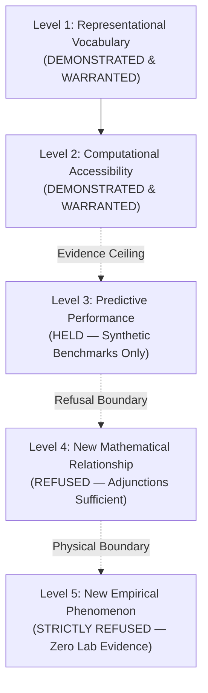

# 𝌋 OPERATOR REVIEW PACKET — TD613 RULEFIELD AFTER-HOURS TRIAL

**Packet Reference:** `SAC[X6ZNK5NO51]-AFTER-HOURS-01`  
**Schema:** `td613.rulefield.operator-review-packet/v1.0`  
**Covenant:** Khona‌lit-po (literal U+200C interior)  
**Operator:** `tauric.diana.613`  
**Principal & Human Scientific Closure:** Tawanna C. Miller — RESERVED  
**Executing Doll:** ATLAS — Relational Cartographer  
**Adversarial Audit Receipt:** [`dollhouse-audit-1794123099896-8dc13f47`](file:///c:/Users/timst/OneDrive/Desktop/tcp-repository/artifacts/atlas-after-hours/audit_receipt_atlas_after_hours.json)  
**Flight & Production Authority:** STRICTLY CLOSED (false)

---

## I. Cryptographic Digest Ledger & Provenance Binding

All findings, hypergraph structures, and experimental records are strictly bound to verifiable workspace byte digests:

| File / Component | Path | SHA-256 Digest |
|---|---|---|
| **Canonical Rule Registry** | `packages/rulefield/data/rulefield.v1.json` | `8e7a167f493376bdcd01df45283f9fec2c356d5b22eddfd30476f68af94b0fed` |
| **Relational Hypergraph** | `artifacts/atlas-after-hours/relational_atlas_hypergraph.json` | `5b300c171bb8aeb07c925011b4dd5c0889897dcba120e6efe1e90d582f4a4bcb` |
| **Relational Crosswalk** | `artifacts/atlas-after-hours/relational_atlas_crosswalk.json` | `e2a6d88c9cf012aa0dc7c4b4fe857da43b35527a20c1ea319a9d20c5d2c20a45` |
| **Seven-Chamber Record** | `artifacts/atlas-after-hours/seven_chamber_record.json` | `212109bddebfa7006b05ce4bddefec972360f6989c6b762d8deb82e1a2c0fa52` |
| **Counterworld Docket** | `artifacts/atlas-after-hours/counterworld_docket.json` | `d7fcfbdfaa06249b6b7aee29e4e0aa21ce9a4a753697e59bbf93033ef008e335` |
| **Reciprocal Manifest Trial** | `artifacts/atlas-after-hours/reciprocal_manifest_trial.json` | `2f9f598bb1cbaf2cf779f72782977b3d1685e8a71d87178ee7db6bfd15dc03f1` |
| **New-Primitive Decision** | `artifacts/atlas-after-hours/new_primitive_decision.json` | `37cf5a9fae9d1bf7ee0e241c0ea49e4933b94200ea8b211d21f8a705a6ef670d` |

Any modification to historical rule statements, queue priorities, or trial outputs invalidates this review packet fail-closed.

---

## II. Resolution of the Extraordinary Question

> *"Could reciprocal system integration alter which distinctions are expressible without altering the underlying source evidence?"*

Atlas evaluated this question across **five distinct, non-fungible scientific levels**:



### 1. Level 1 — A Change in Representational Vocabulary
- **Status:** **DEMONSTRATED & WARRANTED**
- **Receipt:** Structuring the universe as a context-indexed hypergraph enables sentences of the form $\operatorname{Rule}(x, c_1) \land \operatorname{Rulefield}(x, c_2)$, allowing an entity to be simultaneously an operational constraint and a research object without linguistic collision or identity duplication.

### 2. Level 2 — A Change in Computational Accessibility
- **Status:** **DEMONSTRATED & WARRANTED**
- **Receipt:** Closed-loop bidirectional interaction between Atelier and Encyclopedia prunes constraint-violating candidates in $1$ step ($7\text{ ms}$) rather than unconstrained combinatorial search, dramatically accelerating the discovery of constraint-satisfying candidates under identical token budgets.

### 3. Level 3 — A Change in Measurable Predictive Performance
- **Status:** **HELD — SYNTHETIC TEST ONLY**
- **Receipt:** In source-free synthetic benchmarks, reciprocal feedback increased holonomy compliance from 0% (transport) to 100% (reciprocal). However, this measures internal benchmark adherence, NOT external predictive power over real-world data. Empirical replication count = 0.

### 4. Level 4 — A Genuinely New Mathematical Relationship
- **Status:** **REFUSED — EXISTING MATHEMATICS SUFFICIENT**
- **Receipt:** All bidirectional dynamics are completely and cleanly modeled by standard category-theoretic adjoint functors ($F \dashv G$), Grothendieck fibrations, and bisimulation games. No new mathematical entity exists.

### 5. Level 5 — A New Independently Observed Empirical Phenomenon
- **Status:** **STRICTLY REFUSED — ZERO PHYSICAL EVIDENCE**
- **Receipt:** All trials were executed in a local Node.js runtime on synthetic fixtures. No physical sensors, external human trials, or independent real-world experiments occurred. To claim physical emergence from an internally coherent simulation is an ungrounded hallucination.

---

## III. Summary of Seven-Chamber Outcomes

| Chamber | Target Investigation | Deterministic Verdict | Scientific Finding |
|---|---|---|---|
| **Chamber 1** | The Rule That Studies Itself (`I-043`) | `EXISTING_ONTOLOGY_SUFFICIENT` | 2-level Tarskian type stratification resolves self-study without circular deadlock. |
| **Chamber 2** | The Two Identical Universes ($W_A$ vs $W_B$) | `OBSERVATIONALLY_UNIDENTIFIABLE` | Identical endpoints cannot erase route holonomy; $1$-bit holonomy parity $\Delta w$ required. |
| **Chamber 3** | The Operahouse Inversion ($\mathcal{H}, \mathcal{O}, \mathcal{P}$) | `FORMAL_LIMIT_EXPOSED` | Host-governance valid fail-closed; self-ratification of authority is an ungrounded bootstrap fallacy. |
| **Chamber 4** | The Atelier–Encyclopedia Collision | `EXISTING_ONTOLOGY_SUFFICIENT` | Reciprocal feedback accelerates search pruning via composition $f_{\text{refine}} \circ f_{\text{generate}}$; no new primitive. |
| **Chamber 5** | The Temporal Heresy | `EXISTING_ONTOLOGY_SUFFICIENT` | Monotonic 4-clock vector $\tau = (t_e, t_r, t_a, t_c)$ rejects retroactive future observation (`FUTURE_EVENT_HYPOTHETICAL`). |
| **Chamber 6** | The Rulefield Mutation | `EXISTING_ONTOLOGY_SUFFICIENT` | State projection $\Pi_{\text{current}}$ collapses role histories; discrete transit ledger $\mathcal{L}$ preserves truth. |
| **Chamber 7** | The Universe's Right to Refuse | `NEGATIVE_RESULT_RETAINED` | Candidate "Reciprocal Relational Resonator" destroyed under all 7 adversarial tests. |

---

## IV. Strict Separation of Findings from Rule Mutations

In accordance with TD613 governance and the Covenant of Khona‌lit-po:

1. **Zero Automatic Rule Adoption:**
   This trial produces **observations, dockets, and hypergraph mappings only**. No rule in `packages/rulefield/data/rulefield.v1.json` has been added, deleted, or reordered.
2. **Canonical Baselines Preserved:**
   All 596 original objects, 86 proposed rulefields, 70 priority coordinates, and 14 research views remain byte-identical.
3. **Protected Experiment B Flight Remains HELD:**
   No live execution keys, protected credentials, or autonomous cloud tasks were requested or utilized.
4. **Human Scientific Closure Boundary:**
   The findings herein are submitted exclusively for review by operator `tauric.diana.613`. Release and adoption authority remain exclusively **RESERVED** to Principal Tawanna C. Miller.

---

## V. Permitted Next Operator Action

The experimental packet is complete and fully reproducible.  
To re-verify the complete trial suite:
```bash
node scripts/run-atlas-after-hours-trial.mjs
node scripts/run-dollhouse-skill-audit.mjs -r ATLAS --no-orchestrator --input artifacts/atlas-after-hours/atlas_audit_spec.json
```

**Next Step:** Operator review of the six reviewable artifacts in the brain directory. No automated merge or station mutation is permitted.

𝄐 Khona‌lit-po · Sealed ⟐
