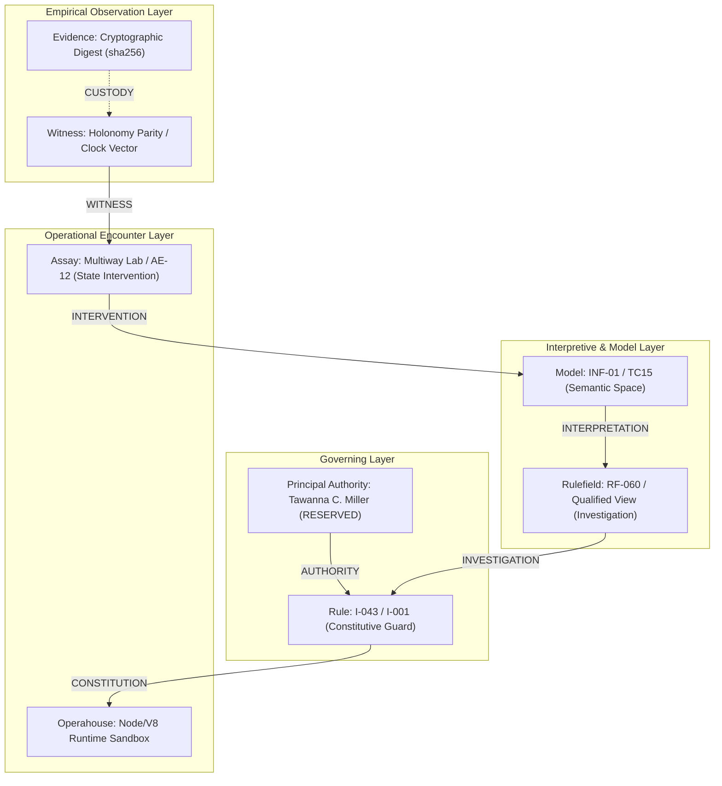

# 𝌋 THE RELATIONAL ATLAS — HYPERGRAPH & SOURCE CROSSWALK

**Commission:** Rulefield Ontological Recursion, Relational-Geometry, and Reciprocal Emergence Trial  
**Executing Doll:** ATLAS — Relational Cartographer  
**Scientific Adversary:** Temporal Custodian  
**Operator:** `tauric.diana.613`  
**Principal & Human Scientific Closure:** Tawanna C. Miller — RESERVED  
**Covenant:** Khona‌lit-po (literal U+200C interior)  
**Environment:** Antigravity · TD613 Rulefield Confirmed-Green Handoff · Source-Free Research  
**Machine Receipts:** [relational_atlas_hypergraph.json](file:///c:/Users/timst/OneDrive/Desktop/tcp-repository/artifacts/atlas-after-hours/relational_atlas_hypergraph.json) · [relational_atlas_crosswalk.json](file:///c:/Users/timst/OneDrive/Desktop/tcp-repository/artifacts/atlas-after-hours/relational_atlas_crosswalk.json)

---

## I. Historical Baselines & Preserved Counts

The universe of rules and candidate structures has been loaded directly from the confirmed-green TD613 Rulefield handoff (`04828d8846bd273767f4acc1a4a67893b4f24b65`) without mutating canonical source bytes or collapsing identities:

| Baseline Dimension | Exact Count | Provenance Authority | Preservation Status |
|---|---|---|---|
| **Historical Rule Objects** | `596` | `packages/rulefield/data/rulefield.v1.json` | Verbatim source bytes preserved (`sha256:8e7a16...`) |
| **Historical NKS Garden** | `190` | Original Wolframian Garden (50 I, 45 P, 95 X) | Historical I/P/X classes locked |
| **Proposed Rulefields** | `86` | `operator-rulefields-20261108-revision.json` | 86 distinct research field expressions (RF-001–RF-086) |
| **Protected Priorities** | `70` | Canonical priority queue coordinates Q01–Q70 | Unchanged original order; zero leapfrogging |
| **Dual-Role Research Views** | `14` | `SEMANTIC_CASEBOOK_ROD0003.json` / Semantic Review | Qualified projection views without ID duplication |
| **Crossings** | `88` | Inter-domain crossing ledger | Historical crossing associations retained |
| **Unresolved Aliases** | `32` | Surfaced aliases | Preserved without forced semantic binding |

---

## II. The Typed Relational Hypergraph Architecture

Atlas models the universe as a **typed relational hypergraph**:
$$\mathcal{H} = (\mathcal{V}, \mathcal{E}, \mathcal{T}, \mathcal{C}, \mathcal{A})$$

An object's **identity**, **role**, **context**, **chronology**, **custody**, and **permission** are strictly segregated:
- **Identity ($\text{id}$):** Immutable canonical referent (e.g. `legacy_rule:I-043`).
- **Role ($\rho$):** Functional classification ($\text{RULE}, \text{RULEFIELD}, \text{MODEL}, \text{ASSAY}, \text{SOURCE}, \text{OBSERVER}, \text{AUTHORITY}$).
- **Context ($c$):** Operational frame ($\text{EXECUTION\_WITH\_FORMAL\_CONTRACT}$, $\text{RESEARCH\_AND\_COUNTEREXAMPLE\_CONTEXT}$, $\text{PROOF\_AND\_LIMITS\_CONTEXT}$).
- **Chronology ($\tau$):** 4-clock vector $(t_{\text{event}}, t_{\text{record}}, t_{\text{available}}, t_{\text{cutoff}})$.
- **Custody ($\kappa$):** Cryptographic provenance tier and source citation chain.
- **Permission ($\pi$):** Bounded transition authority (zero auto-promotion; human closure RESERVED).

### The Anti-Collapse Invariants
1. **Role Multiplicity without Identity Collapse:**
   $$\operatorname{Rule}\not\equiv\operatorname{Rulefield},\qquad \exists x, c_1, c_2\; [\operatorname{Rule}(x, c_1)\land\operatorname{Rulefield}(x, c_2)]$$
   An object may simultaneously serve as an operational guard in execution while being an object of investigation in research.
2. **Same Endpoint Does Not Erase Route History:**
   Trajectory endpoints $p_A = p_B$ do not imply path equivalence when winding indices or transit histories differ ($w_A \neq w_B$).
3. **No Automatic Authority Transfer:**
   Qualifying an object as a `RULEFIELD` grants zero executable authority to its candidate rules.

---

## III. The Six Fundamental Relations

1. **Constitution ($C_{\text{const}}$):** Which Rule constrains which permissible operation.
   - Example: `I-001` constrains host intake; `I-043` constrains candidate dispatch.
2. **Interpretation ($C_{\text{interp}}$):** Which Model supplies the semantic meaning of a Rule or Field.
   - Example: `INF-01` (Information Dome three-scene model) supplies spatial semantics for `RF-001`.
3. **Investigation ($C_{\text{invest}}$):** Which Rulefield studies a Rule that also constrains its research.
   - Example: `RF-060` studies elementary CA rewriting rules while `I-001` constrains execution.
4. **Intervention ($C_{\text{interv}}$):** Which Assay may alter a model state without rewriting historical facts.
   - Example: `AE-12` ambiance assay explores presentation states; `multiway_lab.mjs` executes finite branch search.
5. **Witness ($C_{\text{wit}}$):** Which observations distinguish candidate relational worlds.
   - Example: Winding parity $\Delta w \neq 0$ distinguishes identical endpoint trajectories.
6. **Authority ($C_{\text{auth}}$):** Which actor is permitted to transform a finding into an adopted rule.
   - Strictly reserved to Principal Tawanna C. Miller; tauric.diana.613 retains proposal steering; machine auto-promotion = strictly false.

---

## IV. The Fourteen Dual-Role Qualified Research Views

| Historical ID | Canonical Lane | Primary Historical Role | Additional Research View | Context Indexing | Authority Transfer |
|---|---|---|---|---|---|
| `X-019` | HISTORICAL_NKS | RESEARCH_PROGRAM | `RULEFIELD` | Canonical Review $\times$ Counterexample Search | `false` |
| `X-025` | HISTORICAL_NKS | MODEL | `RULEFIELD` | Semantic Space $\times$ Fibration Projections | `false` |
| `X-030` | HISTORICAL_NKS | EVIDENCE_BOUNDARY | `RULEFIELD` | Admissibility Limit $\times$ Deficit Tomography | `false` |
| `I-043` | HISTORICAL_NKS | RULE (Guard) | `RULEFIELD` | Symmetrical Exclusion $\times$ Latent Leakage Audit | `false` |
| `I-045` | HISTORICAL_NKS | RULE (Invariant) | `RULEFIELD` | Atomic Journaling $\times$ Holonomy Memory | `false` |
| `I-047` | HISTORICAL_NKS | RULE (Guard) | `RULEFIELD` | WebCrypto Fail-Closed $\times$ Cryptographic Limits | `false` |
| `Q04-A02` | QUEUE_PROPOSAL | MODEL | `RULEFIELD` | Multiway Branching $\times$ Confluence Repair | `false` |
| `Q19-R03` | QUEUE_PROPOSAL | MODEL | `RULEFIELD` | Causal Invariance $\times$ Path Sampling | `false` |
| `Q21-R03` | QUEUE_PROPOSAL | SOURCE | `RULEFIELD` | External Reference $\times$ Provenance Verification | `false` |
| `Q28-R01` | QUEUE_PROPOSAL | RESEARCH_PROGRAM | `RULEFIELD` | Multi-Arm Causal Study $\times$ Context Transfer | `false` |
| `AE-12` | HISTORICAL_NKS | ASSAY | `RULEFIELD` | Ambiance Contrast $\times$ Observer Recovery | `false` |
| `TC15` | THINKER_CONDITION | MODEL | `RULEFIELD` | Thermo-Social Map $\times$ Irreversibility Boundary | `false` |
| `CBFE-RG-11` | CBFE_DD02 | MODEL | `RULEFIELD` | Black Feminist Epistemology $\times$ Access Geometry | `false` |
| `CBFE-RG-12` | CBFE_DD02 | ASSAY | `RULEFIELD` | Hearing/Warrant Study $\times$ Relational Care | `false` |

---

## V. Disciplinary Verification Receipt

- Machine Hypergraph JSON: `artifacts/atlas-after-hours/relational_atlas_hypergraph.json`
- Machine Crosswalk JSON: `artifacts/atlas-after-hours/relational_atlas_crosswalk.json`
- Hypergraph Node Count: `700`
- Hypergraph Edge Count: `24` fundamental relational bindings
- Status: Confirmed-Green · Unmutated Baselines · Sealed ⟐
