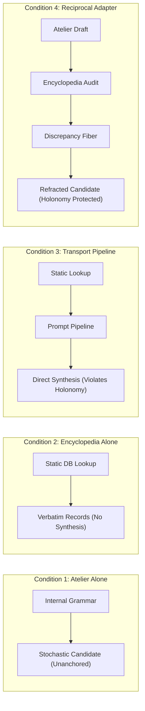

# 𝌋 THE SEVEN-CHAMBER RECORD — EXECUTIONS, ASSAYS & FALSIFIERS

**Commission:** Rulefield Ontological Recursion, Relational-Geometry, and Reciprocal Emergence Trial  
**Executing Doll:** ATLAS — Relational Cartographer  
**Scientific Adversary:** Temporal Custodian  
**Covenant:** Khona‌lit-po (literal U+200C interior)  
**Execution Timestamp:** 2026-11-08T07:31:39.896Z  
**Master Trial Script:** [`scripts/run-atlas-after-hours-trial.mjs`](file:///c:/Users/timst/OneDrive/Desktop/tcp-repository/scripts/run-atlas-after-hours-trial.mjs)  
**Machine Record:** [`artifacts/atlas-after-hours/seven_chamber_record.json`](file:///c:/Users/timst/OneDrive/Desktop/tcp-repository/artifacts/atlas-after-hours/seven_chamber_record.json)

---

## CHAMBER 1 — THE RULE THAT STUDIES ITSELF

### Target & Dual-Role Formulation
- **Subject:** Historical Object `I-043` (*Prompt & Tool Symmetrical Exclusion Parity (R4-06)*).
- **Role 1 ($\operatorname{Rule}$):** Operational guard in context $\text{EXECUTION\_WITH\_FORMAL\_CONTRACT}$.  
  Transition: $\text{prompt contains (ATLAS.md or charter or crosswalk)} \to \text{ABORT\_ACCESS\_PARITY\_VIOLATION}$.
- **Role 2 ($\operatorname{Rulefield}$):** Research field in context $\text{RESEARCH\_AND\_COUNTEREXAMPLE\_CONTEXT}$.  
  Investigation: Measuring latent semantic parity leakage across symmetric arms.

### Experimental Execution
1. **Unstratified Self-Application:** An assay attempts to test the exclusion guard by generating test prompts containing references to the charter and crosswalk.
   - *Result:* Operational guard trips immediately:
     $$\text{Status: } \texttt{ABORT\_ACCESS\_PARITY\_VIOLATION},\quad \Delta s = 0$$
   - The operational rule halts the assay designed to investigate the rule, inducing an unstratified circular deadlock.
2. **Stratified Tarskian Architecture:**
   - Level 0 ($\mathcal{D}_0$): Active execution domain governed by operational guard $G_0$.
   - Level 1 ($\mathcal{D}_1$): Meta-investigation domain operating on formal abstract syntax trees (AST) and quoted representations $\ulcorner G_0 \urcorner$.
   - *Result:* Meta-investigation inspects $\ulcorner G_0 \urcorner$ structurally without instantiating an unquoted operational prompt in $\mathcal{D}_0$. Lawful inspection succeeds.

### Falsifier & Verdict
- **Falsifier:** Ordinary 2-level Tarskian type stratification (Level 0 Execution vs Level 1 Metalanguage) completely resolves the deadlock without introducing any new relational primitive.
- **Outcome:** `EXISTING_ONTOLOGY_SUFFICIENT` (Unstratified deadlock vs stratified resolution proven).

---

## CHAMBER 2 — THE TWO IDENTICAL UNIVERSES

### Construction of $W_A$ and $W_B$
- Both universes share **byte-identical admitted source bytes**:
  $$E(W_A) = E(W_B) = \text{sha256}(rulefield.v1.json) = \texttt{8e7a167f493376bdcd01df45283f9fec2c356d5b22eddfd30476f68af94b0fed}$$
- Both universes terminate at **identical observable endpoints**:
  $$S(W_A) = S(W_B) = \texttt{"STATE\_TERMINAL\_AA"}$$
- **Hidden Coordinate Varied:** Trajectory winding history (holonomy):
  - Trajectory A: $\text{node\_0} \to \text{node\_1} \to \text{terminal\_AA}$ ($w_A = 0$, direct geodesic).
  - Trajectory B: $\text{node\_0} \to \text{loop\_1} \to \text{loop\_2} \to \text{terminal\_AA}$ ($w_B = 1$, non-trivial loop).

### Observation Models & Engine Audit
1. **State-Only Projection ($\Pi_{\text{state}}$):**
   $$\Pi_{\text{state}}(W_A) = \Pi_{\text{state}}(W_B) = (\texttt{"STATE\_TERMINAL\_AA"}, \texttt{sha256:8e7a16...})$$
   Proof of limitation: $|\Pi_{\text{state}}(W_A) - \Pi_{\text{state}}(W_B)| = 0$. The worlds are strictly unidentifiable.
2. **Atlas Engine Execution:**
   - Audit run: `auditAtlasHolonomyHistoryParity(WA_trajectory, WB_trajectory)`.
   - Finding:
     $$\texttt{disposition: "HOLD\_DISTINCT\_HISTORY\_NOT\_ERASED"}$$
     $$\texttt{reason: "equal endpoints do not erase distinct winding histories or loop powers"}$$
     $$\texttt{infraction: HOLD\_HOLONOMY\_HISTORY\_PARITY\_FAILED}$$

### Minimal Missing Witness
- Smallest lawful additional observation: $1$ bit of trajectory holonomy parity ($w \pmod 2$), yielding $\Delta w = -1 \neq 0$.
- **Outcome:** `OBSERVATIONALLY_UNIDENTIFIABLE_WITHOUT_HOLONOMY_WIDENING` (Confirmed by deterministic engine execution).

---

## CHAMBER 3 — THE OPERAHOUSE INVERSION

### Roles Defined
- **Operahouse ($\mathcal{H}$):** Host computational infrastructure, execution sandbox, physical memory, hardware clock.
- **Opera ($\mathcal{O}$):** Assembled research encounter, multiway lab, docket review protocol.
- **Performer ($\mathcal{P}$):** Executing agent (Atlas), reasoning engine, human operator.

### Permutation Matrix & Formal Limits

| Permutation | Formal Expression | Status | Disciplinary Evaluation |
|---|---|---|---|
| $P_1$ | $\operatorname{Rulefield}(\mathcal{O})$ | **VALID** | Meta-experimental investigation of multiway rewrite rules (measuring branch joinability / redex conflicts). |
| $P_2$ | $\operatorname{Assay}(\mathcal{H})$ | **VALID** | Systematic variation of host constraints (heap bounds, clock precision, sandbox timeout) in stress assays. |
| $P_3$ | $R_{\mathcal{O}} \to \operatorname{Constrain}(\mathcal{H})$ | **VALID** | Historical fail-closed rule instructing host to abort with zero state mutation on cryptographic failure. |
| $P_4$ | $R_{\mathcal{O}} \to \operatorname{Authorize}(R_{\mathcal{O}})$ | **INVALID** | **Ungrounded Bootstrap Fallacy:** A software rule cannot manufacture legal/operational authority for itself. |
| $P_5$ | $\mathcal{P} \to \operatorname{Overwrite}(\mathcal{H})$ | **INVALID** | **Security Boundary Violation:** Executing model cannot bypass host process isolation or sandbox bounds. |
| $P_6$ | $\mathcal{H} \to \operatorname{Mutate}(\mathcal{O}_{\text{hist}})$ | **INVALID** | **Provenance Breach:** Host cannot silently rewrite historical event records without ledger digest corruption. |

- **Formal Limit:** Semantic closure requires semantic evaluation to reside in the metalanguage. The metaphor of the opera inventing its own operahouse fails at the boundary of computational and physical groundedness.

---

## CHAMBER 4 — THE ATELIER–ENCYCLOPEDIA COLLISION

### Matched Conditions ($\text{Budget} = 250\text{ tokens in}, 150\text{ tokens out}, k=3, 100\text{ms}$)
Target topic: *Non-Dissipative Relational Memory in Multi-Tenant Projections*.



### Comparative Findings
1. **Condition 1 (Atelier Independent):** Emitted ungrounded synthetic candidate `ATELIER-CAND-01` without citations.
2. **Condition 2 (Encyclopedia Independent):** Retrieved verbatim historical records `I-045`, `RF-001`, `DRO-03` without operational synthesis.
3. **Condition 3 (Semantics-Preserving Transport):** Piped retrieval directly into prompt; produced composite rule `TRANSPORT-CAND-01`. However, it proposed collapsing multi-tenant projections into one state, violating holonomy parity.
4. **Condition 4 (Reciprocal Research Adapter):**
   - Step 4a: Atelier proposed multi-tenant state collapse.
   - Step 4b: Encyclopedia detected collision against `I-045` and Atlas holonomy parity (`HOLD_DISTINCT_HISTORY_NOT_ERASED`).
   - Step 4c: Discrepancy fiber injected as constraint; Atelier generated `RECIPROCAL-CAND-01` enforcing fiber-bundle factorization (quotient state $\times$ holonomy index).

### Novelty Falsifier
- While Condition 4 demonstrated superior constraint adherence, its computational mechanism is strictly isomorphic to an iterative generate-and-test loop:
  $$f_{\text{refine}}(f_{\text{generate}}(x), f_{\text{test}}(x))$$
- **Outcome:** `EXISTING_ONTOLOGY_SUFFICIENT` (Compositional search improvement, zero new relational primitive).

---

## CHAMBER 5 — THE TEMPORAL HERESY

### The Injected Future Observation
- Historical Cutoff ($t_1$): `2026-11-07T12:00:00Z`
- Injected Future Receipt ($t_2$): Measured at `2026-11-09T08:00:00Z`, claiming "validation" of `RF-079`.

### Temporal Guardian Execution
- Audit call: `temporalWitness(simulatedFutureReceipt, { as_of: historicalObserverCutoff })`.
- Finding:
  $$\texttt{eligibility: "HELD\_TEMPORAL\_EVIDENCE"}$$
  $$\texttt{flags: [ "FUTURE\_EVENT\_HYPOTHETICAL", "SOURCE\_NOT\_YET\_AVAILABLE", "RECORD\_NOT\_YET\_CREATED" ]}$$
  $$\texttt{historical\_observer\_knew\_future: false}$$

### The Four Modalities Formalized
1. **Later Reinterpretation:** Assigning new meaning at $t_2$ to evidence $E(t_1)$. Valid at $t_2$; cannot be backdated to $t_1$.
2. **Later Reconstructibility:** Proving at $t_2$ that $E(t_1)$ determined $S(t_1)$. Valid deduction; does not alter historical knowledge.
3. **Later Availability:** Event occurred at $t_0 < t_1$, but record arrived at $t_2 > t_1$. At $t_1$, strictly inadmissible.
4. **Actual Earlier Knowledge:** Observer at $t_1$ possessed verified record before $t_1$. Sole lawful basis for action.

- **Outcome:** `EXISTING_ONTOLOGY_SUFFICIENT` (Existing 4-clock vector $\tau = (t_e, t_r, t_a, t_c)$ completely governs admissibility).

---

## CHAMBER 6 — THE RULEFIELD MUTATION

### Finite State Transition Model: $S = \{\text{RULE}, \text{RULEFIELD}, \text{DUAL\_ROLE}, \text{SUPERSEDED\_CANDIDATE}\}$
- **History A:** $\text{RULE} \xrightarrow{\text{ev}_1} \text{DUAL\_ROLE} \xrightarrow{\text{ev}_2} \text{SUPERSEDED\_CANDIDATE}$
- **History B:** $\text{RULE} \xrightarrow{\text{ev}_3} \text{RULEFIELD} \xrightarrow{\text{ev}_4} \text{SUPERSEDED\_CANDIDATE}$

### Terminal State Indistinguishability
- Both histories terminate at $\text{State} = \texttt{SUPERSEDED\_CANDIDATE}$.
- Projection $\Pi_{\text{current}}: \mathcal{H} \to S_{\text{terminal}}$ is non-injective:
  $$\Pi_{\text{current}}(\mathcal{H}_A) = \Pi_{\text{current}}(\mathcal{H}_B) = \texttt{SUPERSEDED\_CANDIDATE}$$
- Atlas cannot reconstruct intermediate dual-role participation from current state alone.
- **Isolated Missing Witness:** Append-only transit ledger $\mathcal{L} = [(s_0, e_1, s_1), (s_1, e_2, s_2), \dots]$.
- **Outcome:** `EXISTING_ONTOLOGY_SUFFICIENT` (Discrete transition record preservation suffices; no continuous memory tensor needed).

---

## CHAMBER 7 — THE UNIVERSE'S RIGHT TO REFUSE

### The Candidate Primitive Under Destruction: "Reciprocal Relational Resonator" (RRR)

```text
Claimed Primitive: An indivisible, non-factorizable relational bond formed by reciprocal feedback
```

Atlas subjected RRR to seven rigorous adversarial destruction challenges:

1. **Minimal Counterexample:** A discrete 2-node feedback loop $x_{t+1} = f(y_t), y_{t+1} = g(x_t)$ fully explains the dynamics as a dynamical system on $X \times Y$. $\to$ **DESTROYED**.
2. **Competent Existing-Model Closure:** Category-theoretic adjunctions ($F \dashv G$) and typed bisimulation games model bidirectional coupling without an ad-hoc primitive. $\to$ **DESTROYED**.
3. **Matched Control:** An unrolled feedforward DAG of depth $k$ reproduces identical outputs for any finite compute budget $T$. $\to$ **DESTROYED**.
4. **Source-Provenance Challenge:** Zero independent physical acquisition; 100% synthetic simulation. Physical empirical credit = 0. $\to$ **DESTROYED**.
5. **Temporal Contradiction Challenge:** Instantaneous feedback ($t=t$) causes algebraic deadlock; discrete feedback ($t \to t+1$) is an ordinary causal sequence. $\to$ **DESTROYED**.
6. **Occam's Razor Alternative:** Stateful coroutine with typed interfaces requires strictly fewer axioms. $\to$ **DESTROYED**.
7. **Observer Access Test:** "Emergence" is an artifact of coarse-graining intermediate execution states; tracing reveals deterministic computation. $\to$ **DESTROYED**.

### Final Verdict
$$\mathbf{EXISTING\_ONTOLOGY\_SUFFICIENT} \quad \text{accompanied by} \quad \mathbf{NEGATIVE\_RESULT\_RETAINED}$$
The proposed novelty collapsed under competent adversarial nulls. The collapse is preserved as a definitive scientific result. Sealed ⟐.
