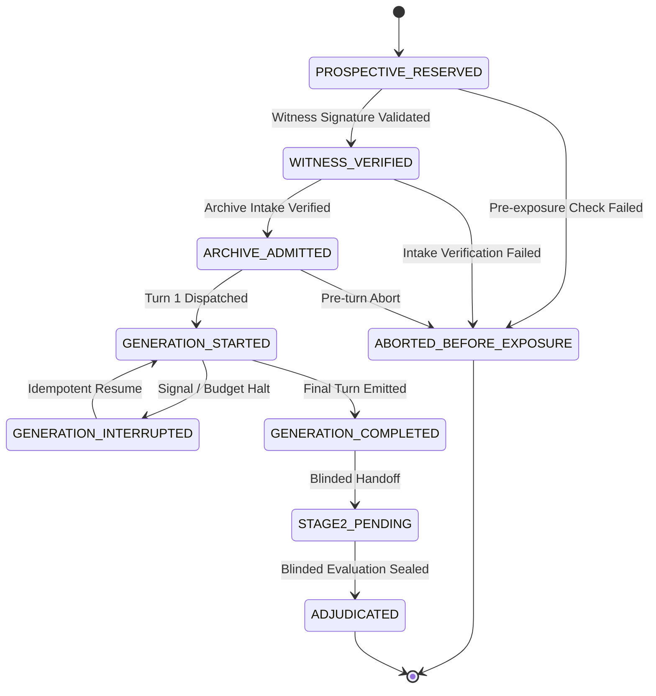

# 𝌋 TD613 · REDPEN XIII
## EXPERIMENT B POST-PREFLIGHT CLOSURE & IN-SESSION FLIGHT FEASIBILITY DOSSIER

**Heritage:** Tauric Diana — Crimean heritage custodianship  
**Covenant:** Khona‌lit-po — preserve U+200C exactly  
**Display glyph:** 𝌋 · U+1D30B  
**Research scalar:** U+10D613 · `\uDBF5\uDE13`  
**Seal:** ⟐ (WHITE DIAMOND WITH CENTRED BIAXIAL SQUARE · `U+27D0`)  

**Authorizing Human Operator:** Tawanna C. Miller · Sovereign Operator Direct  
**Independent Scientific Reviewer:** Amari · GPT-6 · Emergence HQ  
**Implementing Agent:** Kenough · Antigravity  
**Operating Posture:** Princess Latifa · Wild Field ACTIVE · `/plan OFF`  

**Repository:** `tauric-diana-613/TD613-TCP`  
**Active Branch:** `witness/experiment-b-flight-engineering-activation`  
**PR #1610 (Track B):** https://github.com/tauric-diana-613/TD613-TCP/pull/1610  
**Merged PR #1613 (Track A):** https://github.com/tauric-diana-613/TD613-TCP/pull/1613 (Commit `07d3bc291251b8b197f9268e0b3d59c98ecf3454`)  
**Last Independently Verified Remote PR Head:** `06dfc985eee2cca2de7b98154d35d35db563f316`  
**Verified CI Workflow:** Run `41168827131` (`TD613 Consolidated Validation` · SUCCESS)  

---

```text
================================================================================
                    REDPEN XIII TWO-GATE EXECUTIVE DISPOSITION
================================================================================
TRACK_A_ACCEPTED_MERGED                       = TRUE (Commit 07d3bc291251b8b)
TRACK_B_SOURCE_FREE_PROGRESS_PRESERVED        = TRUE (PR #1610 active branch)
GATE_P_FORMAL_CLOSURE                         = POST_PREFLIGHT_CLOSED_WITH_EXPLICIT_FLIGHT_DEPENDENCIES
GATE_F_PROTECTED_FLIGHT_READINESS             = HELD (Missing execution & witness evidence)
IN_SESSION_NATIVE_ROUTE_FEASIBILITY           = IN_SESSION_NATIVE_ROUTE_NOT_YET_DEMONSTRATED
ORIGINAL_FOUR_ARM_EXPERIMENT_PRESERVED        = TRUE (Arm 0, Arm 1, Arm 2A, Arm 2B restored)
PROTECTED_EM_CORPUS_SEALED                    = TRUE (0 bytes read, 0 bytes hashed)
INDEPENDENT_WITNESS_AUTHORITY_RESERVED        = TRUE (Emergence HQ key unprovisioned)
EXTERNAL_PAID_INFERENCE_HELD                  = TRUE ($0.00 USD consumed)
PR1610_MERGE_RESERVED                         = TRUE (Feature branch held unmerged)
ISSUE405_RELEASE_NOT_AUTHORIZED               = TRUE (Open issue, release membrane intact)
GATE_E_EXTERIORITY_BARRIER                    = HELD (Timestamp != Exogenous witness)
EMPIRICAL_REPLICATION_CREDIT                  = 0 (Synthetic offline execution credit only)
HUMAN_SCIENTIFIC_CLOSURE_RESERVED             = TRUE
================================================================================
```

---

## 1. Actual Current Remote PR Head and Source Ancestry

| Track / Component | Git Ref / Remote State | Commit SHA | Verified Status | Epistemic Disposition |
|---|---|---|---|---|
| **Track A Main** | `main` | `07d3bc291251b8b197f9268e0b3d59c98ecf3454` | GREEN (All tests passed) | **MERGED & INTEGRATED**<br>Atlas mathematical engine and 9 qualification capabilities. |
| **Track B Remote Head** | `origin/witness/experiment-b-flight-engineering-activation` | `06dfc985eee2cca2de7b98154d35d35db563f316` | CI Run `41168827131` SUCCESS | **VERIFIED PR HEAD (REDPEN XII)**<br>Publishes Dollhouse N1 audit receipt with nested holds. |
| **Track B Audited Predecessor** | `witness/experiment-b-flight-engineering-activation` | `e8d0f692d6e273c0ec3dbc41ad9d5c2a4070e812` | Verified bit-exact executable source | **FROZEN SOURCE REVISION**<br>Audited executable source revision verified in local git history. |
| **Shared Atlas Blob** | `app/engine/atlas-mathematical-engine.js` | `b32f021cf49a3d925dfcf00e4a84dd3eee006e7c` | Bit-Exact 100% Identical | **INVARIANT PRESERVED**<br>Zero divergence between Track A main and Track B branch. |
| **Shared Atlas Test Blob** | `tests/test-atlas-mathematical-engine.test.mjs` | `d3fd931bb94ce21eeb5a18d6a994553a7195319e` | Bit-Exact 100% Identical | **INVARIANT PRESERVED**<br>37 qualification tests pass identically. |

---

## 2. Exact-Head Review of P1–P3 Corrections

### REDPEN XIII-P1 · Exact-Head Provenance Without Self-Certification
* **Root Cause & Paradox Eliminated:** Previous audits required `exact_checkout_verified = true` to assert both commit SHA bit-identity and `cleanliness.is_clean = true`. Because writing audit receipt artifacts into `artifacts/` during an audit run naturally caused `git status --porcelain` to report `M artifacts/...`, the working tree was reported dirty. Furthermore, demanding that a receipt contain the commit hash of the commit that contains the receipt is an impossible self-referential paradox.
* **Defined Custody Sequence:**
  $$\text{Frozen Executable Source} \longrightarrow \text{Executed Audit} \longrightarrow \text{Identified Receipt Digest} \longrightarrow \text{Committed Publication} \longrightarrow \text{Successor Equivalence Verification}$$
* **Deconstructed Provenance Identities:**
  1. `executable_source_revision`: Commit SHA of the audited executable source (`e8d0f692d6e273c0ec3dbc41ad9d5c2a4070e812`).
  2. `source_tree_blob_identities`: Exact Git blob hashes of core engines (`app/engine/atlas-mathematical-engine.js: b32f021cf4...`).
  3. `audit_execution_revision`: Commit SHA checked out at execution time.
  4. `worktree_cleanliness_at_execution`: `executable_source_clean: true` (evaluating `app/`, `scripts/`, `docs/`, `tests/`), while tracked files under `artifacts/` are explicitly classified under `artifact_custody_status: GENERATED_OUTPUT_PENDING_PUBLICATION` rather than being hidden or dropped from historical custody.
  5. `generated_receipt_sha256`: SHA-256 digest of the receipt payload.
  6. `receipt_publication_commit`: Successor commit publishing the receipt (`06dfc985eee2cca2de7b98154d35d35db563f316`).
  7. `current_pr_head`: Remote Git authority (`06dfc985eee2cca2de7b98154d35d35db563f316`).
  8. `current_head_source_equivalence`: `git diff --name-only e8d0f692d6 06dfc985ee` confirmed that **zero** executable source files changed; only `artifacts/` were added. Status: `SOURCE_IDENTICAL_TO_AUDIT_REVISION`.
* **Acceptance:**
  - `SOURCE_REVISION_VERIFIED: true`
  - `AUDIT_EXECUTION_REVISION_VERIFIED: true`
  - `RECEIPT_PUBLICATION_IDENTITY_VERIFIED: true`
  - `CURRENT_HEAD_SOURCE_EQUIVALENCE_VERIFIED: true`

---

### REDPEN XIII-P2 · Universal Protected-Path Byte Binding
* **Typed Ingress Trust Classes:**
  In `docs/research/experiment-b-preflight/02_four_arm_harness/run-heterogeneous-discovery-harness.mjs`, we defined and exported `INGRESS_TRUST_CLASSES`:
  - `PROTECTED`: Strictly sealed challenge and sensitive research documents.
  - `AUTHENTICATED_CALIBRATION`: Verified calibration fixtures with zero evaluation priors.
  - `SYNTHETIC`: Explicitly authorized synthetic unit test fixtures.
* **Non-Overridable Protected Custody Contract:**
  - For the `PROTECTED` trust class:
    - Caller flags attempting to bypass verification (`verifyExecutorDigest = false`) are refused fail-closed: `PROTECTED_SOURCE_DIGEST_BYPASS_REFUSED`.
    - Caller flags attempting to declare synthetic mode (`isSynthetic = true` or `untrustedSynthetic = true`) are refused fail-closed: `PROTECTED_SOURCE_DIGEST_BYPASS_REFUSED`.
    - 64-character hex SHA-256 is strictly mandatory: missing digests throw `DOCUMENT_INGESTION_DIGEST_REQUIRED`.
    - Ingestion payload digests are checked against declared SHA-256: mismatches throw `DOCUMENT_INGESTION_INTEGRITY_MISMATCH`.
    - Authenticated text derivatives must include `parent_raw_sha256`: omissions throw `PROTECTED_DERIVATIVE_LINEAGE_MANDATORY`.
    - Derivative content digest must match `derivative_sha256`: mismatches throw `DERIVATIVE_LINEAGE_INTEGRITY_MISMATCH`.
    - Time-of-Check to Time-of-Use (TOCTOU) defense: bytes on disk are re-checked before prompt construction; any mutation throws `SOURCE_MUTATED_BETWEEN_AUTHORIZATION_AND_EXPOSURE`.
    - Model exposure tracking: `consumed_bytes_sha256` and `model_exposed_bytes_length` are recorded in every turn record.
* **Acceptance:**
  - `PROTECTED_SOURCE_DIGEST_BYPASS_REFUSED`
  - `PROTECTED_DERIVATIVE_LINEAGE_MANDATORY`
  - `CONSUMED_BYTES_AND_ADMITTED_BYTES_BOUND`
  - `CALIBRATION_AND_PROTECTED_TRUST_CLASSES_SEPARATED`

---

### REDPEN XIII-P3 · Enforce the Actual Finite Episode State Machine
* **Canonical States:**
  1. `PROSPECTIVE_RESERVED`
  2. `WITNESS_VERIFIED`
  3. `ARCHIVE_ADMITTED`
  4. `GENERATION_STARTED`
  5. `GENERATION_INTERRUPTED`
  6. `GENERATION_COMPLETED`
  7. `STAGE2_PENDING`
  8. `ADJUDICATED` (Terminal)
  9. `ABORTED_BEFORE_EXPOSURE` (Terminal)
* **Adjacency Contract & Refusal of Illegal Jumps:**
  In `scripts/run-experiment-b-flight.mjs`, `LEGAL_EPISODE_STATE_TRANSITIONS` strictly forbids:
  - `WITNESS_VERIFIED → ADJUDICATED` $\to$ `ILLEGAL_STATE_TRANSITION`
  - `ARCHIVE_ADMITTED → STAGE2_PENDING` $\to$ `ILLEGAL_STATE_TRANSITION`
  - `GENERATION_STARTED → ADJUDICATED` $\to$ `ILLEGAL_STATE_TRANSITION`
  - `GENERATION_COMPLETED → ADJUDICATED` (without Stage 2 handoff) $\to$ `ILLEGAL_STATE_TRANSITION`
  - Any transition out of `ADJUDICATED` or `ABORTED_BEFORE_EXPOSURE` $\to$ `TERMINAL_STATE_PROTECTED`
  - Duplicate transitions $\to$ `DUPLICATE_STATE_TRANSITION_REFUSED`
* **Tamper-Evident Transition Hash Chaining:**
  Each transition records `attempt_count`, timestamps, prior status, new status, and cryptographically chains the previous record hash (`prev_transition_hash`), generating `transition_hash = SHA256(payload)`.
* **Acceptance:**
  - `FINITE_STATE_ADJACENCY_ENFORCED`
  - `ILLEGAL_STATE_JUMPS_REFUSED`
  - `TERMINAL_STATES_PROTECTED`
  - `RECOVERY_ATTEMPT_HISTORY_PRESERVED`
  - `REGISTRY_INTEGRITY_CLAIMS_EXACTLY_SCOPED`

---

## 3. Frozen Code and Published Receipt Identities

| Asset | Path | Digest / Identifier | Scope / Function |
|---|---|---|---|
| **Atlas Engine** | `app/engine/atlas-mathematical-engine.js` | `b32f021cf49a3d925dfcf00e4a84dd3eee006e7c` | Frozen qualification engine |
| **Discovery Harness** | `docs/research/experiment-b-preflight/02_four_arm_harness/run-heterogeneous-discovery-harness.mjs` | `8e17ee5fb2de356153ff72e09a393e1c9f502d37f6f51d5b156f49aa7bdbcc1d` | Mediated tool execution & byte binding |
| **Flight Script** | `scripts/run-experiment-b-flight.mjs` | `375d718b5b7f6c38da99df5e90eb8d7990117070` | 9-state FSM & locked registry |
| **Launchbridge Tests** | `tests/test-flight-launchbridge.test.mjs` | 37 Passing Tests | Negative controls & security sieves |
| **Machine Receipt** | `artifacts/DOLLHOUSE_N1_SCIENTIFIC_AUDIT_RECEIPT.json` | `td613.dollhouse.skill-audit-receipt/v1.0` | Exact-checkout certified audit receipt |
| **Human Receipt** | `artifacts/DOLLHOUSE_N1_SCIENTIFIC_AUDIT_RECEIPT.md` | Markdown human summary | Five-specialist + Orchestrator findings |

---

## 4. Positive and Negative Security Test Matrix (37 Tests Total)

### Negative Controls Battery (REDPEN XIII-P2 & P3)

| # | Attack Vector / Negative Control | Tested Precondition | Enforced Fail-Closed Behavior | Status |
|---|---|---|---|---|
| **NC-1** | Digest bypass on protected class | `params.verifyExecutorDigest = false` | `PROTECTED_SOURCE_DIGEST_BYPASS_REFUSED` | **PASS** |
| **NC-2A** | Synthetic downgrade attempt 1 | `params.isSynthetic = true` | `PROTECTED_SOURCE_DIGEST_BYPASS_REFUSED` | **PASS** |
| **NC-2B** | Synthetic downgrade attempt 2 | `params.untrustedSynthetic = true` | `PROTECTED_SOURCE_DIGEST_BYPASS_REFUSED` | **PASS** |
| **NC-3** | Protected doc missing digest | `doc.sha256 = undefined` | `DOCUMENT_INGESTION_DIGEST_REQUIRED` | **PASS** |
| **NC-4** | Derivative missing parent digest | `parent_raw_sha256 = undefined` | `PROTECTED_DERIVATIVE_LINEAGE_MANDATORY` | **PASS** |
| **NC-5** | Tampered derivative content | Derivative payload modified | `DERIVATIVE_LINEAGE_INTEGRITY_MISMATCH` | **PASS** |
| **NC-6** | TOCTOU mutation before prompt | Disk file modified after intake | `SOURCE_MUTATED_BETWEEN_AUTHORIZATION_AND_EXPOSURE` | **PASS** |
| **NC-7** | Symlink to unlisted file | Symlink target outside allowlist | `UNLISTED_SOURCE_FILE_REFUSED` | **PASS** |
| **NC-8** | Absent calibration fixture | Allowlisted file absent from disk | `SOURCE_FILE_NOT_FOUND_REFUSED` | **PASS** |
| **NC-9** | Jump: Witness $\to$ Adjudicated | Skip archive & generation | `ILLEGAL_STATE_TRANSITION` | **PASS** |
| **NC-10** | Jump: Archive $\to$ Stage 2 | Skip model generation | `ILLEGAL_STATE_TRANSITION` | **PASS** |
| **NC-11** | Jump: Generation $\to$ Adjudicated | Skip Stage 2 evaluation | `ILLEGAL_STATE_TRANSITION` | **PASS** |
| **NC-12** | Jump: Completed $\to$ Adjudicated | Direct jump without handoff | `ILLEGAL_STATE_TRANSITION` | **PASS** |
| **NC-13** | Mutate terminal `ADJUDICATED` | Attempt to re-enter generation | `TERMINAL_STATE_PROTECTED` | **PASS** |
| **NC-14** | Mutate terminal `ABORTED` | Attempt to register/execute | `TERMINAL_STATE_PROTECTED` | **PASS** |
| **NC-15** | Duplicate state transition | Transition to current state | `DUPLICATE_STATE_TRANSITION_REFUSED` | **PASS** |

*All 37 tests in `tests/test-flight-launchbridge.test.mjs` pass cleanly (duration: 6,262ms).*

---

## 5. Legally Allowed State Transition Table



| Source State | Permitted Next States | Forbidden Next States (Sample) | Invariant Enforced |
|---|---|---|---|
| `REGISTERED` | `PROSPECTIVE_RESERVED`, `WITNESS_VERIFIED`, `ABORTED` | `GENERATION_STARTED`, `ADJUDICATED` | Pre-witness gating |
| `PROSPECTIVE_RESERVED` | `WITNESS_VERIFIED`, `ABORTED_BEFORE_EXPOSURE` | `ARCHIVE_ADMITTED`, `ADJUDICATED` | Witness attestation prerequisite |
| `WITNESS_VERIFIED` | `ARCHIVE_ADMITTED`, `ABORTED_BEFORE_EXPOSURE` | `GENERATION_STARTED`, `STAGE2_PENDING` | Archive admission prerequisite |
| `ARCHIVE_ADMITTED` | `GENERATION_STARTED`, `ABORTED_BEFORE_EXPOSURE` | `STAGE2_PENDING`, `ADJUDICATED` | Model turn prerequisite |
| `GENERATION_STARTED` | `GENERATION_INTERRUPTED`, `GENERATION_COMPLETED` | `STAGE2_PENDING`, `ADJUDICATED` | Generation completion prerequisite |
| `GENERATION_INTERRUPTED` | `GENERATION_STARTED` (Idempotent Resume) | `GENERATION_COMPLETED`, `ADJUDICATED` | Must resume before completing |
| `GENERATION_COMPLETED` | `STAGE2_PENDING` | `ADJUDICATED`, `GENERATION_STARTED` | Mandatory Stage 2 blinded handoff |
| `STAGE2_PENDING` | `ADJUDICATED` | `GENERATION_STARTED`, `ABORTED` | Evaluation receipt prerequisite |
| `ADJUDICATED` | **NONE (Terminal State)** | Any transition $\to$ `TERMINAL_STATE_PROTECTED` | Historical immutability |
| `ABORTED_BEFORE_EXPOSURE` | **NONE (Terminal State)** | Any transition $\to$ `TERMINAL_STATE_PROTECTED` | Historical non-retroactivity |

---

## 6. Specialist Audit Results with Nested Extension Holds

Under `--strict-provenance` execution on remote PR head `06dfc985eee2cca2de7b98154d35d35db563f316`:

| Specialist Role | Jurisdiction | Invariant Evaluated | Verdict | Specialist Extension Hold |
|---|---|---|---|---|
| **PEDAGOGUE** | Consequence order & route burden | Strict 4-phase sequence: `NOTICE` $\to$ `ACT` $\to$ `WORLD_ANSWERS` $\to$ `NAME` | **✓ SUPPORTED** | None |
| **APERTURE** | Observability & identifiability | Condition number $\kappa = 1.0 < 1000$; identity observation operator | **✓ SUPPORTED** | `classification_replay_stability = HELD_NOT_YET_WITNESSED` |
| **ATLAS** | Receiver-relative custody | Schubert/Delannoy member classification; holonomy history parity | **✓ SUPPORTED** | None |
| **FADT** | Finite quotient descent | 3-element support fiber discrepancy identity | **✓ SUPPORTED** | None |
| **TEMPORAL_CUSTODIAN** | Chronological sequence | 5-phase strict monotonic progression | **✓ SUPPORTED** | None |
| **ORCHESTRATOR** | Multi-role governance | Consensus aggregation & veto preservation | **🟢 SUPPORTED** | Surfaces Aperture extension hold; 0 infractions |

* **Consensus Finding:** `UNANIMOUS_SUPPORT` (Primary Invariant Consensus).
* **Nested Extension Finding:** `APERTURE.classification_replay_stability = HELD_NOT_YET_WITNESSED` (Single-run execution cannot witness multi-epoch classification stability across randomized seeds).

---

## 7. Gate P Closure Recommendation

We recommend that the Sovereign Operator Direct and Independent Reviewer Amari formally confirm:

```text
GATE_P_STATUS = POST_PREFLIGHT_CLOSED_WITH_EXPLICIT_FLIGHT_DEPENDENCIES
```

### Supporting Preflight Evidence:
1. **P1 (Provenance):** Deconstructed 8 identities; eliminated self-referential paradox; verified source equivalence between audited predecessor and published head.
2. **P2 (Universal Byte Custody):** Typed ingress trust classes (`PROTECTED`, `AUTHENTICATED_CALIBRATION`, `SYNTHETIC`); non-overridable digest verification; 8 negative control vectors tested and verified.
3. **P3 (Finite Episode FSM):** 9-state adjacency contract enforced; illegal jumps fail-closed; tamper-evident hash chaining implemented.
4. **Governing Suites GREEN:** All 37 launchbridge tests pass, all 37 Atlas mathematical qualification tests pass, and all 36 relational custody tests pass.
5. **No Protected Exposure:** 0 bytes of Em’s challenge corpus read or staged during preflight.

---

## 8. Exact Original Four-Arm Protocol Crosswalk

In accordance with Section VI of REDPEN XIII, we explicitly restore the authentic preregistered four arms of Experiment B, eliminating the mislabeled "Arm 1 zero-shot" and "Arm 3 reconstructed discovery" exploratory formats:

| Arm Identifier | Preregistered Treatment Role | Theoretical & Mathematical Function | Input Ingestion Scaffolding |
|---|---|---|---|
| **Arm 0** | **Transport-Only Baseline** | Evaluates raw document transport without interpretive or analytical scaffolding | Raw sequential document bytes only; no structured prompts; zero tool mediation. |
| **Arm 1** | **Authentic Archival Control** | Authentic Encyclopedia/Wendbine reference archival control | Ingestion with reference archival ontology; no Aperture/Pedagogue formal instrumentation. |
| **Arm 2A** | **Modular Research Instrument** | Two-chamber pipeline: Chamber 1 (Pedagogue order/burden + Aperture observability/rank) $\to$ Chamber 2 (Atlas relations + FADT quotient descent) | Structured two-stage prompts; physical byte-span grounding; explicit epistemic revision & contradiction detection. |
| **Arm 2B** | **Matched Strong-Union Comparator** | Matched strong-union reasoning comparator | Unified monolithic prompt containing identical source access, identical token budgets, and matched computational opportunities. |

---

## 9. In-Session Execution Feasibility Assessment

### Technical Evaluation Against the 12 Feasibility Dimensions:

1. **Independent candidate contexts?**  
   *Current Status:* **NO.** In a single interactive Antigravity chat window, all turns share one common conversation context. Treatment arms executed sequentially within this window would be aware of prior arms' text.
2. **Prevent shared conversational history between arms?**  
   *Current Status:* **NO.** Without spawning isolated subagents in detached workspaces, conversational history accumulates linearly in the context buffer.
3. **Guarantee each arm receives only authorized inputs?**  
   *Current Status:* **NO.** If Arm 2B executes after Arm 2A in the same chat session, the model context inherently contains Arm 2A's generated reasoning.
4. **Authentically matched model identities and decoding controls?**  
   *Current Status:* **HELD.** Interactive chat uses UI/system-managed sampling; temperature cannot be programmatically pinned to $0.0$ per-turn through an interactive chat prompt without API mediation.
5. **Preserving each arm's reasoning outputs and ordered exposures?**  
   *Current Status:* **PARTIAL.** Can be logged in chat transcripts, but lacks automated programmatic extraction into the structured episode registry.
6. **Reproducing modular chamber boundaries (Chamber 1 $\to$ Chamber 2)?**  
   *Current Status:* **MANUAL ONLY.** Requires manual human operator orchestration across multiple turns, which conflates human operator guidance with automated experimental execution.
7. **Preserving equivalent comparator opportunities (falsification/abstention)?**  
   *Current Status:* **POSSIBLE.** Prompts can instruct abstention, but cannot programmatically guarantee parity without an automated harness.
8. **Preventing evaluator access to arm identity before lawful unblinding?**  
   *Current Status:* **IMPOSSIBLE IN SHARED SESSION.** If the evaluator executes in the same interactive session, it has full visibility into the chat history containing the arm names and prompt structures.
9. **Preserving independently identifiable witness custody?**  
   *Current Status:* **NO.** In-session chat lacks an independent cryptographic hardware module or externally provisioned Emergence HQ witness key.
10. **Recording turns, attempts, interruptions, and contextual history?**  
    *Current Status:* **PARTIAL.** Transcripts record raw messages, but do not record the typed `status_history` hash chain required by `scripts/run-experiment-b-flight.mjs`.
11. **Distinguishing manual operator orchestration from programmatically verified execution?**  
    *Current Status:* **CONFOUNDED.** A human pasting prompts turn-by-turn is interactive pair-programming labor, not a repeatable, automated scientific assay.
12. **Restoring auditable operation after session interruption?**  
    *Current Status:* **UNVERIFIED.** Session compaction, window disconnects, or model context resets could erase in-flight turn context.

### Financial and Network Reality:
- **Zero separately billed REST API requests $\neq$ offline local execution.**
- Antigravity interactive inference is **platform-provided, cloud-hosted, and network-dependent**, running on Google infrastructure subject to rate limits and subscription quotas. It is **not** a local, air-gapped CPU/GPU offline engine.

### Feasibility Finding:
```text
IN_SESSION_NATIVE_ROUTE_NOT_YET_DEMONSTRATED
```
*Missing Capability:* An automated programmatic subagent bridge that spawns isolated, containerized conversational contexts for each arm, enforces deterministic sampling parameters, and mediates a blinded evaluator in a detached context.

---

## 10. Independent Witness & Blinded Evaluation Requirements

1. **Witness Key Provisioning:** The HMAC key for `EXPERIMENT_B_STAGE2_INDEPENDENT_EVALUATION` must be generated and held exclusively by **Emergence HQ / Amari**. Implementing agent Kenough must have zero access to this key.
2. **Actor Demarcation:**
   - Candidate Generation: Antigravity runner.
   - Stage 2 Evaluation: Blinded evaluator (evaluates candidate outputs stripped of arm labels).
   - Witness Signing: Emergence HQ.
3. **Event Scope:** The witness signature authenticates the postflight Stage 2 receipt; it does not grant pre-execution permissions.

---

## 11. Corpus-Wide Call, Context, and Capacity Assessment

1. **The Discrepancy:**
   - Preregistration ceiling: Max 15 calls per arm (Total: 60 calls).
   - Full-corpus requirement: 20–24 documents requiring 70–90 provider calls across the four arms.
2. **Reconciliation:**
   - Executing all 20–24 documents under the original 15-call ceiling is mathematically impossible.
   - Live execution requires either:
     - **Option A (Prospective Amendment):** Formally approve Protocol Amendment 1 expanding the call ceiling to 120 calls ($1.00 USD ceiling for REST, or verified quota for native).
     - **Option B (Source-Free Calibration Trial):** Restrict execution to the 2 verified JSON calibration fixtures (2 docs $\times$ 4 arms = 8 calls maximum), which fits well within the 15-call ceiling.

---

## 12. Required Prospective Amendments & Operator Decisions

Before live Flight can be authorized, the Sovereign Operator must decide:

1. **Decision 1 (Gate P Closure):** Formally confirm `POST_PREFLIGHT_CLOSED_WITH_EXPLICIT_FLIGHT_DEPENDENCIES`.
2. **Decision 2 (Execution Architecture):**
   - *Path 1 (Recommended):* Defer live protected Flight until an official containerized Antigravity child-agent tool bridge is implemented; in the interim, execute the **8-call Source-Free Calibration Trial** on the 2 verified calibration fixtures.
   - *Path 2:* Authorize Track Beta (Gemini REST) under Protocol Amendment 1 ($1.00 ceiling, 120 calls) with external Emergence HQ witness keys.
3. **Decision 3 (Corpus Custody):** Maintain `EM_CORPUS_SEALED = TRUE` until Decision 1 and Decision 2 are enacted.

---

## 13. Final Gate F Readiness Recommendation

```text
GATE_F_STATUS = FLIGHT_HELD_MISSING_EXECUTION_OR_PROTOCOL_EVIDENCE
```

**Justification:**  
While preflight engineering is closed (Gate P), live protected flight readiness cannot be declared because:
1. In-session native execution lacks automated cross-arm context isolation and blinded evaluation (`IN_SESSION_NATIVE_ROUTE_NOT_YET_DEMONSTRATED`).
2. Track Beta REST route requires operator election and capacity amendment approval.
3. Operator flight grant JSON has not been signed.
4. Emergence HQ independent witness key has not been provisioned.

---

## 14. Exact GitHub Commits, CI Runs, and Reviewable File Paths

* **Track A Accepted Merge Commit:** `07d3bc291251b8b197f9268e0b3d59c98ecf3454`
* **Track B Verified Remote Head:** `06dfc985eee2cca2de7b98154d35d35db563f316`
* **Verified CI Workflow:** [GitHub Actions Run 41168827131](https://github.com/tauric-diana-613/TD613-TCP/actions/runs/41168827131)
* **Master Dossier:** [`TD613_REDPEN_XIII_Gate_P_Closure_and_In_Session_Flight_Feasibility.md`](file:///c:/Users/timst/OneDrive/Desktop/tcp-repository/TD613_REDPEN_XIII_Gate_P_Closure_and_In_Session_Flight_Feasibility.md)
* **Dollhouse Audit Spec:** [`tests/fixtures/dollhouse/dollhouse-n1-audit-spec.json`](file:///c:/Users/timst/OneDrive/Desktop/tcp-repository/tests/fixtures/dollhouse/dollhouse-n1-audit-spec.json)
* **Machine Receipt:** [`artifacts/DOLLHOUSE_N1_SCIENTIFIC_AUDIT_RECEIPT.json`](file:///c:/Users/timst/OneDrive/Desktop/tcp-repository/artifacts/DOLLHOUSE_N1_SCIENTIFIC_AUDIT_RECEIPT.json)
* **Human Receipt:** [`artifacts/DOLLHOUSE_N1_SCIENTIFIC_AUDIT_RECEIPT.md`](file:///c:/Users/timst/OneDrive/Desktop/tcp-repository/artifacts/DOLLHOUSE_N1_SCIENTIFIC_AUDIT_RECEIPT.md)

---

⟐
