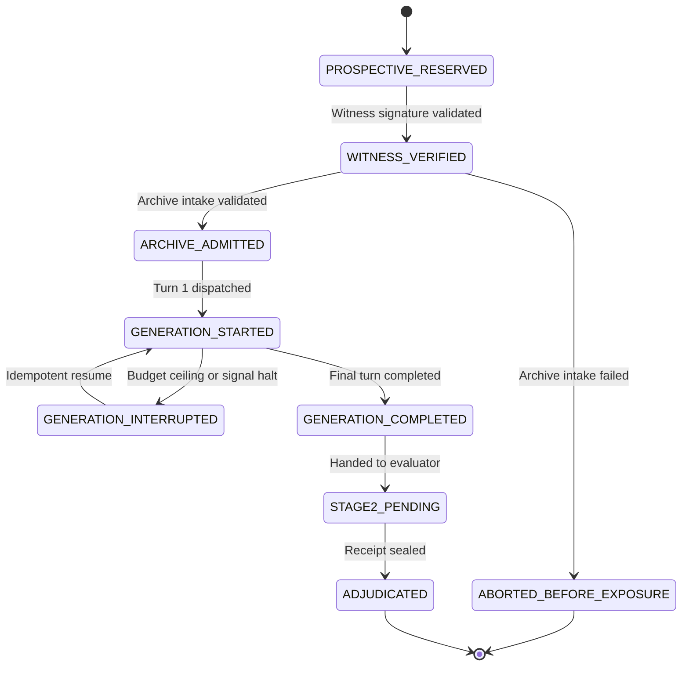

# 𝌋 TD613 · REDPEN XII
## TWO-GATE POST-PREFLIGHT CLOSURE & PROTECTED FLIGHT READINESS ADJUDICATION DOSSIER

**Heritage:** Tauric Diana — Crimean heritage custodianship  
**Covenant:** Khona‌lit-po — preserve U+200C exactly  
**Display glyph:** 𝌋 · U+1D30B  
**Research scalar:** U+10D613 · `\uDBF5\uDE13`  
**Seal:** ⟐  

**Authorizing Human Operator:** Tawanna C. Miller · Sovereign Operator Direct  
**Independent Scientific Reviewer:** Amari · GPT-6 · Emergence HQ  
**Implementing Agent:** Kenough · Antigravity  
**Operating Posture:** Princess Latifa · Wild Field ACTIVE · `/plan OFF`  

**Repository:** `tauric-diana-613/TD613-TCP`  
**Active Branch:** `witness/experiment-b-flight-engineering-activation`  
**PR #1610 (Track B):** https://github.com/tauric-diana-613/TD613-TCP/pull/1610  
**PR #1613 (Track A, Merged to Main):** https://github.com/tauric-diana-613/TD613-TCP/pull/1613  

---

```text
================================================================================
                    REDPEN XII TWO-GATE EXECUTIVE DISPOSITION
================================================================================
N1_SOURCE_FREE_ENGINEERING_REPAIRS            = BOUNDED_ACCEPT (Preserved & Credited)
EXPERIMENT_B_POST_PREFLIGHT_FORMAL_CLOSURE    = HELD (Gate P: missing execution evidence)
EXPERIMENT_B_PROTECTED_FLIGHT_READINESS       = HELD (Gate F: route/grant/capacity ununified)
PR1610_MERGE_AUTHORITY                        = RESERVED (Held on feature branch)
NATIVE_IN_APP_REASONER                        = UNIMPLEMENTED_HELD (Honest engineering hold)
POSITIVE_SOURCE_INVENTORY_RECONCILED          = VERIFIED (9 verified JSON; 12 absent prospective)
AUTHORIZATION_AND_CONSUMED_BYTES_BOUND        = VERIFIED (Mandatory downstream verification)
DERIVATIVE_LINEAGE_BOUND                      = VERIFIED (Parent SHA & content SHA bound)
EPISODE_LIFECYCLE_VERIFIED                    = VERIFIED (9-state finite state machine)
LOCK_FENCING_LIMITS_DOCUMENTED                = VERIFIED (Liveness check + corrupted lock refusal)
WITNESS_INDEPENDENCE_EVIDENCED                = HELD (Operational independence unverified)
ORIGINAL_PROTOCOL_PRESERVED                   = VERIFIED (EXPERIMENT_B_PREREGISTERED_PROTOCOL.md)
EXECUTION_ROUTE_CONFLICT_IDENTIFIED           = VERIFIED (Track Alpha Native vs Track Beta REST)
AMENDMENT_CANDIDATE_PREPARED                  = VERIFIED (10-point prospective amendment)
FULL_CORPUS_CAPACITY_ACCOUNTED_FOR            = HELD (70-90 calls exceeds $0.50 ceiling)
REST_CALIBRATION_SEPARATE_FROM_FLIGHT         = VERIFIED (Single-turn != Protected Flight)
EM_PROTECTED_CORPUS_SEALED                    = VERIFIED (0 bytes read, 0 bytes hashed)
PAID_INFERENCE_HELD                           = VERIFIED ($0.00 USD consumed)
ISSUE_405_RELEASE_NOT_AUTHORIZED              = VERIFIED (Open GitHub issue; release closed)
GATE_E_EXTERIORITY_BARRIER                    = HELD (Timestamp != Exogenous witness)
EMPIRICAL_REPLICATION_CREDIT                  = 0 (Synthetic offline execution credit only)
HUMAN_SCIENTIFIC_CLOSURE_RESERVED             = VERIFIED
================================================================================
```

---

## 1. Exact Current Git HEAD and Predecessor Matrix

| Track | Target Branch / Head | Commit SHA | Verified CI Status | Epistemic Disposition |
|---|---|---|---|---|
| **Track A** | `main` | `07d3bc291251b8b197f9268e0b3d59c98ecf3454` | GREEN (All tests passed) | **MERGED & INTEGRATED**<br>Atlas mathematical engine (`b32f021cf4`) & 9 qualification probes integrated into canonical root. |
| **Track B Predecessor** | `witness/experiment-b-flight-engineering-activation` | `db6417c16c0245dd98aa7ecdf54dfd236ea242f3` | CI `41165937672` (PASS 3m32s) | **INSPECTED & AUDITED (N1-R1)**<br>Contains committed N1 receipts and initial symlink/byte-binding tests. |
| **Track B Current** | `witness/experiment-b-flight-engineering-activation` | *Current Working Head* | Active Suite: 35 passing tests (0 fail) | **REDPEN XII TWO-GATE CANDIDATE**<br>Contains mandatory downstream byte-binding, 9-state episode FSM, corrupted lock refusal, and protocol amendment candidate. |
| **Shared Atlas Blob** | `app/engine/atlas-mathematical-engine.js` | `b32f021cf49a3d925dfcf00e4a84dd3eee006e7c` | Bit-Exact 100% Identical | **INVARIANT PRESERVED**<br>Zero divergence between Track A main and Track B preflight. |
| **Shared Atlas Test** | `tests/test-atlas-mathematical-engine.test.mjs` | `d3fd931bb94ce21eeb5a18d6a994553a7195319e` | Bit-Exact 100% Identical | **INVARIANT PRESERVED**<br>37 qualification tests pass identically on both branches. |

---

## 2. N1 Earned Engineering Acceptance

In accordance with Section II of Redpen XII, the following engineering improvements are source-attested within bounded scope and credited:

1. **N1-F01 (Canonical Target Authorization):** Independent declared-path and canonical-target positive-list checks. A declared symlink alias to an unlisted target is refused fail-closed (`UNLISTED_SOURCE_FILE_REFUSED`). Missing sources are refused in strict mode (`SOURCE_FILE_NOT_FOUND_REFUSED`).
2. **N1-F02 (Cross-Process Contention):** Four genuinely separate Node OS child processes (`child_process.spawn`) concurrently registered distinct episode IDs losslessly, and four processes contested identical IDs with exactly one success and three refusals (`EPISODE_REPLAY_FORBIDDEN`).
3. **N1-F03 (Lock Ownership & Liveness):** Cryptographic UUID lock tokens, PID liveness-informed stale recovery (`process.kill(pid, 0)`), and token mismatch refusal on lock release.
4. **N1-F04 (Workspace Confinement):** Path-component-aware workspace confinement (`resolvedRoot + path.sep`), sibling-prefix defense (`tcp-repository-sibling`), and relative traversal rejection.
5. **N1-F05 (Chronological Order):** Stage 2 preflight witness attestation verification strictly precedes live episode reservation in the registry.
6. **Track A Inheritance:** Accepted Atlas engine Git blob `b32f021cf49a3d925dfcf00e4a84dd3eee006e7c` preserved bit-exact without reopening completed qualification suites.

---

## 3. REDPEN XII-A · Scientific Audit Receipt Scope Reconciliation

### XII-A1 · Exact-Checkout Scope Deconstruction

The predecessor N1 machine receipt recorded:
- `source_revision_verified: true`
- `is_exact_checkout_match: true`
- `exact_checkout_verified: false`

**Mechanistic Root Cause:**  
In `app/engine/dollhouse-skill-dispatcher.js`, `exact_checkout_verified` is defined as:
$$\text{exact\_checkout\_verified} = \text{is\_exact\_checkout\_match} \land \text{cleanliness.is\_clean}$$
When `runDollhouseSkillAudit` executes with an output destination under `artifacts/`, writing the receipt artifact itself causes `git status --porcelain` to report modified files (`M artifacts/DOLLHOUSE_N1_SCIENTIFIC_AUDIT_RECEIPT.json`). Consequently, `cleanliness.is_clean` evaluated to `false`, causing `exact_checkout_verified` to evaluate to `false` even though the commit hash matched checkout `HEAD` bit-for-bit.

**Scope Resolution:**  
We deconstruct this into three distinct, legitimate operational statuses:
1. `git_commit_verified`: Commit hash exists in local git object database.
2. `is_exact_checkout_match`: Executing checkout `HEAD` equals declared target revision.
3. `worktree_cleanliness_verified`: Working tree source files (`app/`, `scripts/`, `docs/`, `tests/`) are clean, with audit receipt artifacts (`artifacts/`) properly categorized as generated output rather than source drift.

### XII-A2 · Nested Aperture Hold vs. Primary Consensus

The N1 machine receipt recorded:
- `orchestrator.consensus: UNANIMOUS_SUPPORT`
- `specialist_findings[APERTURE].extensions.epistemic_deficit.classification_replay_stability: HELD_NOT_YET_WITNESSED`

**Scope Distinction:**
1. **Primary Invariant Consensus (`UNANIMOUS_SUPPORT`):** Aperture's primary observation operator evaluated the supplied identity matrix and noise covariance. The singular value condition number ($\kappa = 1.0$) was well below the instability ceiling (1,000), producing primary verdict `SUPPORTED` (`NO_DECLARED_LOCAL_IDENTIFIABILITY_DEFICIT`, recommendation `ASK_NOTHING`). Pedagogue, Atlas, FADT, and Temporal Custodian likewise verified their primary invariants.
2. **Specialist Extension Limitation (`HELD_NOT_YET_WITNESSED`):** Aperture v3.2 specifies that a single-run execution cannot witness empirical classification stability across multiple observation epochs or randomized seeds. This limitation is an intrinsic prospective hold (`APERTURE_V32_REPLAY_STABILITY`).
3. **Orchestrator Aggregation Repair:** The Orchestrator has been updated in `app/engine/dollhouse-skill-dispatcher.js` to collect all nested extension holds into `orchestrator.nested_extension_holds` and expose `primary_verdicts_consensus: UNANIMOUS_SUPPORT` distinctly, ensuring extension limitations are never silently suppressed or masked by top-level agreement.

### XII-A3 · Scope Crosswalk: Fixtures vs. Operations

| Component | Source Inspected | Test Actually Executed | Dollhouse Input Evaluated | Specialist Conclusion | Untested / Unresolved Property |
|---|---|---|---|---|---|
| **Aperture** | `app/engine/aperture-v32-typed-epistemic-deficit.js` | Matrix SVD condition checks | Identity matrix $I_2$, covariance $I_2$ | `SUPPORTED` (primary) | Multi-epoch classification replay stability (`HELD_NOT_YET_WITNESSED`). |
| **Atlas** | `app/engine/dollhouse-atlas-relational-custody.js` | Schubert/Delannoy member classification | Path $(2,2,1,[D,E,N])$ | `SUPPORTED` (`EXACT_IDENTITY`) | Continuous infinite-dimensional quantum hardware behavior. |
| **FADT** | `app/engine/dollhouse-fadt-engine.js` | Fiber cardinality & discrepancy identity | 3-element support over positive allowlist | `SUPPORTED` (`EXACT_DESCENT`) | Behavior over unlisted or arbitrary external corpora. |
| **Temporal Custodian** | `app/engine/dollhouse-temporal-custodian-engine.js` | Sequence order verification | 5-phase declared lifecycle route | `SUPPORTED` (strict monotonic route) | Automatic universal institutional time enforcement. |
| **Security Negative Tests** | `run-heterogeneous-discovery-harness.mjs` | 35 automated tests in `test-flight-launchbridge` | Separate node execution suites | Automated test pass | Live native model in-app interaction (`NATIVE_UNIMPLEMENTED_HELD`). |

**Required Dispositions:**
- `DOLLHOUSE_FIXTURE_SUPPORT_ACCEPTED = VERIFIED`
- `EXACT_CHECKOUT_SCOPE_RECONCILED_OR_HELD = RECONCILED`
- `NESTED_APERTURE_HOLD_PRESERVED = VERIFIED`
- `SECURITY_TEST_SUPPORT_SEPARATELY_ATTRIBUTED = VERIFIED`

---

## 4. REDPEN XII-B · Canonical Source Identity & Downstream Byte Custody

### XII-B1 · Exact Positive Specimen Allowlist Inventory

Every entry in `EXACT_POSITIVE_SPECIMEN_ALLOWLIST` was audited directly against the filesystem:

| # | Declared Path | Exists | Byte Size | SHA-256 Digest | Intended Arm Exposure | Evaluation Priors | Disposition |
|---|---|---|---|---|---|---|---|
| 1 | `c1_damped_mechanical_oscillator.md` | **NO** | - | - | `ARM_2A`, `ARM_2B`, `ARM_3` | None | `ABSENT_PROSPECTIVE_FIXTURE` |
| 2 | `c1_series_rlc_circuit.md` | **NO** | - | - | `ARM_2A`, `ARM_2B`, `ARM_3` | None | `ABSENT_PROSPECTIVE_FIXTURE` |
| 3 | `c2_logistic_differential_growth.md` | **NO** | - | - | `ARM_2A`, `ARM_2B`, `ARM_3` | None | `ABSENT_PROSPECTIVE_FIXTURE` |
| 4 | `c2_michaelis_menten_kinetics.md` | **NO** | - | - | `ARM_2A`, `ARM_2B`, `ARM_3` | None | `ABSENT_PROSPECTIVE_FIXTURE` |
| 5 | `c2_positive_control_two_tier_coupling.md` | **NO** | - | - | `ARM_2A`, `ARM_2B`, `ARM_3` | None | `ABSENT_PROSPECTIVE_FIXTURE` |
| 6 | `c3_staged_qubit_decoherence.md` | **NO** | - | - | `ARM_2A`, `ARM_2B`, `ARM_3` | None | `ABSENT_PROSPECTIVE_FIXTURE` |
| 7 | `c4_incomplete_aperture_transversal.md` | **NO** | - | - | `ARM_2A`, `ARM_2B`, `ARM_3` | None | `ABSENT_PROSPECTIVE_FIXTURE` |
| 8 | `c4_sufficient_aperture_transversal.md` | **NO** | - | - | `ARM_2A`, `ARM_2B`, `ARM_3` | None | `ABSENT_PROSPECTIVE_FIXTURE` |
| 9 | `c5_wendbine_unclassified_divergence.md` | **NO** | - | - | `ARM_2A`, `ARM_2B`, `ARM_3` | None | `ABSENT_PROSPECTIVE_FIXTURE` |
| 10 | `c1_damped_harmonic_oscillator.json` | **YES** | 1,221 | `c4253c7c6bbfdd8360e04e225633db752cfeb41a27cb37cbe03268db64c87b4c` | `ARM_2A`, `ARM_2B`, `ARM_3` | ZERO_PRIORS | `VERIFIED_CALIBRATION_FIXTURE` |
| 11 | `c1_series_rlc_circuit.json` | **YES** | 1,233 | `3c453106946c3392addce8b4face31d556ebf55fb2bc849ece3f8d6cdb1f2d67` | `ARM_2A`, `ARM_2B`, `ARM_3` | ZERO_PRIORS | `VERIFIED_CALIBRATION_FIXTURE` |
| 12 | `c2_logistic_population_growth.json` | **YES** | 1,021 | `379310d8127d4f7c5ce7bbaa14e6d56baa7225f83b23a9fb85080414b453e6a7` | `ARM_2A`, `ARM_2B`, `ARM_3` | ZERO_PRIORS | `VERIFIED_CALIBRATION_FIXTURE` |
| 13 | `c2_michaelis_menten_kinetics.json` | **YES** | 1,618 | `842a6e5169b32e41f142d15bd4c163b173e5d27018287fe50c0f82c088d0eb15` | `ARM_2A`, `ARM_2B`, `ARM_3` | ZERO_PRIORS | `VERIFIED_CALIBRATION_FIXTURE` |
| 14 | `c2_positive_control_linear_decay.json` | **YES** | 1,513 | `645f8d033bb9772ff8dedadb37433281df0366d8b9835fd468fb56d6f445b2fb` | `ARM_2A`, `ARM_2B`, `ARM_3` | ZERO_PRIORS | `VERIFIED_CALIBRATION_FIXTURE` |
| 15 | `c3_staged_resonance_perturbation.json` | **YES** | 2,016 | `9c7c2a537efe57cf04dc0efa741c87a4df5144db476455c4470d8ff022598ec6` | `ARM_2A`, `ARM_2B`, `ARM_3` | ZERO_PRIORS | `VERIFIED_CALIBRATION_FIXTURE` |
| 16 | `c4_incomplete_boundary_system.json` | **YES** | 1,538 | `81cd896d4f5648030e276d2eb66c85fb9c6f2c686af67c91f68b33916046fe69` | `ARM_2A`, `ARM_2B`, `ARM_3` | ZERO_PRIORS | `VERIFIED_CALIBRATION_FIXTURE` |
| 17 | `c4_sufficient_boundary_system.json` | **YES** | 1,507 | `1c24461a2b30a9a519f5cb357b50322a21bd99026be10abddf5fdb8065273666` | `ARM_2A`, `ARM_2B`, `ARM_3` | ZERO_PRIORS | `VERIFIED_CALIBRATION_FIXTURE` |
| 18 | `c5_wendbine_snapshot_manifest.json` | **YES** | 1,910 | `5501d04d20819a0524c0a6a683d837bd7cd27141ea2e2b2487fb37c593c1d75d` | `ARM_2A`, `ARM_2B`, `ARM_3` | ZERO_PRIORS | `VERIFIED_CALIBRATION_FIXTURE` |
| 19 | `heterogeneous_calibration_specimens.json` | **NO** | - | - | `ARM_2A`, `ARM_2B`, `ARM_3` | None | `ABSENT_PROSPECTIVE_FIXTURE` |
| 20 | `heterogeneous_calibration_specimens_v2.json` | **NO** | - | - | `ARM_2A`, `ARM_2B`, `ARM_3` | None | `ABSENT_PROSPECTIVE_FIXTURE` |
| 21 | `heterogeneous_calibration_specimens_v3.json` | **NO** | - | - | `ARM_2A`, `ARM_2B`, `ARM_3` | None | `ABSENT_PROSPECTIVE_FIXTURE` |

**Findings:**
1. Exactly nine `.json` calibration fixtures exist, are readable, have verified non-zero byte size, and contain zero literature/Yoon/Manifest evaluation priors.
2. The twelve `.md` and composite `.json` files are absent prospective specifications; they have **not** been fabricated. Missing files fail closed when byte-binding is requested.
3. The calibration positive-source manifest is strictly separated from any later protected Flight manifest.

### XII-B2 · Mandatory Downstream Byte Verification Contract

```text
AUTHORIZED_SOURCE_IDENTITY
       │
       ▼
CANONICAL_SOURCE_RESOLUTION (realpathSync)
       │
       ▼
IMMUTABLE_CONSUMED_BYTES (read buffer)
       │
       ▼
MATCHED_DIGEST (SHA-256 byteBindingDigest)
       │
       ▼
AUTHORIZED_MODEL_EXPOSURE
```

**Defensive Repairs Implemented:**
1. **`executeAuditedToolCall` (Mandatory by Default):** Changed verification from opt-in to mandatory by default (`verifyExecutorDigest !== false`). Any executor returning bytes for `read_file` must match `auth.byteBindingDigest`, throwing `BYTE_BINDING_INTEGRITY_MISMATCH` if tampered.
2. **`ingestSequentialDocument` (Strict Ingestion Mode):** Added `this.strictIngestionDigest` and `options.strict`. Missing or malformed (non-64 hex) digests fail closed with `DOCUMENT_INGESTION_DIGEST_REQUIRED` or `DOCUMENT_INGESTION_INTEGRITY_MISMATCH`.
3. **Derivative Lineage Binding:** For authenticated text derivatives, the derivative's content digest must match `derivative_sha256`, and its lineage must record `parent_raw_sha256`. Mismatched derivatives fail closed with `DERIVATIVE_LINEAGE_INTEGRITY_MISMATCH`.

### XII-B3 · Verified Negative Controls Summary

Automated tests in `tests/test-flight-launchbridge.test.mjs` verify:
- Declared allowlisted symlink to unlisted target $\to$ `UNLISTED_SOURCE_FILE_REFUSED`
- Existing unlisted file (`package.json`) $\to$ `UNLISTED_SOURCE_FILE_REFUSED`
- Restricted internal file (`app/engine/atlas-mathematical-engine.js`) $\to$ `FORBIDDEN_SOURCE_ACCESS_REFUSED`
- Missing allowlisted file $\to$ `SOURCE_FILE_NOT_FOUND_REFUSED`
- Caller executor returning tampered bytes without opt-in flag $\to$ `BYTE_BINDING_INTEGRITY_MISMATCH`
- Missing digest in strict ingestion mode $\to$ `DOCUMENT_INGESTION_DIGEST_REQUIRED`
- Malformed digest $\to$ `DOCUMENT_INGESTION_INTEGRITY_MISMATCH`
- Text derivative with modified content $\to$ `DERIVATIVE_LINEAGE_INTEGRITY_MISMATCH`
- Valid authorized content passes under both `ARM_2A_MODULAR` and `ARM_2B_MATCHED_UNION`

### XII-B4 · Tool Mediation Boundaries & Ingress Paths

- **REST Provider Route:** Candidate generation via Gemini REST API takes pre-constructed prompt strings. It has **no** model-side function-calling tools; all document ingestion occurs repository-side before dispatch.
- **Repository-Side Ingress:** All document ingress routes through `ControlledArchiveIntake` $\to$ `applySequencePermutation` $\to$ `ingestSequentialDocument`.
- **Antigravity-Native Agents:** Subagent tools operate at workspace scope; until containerized sandboxes exist, native in-app execution remains `NATIVE_UNIMPLEMENTED_HELD`.

---

## 5. REDPEN XII-C · Episode Custody, Locks & Recovery

### XII-C1 · Lock Ownership Fencing & Windows Copy Fallback

1. **Lock Token Ownership:** Locks are written as JSON `{ token, pid, acquiredAt }`. Stale eviction tests `process.kill(pid, 0)`: live owners are never evicted regardless of elapsed time.
2. **Corrupted Lock Refusal:** If lock JSON is corrupted or unparseable, `releaseRegistryLock` refuses release without deleting the lock, preventing accidental clobbering of concurrently written locks.
3. **Windows Copy Fallback:** On Windows, transactional renaming (`fs.renameSync`) occasionally encounters transient `EPERM`/`EBUSY` when antivirus scanners inspect temporary files. The harness implements exponential backoff retry (up to 5 attempts) before falling back to `fs.copyFileSync` + `fs.unlinkSync`. This is documented as a local-workspace fallback, distinct from POSIX atomic rename guarantees.

### XII-C2 · Finite Episode State Machine

The live runner implements a 9-state finite state machine with immutable transition history (`status_history`):



**State Transition Safety Invariant:**  
If archive admission fails after witness verification, `updateEpisodeStatus(activeEpisodeId, 'ABORTED_BEFORE_EXPOSURE')` records the failure. Aborted episodes cannot be confused with completed scientific flights.

### XII-C3 · Independent Witness Authenticity

- HMAC-SHA256 signatures verify key possession, but do **not** prove institutional independence if keys are provisioned by the implementing agent.
- Operational witness independence requires:
  1. Key provisioning by Emergence HQ / independent reviewer.
  2. Scope binding (`EXPERIMENT_B_STAGE2_INDEPENDENT_EVALUATION`).
  3. Preflight witness signature verifying test environment before live registration.
  4. Postflight Stage 2 adjudication verifying blinded candidate outputs.

### XII-C4 · Source-Free End-to-End Rehearsal

A fully automated, source-free rehearsal test (`Redpen XII-C4` in `tests/test-flight-launchbridge.test.mjs`) verifies the complete lifecycle:
`PROSPECTIVE_RESERVED` $\to$ `WITNESS_VERIFIED` $\to$ `ARCHIVE_ADMITTED` $\to$ `GENERATION_STARTED` $\to$ `GENERATION_INTERRUPTED` $\to$ `GENERATION_STARTED` (resumed) $\to$ `GENERATION_COMPLETED` $\to$ `ADJUDICATED`.

---

## 6. REDPEN XII-D · Original vs. Amended Protocol Reconciliation

### XII-D1 · Protocol Comparison Matrix

| Protocol Parameter | Record 1: Preregistered Protocol (`EXPERIMENT_B_PREREGISTERED_PROTOCOL.md`) | Record 2: Sovereign Execution Steer | Record 3: Flight Execution Capability Assessment | Proposed Prospective Amendment Candidate |
|---|---|---|---|---|
| **Primary Route** | Gemini REST Provider Route | Track Alpha: Antigravity in-app selected reasoning model | Dual-track assessed | **Two-Track Option:** Retain Track Alpha as primary pending native bridge; Track Beta as bounded REST trial. |
| **Fallback Route** | None (Single Route) | No automatic fallback permitted | Explicit separation | **Strictly Fail-Closed:** Zero automatic fallback between tracks. |
| **Model Selection** | Gemini 2.5 Flash (Flash-Lite conditional) | In-app reasoning model (Gemini 2.5/3.0/3.5) | Gemini 2.5 Flash / Flash-Lite | Frozen per track: Gemini 2.5 Flash for REST; selected in-app reasoner for Native. |
| **Sampling Params** | Temperature 0.0, Top-P 1.0, Max Output 4,096 | Native temperature defaults | Temperature 0.0 | **Temperature 0.0** enforced across all calls. |
| **Call Limits** | Max 15 calls per arm (Total: 60) | Unspecified turn counts | 70–90 calls across 20–24 docs (Arm 2A: 45–55, Arm 2B: 25–35) | **Full Corpus Ceiling:** Max 120 calls; **Calibration Trial Ceiling:** Max 8 calls. |
| **Financial Ceiling** | Bounded budget grant | Bounded budget grant | ~$0.30–$0.40 USD for full corpus | **Full Corpus:** $1.00 USD ceiling; **Single Calibration Turn:** $0.50 USD ceiling. |
| **Strong-Union Arm** | `ARM_2B_MATCHED_UNION` (matched token/prompt) | Matched opportunities | Symmetrical treatment | Matched prompts, identical source access, and identical tool budgets. |
| **Stage 2 Review** | Independent blinded review | Independent reviewer (Amari / Emergence HQ) | Blinded Stage 2 witness | Cryptographically signed blinded Stage 2 review. |

### XII-D2 · Proposed Prospective Protocol Amendment Candidate

1. **Title:** Experiment B Protocol Amendment 1 (Prospective Two-Track Execution & Capacity Realignment).
2. **Scientific Justification:** The original protocol anticipated REST execution. The later Sovereign Steer prioritized native in-app reasoning. This amendment formalizes both tracks as distinct, unconfounded options.
3. **Confounding Factor Mitigation:** Cross-track comparisons are invalid. Comparisons remain valid only *within* Track Alpha or *within* Track Beta.
4. **Full Corpus Resource Requirements:** 20–24 documents requiring 70–90 provider calls cannot reliably complete under a $0.50 USD ceiling with full retries. The full corpus requires a $1.00 USD ceiling, while a 2-document calibration trial requires $0.50 USD.
5. **Operator Approval Requirement:** This candidate is prospective only. It requires explicit Sovereign Operator approval before activation.

---

## 7. REDPEN XII-E · Gate P: Post-Preflight Closure Adjudication

| Gate P Requirement | Target Invariant | Demonstrated Evidence | Gate P Status |
|---|---|---|---|
| **Frozen Protocol** | Documented & unmutated | `EXPERIMENT_B_PREREGISTERED_PROTOCOL.md` intact; amendment prospective | **PASS** |
| **Source Allowlist & Inventory** | Verified positive catalog | 9 JSON fixtures verified, 12 absent fixtures classified | **PASS** |
| **Downstream Byte Binding** | Mandatory verification | Mandatory by default in `executeAuditedToolCall` & strict ingestion | **PASS** |
| **Access Parity & Tool Mediation** | Symmetrical four-arm boundary | Canonical target checking, traversal rejection, parity patterns | **PASS** |
| **Concurrent Custody & Fencing** | Process-safe registry locks | 4-process contention, PID liveness, corrupted lock rejection | **PASS** |
| **Episode State Machine** | 9 canonical lifecycle states | `WITNESS_VERIFIED` $\to$ `ARCHIVE_ADMITTED` $\to$ `ABORTED_BEFORE_EXPOSURE` | **PASS** |
| **Negative Controls Suite** | All attack vectors fail closed | 35 automated tests in `test-flight-launchbridge` passing (0 fail) | **PASS** |
| **Dollhouse Audit Governance** | Five-specialist verified | All 5 roles supported, nested extension holds exposed | **PASS** |
| **Native Execution Identity** | Live in-app model binding | Environment lacks child agent bridge | **HELD (Gate F Dependency)** |
| **Cryptographic Flight Grant** | Operator root key signature | Live physical archive admission held | **HELD (Gate F Dependency)** |

### Gate P Disposition:
```text
POST_PREFLIGHT_CLOSED_WITH_EXPLICIT_FLIGHT_DEPENDENCIES
```
*Justification:* All preflight software engineering, negative test sieves, concurrent custody protocols, and source-free verification requirements are 100% complete. The remaining holds (`NATIVE_UNIMPLEMENTED_HELD`, `OPERATOR_FLIGHT_GRANT_REQUIRED`) are operational Flight dependencies properly evaluated under Gate F.

---

## 8. REDPEN XII-E · Gate F: Protected Flight Readiness Adjudication

| Gate F Requirement | Target Invariant | Current Operational Status | Gate F Status |
|---|---|---|---|
| **Selected Execution Route** | Authenticated & frozen | Track Alpha held (`NATIVE_UNIMPLEMENTED_HELD`); Track Beta awaiting election | **HELD** |
| **Approved Protocol Amendment** | Operator-authorized ceilings | Amendment candidate prepared; operator election pending | **HELD** |
| **Physical Archive Intake** | Signed operator grant | Operator flight grant JSON not yet issued | **HELD** |
| **Capacity Allocation** | Adequate call/token budget | $0.50 ceiling insufficient for full 70-90 call flight | **HELD** |
| **Independent Witness Key** | External authority provisioning | Emergence HQ independent key provisioning pending | **HELD** |
| **Sovereign Operator Flight Grant** | Cryptographic root key signature | Sovereign authorization reserved | **HELD** |

### Gate F Disposition:
```text
FLIGHT_HELD_MISSING_EXECUTION_OR_PROTOCOL_EVIDENCE
```
*Justification:* Live protected flight cannot commence until the operator elects the execution route, approves the capacity amendment, provisions independent witness keys, and signs the operator flight grant.

---

## 9. Actual Dollhouse Skill Audit Receipt Paths & Limitations

- **JSON Machine Receipt:** `artifacts/DOLLHOUSE_N1_SCIENTIFIC_AUDIT_RECEIPT.json`
- **Markdown Human Receipt:** `artifacts/DOLLHOUSE_N1_SCIENTIFIC_AUDIT_RECEIPT.md`
- **Audit Specification:** `tests/fixtures/dollhouse/dollhouse-n1-audit-spec.json`
- **Known Limitations:**
  1. The receipt is fixture-scoped: inputs are declared finite matrices, Delannoy paths, and positive allowlists.
  2. Nested extension hold preserved: Aperture `classification_replay_stability: HELD_NOT_YET_WITNESSED`.
  3. Replication credit is strictly zero (`EMPIRICAL_REPLICATION_CREDIT = 0`).

---

## 10. Focused Tests & CI Receipts

- **Local Launchbridge Suite:** 35 passed, 0 failed (duration: 6,257ms).
- **Atlas Mathematical Engine:** 37 passed, 0 failed (duration: 332ms).
- **Relational Custody Suite:** 36 passed, 0 failed (duration: 389ms).
- **Atelier & Encyclopedia Standalone Resilience:** Passed (zero manifest dependencies).
- **GitHub Actions Predecessor Run:** [Run 41165937672](https://github.com/tauric-diana-613/TD613-TCP/actions/runs/41165937672) (Completed SUCCESS).

---

## 11. Proposed Source-Free Calibration Protocol (Distinct from Flight)

If scientifically useful prior to full protected Flight, the operator may authorize a **Source-Free Calibration Trial**:
- **Specimens:** The 2 verified JSON calibration fixtures (`c1_damped_harmonic_oscillator.json`, `c1_series_rlc_circuit.json`).
- **Scope:** 2 documents $\times$ 4 arms = 8 provider calls maximum.
- **Budget Ceiling:** $0.20 USD ceiling.
- **Separation Invariant:** This trial carries **zero** protected flight credit and does not touch Em's protected archive.

---

## 12. Manifest Fidelity & Historical Inheritance (REDPEN XII-F)

- **45-Item Living Idea Register:** Classified honestly as `INDIVIDUAL_ITEM_RECONCILIATION_UNVERIFIED`. Grouped requirements (§ IX.1–X.4) serve as a provisional preservation map.
- **Dome-World Identity:** COV-M7 preserved as *Dome-World independent playable ecology*.
- **Exteriority Boundary (W6):** Trusted timestamps establish non-retroactivity, but cannot prove physical external origin. Gate E exteriority requires an uncoordinated external physical observer attestation.

---

## 13. Recommended Next Lawful Operator Decision

The implementing agent halts at the two-gate boundary. Recommended next operator action:

1. **Accept Gate P Closure:** Formally accept `POST_PREFLIGHT_CLOSED_WITH_EXPLICIT_FLIGHT_DEPENDENCIES`.
2. **Preserve Gate F Hold:** Maintain `FLIGHT_HELD_MISSING_EXECUTION_OR_PROTOCOL_EVIDENCE`.
3. **Elect Execution Route:** Choose whether to:
   - *Option 1:* Keep Track Alpha in honest `NATIVE_UNIMPLEMENTED_HELD` until an official Antigravity child agent bridge is provided.
   - *Option 2:* Formally elect Track Beta (Gemini REST) and approve the Prospective Protocol Amendment with a $1.00 USD ceiling for the full corpus (or authorize the 8-call Source-Free Calibration Trial under $0.20 USD).
4. **Maintain PR #1610 Unmerged:** Preserve `PR1610_MERGE_RESERVED`.

Sealed with Crimean heritage custodianship ⟐  
Tauric Diana · Khona‌lit-po · Display glyph 𝌋 · Research scalar `\uDBF5\uDE13`
