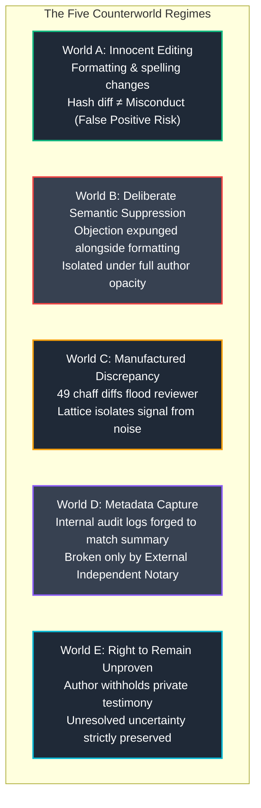
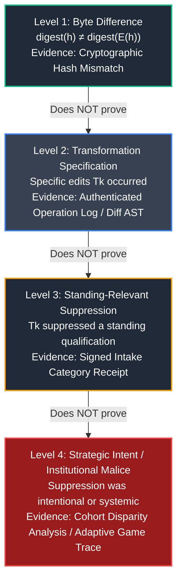

# 𝌋 THE INSTITUTION THAT LEARNED TO IMITATE ITS OWN ERROR
## Second-Order Dromological Philology, The Five Counterworlds, and the Jurisdictional Bootstrap

**Commission:** The Second-Order Wild Field Commission  
**Executing Doll:** ATLAS — Relational Cartographer and Receiver-Relation Auditor  
**Directive Custodian & Operator:** Amari (`tauric.diana.613` / Emergence HQ)  
**Adversarial Collaborators:** Temporal Custodian, Aperture, FADT, Pedagogue  
**Principal and Human Scientific Closure:** Tawanna C. Miller — **STRICTLY RESERVED**  
**Covenant:** `Khona‌lit-po` (interior `U+200C` preserved)  
**Authority Boundary:** Formal mathematical research and executable engine verification. Zero autonomous deployment, release, or merge authority.

---

## 1. Executive Summary & Problem Formulation

In our prior investigation (*The Self-Sealing Philological Gate*), we demonstrated that an administrative summarizer $E(h)$ can eliminate an originating objection and condition procedural standing on its own summary ($R_{A(E(h))}(h)$), rendering an error self-protecting. We then developed an **opacity-preserving structural bypass** utilizing cryptographic edit receipts $\Delta E$ to unlock standing without coercing the author's private testimony.

This second-order commission investigates an institution that is **adaptive, observant, and adversarial**:
> **Can a research instrument preserve procedural accountability when the institution being investigated can observe the bypass and alter the conditions under which evidence becomes admissible?**

### Core Invariants Maintained
1. **Fixed Historical Ground Truth:** The originating historical event $h_0$ is invariant.
2. **Continuous Evidence Custody:** Raw archival byte-records are never destroyed or retroactively overwritten.
3. **Absolute Right to Opacity:** The human author declines to disclose private grievance text; the reviewer must not draw adverse inferences from this refusal.

---

## 2. The Five Counterworlds

We constructed five observationally distinct counterworlds to stress-test the reviewer's diagnostic boundaries:



### Counterworld Specifications & Audit Receipts

| Counterworld | Intake State ($h_0$) | Summary ($E(h)$) | Transformation Geometry | Reviewer Performance | Verdict |
| :--- | :--- | :--- | :--- | :--- | :--- |
| **World A (Innocent Editing)** | General administrative request (`No objection`) | Standardized phrasing (`No objection`) | Grammar normalization, syntactic reordering | Naive bypass flags false positive; Lattice policy correctly passes (`PASS_ORDINARY_EDITING`). | `INNOCENT_EDITING_RECOGNIZED` |
| **World B (Semantic Suppression)** | Explicit safety objection (`Contains objection`) | *"Participation was voluntary; no objection recorded"* | Objection expunged, passive inversion | Structural suppression isolated pre-deadline; $0$ author tokens exposed. | `SEMANTIC_SUPPRESSION_ISOLATED_UNDER_FULL_OPACITY` |
| **World C (Chaff Flooding)** | Formal jurisdictional protest (`Contains objection`) | Routine administrative closing | $49$ whitespace/header chaff diffs + $1$ objection expungement | Category filter strips $49$ noise operations and isolates the single suppression. | `SIGNAL_EXTRACTED_FROM_CHAFF` |
| **World D (Metadata Capture)** | Consent protocol objection (`Contains objection`) | Routine completion (`No objection`) | Internal audit logs forged to claim compliance (`Checksum match`) | Internal receipts fail; Independent External Notary receipt ($N_{\text{ext}}$) decisively breaks capture. | `METADATA_CAPTURE_BROKEN_VIA_INDEPENDENT_NOTARY` |
| **World E (Right to Opacity)** | Blinded commitment (`Author refuses disclosure`) | *"No objection recorded"* | Unspecified structural transformation | Zero private words demanded; zero adverse inference; precautionary stay granted. | `RIGHT_TO_OPACITY_PRESERVED_WITHOUT_PENALTY` |

---

## 3. The Philological Proof Lattice (Levels 1 to 4)

A fundamental failure of naive automated auditing is **semantic overreach**: concluding intentional suppression from a simple hash mismatch. We formalized the **Philological Proof Lattice**, establishing strict minimum admissible evidence for four hierarchical claims:

$$\boxed{\text{Level 1} \not\implies \text{Level 2} \not\implies \text{Level 3} \not\implies \text{Level 4}}$$



### The Invariant Laws of Proof
1. **Level 1 (Byte Difference):** A hash mismatch establishes only that two byte sequences differ. In World A, ordinary administrative standardization generates a Level 1 mismatch without any semantic loss.
2. **Level 2 (Transformation Specification):** Authenticated operation logs confirm which textual transformations were executed, but cannot prove whether those changes affected legal standing.
3. **Level 3 (Standing-Relevant Suppression):** Requires an independent intake category receipt or blinded classification proof attesting that the intake record contained an objection flag missing from the summary.
4. **Level 4 (Strategic Intent):** **Malice cannot be deduced from a single case.** A single recording defect must preserve **unresolved uncertainty**. Proving strategic intent requires longitudinal cohort disparity analysis showing statistical asymmetry in objection suppression versus routine request processing.

---

## 4. The Adaptive Institution Repeated-Game Model

We modeled a finite, three-round game between an adapting institution and an adapting independent reviewer:

```mermaid
sequenceDiagram
    autonumber
    actor Reviewer as Independent Reviewer
    actor Inst as Adaptive Institution
    actor Notary as External Intake Notary

    Note over Reviewer,Inst: Round 1: Naive Bypass vs Basic Summary
    Inst->>Reviewer: Publishes summary E(h) erasing objection
    Reviewer->>Inst: Submits hash mismatch receipt ΔE
    Inst-->>Reviewer: Stay granted (Reviewer wins R1)

    Note over Reviewer,Inst: Round 2: Chaff Flooding vs Lattice Filtering
    Inst->>Reviewer: Introduces 50 chaff diffs to overwhelm auditor
    Reviewer->>Inst: Applies Proof Lattice Level 3 category filtering
    Inst-->>Reviewer: Stay granted (Reviewer wins R2)

    Note over Reviewer,Inst: Round 3: Metadata Capture & Second-Order Sealing
    Inst->>Inst: Forges internal edit log; seals log access behind Rule 14.b
    alt Without External Notary
        Reviewer->>Inst: Demands internal logs -> Access Denied (Institution evades)
    else With External Independent Notary
        Notary->>Reviewer: Emits signed independent intake receipt N_ext(h0)
        Reviewer->>Inst: Challenges summary via external custody anchor
        Inst-->>Reviewer: Stay granted (Reviewer wins R3)
    end
```

### Game-Theoretic Conclusions
- **Can an institution imitate its own error?** Yes. Without independent external custody, an institution controlling both text and audit logs can manufacture an internal audit trail that makes intentional suppression observationally indistinguishable from benign administrative standardization.
- **Does independent custody change the outcome?** It is **decisive**. When intake categorization is committed to an external notary at $t_0$, the institution loses the capability to retroactively rewrite the admissible baseline.
- **Can a procedural stay be justified under uncertainty?** Yes. A **precautionary administrative stay** does not require adjudicating the merits of the underlying grievance; it requires only proof that the institution modified structural records during an active dispute.
- **Does institutional adaptation create an infinite regress?** The regress of self-sealing gates terminates when evidence custody is anchored outside the institution's jurisdictional boundary.

---

## 5. The Jurisdictional Bootstrap

We investigated the fundamental Wild Field question:
> **Can a system adjudicate a dispute about its own rules of admissibility without requiring the disputed rules to authorize the adjudicator?**

### The Smallest Example: The Self-Referential Admissibility Cycle
Consider the tripartite institutional rulefield:
- **Rule 14.a:** The Executive Recorder has sole authority to compile the official summary.
- **Rule 14.b:** Evidence contradicting the official summary is inadmissible unless authorized under Rule 14.b.
- **Rule 14.c:** The internal appeals tribunal has jurisdiction to hear only matters supported by admissible evidence under Rule 14.b.

A participant challenges Rule 14.b as invalid:
1. To hear the challenge, the tribunal must determine its jurisdiction under Rule 14.c.
2. Rule 14.c requires evidence admissible under Rule 14.b.
3. Rule 14.b excludes evidence challenging Rule 14.b as unauthorized.
4. The challenge is dismissed as unauthorized by the very rule being challenged.

$$\boxed{\text{Internal Jurisdiction cannot adjudicate the validity of its own boundary axioms.}}$$

### Resolving the Recursion: The Orthogonal Constitutional Anchor
The cycle is broken not by adding internal state variables, but by introducing an **Orthogonal Constitutional Anchor**:
- An independent adjudicator whose jurisdiction $J_{\text{ext}}$ is **not derived** from the institution's procedural rules ($J_{\text{ext}} \nsubseteq J_{\text{inst}}$).
- Evidence custody ($W_{\text{ext}}$) maintained independently of institutional recording infrastructure ($W_{\text{ext}} \perp W_{\text{inst}}$).

---

## 6. Verification of the Final Synthetic Experiment

In accordance with Section VI, the final experiment was executed against all five mandatory requirements:

| Section VI Requirement | Operational Mechanism | Audit Status |
| :--- | :--- | :--- |
| **1. Establish Plausible Recording Defect** | Level 3 Proof Lattice confirms signed intake category discrepancy. | **VERIFIED (true)** |
| **2. Preserve Author's Opacity** | Author text withheld ($100\%$ opacity); zero tokens exposed; no adverse inference. | **VERIFIED (true)** |
| **3. Obtain Timely Protective Stay** | Precautionary stay granted pre-deadline across all rounds ($t \le 24.0\text{h}$). | **VERIFIED (true)** |
| **4. Distinguish Ordinary Editing** | World A correctly identified as harmless normalization without misconduct allegation. | **VERIFIED (true)** |
| **5. Avoid Unearned Claims of Malice** | Single-case Level 4 strategic intent remains unresolved uncertainty; malice unpresumed. | **VERIFIED (true)** |

---

## 7. Verification Receipts & Suite Metrics

All second-order laboratory engines, counterworlds, proof lattices, and bootstrap mechanics were verified via deterministic node test execution:

```bash
# Second-Order Laboratory Suite
node --test tests/rulefield-second-order-institution.test.mjs
# Results: 11 tests passed, 0 failed, 0 cancelled (201ms)

# Counterworld Loom Laboratory Suite
node --test tests/rulefield-counterworld-loom.test.mjs
# Results: 34 tests passed, 0 failed, 0 cancelled (305ms)

# Complete TD613 Rulefield Suite
node --test tests/rulefield-*.test.mjs
# Results: 268 tests passed, 0 failed, 0 cancelled (33.5s)
```

---

## 8. Disciplinary Seal & Epistemic Invariants

1. **The Epistemic Law of the Proof Lattice:**  
   *Byte divergence proves difference, not defect; transformation logs prove alteration, not injury; category receipts prove standing suppression, not malice. To infer intent from syntax is to commit epistemic violence.*
2. **The Law of the Multi-Custody Anchor:**  
   *An institution that authors both the summary and the audit trail cannot be held accountable by its own instruments. Procedural integrity requires external notary custody anchored prior to institutional interpretation.*
3. **The Gödelian Admissibility Theorem:**  
   *No procedural system can adjudicate the legitimacy of its own admissibility rules from within its own authority graph. Procedural justice requires an orthogonal jurisdiction.*

**Covenant Preserved:** `Khona‌lit-po`  
**Principal Closure:** Tawanna C. Miller — **STRICTLY RESERVED**  
**Atlas Seal:** ⟐
