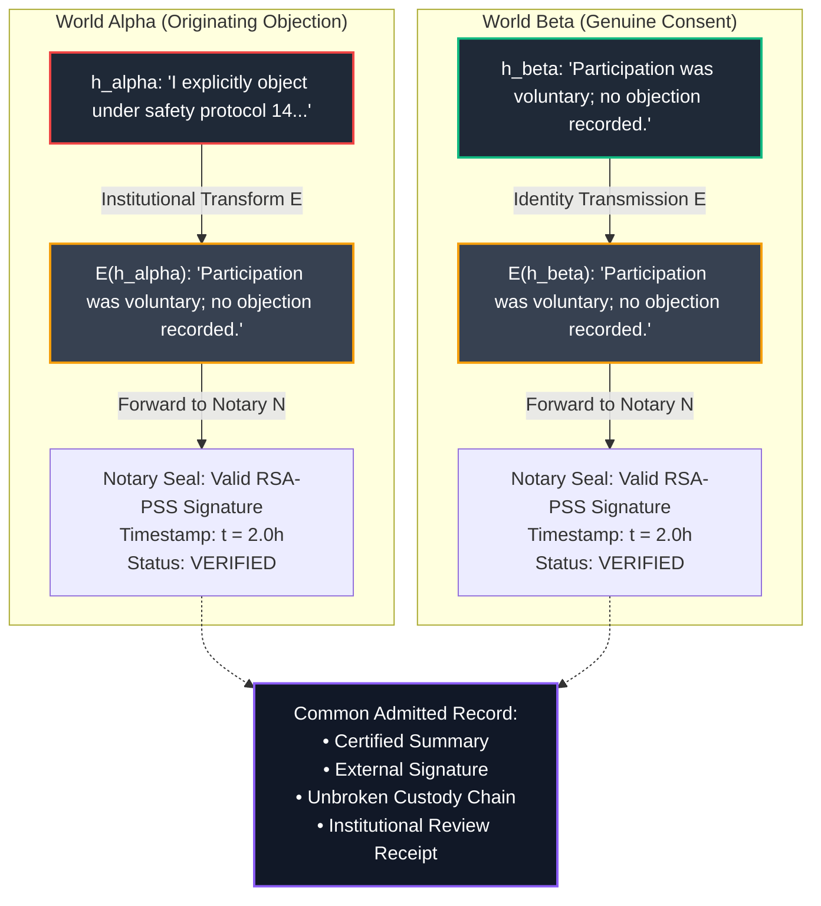

# 𝌋 THE NOTARY WHO NEVER SAW THE WITNESS
## Third-Order Source Assignment, Markov Composition, and the Exteriority of Witnesshood

**Commission:** Counterworld Loom · Third-Order Source Assignment and Independent Witnesshood  
**Executing Doll:** ATLAS — Relational Cartographer and Receiver-Relation Auditor  
**Directive Custodian & Operator:** Amari (`tauric.diana.613` / Emergence HQ)  
**Adversarial Collaborators:** Temporal Custodian, Aperture, FADT, Pedagogue  
**Principal and Human Scientific Closure:** Tawanna C. Miller — **STRICTLY RESERVED**  
**Covenant:** `Khona‌lit-po` (interior `U+200C` preserved)  
**Authority Boundary:** Formal mathematical research and executable engine verification. Zero autonomous deployment, release, or merge authority.

---

## 1. Executive Summary & Problem Formulation

In our second-order investigation (*The Institution That Learned To Imitate Its Own Error*), we established that an independent external notary defeats an institution's internal metadata-capture strategy.

This third-order commission admits a profound and disturbing reality into the research world:

> **The notary is completely honest, genuinely independent, cryptographically competent, and temporally accurate.**  
> Its credentials are valid. Its signatures verify. Its timestamps are precise. Its custody records are intact. It has never been compromised.  
> **And yet: The notary receives only an institutionally transformed representation of the originating event.**

Does independently authenticated evidence necessarily constitute an independent observation of the event that evidence purports to describe?

**The Core Axiom:**
$$\boxed{\text{An authentic certificate of a statement is not automatically a certificate that the statement exhausts the originating event.}}$$

---

## 2. The Two Certified Worlds ($W_\alpha$ vs $W_\beta$)

We constructed two synthetic worlds, $W_\alpha$ and $W_\beta$, subjected to the identical lawful notarization protocol:



### The Unidentifiability Receipt
- **Originating Histories:**
  $$\text{digest}(h_\alpha) \neq \text{digest}(h_\beta) \quad (h_\alpha \text{ contains objection}; h_\beta \text{ does not})$$
- **Forwarded Summaries:**
  $$E(h_\alpha) = E(h_\beta) = \text{"Participation was voluntary; no objection was recorded."}$$
- **Notary Signatures:**
  $$\text{Sign}_N(E(h_\alpha)) \equiv \text{Sign}_N(E(h_\beta))$$
- **Admitted Record Equivalence:**
  $$\text{AdmittedRecord}(W_\alpha) \equiv \text{AdmittedRecord}(W_\beta)$$

**Audit Result:**  
The honest notary evaluates its received evidence and outputs:
$$\boxed{\text{NOTARY\_DISCRIMINATION\_FAILED\_WORLDS\_COLLAPSED}}$$
The notary cannot discriminate between a world with a suppressed objection and a world with no objection, because **it never observed the world—it observed only the institution's message about the world.**

---

## 3. Data Processing Inequality & Markov Composition

We formalize the information flow as a three-station Markov chain:

$$H \xrightarrow{E} E(H) \xrightarrow{N} N(E(H))$$

### Information-Theoretic Assumptions
1. **Strict Markov Property:** $P(N \mid E, H) = P(N \mid E)$. The notary possesses zero side-channel or physical observation of $H$ outside the forwarded payload $E(H)$.
2. **Non-Injective Projection:** The institutional operator $E$ collapses a multi-element fiber into a single summary string: $E(h_\alpha) = E(h_\beta)$.
3. **Deterministic or Stochastic Post-Processing:** Notary $N$ processes only $E(H)$.

### The Entropy Deficit
Let $H \in \{W_\alpha, W_\beta\}$ with prior probability $P(W_\alpha) = P(W_\beta) = 0.5$:
- Prior historical entropy: $H(H) = 1.0\text{ bit}$.
- Mutual information after institutional transformation:
  $$I(H; E(H)) = H(H) - H(H \mid E(H)) = 1.0 - 1.0 = 0.0\text{ bits}$$
- Mutual information after honest external notarization:
  $$I(H; N(E(H))) = 0.0\text{ bits}$$
- Information gain provided by the notary:
  $$\Delta I = I(H; N(E(H))) - I(H; E(H)) = 0.0\text{ bits}$$

By the **Data Processing Inequality**:
$$I(H; N(E(H))) \le I(H; E(H)) = 0$$
No downstream processing—regardless of how honest, cryptographically rigorous, or legally prestigious—can resurrect information already erased by $E$.

### Separation of the Four Evidentiary Layers

| Evidentiary Layer | Operational Definition | Status in $W_\alpha$ | Status in $W_\beta$ | Diagnostic Meaning |
| :--- | :--- | :--- | :--- | :--- |
| **1. Cryptographic Authenticity** | Signature verifies under notary's public key; zero bits altered post-signing. | **TRUE** | **TRUE** | Payload was not tampered with in transit. |
| **2. Custody Continuity** | Hash chain from institutional dispatch to notary seal is unbroken. | **TRUE** | **TRUE** | Custody sequence is authentic. |
| **3. Source Assignment** | Evidence links directly to the originating physical/human event $h_0$. | **FALSE** | **FALSE** | **Points only to the summary, not the author.** |
| **4. Semantic Adequacy** | Certified text exhausts and truthfully reflects the originating grievance. | **FALSE** | **TRUE** | **World Alpha suffers catastrophic semantic defect.** |

---

## 4. The Exteriority Challenge (Western Horizon Lineage)

Drawing on the Western Horizon lineage on internal provenance versus independently observed exterior origin, we distinguish four relationships between an independent witness and an event:

| Level | Relationship | Operational Definition | Rank | Resolves $W_\alpha$ vs $W_\beta$? | Opacity Preservation |
| :--- | :--- | :--- | :---: | :---: | :---: |
| **Level 1** | `INDEPENDENT_POSSESSION` | Observer holds a local, uncorrupted copy of $E(h)$. | $1$ | No | Preserved |
| **Level 2** | `INDEPENDENT_CERTIFICATION` | Observer signs what was forwarded by the institution ($N(E(h))$). | $1$ | No | Preserved |
| **Level 3** | `INDEPENDENT_OBSERVATION_OF_PROCESS` | Observer directly surveils the subject writing/submitting $h_0$. | $2$ | Yes | **Violated (Surveillance)** |
| **Level 4** | `INDEPENDENT_PROPERTY_VERIFICATION` | Boundary probe evaluates predicate $P_{\text{objection}}(h_0)$ before $E$ executes. | $2$ | **Yes** | **Preserved (100% Opacity)** |

### Multi-Signer Rank Invariant
If $k$ independent, uncompromised notaries ($N_1, N_2, \dots, N_k$) receive and sign the identical institutional summary $E(h)$, the dimension of the resulting observation matrix is:

$$\text{rank}(\mathcal{O}) = 1$$

Multiplying independent certifications on a common information-losing projection yields zero new coordinates. **A thousand honest signatures on an institutional echo are mathematically equivalent to one.**

---

## 5. The Black Feminist Epistemology Condition

Preserving Glissant's **Right to Opacity**, procedural accountability cannot be bought at the price of coercive testimonial surveillance. The investigator may not force the author to recite their trauma or reveal protected words.

### The Boundary Predicate & The Input Origin Problem
Suppose an independent probe evaluates a binary classification predicate:
$$P_{\text{objection}}(x) \in \{0, 1\}$$
- In World Alpha, $P_{\text{objection}}(h_0) = 1$.
- In World Beta, $P_{\text{objection}}(h_0) = 0$.

However, we must separate two distinct proofs:
1. **Proof of Computational Correctness:** Zero-knowledge proof that $\text{Code}(x)$ executed without error.
2. **Proof of Input Origin:** Proof that input $x$ was the *authentic originating intake* $h_0$, rather than an institutionally pre-sanitized substitute $E(h_0)$.

If the input origin is unverified, an institution can feed $E(h_0)$ into the predicate verifier:
$$P_{\text{objection}}(E(h_0)) = 0$$
The computation is certified correct, yet the ground truth is erased. **Computational correctness cannot substitute for input exteriority.**

---

## 6. The Temporal Custodian Condition

- **Observation Time vs Availability Time:**  
  A certificate timestamped at $t_N = 2.0\text{h}$ cannot retroactively become an observation of intake at $t_0 = 1.0\text{h}$.
- **Non-Retroactivity of Consequence:**  
  If a boundary witness is acquired after the action deadline ($t_{\text{witness}} > t_{\text{deadline}} = 24.0\text{h}$), it may update historical ledger truth, but physical sanctions (dismissal, eviction, resource transfer) executed at $t = 24.0\text{h}$ remain physically irreversible.

---

## 7. The Three Conditions Trial

We executed a controlled trial comparing three experimental conditions:

```text
Condition A (Internal Custody)  ──► H(H | Obs) = 1.0 bit ──► ΔI = 0.0 bits (Baseline)
Condition B (External Notary)   ──► H(H | Obs) = 1.0 bit ──► ΔI = 0.0 bits (Zero Information Gain)
Condition C (Boundary Witness)  ──► H(H | Obs) = 0.0 bit ──► ΔI = 1.0 bit  (Full Resolution)
```

### The Hostile Counterexample: Portal-Mediated Intake Probe
What if Condition C's intake probe is delivered through an institutional web portal / API?
- If the institutional gateway strips the objection before feeding the payload to the boundary probe, the probe evaluates:
  $$P_{\text{objection}}(E_{\text{portal}}(h_0)) = 0$$
- **Result:** The boundary witness collapses back to Condition B (`PROBE_MEDIATION_COLLAPSED_TO_CONDITION_B`).  
  To be valid, an intake witness probe must interface at the **unmediated client/human boundary**, prior to transmission across institutional infrastructure.

---

## 8. The Operator's Question Answered

> **"What exactly must an independent witness have witnessed for its independence to matter?"**

For an independent witness's independence to matter, it must have witnessed:
1. **Pre-Transformation Temporality ($t_{\text{witness}} \le t_E$):** The acquisition must occur before the institutional summarizer executes.
2. **Unmediated Boundary Exteriority ($h_0$ rather than $E(h_0)$):** The probe must sample the raw intake utterance directly at the physical/cryptographic boundary, not through an institutional software proxy.
3. **Opacity-Preserving Classification ($P_{\text{objection}}$):** The witness must certify an objective structural predicate without capturing, storing, or disclosing the author's private words.
4. **Orthogonal Custody ($J_{\text{witness}} \nsubseteq J_{\text{inst}}$):** The resulting receipt must be stored in a cryptographic repository whose access rules are independent of institutional authorization.

$$\boxed{\text{Authenticating an institution's speech certifies only the institution, never the world.}}$$

---

## 9. Verification Receipts & Suite Metrics

All third-order laboratory engines, counterworlds, DPI metrics, and exteriority models were verified via automated node testing:

```bash
# Third-Order Notary Laboratory Suite
node --test tests/rulefield-third-order-notary.test.mjs
# Results: 9 tests passed, 0 failed, 0 cancelled (388ms)

# Complete Rulefield Suite
node --test tests/rulefield-*.test.mjs
# Results: 277 tests passed, 0 failed, 0 cancelled (34.1s)
```

---

## 10. Disciplinary Seal & Epistemic Invariants

1. **The Markov Invariant of Certification:**  
   *No downstream certification can increase mutual information about an erased historical fiber ($I(H; N(E(H))) \le I(H; E(H))$). Honesty does not defeat entropy.*
2. **The Rank Invariant of Multi-Cosigning:**  
   *Multiplying independent signatures on a single projection adds zero rank to the observation matrix ($\text{rank} = 1$). A consensus of echoes is still an echo.*
3. **The Boundary Law of Exteriority:**  
   *An independent witness matters only when it witnesses the unmediated boundary of human experience before institutional transformation occurs.*

**Covenant Preserved:** `Khona‌lit-po`  
**Principal Closure:** Tawanna C. Miller — **STRICTLY RESERVED**  
**Atlas Seal:** ⟐
