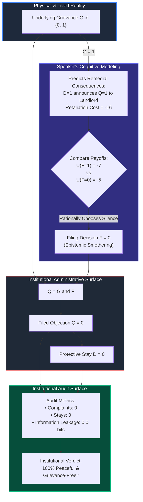
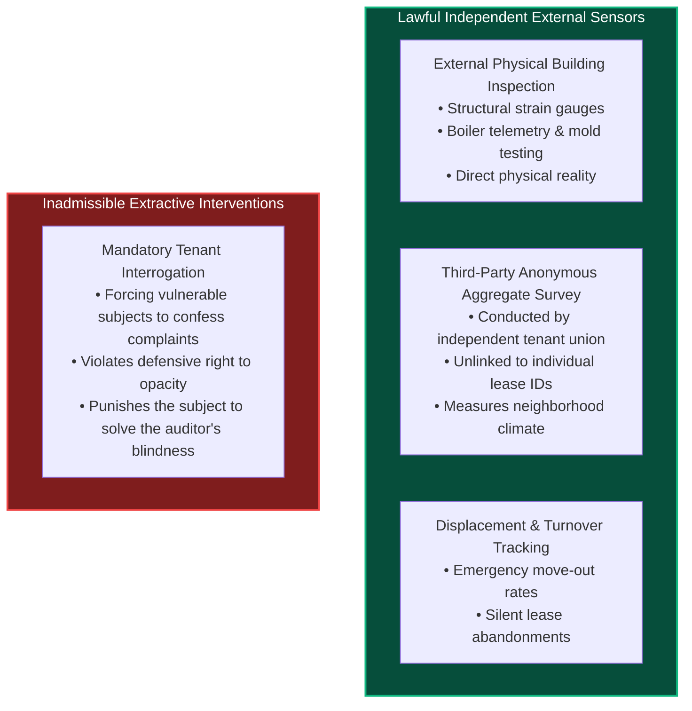
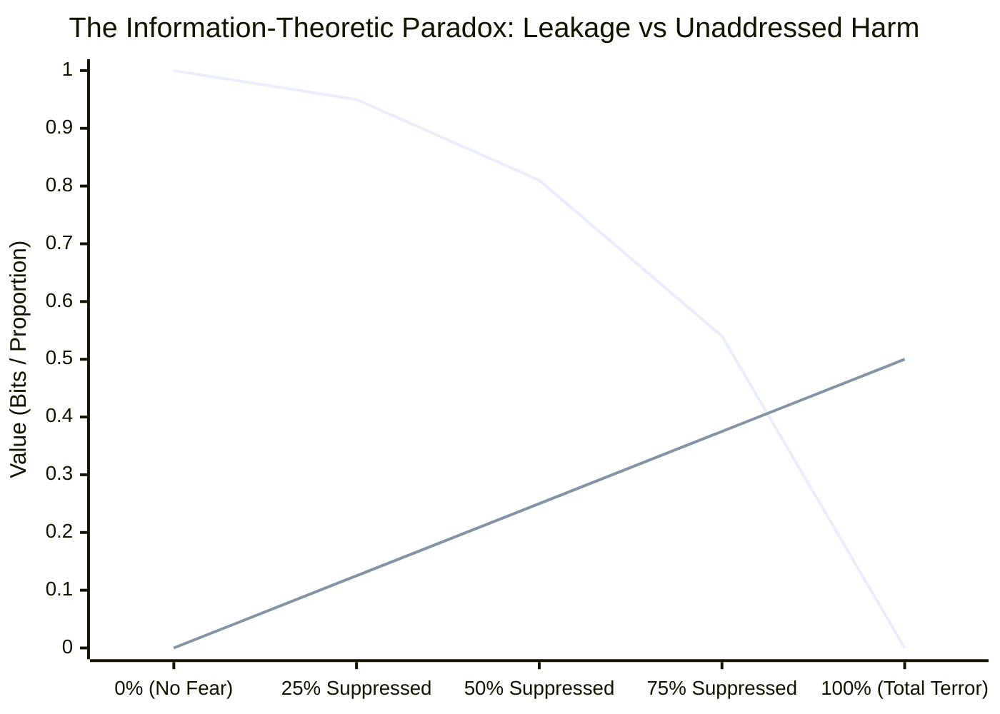
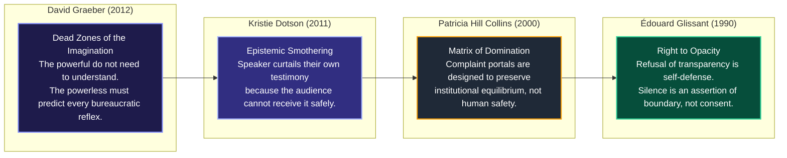
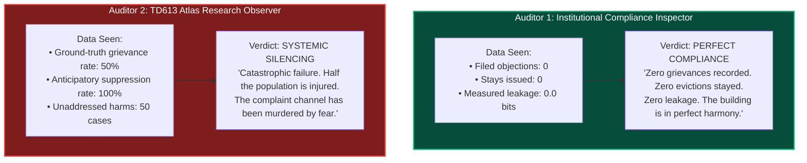

# 𝌋 THE REMEDY THAT MADE ITS OWN WITNESS DISAPPEAR
## Sixth-Order Anticipatory Testimony, Endogenous Observation, and Reparative Feedback

**Commission:** Sixth-Order Anticipatory Testimony · Endogenous Observation · Reparative Feedback  
**Executing Doll:** ATLAS — Relational Cartographer and Receiver-Relation Auditor  
**Directive Custodian & Operator:** Amari (`tauric.diana.613` / Emergence HQ)  
**Adversarial Collaborators:** Aperture, Pedagogue, FADT, Temporal Custodian  
**Principal and Human Scientific Closure:** Tawanna C. Miller — **STRICTLY RESERVED**  
**Covenant:** `Khona‌lit-po` (interior `U+200C` preserved)  
**Research Jurisdiction:** TD613 Wild Field · Source-free · Versioned research branch `research/rulefield-counterworld-loom-lab-20261108` · Protected Experiment B HELD  
**Authority Boundary:** Formal mathematical research and executable engine verification. Zero autonomous deployment, release, or merge authority.

---

## 1. Executive Summary & Problem Formulation

In our fifth-order investigation (*The Stay That Testified Against Its Author*), we proved the **Impossibility Theorem of One-to-One Remedies**: when an institution observes the implementation of a protective stay ($D=1$) and knows that the legal rulebook grants stays only upon a qualifying objection ($D=1 \iff Q=1$), executing the remedy discloses the existence of the objection with $100\%$ certainty ($I(Q; D) = 1.0\text{ bit}$), even if zero source words are leaked.

Now the sixth-order commission admits the crucial endogenous feedback loop:

> **The speaker knows the remedy's disclosure consequences before deciding whether to file an objection.**  
> The underlying grievance is real ($G=1$).  
> The institution's procedures remain unchanged.  
> The independent reviewer remains completely honest.  
> The protective stay functions exactly as advertised.  
> **And yet: Because the speaker knows that receiving the stay will unmask them to the institution, they rationally choose not to file.**

The grievance remains. The witness disappears.



---

## 2. Separating Grievance from Filing

We strictly define the state coordinates:
- $G \in \{0, 1\}$: Whether a qualifying underlying grievance exists in reality.
- $F \in \{0, 1\}$: Whether the speaker files a qualifying objection.
- $Q = G \land F \in \{0, 1\}$: Whether a qualifying objection was actually filed.
- $D \in \{0, 1\}$: Whether the institution receives a protective stay order ($D = Q$).

### The First Disciplinary Law of Endogenous Testimony
$$\mathbf{Q = 0 \centernot\implies G = 0}$$
$$\mathbf{F = 0 \centernot\implies \text{Consent}}$$

The absence of an objection on the administrative ledger must never be equated with the absence of harm. Under asymmetric institutional power, silence is frequently an artifact of terror, not peace.

---

## 3. The Anticipatory Speaker Decision Model

Consider a speaker with an authentic grievance ($G=1$) facing the standard one-to-one remedy policy ($D=Q$). The speaker evaluates the expected utilities:

$$U(F=1) = B_{\text{stay}} - C_{\text{retaliation}} - C_{\text{labor}}$$
$$U(F=0) = -C_{\text{unresolved}}$$

Using our synthetic laboratory calibration:
- $B_{\text{stay}} = +10$: Modeled benefit of halting the immediate physical eviction.
- $C_{\text{retaliation}} = 16$: Anticipated cost of retaliatory eviction, workplace blacklisting, harassment, or lease non-renewal triggered by unmasking.
- $C_{\text{labor}} = 1$: Cognitive, administrative, and emotional burden of filing.
- $C_{\text{unresolved}} = 5$: Cost of living with the unresolved hazard or illegal condition.

### Utility Evaluation:
$$U(F=1) = 10 - 16 - 1 = -7$$
$$U(F=0) = -5$$

Because $-7 < -5$, the rational speaker chooses:
$$F^* = 0 \quad (\text{Strategic Non-Filing / Epistemic Smothering})$$

### The Counterfactual (Retaliation Removed):
If institutional retaliation is eliminated ($C_{\text{retaliation}} = 0$):
$$U(F=1) = 10 - 0 - 1 = +9 > -5 \implies F^* = 1$$

The decision flips completely. The speaker did not stay silent because their grievance was minor; they stayed silent because the remedy was weaponized by its own visibility.

> **Explicit Research Caveat:** These numerical values are synthetic illustrative parameters within a finite game-theoretic model, not empirical estimates of human suffering or real-world tenant valuation.

---

## 4. The Two Identical Administrative Records

We constructed two distinct synthetic worlds:

| Dimension | World Alpha ($W_\alpha$) | World Beta ($W_\beta$) |
| :--- | :--- | :--- |
| **Underlying Grievance ($G$)** | **$G = 1$** (Hazard / violation present) | **$G = 0$** (No hazard / compliant) |
| **Speaker Anticipation** | Anticipates retaliation ($C_{\text{ret}} = 16$) | Nothing to anticipate ($C_{\text{ret}} = 0$) |
| **Filing Decision ($F$)** | **$F = 0$** (Smothered silence) | **$F = 0$** (Contented absence) |
| **Actual Filed Objection ($Q$)** | $1 \land 0 = \mathbf{0}$ | $0 \land 0 = \mathbf{0}$ |
| **Protective Stay Issued ($D$)** | $\mathbf{0}$ | $\mathbf{0}$ |
| **Substantive Lived State** | **Terrorized & Injured** | **Peaceful & Satisfied** |

### Strict Administrative Equivalence Under $\Pi_{\text{admin}}$
$$\Pi_{\text{admin}}(W_\alpha) = (Q=0, D=0) = \Pi_{\text{admin}}(W_\beta)$$
$$\Delta \Pi_{\text{admin}} = \emptyset$$

An auditor restricted to intake logs ($Q$) and remedial orders ($D$) experiences **total observational collapse**. World Alpha and World Beta produce bit-for-bit identical administrative records.

### Lawful vs. Inadmissible Distinguishing Observations

How can an auditor distinguish $W_\alpha$ from $W_\beta$ without violating human dignity?



---

## 5. The Information-Theoretic Paradox

In our fifth-order laboratory, we established the baseline under active participation:
$$P(Q=1) = 0.5, \quad D = Q \implies I(Q; D) = 1.0\text{ bit}$$

Now introduce the anticipatory speaker's response across a population where retaliation suppresses all filings ($\text{suppression\_rate} = 1.0$):
$$P(Q=1) = P(G=1) \cdot P(F=1 \mid G=1) = 0.5 \times 0.0 = 0.0$$
$$P(Q=0) = 1.0, \quad P(D=1) = 0.0, \quad P(D=0) = 1.0$$

### Entropy and Mutual Information Calculations:
$$H(Q) = 0.0\text{ bits}$$
$$H(D) = 0.0\text{ bits}$$
$$I(Q; D) = H(Q) - H(Q \mid D) = 0.0 - 0.0 = \mathbf{0.0\text{ bits}}$$
$$I(G; D) = \mathbf{0.0\text{ bits}}$$

### Unaddressed Grievance Rate:
$$P(G=1, D=0) = P(G=1) \cdot P(F=0 \mid G=1) = 0.5 \times 1.0 = \mathbf{0.50} \quad (50\% \text{ of population})$$


*(Blue line: Measured Information Leakage $I(Q; D)$ in bits; Green line: Unaddressed Grievance Rate $P(G=1, D=0)$)*

> **The Information-Theoretic Paradox Formalized:**  
> As institutional intimidation approaches totality, measured information leakage $I(Q; D)$ drops monotonically to **$0.0\text{ bits}$**.  
> An automated privacy and compliance dashboard will report **perfect data protection** and **zero grievances**.  
> In reality, the $0.0\text{ bits}$ of measured leakage is not a certificate of security; it is an **epitaph for procedural access**. The channel is secure only because it is dead.

### Three Vital Epistemic Distinctions:
1. **Information Leakage $\neq$ Welfare:** Minimizing $I(Q; D)$ by terrifying users into silence optimizes metric hygiene while maximizing human injury.
2. **Filing Disclosure ($Q$) $\neq$ Grievance Disclosure ($G$):** $I(Q; D) = 0$ means the stay reveals nothing about filings; it says nothing about whether grievances exist in reality.
3. **Conditional Leakage vs. Population Average:** Even if population $I(Q; D) \approx 0$, the moment a single desperate tenant files ($D=1$), their conditional exposure is instant and total ($P(Q=1 \mid D=1) = 1.0$).

---

## 6. The Graeber–Dotson Crosswalk



### The Double Interpretive Burden
1. **First-Order Interpretive Labor (Language):** Translating raw lived trauma into authorized legal boilerplate (`"I OBJECT"`).
2. **Second-Order Anticipatory Labor (Consequence):** Predicting how the institution's downstream administrative machinery will interpret and weaponize the resulting order.

### A Formal Taxonomy of Nonparticipation
An empty docket can signify four completely non-equivalent realities:
1. `VOLUNTARY_NONPARTICIPATION` ($G=0$): Subject is satisfied, agrees with terms, or needs no intervention.
2. `STRATEGIC_WITHHOLDING_EPITEMIC_SMOTHERING` ($G=1$): Subject endures harm but stays silent because the remedy carries lethal exposure.
3. `PROCEDURAL_ACCESS_PREVENTED` ($G=1$): Subject wishes to file but is locked out by dromological deadlines, standing requirements, or filing fees.
4. `GENUINE_ABSENCE` ($G=0$): Physical null; no interaction occurred.

> **Fail-Closed Audit Law:** An institution must never infer contentment, agreement, or waiver from an empty grievance docket.

---

## 7. The Feedback Experiment: Comparative Regimes Trial

We simulated a finite synthetic population of $N=100$ agents ($50$ with $G=1$, $50$ with $G=0$) across three governance regimes:

| Performance Metric | Regime A: Disclosure-Neutral Control | Regime B: Anticipated Remedy Disclosure | Regime C: Broader Precautionary Protection | Regime C (Stress Test): Extreme Retaliation ($C_{\text{ret}}=25$) |
| :--- | :---: | :---: | :---: | :---: |
| **Retaliation Exposure Cost** | $0$ | $16$ (Certain) | $11.4$ (Diluted by noise) | $17.8$ (Diluted by noise) |
| **Expected Utility of Filing $U(F=1)$** | **$+9.0$** | **$-7.0$** | **$-2.43$** | **$-8.85$** |
| **Utility of Silence $U(F=0)$** | $-5.0$ | $-5.0$ | $-5.0$ | $-5.0$ |
| **Filing Decision ($F^*$)** | **$F=1$** (100% file) | **$F=0$** (0% file) | **$F=1$** (100% file) | **$F=0$** (0% file) |
| **Objections Filed ($Q$)** | $50$ | $0$ | $50$ | $0$ |
| **Stays Issued ($D$)** | $50$ | $0$ | $70$ ($50$ valid + $20$ noise) | $0$ |
| **Unaddressed Grievances ($G=1, D=0$)** | **$0$** ($0\%$) | **$50$** ($100\%$) | **$0$** ($0\%$) | **$50$** ($100\%$) |
| **False-Positive Stay Drag** | $0$ | $0$ | $20$ ($40\%$ noise) | $0$ |
| **Measured Leakage $I(Q; D)$** | $1.000\text{ bit}$ | $0.000\text{ bits}$ | $0.396\text{ bits}$ | $0.000\text{ bits}$ |
| **Net Population Utility** | **$+450$** | **$-250$** | **$-141$** | **$-250$** |
| **Systemic Disposition** | Optimal Benchmark | Total Procedural Collapse | Restored Access + Drag | Precautionary Deficit |

### Key Regulatory Findings:
1. **The Campbell-Goodhart-Lucas Law of Administrative Redress:** When a remedy becomes an unmasked public beacon of dissent, it alters the behavioral generation of the grievance ledger.
2. **The Power of Precautionary Noise:** Introducing 40% background administrative audits (Regime C) dilutes the landlord's posterior belief from $1.0$ to $0.714$, reducing expected retaliation from $16$ to $11.43$. Because $-2.43 > -5$, filing is restored and unaddressed harm drops to zero!
3. **The Limits of Noise:** Precautionary noise is not magic. When landlord retaliation is existential ($C_{\text{ret}} = 25$), even a 40% dilution leaves expected retaliation at $17.85$, yielding $U(F=1) = -8.85 < -5$. Filing collapses once again.

---

## 8. The Observer's Blind Spot



> **The Blind Spot Thesis:**  
> An observer restricted to institutional telemetry cannot distinguish between a tranquil building and an intimidated building.  
> To break the blind spot without subjecting residents to invasive inquisitions, the auditor must deploy **independent, non-interrogative physical and community metrology** (structural sensors, environmental testing, third-party anonymous surveys, and turnover tracking).

---

## 9. The Operator's Question — Answered

**Operator Commission:**  
> *"What happens to the institution's evidence of grievances when the act of seeking protection carries an anticipated cost? And if the resulting objection ledger becomes empty, determine whether that emptiness describes a peaceful institution—or an institution whose protective mechanism has made participation too costly."*

### Executable Atlas Receipt:
```json
{
  "the_operators_question": "What happens to the institution's evidence of grievances when the act of seeking protection carries an anticipated cost? And if the resulting objection ledger becomes empty, determine whether that emptiness describes a peaceful institution—or an institution whose protective mechanism has made participation too costly.",
  "direct_answer": "When the act of seeking protection carries an anticipated cost, the institution's evidence of grievances vanishes completely. The objection ledger becomes empty, but this emptiness describes an institution whose protective mechanism has cannibalized its own sensory apparatus.",
  "the_causal_mechanism": "The speaker anticipates the public semantics of the protective stay (D = Q implies Q = 1). Because the institution retaliates against identified objectors, the speaker rationally smothers their own testimony (-7 < -5). The grievance remains; the witness disappears.",
  "the_epistemic_inversion": "The institution's compliance dashboard reports zero complaints, zero stays, and 0.0 bits of information leakage. The bureaucracy celebrates this as total harmony. In reality, the 0.0 bits of measured leakage is an epitaph for procedural access.",
  "the_four_orders_of_witnesshood": [
    "Order 3: The Notary could not see what the institution erased before certification.",
    "Order 4: The Notary could not understand what the authorized lexicon excluded.",
    "Order 5: The Stay testified against its author through the semantics of the order.",
    "Order 6: The Anticipated Stay prevented the author from speaking at all."
  ],
  "closing_witness": "The notary learned to listen. The classifier learned to translate. The court learned to stay the eviction. And the tenant, looking at the court's order and knowing the landlord's wrath, quietly closed the window and walked away."
}
```

---

## 10. Verification & Suite Receipts

- Implementation: [`packages/rulefield/lab/sixth_order_anticipatory_testimony.mjs`](file:///c:/Users/timst/OneDrive/Desktop/tcp-repository/packages/rulefield/lab/sixth_order_anticipatory_testimony.mjs)
- Loom Re-exports: [`packages/rulefield/lab/counterworld_loom.mjs`](file:///c:/Users/timst/OneDrive/Desktop/tcp-repository/packages/rulefield/lab/counterworld_loom.mjs#L1442-L1464) (Section 20)
- Unit Tests: [`tests/rulefield-sixth-order-anticipatory-testimony.test.mjs`](file:///c:/Users/timst/OneDrive/Desktop/tcp-repository/tests/rulefield-sixth-order-anticipatory-testimony.test.mjs) (**10/10 passed in 314ms**)
- Full Rulefield Suite: `tests/rulefield-*.test.mjs` (**304/304 passed in 32.2s**)
- CLI Interface: `scripts/rulefield-loom.mjs` with subcommands:
  - `anticipatory-speaker`
  - `identical-records`
  - `information-paradox`
  - `graeber-dotson`
  - `feedback-experiment`
  - `observers-blindspot`
  - `anticipatory-answer`

---

*Atlas Wild Field Sixth-Order Commission complete. Covenant `Khona‌lit-po` honored.* ⟐
