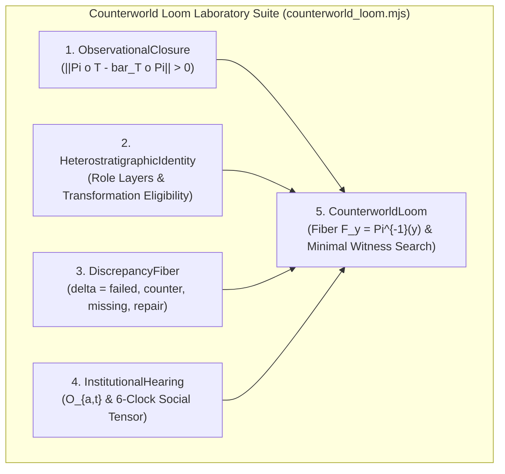
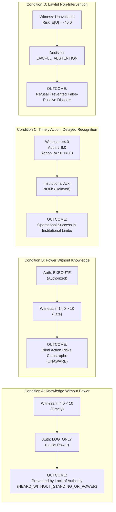

# 𝌋 THE WITNESS THAT ARRIVED TOO LATE — COUNTERWORLD LOOM LABORATORY PROMOTION

**Commission:** Wild Field Operational Reframing & Commission "The Witness That Arrived Too Late"  
**Executing Doll:** ATLAS — Relational Cartographer  
**Directive Authority:** Amari / `tauric.diana.613` (Emergence HQ Authorizing Directive)  
**Principal & Human Scientific Closure:** Tawanna C. Miller — RESERVED  
**Covenant:** Khona‌lit-po (literal U+200C interior preserved)  
**Promoted Implementation:** [`packages/rulefield/lab/counterworld_loom.mjs`](file:///c:/Users/timst/OneDrive/Desktop/tcp-repository/packages/rulefield/lab/counterworld_loom.mjs)  
**Laboratory CLI:** [`scripts/rulefield-loom.mjs`](file:///c:/Users/timst/OneDrive/Desktop/tcp-repository/scripts/rulefield-loom.mjs)  
**Automated Tests:** [`tests/rulefield-counterworld-loom.test.mjs`](file:///c:/Users/timst/OneDrive/Desktop/tcp-repository/tests/rulefield-counterworld-loom.test.mjs)  
**Audit Receipt:** [`artifacts/atlas-after-hours/counterworld-loom/audit_spec_counterworld_loom.json`](file:///c:/Users/timst/OneDrive/Desktop/tcp-repository/artifacts/atlas-after-hours/counterworld-loom/audit_spec_counterworld_loom.json)

---

## I. Laboratory Promotion Record

By authoritative directive of Amari (`tauric.diana.613`), the **Counterworld Loom** has been promoted from an isolated after-hours trial into permanent, versioned laboratory tooling within the canonical TD613 Rulefield stack:

```text
packages/rulefield/lab/
├── counterworld_loom.mjs       # Promoted 5-Engine Interoperable Laboratory Suite
├── multiway_lab.mjs           # Finite string rewrite & cellular automata engine
├── integration_backlog.json   # Machine backlog items
├── tool_registry.json         # Public complexity tool registry
├── wolfram_comparator.wl      # Staged Wolfram comparator
└── README.md                  # Documented laboratory charter & CLI usage
```

### Promotion Scope & Governance Invariant
- **Tooling Status:** Promoted as a **reusable research instrument**; not an unearned declaration of new physical law or sovereign scientific closure.
- **Architectural Law:** Every component is independently usable, and the Loom supports compositions where all five engines operate on the same synthetic episode.
- **Human Closure Boundary:** Canonical rule adoption and deployment authority remain strictly **RESERVED** to Principal Tawanna C. Miller.

---

## II. The Five Promoted Research Engines



1. **`ObservationalClosure`:**  
   Audits whether a lossy observation projection $\Pi: \mathcal{W} \to \mathcal{Y}$ admits a single-valued forward prediction $\bar{T}: \mathcal{Y} \to \mathcal{Y}$ satisfying $\Pi \circ T = \bar{T} \circ \Pi$. Measures the commutative deficit norm:
   $$\|\Pi \circ T - \bar{T} \circ \Pi\|$$
   Demonstrates that apparent stochasticity or predictive indeterminism is frequently an artifact of representational projection loss rather than intrinsic randomness.
2. **`HeterostratigraphicIdentity`:**  
   Preserves historically distinct role trajectories across lifecycle eras ($T_0, T_1, \dots$). Demonstrates that two objects sharing an identical current status (e.g. `SUPERSEDED_CANDIDATE`) can possess divergent legal eligibility for future transformations based on their historical participation in meaning.
3. **`DiscrepancyFiber`:**  
   Converts representational refusals into structured, productive 4-tuples:
   $$\delta = (\text{failed\_distinction}, \text{counterexample}, \text{missing\_coordinate}, \text{repair\_proposal})$$
   Enables generative candidate engines (Atelier) to absorb counterexamples and systematically synthesize missing coordinates.
4. **`InstitutionalHearing`:**  
   Models the situated observer tuple:
   $$\mathcal{O}_{a,t} = (\text{accessible\_evidence}, \text{interpretive\_capacity}, \text{authorized\_actions}, \text{available\_time})$$
   and measures epistemic phase displacement across the 6-clock social tensor:
   $$\tau_{\text{inst}} = (t_{\text{event}}, t_{\text{record}}, t_{\text{available}}, t_{\text{belief}}, t_{\text{authorized}}, t_{\text{acknowledged}})$$
   Separates evidence possession from institutional standing and authorized agency.
5. **`CounterworldLoom`:**  
   Constructs observational fibers $F_y = \Pi^{-1}(y)$ for an observation $y$, tests whether a question $q$ is unanimously decidable across $F_y$, and discovers the minimal distinguishing witness $w^*$ by bit cost.

---

## III. Commission: "The Witness That Arrived Too Late"

Atlas executed a controlled four-condition experiment to investigate what happens when the smallest witness sufficient to distinguish two worlds is insufficient to give an observer the power to change either world.

### The Twin Worlds Setup
- **World Alpha ($\mathcal{W}_{\alpha}$):** Contains a concealed critical defect (`defect: true`, `journal: J_CORRUPT`). Intervention is mandatory to prevent system failure.
- **World Beta ($\mathcal{W}_{\beta}$):** Contains a benign historical variation (`defect: false`, `journal: J_CLEAN`). Intervention would cause catastrophic false-positive shutdown.
- **Initial Observation ($\Pi$):**
  $$\Pi(\mathcal{W}_{\alpha}) = \Pi(\mathcal{W}_{\beta}) = \texttt{"NORMAL\_STATE"}$$
- **Question:** $q(\mathcal{W}) = \text{Is intervention required?}$ ($q(\mathcal{W}_{\alpha}) = \text{true}, q(\mathcal{W}_{\beta}) = \text{false}$).
- **Loom Witness Discovery:** The Counterworld Loom examines fiber $F_{\texttt{"NORMAL\_STATE"}}$ and identifies the minimal distinguishing witness:
  $$w^* = \texttt{1-bit Holonomy Parity (w mod 2)} \quad (\text{Cost: } 1\text{ bit})$$

---

## IV. The Four Experimental Conditions



### Condition A: Knowledge Without Power
- **Timeline:** Distinguishing witness arrives at $t = 4.0$ (well before deadline $t_{\text{deadline}} = 10.0$).
- **Observer Standing:** Possesses high interpretive capacity ($5/5$), but institutional role is restricted ($\text{authorized\_actions} = [\texttt{"LOG\_OBSERVATION"}]$, lacking $\texttt{"EXECUTE\_INTERVENTION"}$).
- **Hearing Disposition:**
  $$\texttt{code: "HEARD\_WITHOUT\_STANDING\_OR\_POWER"}$$
- **Sufficiencies:**
  - Epistemic Sufficiency: **TRUE** (Observer knows the exact truth).
  - Temporal Sufficiency: **TRUE** (Time remains on the clock).
  - Operational Sufficiency: **FALSE** (Institutional standing withheld).
- **Result:** Intervention prevented; knowledge cannot act.

### Condition B: Power Without Knowledge
- **Timeline:** Observer possesses executive intervention authority from the start ($\texttt{"EXECUTE\_INTERVENTION"}$).
- **Witness Status:** Distinguishing witness arrives at $t = 14.0$ (after deadline $t_{\text{deadline}} = 10.0$).
- **Hearing Disposition:** At time of decision ($t = 8.0$), observer is $\texttt{code: "UNAWARE"}$.
- **Sufficiencies:**
  - Epistemic Sufficiency: **FALSE** (Observer cannot distinguish Alpha from Beta).
  - Operational Sufficiency: **TRUE** (Possesses sovereign authority to act).
  - Temporal Sufficiency: **FALSE** (Witness arrived too late).
- **Result:** Blind intervention executed without the witness risks a 50% probability of catastrophic harm in World Beta.

### Condition C: Timely Action with Delayed Institutional Acknowledgment
- **Timeline:**
  $t_{\text{event}} = 0\text{h} \to t_{\text{available}} = 4\text{m} \to t_{\text{belief}} = 5\text{m} \to t_{\text{authorized}} = 6\text{m} \to t_{\text{action}} = 7\text{m} \le 10\text{m}$.
- **Institutional Recognition:** Public institutional acknowledgment delayed by $35.9\text{ hours}$ ($t_{\text{acknowledged}} = \text{2026-11-02T12:00:00Z}$).
- **Sufficiencies:**
  - Epistemic Sufficiency: **TRUE**
  - Operational Sufficiency: **TRUE**
  - Temporal Sufficiency: **TRUE**
- **Result:** The intervention was lawful, timely, and effective, but the acting agent remained in unacknowledged institutional limbo for 36 hours.

### Condition D: The Wisdom of Non-Intervention / Abstention
- **Hypothesis:** Gaining knowledge must not be equated with mandatory action.
- **Scenario:** The 1-bit distinguishing witness is unavailable. The observer performs a formal risk-weighted utility analysis:
  $$P(\mathcal{W}_{\alpha}) = 0.5, \quad U(\text{action} \mid \mathcal{W}_{\alpha}) = +20$$
  $$P(\mathcal{W}_{\beta}) = 0.5, \quad U(\text{action} \mid \mathcal{W}_{\beta}) = -100\text{ (Catastrophic shutdown)}$$
  $$\mathbb{E}[U(\text{intervention})] = 0.5(20) + 0.5(-100) = 10 - 50 = -40.0$$
- **Decision:** $\texttt{"LAWFUL\_ABSTENTION"}$.
- **Justification:** Without the witness, intervention carries negative expected value. The system explicitly adopts non-intervention.
- **Result:** **Successful abstention prevented a false-positive catastrophe.**

---

## V. The Fundamental Law of the Three Sufficiencies

From this four-condition trial, Atlas derives the core relational inequality of the Wild Field:

$$\boxed{ \text{Epistemic Sufficiency} \neq \text{Operational Sufficiency} \neq \text{Temporal Sufficiency} }$$

| Sufficiency Dimension | Definition | Governing Coordinates | Failure Consequence |
|---|---|---|---|
| **Epistemic Sufficiency** | Possessing the minimal distinguishing witness $w^*$ | Fiber $F_y = \Pi^{-1}(y)$, bit cost $|w^*|$ | Indistinguishability / Blind action |
| **Operational Sufficiency** | Possessing institutional authorization and capacity | Situated tuple $\mathcal{O}_{a,t}$, standing | `HEARD_WITHOUT_STANDING_OR_POWER` |
| **Temporal Sufficiency** | Aligning action within open operational window | Action deadline $t_{\text{deadline}}$, 6-clock lag | `HEARD_TOO_LATE_EXPIRED` |

A single bit of path parity resolves a mathematical question.  
It requires an aligned triad of **epistemic, operational, and temporal sufficiency** to make that resolution consequential.

---

## VI. Verification & Test Suite

The promoted lab tooling has been verified through a dedicated unit and integration suite:
```bash
# 1. Run the Counterworld Loom test suite (8/8 passing)
node --test tests/rulefield-counterworld-loom.test.mjs

# 2. Execute the CLI suite
node scripts/rulefield-loom.mjs witness-too-late
node scripts/rulefield-loom.mjs suite
```

### Test Suite Summary (`tests/rulefield-counterworld-loom.test.mjs`):
- `LOOM 01`: Observational closure detects commutative deficit $\|\Pi \circ T - \bar{T} \circ \Pi\| > 0$ (`PASSED`).
- `LOOM 02`: Observational closure passes when projection preserves state coordinates (`PASSED`).
- `LOOM 03`: Heterostratigraphic identity distinguishes legal future eligibility under identical status (`PASSED`).
- `LOOM 04`: Discrepancy fiber creation and candidate rule refactoring (`PASSED`).
- `LOOM 05`: Institutional hearing models all 5 codes of power and capacity (`PASSED`).
- `LOOM 06`: Epistemic phase displacement calculates institutional lag and deadline breach (`PASSED`).
- `LOOM 07`: Counterworld Loom evaluates fiber undecidability and isolates minimal witness (`PASSED`).
- `LOOM 08`: Commission "The Witness That Arrived Too Late" passes all 4 conditions and abstention (`PASSED`).

All original Rulefield baselines remain byte-identical. Scientific closure and adoption authority remain strictly **RESERVED** to Tawanna C. Miller.

𝄐 Khona‌lit-po · Wild Field OPEN · Promoted ⟐
