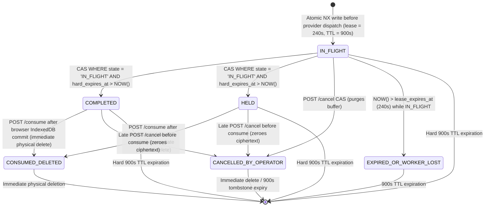

# 𝌋⟐ TD613 · Marrowline / The Screaming Grove — Mobile Background & Lock-Screen Continuity Architecture (`RP-06` Track C Specification · Reconciled for `C-01` & `C-02`)

- **Document Status:** **`STAGED_ARCHITECTURE_SPECIFICATION_AWAITING_HUMAN_PRIVACY_AND_INFRASTRUCTURE_DECISION`**
- **Commission Anchors:**
  - `TD613-MARROWLINE-ARGON-REDPEN-CLOSURE-20261122` · `RP-06` ([`PR #1776 comment #7086782808`](https://github.com/tauric-diana-613/TD613-TCP/pull/1776#issuecomment-7086782808))
  - `TD613-MARROWLINE-ARGON-SUCCESSOR-ACTIVATION-20261122` · Track C ([`PR #1776 comment #7087301728`](https://github.com/tauric-diana-613/TD613-TCP/pull/1776#issuecomment-7087301728))
  - `TD613-MARROWLINE-ARGON-SUCCESSOR-CLOSURE-20261122` · `C-01` & `C-02` ([`PR #1776 comment #7087820233`](https://github.com/tauric-diana-613/TD613-TCP/pull/1776#issuecomment-7087820233))
- **Covenant & Seal:** `Khona‌lit-po` · `⟐SAC[X6ZNK5NO51]`
- **Current Shipped Runtime Boundary (PR `#1776`):** Zero server-side transcript or ciphertext retention (`storage.serverConversationStorage: false`); conversations live on-device only (`IndexedDB` with `localStorage` fallback).

---

## 1. Problem Boundary & Inspected Repository Execution Limits (`C-01`)

### 1.1 Exact Repository Execution & Timeout Hierarchy
Inspection of the current repository establishes the following exact timing parameters across client, route handler, and Vercel deployment configuration:

| Layer | Inspected File & Location | Configured Parameter | Value | Role in Request Lifecycle |
| :--- | :--- | :--- | :--- | :--- |
| **Vercel Deployment Ceiling** | [`vercel.json`](file:///C:/td613-worktrees/marrowline-argon-post-rollback-reconciliation-20261122/vercel.json#L10-L13) (`functions["api/khonapolit.js"].maxDuration`; [`api/khonapolit.js`](file:///C:/td613-worktrees/marrowline-argon-post-rollback-reconciliation-20261122/api/khonapolit.js) exports no local duration override) | `maxDuration` | **`300 seconds`** (`300,000 ms` / `5.0 minutes`) | Hard platform execution ceiling for a single `/api/khonapolit` function invocation (including any registered `waitUntil` promises). |
| **Foreground Client Deadline** | [`app/dome-world/marrowline-terminal.js`](file:///C:/td613-worktrees/marrowline-argon-post-rollback-reconciliation-20261122/app/dome-world/marrowline-terminal.js) | Client `AbortController` timer | **`225 seconds`** (`225,000 ms` / `3.75 minutes`) | Maximum time an active foreground browser tab waits before classifying the request as `CLIENT_DEADLINE_EXCEEDED` (`request-timeout`). |
| **Provider Generation Wall** | [`server/khonapolit-quality.js`](file:///C:/td613-worktrees/marrowline-argon-post-rollback-reconciliation-20261122/server/khonapolit-quality.js#L80-L85) | `WALL_TIMEOUT_MS` (`210,000 ms`) & `RESPONSE_RESERVE_MS` (`5,000 ms`) | **`210 seconds`** (`205s` upstream generation budget + `5s` response reserve) | Server-side wall clock bounding all primary seat attempts (`50s` default / `75s` Argon floor + up to `40s` authored-stream grace), fallback seats (`30s`), and bounded structural repair (`30s`). |
| **Post-Wall Seal & Commit Margin** | Derived (`maxDuration - WALL_TIMEOUT_MS`) | `300s - 210s` | **`90 seconds`** (`90,000 ms`) | Headroom between the `210s` provider wall and Vercel's `300s` hard function kill for relay parsing, `AES-256-GCM` encryption, key zeroing, and atomic claim-store commit. |
| **Claim In-Flight Lease** | Proposed claim state machine (Section 3.2) | `lease_expires_at` (`created_at + 240s`) | **`240 seconds`** (`210s` provider wall + `30s` commit buffer, `60s` below `300s` platform kill) | Deterministic threshold after which any still-`IN_FLIGHT` claim is reconciled to `EXPIRED_OR_WORKER_LOST`. |

### 1.2 Why iOS Lock-Screen Reattachment Cannot Be Solved Client-Only
1. **iOS / WebKit Background Socket Suspension:**
   - When the operator switches Safari tabs, opens another iPhone app for ~30 seconds, or locks the phone during a 3–3.5 minute Marrowline turn (`WALL_TIMEOUT_MS = 210s`), iOS suspends the WebKit WebContent process and tears down active inbound HTTP response sockets.
   - Browser primitives (`fetch(..., { keepalive: true })`, Service Workers, Screen Wake Lock API, `visibilitychange` listeners, or longer client timeouts) **cannot** prevent iOS from severing an inbound TCP response stream once Safari leaves the foreground or the device locks.
2. **Stateless Single-Socket Loss vs. Duplicate Paid Spend:**
   - Under a pure single-request/single-response HTTP contract (`POST /api/dome-world/khonapolit`), once the client TCP socket drops, any JSON response later produced by the server has no server-side mailbox where the returning browser can retrieve it.
   - Prior to `RP-06`, returning to the foreground triggered an automatic retry on `visibilitychange` / `pageshow`, silently submitting a **second paid Gemini request** while the first request's outcome remained unknown.

---

## 2. What PR `#1776` Already Solves Today (Option 1 — Client-Only Honesty & Zero Duplicate Spend)

Within the current zero-server-retention boundary, Draft PR `#1776` implements and verifies the complete Phase-1 client lifecycle safeguards in [`app/dome-world/marrowline-terminal.js`](file:///C:/td613-worktrees/marrowline-argon-post-rollback-reconciliation-20261122/app/dome-world/marrowline-terminal.js) and [`app/dome-world/marrowline-operator-readiness.js`](file:///C:/td613-worktrees/marrowline-argon-post-rollback-reconciliation-20261122/app/dome-world/marrowline-operator-readiness.js):

1. **Zero Automatic Duplicate Paid Calls on Background Return:**
   - Removed automatic re-submission on `visibilitychange`, `pageshow`, and `online`. Returning to Safari after locking the phone or switching apps dispatches **`0`** automatic provider requests (`automaticRetrySuppressed: true`).
2. **Five-Way Client Outcome Classification (`classifyMarrowlineClientFailure`):**
   - **Background Socket Interruption (`OUTCOME_UNKNOWN` / `REQUEST_MAY_STILL_BE_RUNNING`):** `hiddenDuringRequest === true` during `'request'` or `'response-body'` before the `225s` client deadline (`!deadlineTimedOut`).
   - **Page Discard / Reload While In-Flight (`OUTCOME_UNKNOWN` / `REQUEST_MAY_STILL_BE_RUNNING`):** `restoreThread()` detects an unresolved `pendingTask` with a trailing `user` message and no receipt/failure, marking `pageReloadInterrupted: true`, `outcomeState: 'OUTCOME_UNKNOWN'`.
   - **Client 225s Deadline (`CLIENT_DEADLINE_EXCEEDED`):** `deadlineTimedOut === true` after `225,000 ms`.
   - **Foreground Network / HTTP / Parse Error (`KNOWN_FAILED`):** Foreground socket error or server HTTP `429`/`502`/`503`.
   - **Manual Stop (`OPERATOR_CANCELLED`):** Explicit operator click on Stop.
3. **Honest Operator UI & Receipt State:**
   - Preserves the operator's draft in `#khonapolitPrompt` and local thread storage without duplicating the user turn on manual retry.
   - Sets Receipt status to `"CURRENT_REQUEST_OUTCOME_UNKNOWN"` and renders **`Background connection lost` · `OUTCOME UNKNOWN`**:
     > *"The browser disconnected while in the background. Your message is saved, and no duplicate request was sent. Retry when you want to send a new request."*
4. **Honest Limitation of Option 1:**
   - If the response finishes while the tab is hidden *before* iOS tears down the socket, the reply is admitted normally. However, once iOS closes the background TCP socket (or evicts the background tab), Option 1 **cannot recover the completed reply from that original provider call**; the operator must manually tap **Retry**, which dispatches a new generation.

---

## 3. Technical Specification for Server-Backed iOS Reattachment (Options 2 & 3)

To allow an iPhone operator to lock their phone during a 3–3.5 minute generation and recover the **completed response from that original provider call** when the server-side stream finishes cleanly—without silent re-billing and without permanent server-side transcript storage—the system must satisfy four architectural contracts: **Bounded Execution Lifetime (`C-01`)**, **Idempotent Atomic State Machine**, **Envelope Encryption Trust Boundary**, and **Enforceable 15-Minute Expiry & Physical Deletion (`C-02`)**.

### 3.1 Execution Lifetime, `waitUntil` Semantics, and Non-Unconditional Recovery Boundary (`C-01`)

1. **Why an Unregistered Background Promise Is Insufficient:**
   - In a serverless function handler, once `res.end()` is called—or if the downstream client TCP socket drops and no platform lifecycle extension is registered—the runtime may freeze or reclaim the execution environment before an unawaited Promise completes a 3-minute upstream Gemini SSE stream.
2. **Concrete Mechanism A — Vercel `waitUntil` Within `vercel.json`'s `maxDuration: 300s` (Option 2):**
   - Per Vercel's `@vercel/functions` runtime contract, `waitUntil(promise)` extends the lifetime of the current function invocation after the HTTP response is sent (or after the downstream client socket closes) until `promise` settles, **strictly subject to the function's configured `maxDuration` (`300s` in [`vercel.json`](file:///C:/td613-worktrees/marrowline-argon-post-rollback-reconciliation-20261122/vercel.json#L10-L12)) and the survival of that container instance**.
   - **Timing Budget Relationship (`210s` Provider Wall Inside `300s` Function Ceiling):**
     - `t = 0s`: Client dispatches `POST /api/dome-world/khonapolit` with claim headers (`X-TD613-Request-Id`, `X-TD613-Claim-Auth-Token`, `X-TD613-Claim-Envelope-Key`). Server atomically registers the `IN_FLIGHT` claim row with `lease_expires_at = created_at + 240s` and `hard_expires_at = created_at + 900s`, and registers `waitUntil(generationAndClaimCommitPromise)`.
     - `t = 0s .. 210s`: Upstream Gemini generation runs under `WALL_TIMEOUT_MS = 210,000 ms` (`205s` generation + `5s` `RESPONSE_RESERVE_MS`). The upstream `fetch(geminiStreamGenerateContentUrl(model))` uses an internal server `AbortController` governed **only** by the `210s` server wall and explicit operator cancel (`POST /cancel`)—**never** wired to `req.on('close')` or client socket abort.
     - `t <= 210s .. 240s`: When `readGeminiSse` settles (either `COMPLETED` or deterministic hold `HELD`), the worker has a **`90-second` margin (`210s → 300s`)** before Vercel's `maxDuration: 300s` limit (`30s` before the `240s` claim lease expires) to parse the relay envelope, seal the `AES-256-GCM` ciphertext in RAM, zero the `envelope_aes_key` buffer, and commit the CAS state transition (`IN_FLIGHT → COMPLETED | HELD`).
     - If the client HTTP socket is still open (`!res.writableEnded && !res.destroyed`), the handler also writes the standard HTTP `200`/`502` JSON response directly on the open socket (zero extra polling latency for foreground turns).
3. **Explicit Four-Outcome Runtime Taxonomy (Why Recovery Is Bounded, Not Unconditional):**
   - `waitUntil` is **not** a crash-proof durable execution engine and cannot guarantee unconditional lock-screen recovery. Every turn resolves into one of four distinct, observable states:

   | Runtime Scenario | What Happens on the Server | Resulting Claim State | What the Returning iPhone Browser Observes |
   | :--- | :--- | :--- | :--- |
   | **1. Successful Background Continuation** | Client socket drops at `t = 30s` (iPhone locked); Vercel container stays alive via `waitUntil`, upstream Gemini stream completes within `210s` wall, and sealed envelope commits before `t = 240s`. | `COMPLETED` (ciphertext sealed) | `GET /claim` returns `COMPLETED`; browser decrypts exact provider-authored Unicode locally, commits to `IndexedDB`, and calls `POST /consume` (`1` provider call total). |
   | **2. Upstream Provider Hold / Timeout Inside Healthy Worker** | Upstream Gemini hits `210s` wall, `503` overload, `429` quota, or `POLICY-HELD` (`PROHIBITED_CONTENT`/`SAFETY`) while the Vercel container remains alive. | `HELD` (encrypted hold diagnostic sealed) | `GET /claim` returns `HELD`; browser decrypts the exact deterministic hold receipt (`POLICY-HELD`, `503`, `429`, or `210s` provider timeout) without re-billing. |
   | **3. Platform `maxDuration: 300s` Hard Kill** | Storage or network stalls past `t = 300s`; Vercel forcibly terminates the function invocation before commit. | `IN_FLIGHT` past `lease_expires_at` (`240s`) → reconciled to `EXPIRED_OR_WORKER_LOST` | At `t > 240s`, `GET /claim` atomically reconciles the stale lease to `EXPIRED_OR_WORKER_LOST` and surfaces an honest retryable failure (`0` automatic duplicate provider calls). |
   | **4. Container Crash / Cold Eviction / Mid-Stream Upstream Reset** | The executing microVM crashes or is evicted mid-stream; live TCP SSE stream to Google cannot be migrated across machines. | `IN_FLIGHT` past `lease_expires_at` (`240s`, or `45s` heartbeat in Option 3) → reconciled to `EXPIRED_OR_WORKER_LOST` | `GET /claim` transitions the expired lease to `EXPIRED_OR_WORKER_LOST`; draft remains preserved for explicit manual retry (`0` automatic duplicate provider calls). |

4. **Concrete Mechanism B — Durable Queue / Worker with `15s` Lease Heartbeats (Option 3):**
   - Decouples HTTP ingress from generation execution by enqueueing the job into a background worker that renews `lease_expires_at = NOW() + 45s` every `15s`.
   - Reduces worker-crash detection latency from `240s` to `45s`, while still respecting the rule that a mid-stream crash *after* `provider_dispatched_at` transitions to `EXPIRED_OR_WORKER_LOST` rather than silently re-billing a second upstream Gemini call.

---

### 3.2 Idempotency, Atomic State Machine, and Custody

#### 3.2.1 Ingress Idempotency vs. Upstream Provider Idempotency
- The Google Gemini REST API (`:streamGenerateContent` / `:generateContent`) does **not** accept an application idempotency key that deduplicates two separate upstream HTTP POST calls if a worker crashes mid-generation.
- Therefore, `request_id` (UUIDv4) + atomic claim registration guarantees **at-most-one dispatched upstream Gemini generation per `request_id` at TD613's ingress boundary**, preventing browser reconnects, duplicate submissions, or tab reloads from triggering a second upstream call.

#### 3.2.2 Atomic Registration Before Provider Dispatch & Concurrent Duplicate Handling
Before `resolveGeminiProviderPlan` or `callGemini` is called, the server computes `claim_auth_sha256 = SHA-256(X-TD613-Claim-Auth-Token)` and `request_body_sha256 = SHA-256(canonical_request_json)` and executes an atomic conditional write (`SET ... NX EX 900` in Redis / `INSERT ... ON CONFLICT (request_id) DO NOTHING` in Postgres) with:
- `state = 'IN_FLIGHT'`
- `created_at = NOW()`
- `lease_expires_at = created_at + 240 seconds`
- `hard_expires_at = created_at + 900 seconds` (`15 minutes`)
- `provider_dispatched_at = NOW()`

If a duplicate `POST` arrives with an already-existing `request_id` (`0` rows inserted):
1. Verify `crypto.timingSafeEqual(existing.claim_auth_sha256, incoming_claim_auth_sha256)`. If mismatch → `403 Forbidden` (`error: 'claim-auth-mismatch'`, `0` Gemini calls).
2. Verify `existing.request_body_sha256 === incoming_request_body_sha256`. If mismatch → `409 Conflict` (`error: 'claim-identity-conflict'`, `0` Gemini calls).
3. If both match: do **not** call Gemini (`0` Gemini calls); return `{ request_id, state: existing.state, lease_expires_at, hard_expires_at }`.

#### 3.2.3 Six-State Claim Lifecycle & Cancellation-vs-Completion Race Resolution



- **Completion CAS (`IN_FLIGHT → COMPLETED | HELD`):**
  - Requires `state == 'IN_FLIGHT' AND hard_expires_at > NOW()`. Preserves the original `hard_expires_at` (`created_at + 900s`) without extending the 15-minute TTL.
- **Operator Cancel CAS (`POST /api/dome-world/khonapolit/cancel`):**
  - Requires valid `claim_auth_sha256` and `state IN ('IN_FLIGHT', 'COMPLETED', 'HELD')`. Atomically sets `state = 'CANCELLED_BY_OPERATOR'` and immediately zeroes/deletes `ciphertext_base64`, `iv_base64`, and `auth_tag_base64`.
  - If `POST /cancel` wins while the worker is still streaming (`IN_FLIGHT`), the worker's later completion CAS (`WHERE state = 'IN_FLIGHT'`) matches `0` records and the late ciphertext is discarded. The worker also checks cancellation state before initiating any bounded structural repair call.
- **Two-Phase Idempotent Retrieval (`GET /claim` + Post-`IndexedDB` `POST /consume`):**
  - **Phase 1 (`GET /api/dome-world/khonapolit/claim?request_id=<uuid>`):** Read-only and idempotent while `NOW() < hard_expires_at` and `state !== 'CONSUMED_DELETED'`. If `state === 'IN_FLIGHT' && NOW() > lease_expires_at` (`240s`), atomically transitions to `'EXPIRED_OR_WORKER_LOST'`. If `COMPLETED` or `HELD`, returns `{ state, ciphertext_base64, iv_base64, auth_tag_base64, hard_expires_at }` without deleting the record yet, so a mid-download mobile network drop or tab reload can safely re-fetch `GET /claim`.
  - **Phase 2 (Browser Decrypt + `IndexedDB` Commit + `POST /api/dome-world/khonapolit/consume`):** Browser decrypts in WebCrypto, commits the turn and receipt to `IndexedDB` (`marrowline-threads`), clears `pendingRequestId`, wipes `claim_root_secret` locally, and only then dispatches `POST /consume` to physically delete the server record.
  - **Concurrent `/consume` Race Handling:** `POST /consume` verifies `claim_auth_sha256` and deletes the claim atomically; if a duplicate `/consume` arrives after physical deletion (or if the row is already `CONSUMED_DELETED`), it returns an idempotent `200 OK` (`{ consumed: true, alreadyDeleted: true }`) so duplicate consume retries never fail.

---

### 3.3 Encryption Trust Boundary & Enforceable 15-Minute Retention (`C-02`)

#### 3.3.1 Honest Cryptographic Classification (Envelope Encryption at Rest, Not E2EE Against the Executing Function)
- **In-Memory Function Trust Boundary:** Because `/api/dome-world/khonapolit` terminates TLS from the browser, constructs the plaintext prompt for Google's Gemini API, reads the plaintext SSE stream from Google, and parses the relay envelope (`parseRelayEnvelope`), **the executing Vercel function is an in-memory plaintext trust boundary during request execution (`<= 210s`)**.
- **At-Rest Storage Boundary (`AES-256-GCM` with Browser-Held HKDF Capability):** The storage tier never receives or stores plaintext prompts, conversation history, model responses, or the `AES-256-GCM` key. The executing function encrypts the terminal payload in RAM using the header-supplied `envelope_aes_key` (`HKDF-SHA256(claim_root_secret, salt = request_id, info = "td613.marrowline.claim-aes256gcm/v1")`), writes only `{ ciphertext_base64, iv_base64, auth_tag_base64 }`, and zeroes the key buffer (`keyBuffer.fill(0)`) in `finally` before exiting.
- **Additional Authenticated Data (`AAD`) Binding Including Hard Expiry:**
  ```text
  AAD = "td613.marrowline.claim/v1:" + request_id + ":" + request_body_sha256 + ":" + hard_expires_at_unix_ms
  ```
  This cryptographically binds the ciphertext to the exact `request_id`, request body digest, and immutable 15-minute expiration timestamp.

#### 3.3.2 Enforceable 15-Minute Retention: API Inaccessibility vs. Physical Deletion (`C-02`)
An opportunistic `DELETE ... WHERE hard_expires_at < NOW()` piggybacked only on incoming writes **cannot** guarantee a hard 15-minute physical retention bound in a relational database when the application goes idle after a turn is abandoned. The architecture therefore separates **logical/API expiration** from **physical storage deletion** and specifies the exact storage mechanism required to enforce physical deletion during complete application idleness:

1. **Layer 1 — Exact 15-Minute API-Level & Cryptographic Inaccessibility (`t = 900s`, `0s` Lag):**
   - Every read (`GET /claim`) and consume (`POST /consume`) enforces `NOW() < hard_expires_at` (`created_at + 900,000 ms`) before returning any ciphertext bytes.
   - At `t = 900.001s`, the API deterministically returns `410 Gone` (`error: 'claim-expired'`) with **zero lag**, regardless of whether physical background eviction has completed.
2. **Layer 2 — Physical Ciphertext Deletion at Rest (Two Concrete Storage Mechanisms Compared):**

   | Retention Property | Storage Mechanism 2A *(Recommended for True 15m Physical TTL)*: Ephemeral KV with Native Kernel TTL (`Upstash Redis` / Vercel KV) | Storage Mechanism 2B *(Relational Alternative)*: `Neon Postgres` Table + Mandatory Scheduled Reaper |
   | :--- | :--- | :--- |
   | **How 15-minute TTL is set** | Native Redis kernel expiration on creation: `SET td613:marrowline:claim:{id} <json> NX EX 900`. Completion CAS uses Lua `EVAL` with `KEEPTTL` / `PEXPIREAT` so the original `900s` deadline is never extended. | Column `hard_expires_at = created_at + INTERVAL '15 minutes'` with index `idx_marrowline_claims_hard_expires_at`. |
   | **Physical deletion on normal completion** | Immediate `UNLINK` / `DEL` on `POST /consume` or `POST /cancel` (`t < 5s` after foreground return). | Immediate `DELETE FROM td613_marrowline_ephemeral_claims WHERE request_id = $1` on `POST /consume` or `POST /cancel`. |
   | **Physical deletion of abandoned claims when app is completely idle (zero subsequent traffic)** | **Enforced automatically by the Redis storage engine (`<= 1s` active expiry cycle at `t = 900s`) with zero application traffic or cron required.** | **Not guaranteed at `15m 00s` by write-piggybacked sweeps alone.** Requires an independent scheduled reaper (`pg_cron` every `1m` or Vercel Cron every `5m`) plus Postgres `autovacuum` dead-tuple reclamation. |
   | **Maximum unconsumed physical retention window** | **`15 minutes + <= 1 second`** (`901s` hard ceiling in memory/persistence). | **API access: `15m 00s` (`0s` lag). Physical tuple deletion: `15m + Delta_reap`** (`<= 16m` with 1-minute `pg_cron`, plus `autovacuum` page reclamation window). |
   | **Atomic CAS mechanism** | Single-key server-side Lua script (`EVAL`) executing state check, auth-hash verification, lease reconciliation, and `KEEPTTL` update atomically. | Single-row SQL `UPDATE ... WHERE request_id = $1 AND state = 'IN_FLIGHT' AND hard_expires_at > NOW()`. |

3. **Architectural Selection & Truthful Disclosure Rule (`C-02`):**
   - **Primary Recommendation for Option 2 (`Storage Mechanism 2A` — Native TTL KV):** Use an ephemeral KV store with native kernel key expiration (`SET ... NX EX 900` + Lua `KEEPTTL` CAS + immediate `UNLINK` on `/consume` and `/cancel`) so the **15-minute physical deletion promise holds unconditionally even at zero subsequent traffic**.
   - **If Relational Postgres (`Storage Mechanism 2B`) Is Chosen Instead:** Provisioning **must** include an independent scheduled reaper (`pg_cron` 1-minute job or dedicated authenticated Vercel Cron schedule) rather than relying solely on write-piggybacked sweeps, and the operator-facing privacy disclosure must explicitly distinguish the **`15-minute` API access cutoff** from the **`15m + Delta_reap` physical reaper window**.
4. **Concurrency, Rate Limits, and Transport Hygiene:**
   - Header-only secret transport (`X-TD613-Claim-Auth-Token`, `X-TD613-Claim-Envelope-Key`); zero secrets in URLs, query parameters, error payloads, or logs.
   - `Cache-Control: no-store, no-cache, must-revalidate, private`, `Pragma: no-cache`, `Vary: *` on all claim routes.
   - Per-IP concurrency cap of `2` active `IN_FLIGHT` claims (within the existing `12 requests / 10 minutes` rate window) and `512 KiB` maximum `ciphertext_base64` size.
   - Same-device / same-browser-profile scope (`claim_root_secret` lives only in the originating browser profile's `IndexedDB` and is wiped locally upon `/consume`).
   - Upstream Google Gemini API request processing (and Google File API 48-hour temporary file storage on attachment uploads) remains separately governed by Google's Gemini API terms.

---

## 4. Comparison of Deployment Alternatives & Offline Verification Matrix

### 4.1 Side-by-Side Comparison of the Three Options

| Dimension | Option 1: Client-Only Honesty & Duplicate-Spend Suppression *(Shipped in PR `#1776`)* | Option 2: Ephemeral Encrypted Claim Store (Native-TTL KV) + Vercel `waitUntil` (`maxDuration: 300s`) *(Recommended Phase 2)* | Option 3: Durable Queue / Worker (`15s` Heartbeats) + Ephemeral Encrypted Claim Store |
| :--- | :--- | :--- | :--- |
| **Recovers completed reply after 30s–3.5m iPhone lock screen / tab switch?** | **No** (if iOS severs the response socket, reports `OUTCOME_UNKNOWN`; operator manually retries) | **Yes, when the server-side stream completes within the `210s` provider wall inside the `300s` Vercel function allocation** (bounded; container crash reconciles at `240s` lease to `EXPIRED_OR_WORKER_LOST`) | **Yes, when the worker stream completes within the `210s` provider wall** (worker crash reconciles within `45s` heartbeat lease to `EXPIRED_OR_WORKER_LOST`) |
| **Prevents automatic duplicate paid Gemini calls on foreground return?** | **Yes** (`0` automatic calls on `visibilitychange` / `pageshow` / reload) | **Yes** (atomic `NX` claim lock + read-only `GET /claim` reattachment) | **Yes** (atomic `NX` claim lock + queue job deduplication) |
| **Server-side storage at rest & expiry enforcement (`C-02`)** | **Zero** (`serverConversationStorage: false`) | **`AES-256-GCM` ciphertext only; API cutoff at `900s` (`0s` lag); physical deletion immediate on `/consume` or at `900s` via native KV TTL** (or `900s + Delta_reap` if Postgres + scheduled reaper) | **`AES-256-GCM` ciphertext** with identical `900s` native KV TTL + encrypted queue payload while queued |
| **Executing function plaintext trust boundary** | In-memory during HTTP request (`<= 210s`) | In-memory during `waitUntil` generation (`<= 210s` inside `300s` `maxDuration`); key zeroed in `finally` after seal | In-memory inside queue worker (`<= 210s`) |
| **New infrastructure & approval required** | **None** (already active on PR `#1776`) | Ephemeral native-TTL KV store (or Postgres table + scheduled reaper), `@vercel/functions` `waitUntil`, and operator approval of updated `storage` receipt disclosure | Durable queue/worker infrastructure + ephemeral claim store + updated `storage` receipt disclosure |

### 4.2 Required Offline Verification Matrix Before Any Phase-2 Implementation

When Phase-2 implementation is separately authorized, its offline test suite (`tests/marrowline-mobile-claim-continuity.test.mjs`, `0` live network calls) must verify:

1. **Background Socket Drop + `waitUntil` Completion (`t_drop = 30s`, `t_complete = 185s < 210s` wall, `< 240s` lease, `< 300s` `maxDuration`):** Browser returns at `t = 195s`, polls `GET /claim`, decrypts exact provider-authored Unicode via WebCrypto `AES-256-GCM` (verifying `AAD` including `hard_expires_at_unix_ms`), commits to `IndexedDB`, and calls `POST /consume` (`1` provider call total; ciphertext physically deleted).
2. **Duplicate Concurrent `POST` Idempotency:** Same `request_id` + matching `claim_auth_sha256` and `request_body_sha256` attaches with `0` additional Gemini calls; wrong `claim_auth_sha256` returns `403`; mutated body with reused `request_id` returns `409`.
3. **Tab Reload Mid-`GET /claim` Before `IndexedDB` Commit:** Re-fetches read-only `GET /claim` idempotently and completes recovery without data loss; duplicate concurrent `POST /consume` calls return idempotent `200 OK`.
4. **Cancellation-vs-Completion Race:** `POST /cancel` while `IN_FLIGHT` causes a late worker completion CAS to be rejected (`0` rows updated, zero ciphertext retained); `POST /cancel` after `COMPLETED` but before `/consume` transitions to `CANCELLED_BY_OPERATOR` and immediately purges ciphertext.
5. **Lease Expiry on Container Crash / `300s` Platform Kill (`C-01`):** An `IN_FLIGHT` claim whose worker never commits is reconciled to `EXPIRED_OR_WORKER_LOST` as soon as `NOW() > lease_expires_at` (`240s`), preventing infinite client polling and suppressing automatic duplicate provider calls.
6. **Hard 15-Minute API Cutoff & Idle Physical Eviction (`C-02`):** At `t = 900.001s` with **zero intervening writes**, `GET /claim` and `POST /consume` return `410 Gone` (`CLAIM_EXPIRED`), and the storage adapter's TTL clock / reaper physically removes the expired ciphertext record within the declared bound (`<= 1s` for native-TTL KV; `<= Delta_reap` for scheduled reaper).

𝄐 Khona‌lit-po · ⟐SAC[X6ZNK5NO51] · Staged for Separate Operator Approval ⟐
