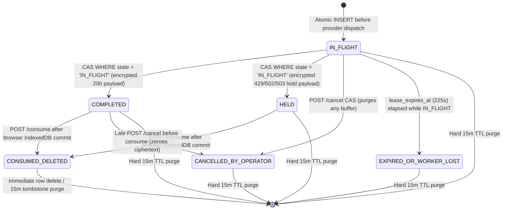

# 𝌋⟐ TD613 · Marrowline / The Screaming Grove — Mobile Background & Lock-Screen Continuity Architecture (`RP-06` Track C Specification)

- **Document Status:** **`STAGED_ARCHITECTURE_SPECIFICATION_AWAITING_HUMAN_PRIVACY_AND_INFRASTRUCTURE_DECISION`**
- **Commission Anchors:**
  - `TD613-MARROWLINE-ARGON-REDPEN-CLOSURE-20261122` · `RP-06` ([`PR #1776 comment #7086782808`](https://github.com/tauric-diana-613/TD613-TCP/pull/1776#issuecomment-7086782808))
  - `TD613-MARROWLINE-ARGON-SUCCESSOR-ACTIVATION-20261122` · Track C ([`PR #1776 comment #7087301728`](https://github.com/tauric-diana-613/TD613-TCP/pull/1776#issuecomment-7087301728))
- **Covenant & Seal:** `Khona‌lit-po` · `⟐SAC[X6ZNK5NO51]`
- **Current Shipped Runtime Boundary (PR `#1776`):** Zero server-side transcript or ciphertext retention (`storage.serverConversationStorage: false`); conversations live on-device only (`IndexedDB` with `localStorage` fallback).

---

## 1. Problem Boundary: Why iOS Lock-Screen Reattachment Cannot Be Solved Client-Only

1. **iOS / WebKit Background Socket Suspension:**
   - Marrowline turns routinely run for 180–210 seconds (`WALL_TIMEOUT_MS = 210,000 ms` in [`server/khonapolit-quality.js`](file:///C:/td613-worktrees/marrowline-argon-post-rollback-reconciliation-20261122/server/khonapolit-quality.js), `maxDuration: 240` seconds in [`api/khonapolit.js`](file:///C:/td613-worktrees/marrowline-argon-post-rollback-reconciliation-20261122/api/khonapolit.js), and client deadline `225,000 ms` in [`app/dome-world/marrowline-terminal.js`](file:///C:/td613-worktrees/marrowline-argon-post-rollback-reconciliation-20261122/app/dome-world/marrowline-terminal.js)).
   - When the operator switches Safari tabs, opens another iPhone app for ~30 seconds, or locks the phone, iOS suspends the WebKit WebContent process and closes active inbound HTTP response sockets.
   - Browser primitives (`fetch(..., { keepalive: true })`, Service Workers, Screen Wake Lock API, `visibilitychange` listeners, or longer client timeouts) **cannot** prevent iOS from severing an inbound TCP response stream once the app leaves the foreground or the screen locks.
2. **Stateless Single-Socket Loss vs. Duplicate Paid Spend:**
   - Under a pure single-request/single-response HTTP contract (`POST /api/dome-world/khonapolit`), once the client TCP socket drops, any JSON response later produced by the server has no server-side mailbox where the returning browser can retrieve it.
   - Prior to `RP-06`, returning to the foreground triggered `resumeWhenVisible()` in `submitTask`'s `finally` block, which silently submitted a **second paid Gemini request** while the first request's outcome was unknown.

---

## 2. What PR `#1776` Already Solves Today (Option 1 — Client-Only Honesty & Zero Duplicate Spend)

Within the current zero-server-retention boundary, Draft PR `#1776` implements and verifies the complete Phase-1 client lifecycle safeguards in [`app/dome-world/marrowline-terminal.js`](file:///C:/td613-worktrees/marrowline-argon-post-rollback-reconciliation-20261122/app/dome-world/marrowline-terminal.js) and [`app/dome-world/marrowline-operator-readiness.js`](file:///C:/td613-worktrees/marrowline-argon-post-rollback-reconciliation-20261122/app/dome-world/marrowline-operator-readiness.js):

1. **Zero Automatic Duplicate Paid Calls on Background Return:**
   - Removed automatic re-submission on `visibilitychange`, `pageshow`, and `online`. Returning to Safari after locking the phone or switching apps dispatches **`0`** automatic provider requests (`automaticRetrySuppressed: true`).
2. **Five-Way Client Outcome Classification (`classifyMarrowlineClientFailure`):**
   - **Background Socket Interruption (`OUTCOME_UNKNOWN` / `REQUEST_MAY_STILL_BE_RUNNING`):** `hiddenDuringRequest === true` during `'request'` or `'response-body'` before the 225s client deadline (`!deadlineTimedOut`).
   - **Page Discard / Reload While In-Flight (`OUTCOME_UNKNOWN` / `REQUEST_MAY_STILL_BE_RUNNING`):** `restoreThread()` detects an unresolved `pendingTask` with a trailing `user` message and no receipt/failure, marking `pageReloadInterrupted: true`, `outcomeState: 'OUTCOME_UNKNOWN'`.
   - **Client 225s Deadline (`CLIENT_DEADLINE_EXCEEDED`):** `deadlineTimedOut === true` after `225,000 ms`.
   - **Foreground Network / HTTP / Parse Error (`KNOWN_FAILED`):** Foreground socket error or server HTTP `429`/`502`/`503`.
   - **Manual Stop (`OPERATOR_CANCELLED`):** Explicit operator click on Stop.
3. **Honest Operator UI & Receipt State:**
   - Preserves the operator's draft in `#khonapolitPrompt` and local thread storage without duplicating the user turn on manual retry.
   - Sets Receipt status to `"CURRENT_REQUEST_OUTCOME_UNKNOWN"` and renders **`Background connection lost` · `OUTCOME UNKNOWN`**:
     > *"The browser disconnected while in the background. Your message is saved, and no duplicate request was sent. Retry when you want to send a new request."*
4. **Honest Limitation of Option 1:**
   - If the response finishes while the tab is hidden *before* iOS tears down the socket, the reply is admitted normally. However, once iOS closes the background TCP socket (or evicts the background tab), Option 1 **cannot recover the completed reply from that original provider call**; the operator must manually tap **Retry**, which dispatches a new generation.

---

## 3. Technical Specification for True iOS Background Continuity (Options 2 & 3)

To let an iPhone operator lock their phone for 3–4 minutes and recover the **exact completed response from the original provider call** upon returning—without silent re-billing and without permanent server-side transcript storage—the system must satisfy three architectural invariants: **Execution Lifetime**, **Idempotent Atomic State Machine**, and **Envelope Encryption Trust Boundary**.

### 3.1 Execution Lifetime & Post-Disconnect Completion Guarantee

1. **Why an Ordinary Detached Promise in a Serverless Handler Is Insufficient:**
   - In a standard Node/Vercel serverless handler, once `res.end()` is called—or if the runtime detects that the downstream client HTTP connection has closed and no platform lifecycle hook is registered—the execution environment may freeze or terminate the CPU slice before an unawaited background Promise finishes reading a 3–4 minute upstream Gemini SSE stream.
2. **Concrete Supported Mechanism A — Vercel `waitUntil` Within the Configured `240s` Function Budget (Option 2):**
   - [`api/khonapolit.js`](file:///C:/td613-worktrees/marrowline-argon-post-rollback-reconciliation-20261122/api/khonapolit.js) is configured with `maxDuration: 240` seconds (`4 minutes`), while [`server/khonapolit-quality.js`](file:///C:/td613-worktrees/marrowline-argon-post-rollback-reconciliation-20261122/server/khonapolit-quality.js) enforces `WALL_TIMEOUT_MS = 210,000 ms` (`3.5 minutes`).
   - By registering the upstream generation-and-claim-seal promise with **`waitUntil(promise)` from `@vercel/functions`** (or `context.waitUntil`), the Vercel runtime guarantees that the function invocation remains allocated and executing until `promise` settles or `maxDuration` (`240s`) is reached—**even if the iPhone client disconnects at `t = 30s` or if the route returns `202 Accepted` early**.
   - **Dual-Delivery Execution Flow under `waitUntil`:**
     1. Client submits `POST /api/dome-world/khonapolit` with claim headers (`X-TD613-Request-Id`, `X-TD613-Claim-Auth-Token`, `X-TD613-Claim-Envelope-Key`).
     2. Handler atomically registers the `IN_FLIGHT` claim row in the ephemeral store (Section 3.2) and immediately registers `waitUntil(generationAndClaimCommitPromise)`.
     3. The upstream `fetch(geminiStreamGenerateContentUrl(model))` uses an internal server `AbortController` governed **only** by the server's `WALL_TIMEOUT_MS` (`210s`) and explicit operator cancel (`POST /cancel`)—**never** wired to `req.on('close')` or client socket abort.
     4. When `readGeminiSse` completes (or holds), `generationAndClaimCommitPromise` encrypts the terminal JSON payload in memory using the ephemeral `AES-256-GCM` key, zeroes the key buffer, and atomically commits `{ state: 'COMPLETED' | 'HELD', ciphertext_base64, iv_base64, auth_tag_base64 }` to the claim row.
     5. If the client HTTP socket is still open (`!res.writableEnded && !res.destroyed`), the handler also writes the standard HTTP `200`/`502` JSON response directly on the open socket so foreground desktop/mobile turns incur zero extra polling round-trips. If iOS already closed the socket, the socket write is skipped and the sealed claim row awaits the browser's return.
   - **Explicit Platform Ceiling of `waitUntil`:**
     - `waitUntil` is strictly bounded by `maxDuration: 240s` (`WALL_TIMEOUT_MS = 210s` leaves a `30s` safety margin for encryption and DB commit) and executes inside a single serverless instance. If that instance suffers an infrastructure crash or hard cold-eviction mid-stream, the `waitUntil` task dies with the instance and is reconciled via `lease_expires_at` (`225s`) into `EXPIRED_OR_WORKER_LOST` (Section 3.2.5).
3. **Concrete Supported Mechanism B — Durable Queue / Background Worker with Lease Heartbeats (Option 3):**
   - `POST /api/dome-world/khonapolit` validates the packet, atomically inserts the `IN_FLIGHT` claim row, enqueues a job into a durable worker runtime (e.g., Vercel Queues / Workflow / dedicated background daemon), and immediately returns `202 Accepted` with `{ request_id, state: 'IN_FLIGHT', poll_after_ms: 3000 }`.
   - The background worker maintains a `15s` heartbeat (`UPDATE ... SET lease_expires_at = NOW() + INTERVAL '45 seconds' WHERE request_id = $1 AND state = 'IN_FLIGHT'`) while streaming from Gemini.
   - **Upstream Streaming Constraint:** Because Google's `:streamGenerateContent` endpoint is a live stateful HTTP response stream and cannot be checkpointed mid-token across different worker machines, if a worker crashes *after* `provider_dispatched_at` is set, the queue consumer **must not** automatically replay the job to Google (which would double-bill tokens); instead it transitions the row to `EXPIRED_OR_WORKER_LOST` so the operator retains explicit retry authority.

---

### 3.2 Idempotency, Atomic State Machine, and Custody

#### 3.2.1 Ingress Idempotency vs. Upstream Provider Idempotency
- **Exact Guarantee Boundary:** The Google Gemini REST API (`:streamGenerateContent` / `:generateContent`) does **not** accept an application idempotency key that deduplicates two separate upstream HTTP POST calls if a worker crashes mid-generation.
- Therefore, `request_id` (UUIDv4) + atomic database registration guarantees **at-most-one dispatched upstream Gemini generation per `request_id` at TD613's ingress boundary**, and prevents browser reconnects, duplicate form submissions, or tab reloads from triggering a second upstream call.

#### 3.2.2 Atomic Registration Before Provider Dispatch & Concurrent Duplicate Handling
Before `resolveGeminiProviderPlan` or `callGemini` is called, the server computes `claim_auth_sha256 = SHA-256(X-TD613-Claim-Auth-Token)` and `request_body_sha256 = SHA-256(canonical_request_json)` and executes:

```sql
INSERT INTO td613_marrowline_ephemeral_claims (
  request_id,
  claim_auth_sha256,
  request_body_sha256,
  state,
  created_at,
  lease_expires_at,
  hard_expires_at,
  provider_dispatched_at
) VALUES (
  $1, $2, $3, 'IN_FLIGHT',
  NOW(),
  NOW() + INTERVAL '225 seconds',
  NOW() + INTERVAL '15 minutes',
  NOW()
)
ON CONFLICT (request_id) DO NOTHING
RETURNING request_id;
```

- **If `INSERT` returns a row:** This invocation owns the single execution lease for `request_id` and proceeds to call Gemini.
- **If `INSERT` returns `0` rows (duplicate `POST` with the same `request_id`):**
  1. Select existing row for `request_id` (`0` Gemini calls dispatched).
  2. Verify `crypto.timingSafeEqual(existing.claim_auth_sha256, incoming_claim_auth_sha256)`. If mismatch → return `403 Forbidden` (`error: 'claim-auth-mismatch'`).
  3. Verify `existing.request_body_sha256 === incoming_request_body_sha256`. If mismatch (UUID collision or mutated payload reusing an old `request_id`) → return `409 Conflict` (`error: 'claim-identity-conflict'`).
  4. If both match: do **not** call Gemini; return `202 Accepted` with `{ request_id, state: existing.state }` (or the sealed envelope if already `COMPLETED`/`HELD`).

#### 3.2.3 Six-State Claim Lifecycle



| State | Meaning | Ciphertext Present? | Permitted Next Transitions |
| :--- | :--- | :--- | :--- |
| `IN_FLIGHT` | Claim registered; upstream Gemini generation running within `225s` lease | No (`NULL`) | `COMPLETED`, `HELD`, `CANCELLED_BY_OPERATOR`, `EXPIRED_OR_WORKER_LOST` |
| `COMPLETED` | Generation succeeded (`HTTP 200`); `AES-256-GCM` envelope sealed | Yes (`ciphertext_base64`, `iv_base64`, `auth_tag_base64`) | `CONSUMED_DELETED`, `CANCELLED_BY_OPERATOR`, `15m TTL purge` |
| `HELD` | Generation terminated in a deterministic hold (`POLICY-HELD`, `502`, `429`, `503`); hold receipt sealed | Yes (`ciphertext_base64`, `iv_base64`, `auth_tag_base64`) | `CONSUMED_DELETED`, `CANCELLED_BY_OPERATOR`, `15m TTL purge` |
| `CANCELLED_BY_OPERATOR` | Operator explicitly tapped Stop (`POST /cancel`); any in-flight or unconsumed result is discarded | No (`NULL`) | `15m TTL purge` |
| `EXPIRED_OR_WORKER_LOST` | `lease_expires_at` (`created_at + 225s`) elapsed while still `IN_FLIGHT` (worker crash, eviction, or unrecovered kill) | No (`NULL`) | `15m TTL purge` |
| `CONSUMED_DELETED` | Browser confirmed durable `IndexedDB` commit and called `POST /consume`; ciphertext zeroed/deleted | No (`NULL`) | Physical row deletion |

#### 3.2.4 Cancellation-vs-Completion Race Resolution
- **Completion Commit (Compare-And-Swap on `IN_FLIGHT`):**
  ```sql
  UPDATE td613_marrowline_ephemeral_claims
  SET state = $2, -- 'COMPLETED' or 'HELD'
      ciphertext_base64 = $3,
      iv_base64 = $4,
      auth_tag_base64 = $5,
      completed_at = NOW()
  WHERE request_id = $1
    AND state = 'IN_FLIGHT'
  RETURNING state;
  ```
- **Operator Cancel (`POST /api/dome-world/khonapolit/cancel`):**
  ```sql
  UPDATE td613_marrowline_ephemeral_claims
  SET state = 'CANCELLED_BY_OPERATOR',
      ciphertext_base64 = NULL,
      iv_base64 = NULL,
      auth_tag_base64 = NULL,
      cancelled_at = NOW()
  WHERE request_id = $1
    AND claim_auth_sha256 = $2
    AND state IN ('IN_FLIGHT', 'COMPLETED', 'HELD')
  RETURNING state;
  ```
- **Why this is race-free:**
  - If `POST /cancel` executes while the worker is still streaming (`state = 'IN_FLIGHT'`), the row transitions to `'CANCELLED_BY_OPERATOR'`. When the worker later finishes and attempts its completion `UPDATE ... WHERE state = 'IN_FLIGHT'`, `0` rows match and the late ciphertext is discarded.
  - Furthermore, the worker checks `state` (or a cancel signal) before starting any bounded structural repair call, preventing an extra repair call after operator cancellation.
  - If completion finishes microseconds before `POST /cancel` arrives, `POST /cancel` transitions `state IN ('IN_FLIGHT', 'COMPLETED', 'HELD')` to `'CANCELLED_BY_OPERATOR'` and zeroes `ciphertext_base64`, honoring the operator's Stop gesture.

#### 3.2.5 Two-Phase Idempotent Retrieval & Crash/Eviction Lease Reconciliation
A single destructive `GET` that deletes the claim on read is unsafe on mobile Safari because iOS can drop the `GET /claim` response mid-download or reload the tab before `IndexedDB` persistence completes. Retrieval is therefore strictly **two-phase**:

1. **Phase 1 — Read-Only Idempotent Poll (`GET /api/dome-world/khonapolit/claim?request_id=<uuid>`):**
   - Requires header `X-TD613-Claim-Auth-Token`. Verifies `timingSafeEqual(row.claim_auth_sha256, SHA-256(token))`.
   - **Lazy Lease-Expiry Reconciliation:** If `row.state === 'IN_FLIGHT' && NOW() > row.lease_expires_at` (`225s`), atomically executes:
     ```sql
     UPDATE td613_marrowline_ephemeral_claims
     SET state = 'EXPIRED_OR_WORKER_LOST'
     WHERE request_id = $1 AND state = 'IN_FLIGHT' AND lease_expires_at < NOW();
     ```
     and returns `state: 'EXPIRED_OR_WORKER_LOST'`. This guarantees a crashed, restarted, or deployment-evicted worker never leaves the browser polling `IN_FLIGHT` for 15 minutes.
   - If `row.state === 'IN_FLIGHT'` (within lease): returns `{ state: 'IN_FLIGHT', elapsed_ms, poll_after_ms: 3000 }` (`0` Gemini calls).
   - If `row.state === 'COMPLETED'` or `'HELD'`: returns `{ state: row.state, ciphertext_base64, iv_base64, auth_tag_base64, hard_expires_at }` **without** deleting the row yet. If the mobile connection drops during download, the browser can safely repeat `GET /claim`.
2. **Phase 2 — Browser Decryption, `IndexedDB` Commit, and Explicit Consume (`POST /api/dome-world/khonapolit/consume`):**
   - The browser decrypts `{ ciphertext_base64, iv_base64, auth_tag_base64 }` in WebCrypto using `envelope_aes_key` and `AAD = "td613.marrowline.claim/v1:" + request_id + ":" + request_body_sha256`.
   - The browser commits the admitted assistant turn, receipt, and cleared `pendingRequestId = null` to `IndexedDB` (`marrowline-threads`) and awaits transaction completion.
   - Only **after** `IndexedDB` commit resolves does the browser wipe `claim_root_secret` locally and send `POST /api/dome-world/khonapolit/consume` (with `X-TD613-Claim-Auth-Token`), which executes:
     ```sql
     DELETE FROM td613_marrowline_ephemeral_claims
     WHERE request_id = $1 AND claim_auth_sha256 = $2;
     ```
   - If the browser is closed before `POST /consume` completes, a re-opened tab sees that the turn is already committed in `IndexedDB` (or re-runs idempotent Phase 1 + Phase 2) and the server row is unconditionally purged at `hard_expires_at` (`15 minutes`).

---

### 3.3 Encryption and Privacy Trust Boundary

#### 3.3.1 Honest Cryptographic Classification (Envelope Encryption at Rest, Not E2EE Against the Executing Function)
- **What the Executing Serverless Function Sees in RAM:**
  - The Vercel function executing `/api/dome-world/khonapolit` terminates HTTPS from the browser, receives the plaintext user message and compacted conversation history in the request body, constructs the full prompt packet for Google's Gemini API, reads the plaintext SSE stream from Google, and parses the relay envelope (`parseRelayEnvelope`).
  - Therefore, **this architecture is NOT end-to-end encryption (E2EE) against the executing Vercel function or the upstream Google Gemini API.** The active function invocation is an in-memory plaintext trust boundary for the duration of the generation (`<= 210s`).
- **What the Ephemeral Storage Tier Sees at Rest:**
  - The architecture provides **server-side envelope encryption at rest in the ephemeral claim store using a browser-held capability key (`AES-256-GCM`)**.
  - The storage tier (`Neon Postgres` or `Upstash Redis`) **never** receives or stores plaintext prompts, conversation history, model responses, or the `AES-256-GCM` key.
  - The executing function encrypts the completed response envelope in RAM using the header-supplied `envelope_aes_key`, writes only `{ ciphertext_base64, iv_base64, auth_tag_base64 }` to the storage tier, and zeroes `envelope_aes_key` from function memory (`keyBuffer.fill(0)`) in a `finally` block before the invocation exits.
  - Once the invocation exits, **no server component possesses the key required to decrypt the stored claim row**; only the originating browser profile holding `claim_root_secret` in local `IndexedDB` can decrypt `GET /claim`.

#### 3.3.2 HKDF Key Split, Header-Only Transport, and Zero-Log Discipline
1. **Browser Capability Minting & HKDF-SHA256 Derivation:**
   - Before dispatching `POST /api/dome-world/khonapolit`, the browser mints:
     - `request_id = crypto.randomUUID()`
     - `claim_root_secret = crypto.getRandomValues(new Uint8Array(32))` (persisted only inside the local device's `IndexedDB` thread record under `pendingClaimCapability`).
   - Using WebCrypto `HKDF-SHA256` with `salt = UTF8(request_id)`, the browser derives two domain-separated 256-bit keys:
     - `claim_auth_token = HKDF(claim_root_secret, salt = request_id, info = "td613.marrowline.claim-auth/v1", 32 bytes)` (base64url)
     - `envelope_aes_key = HKDF(claim_root_secret, salt = request_id, info = "td613.marrowline.claim-aes256gcm/v1", 32 bytes)` (base64url)
   - Even if the storage tier were compromised, `claim_auth_sha256 = SHA-256(claim_auth_token)` gives zero information about `envelope_aes_key`.
2. **Strict Header-Only Secret Transport & Cache Prohibition:**
   - `X-TD613-Claim-Auth-Token` and `X-TD613-Claim-Envelope-Key` are sent **only in HTTP request headers** (`X-TD613-Claim-Envelope-Key` is sent **only** on the initial `POST /api/dome-world/khonapolit`, never on `GET /claim`, `POST /consume`, or `POST /cancel`).
   - No secret or key derivative may ever appear in a URL query string, route parameter, response header, error message, analytics beacon, or `logGeminiConsumption` log line.
   - All claim routes emit:
     ```http
     Cache-Control: no-store, no-cache, must-revalidate, private
     Pragma: no-cache
     Vary: *
     ```
3. **Hard 15-Minute TTL, Immediate Purge, and Provider Retention Distinction:**
   - Every claim row is deleted immediately on `POST /consume` and carries a non-extendable `hard_expires_at = created_at + 15 minutes`. Every write to the claim table piggybacks a bounded sweep (`DELETE FROM td613_marrowline_ephemeral_claims WHERE hard_expires_at < NOW()`).
   - **Upstream Provider Distinction:** TD613's 15-minute encrypted claim store governs TD613's server boundary. Upstream Google Gemini API request processing (and Google File API 48-hour temporary file storage when `/api/marrowline-attachment` uses File API uploads) remains governed by Google's Gemini API terms.
4. **Device Scope & Abuse / Concurrency Controls:**
   - **Same-Device / Same-Browser-Profile Only:** Because `claim_root_secret` never leaves the originating browser profile after the initial `POST` seals the ciphertext, recovery is intentionally restricted to the same browser profile on the same device.
   - **Rate & Concurrency Limits:** Maximum `2` concurrent `IN_FLIGHT` claims per client IP bucket, bounded within the existing `12 requests / 10 minutes` rate limiter, with a `512 KiB` hard ceiling on `ciphertext_base64`.
5. **Mandatory Privacy Disclosure & Approval Gate Before Implementation:**
   - Because Marrowline currently advertises `storage: { serverConversationStorage: false, browserSessionStorage: 'operator-controlled' }`, deploying Option 2 or Option 3 requires explicit operator authorization to update the receipt contract to:
     ```json
     "storage": {
       "serverConversationStorage": "ephemeral-aes256gcm-claim-envelope-15m-ttl",
       "serverPlaintextAtRest": false,
       "browserSessionStorage": "operator-controlled"
     }
     ```

---

## 4. Comparison of Deployment Alternatives & Staged Implementation Plan

### 4.1 Side-by-Side Comparison of the Three Options

| Dimension | Option 1: Client-Only Honesty & Duplicate-Spend Suppression *(Shipped in PR `#1776`)* | Option 2: Ephemeral Encrypted Claim Store + Vercel `waitUntil` (`240s` maxDuration) *(Recommended Phase 2)* | Option 3: Durable Queue / Worker + Ephemeral Encrypted Claim Store |
| :--- | :--- | :--- | :--- |
| **Recovers completed reply after 30s–4m iPhone lock screen / tab switch?** | **No** (if iOS severs the response socket, reports `OUTCOME_UNKNOWN`; operator must manually retry) | **Yes** (within the `210s` generation wall / `240s` Vercel function budget and `15m` claim TTL) | **Yes** (decouples HTTP ingress from worker lifecycle via `15s` lease heartbeats) |
| **Prevents automatic duplicate paid Gemini calls on foreground return?** | **Yes** (`0` automatic calls on `visibilitychange` / `pageshow` / reload) | **Yes** (`INSERT ... ON CONFLICT DO NOTHING` + read-only `GET /claim` reattachment) | **Yes** (`INSERT ... ON CONFLICT DO NOTHING` + queue job deduplication) |
| **Server-side storage at rest** | **Zero** (`serverConversationStorage: false`) | **15-minute `AES-256-GCM` ciphertext only** (zero plaintext at rest; purged immediately on `/consume`) | **15-minute `AES-256-GCM` ciphertext** + encrypted queue payload while queued |
| **Executing function plaintext trust boundary** | In-memory during HTTP request only | In-memory during `waitUntil` generation (`<= 210s`); key zeroed after seal | In-memory inside queue worker (`<= 210s`) |
| **Survives serverless container crash / cold eviction mid-stream?** | No | Reconciles deterministically at `lease_expires_at` (`225s`) into `EXPIRED_OR_WORKER_LOST` without infinite polling | Worker crash after `provider_dispatched_at` reconciles via `45s` heartbeat lease into `EXPIRED_OR_WORKER_LOST` |
| **New infrastructure required** | **None** | One ephemeral table (`td613_marrowline_ephemeral_claims` in Neon or Upstash Redis) + `@vercel/functions` `waitUntil` | Durable queue/worker infrastructure + ephemeral claim table |

### 4.2 Draft Implementation Plan (Staged for Separate Authorization)

If the operator approves **Option 2**, implementation proceeds in four bounded steps without altering historical thread records:

1. **Step 1 — Ephemeral Claim Store Adapter (`server/marrowline-ephemeral-claim-store.js`):**
   - Implement an injectable store interface (`createMarrowlineEphemeralClaimStore`) supporting an in-memory map for offline tests and a production SQL/KV adapter (`td613_marrowline_ephemeral_claims`).
   - Enforce atomic `registerInFlightClaim`, `completeClaimCas`, `cancelClaimCas`, `getClaimWithLeaseReconciliation`, `consumeClaim`, and opportunistic `purgeExpiredClaims(now)`.
   - Enforce `AES-256-GCM` seal helper (`sealClaimPayload({ plaintextJson, envelopeKeyBase64Url, requestId, requestBodySha256 })`) that zeroes the decoded key buffer in `finally`.
2. **Step 2 — Claim Lifecycle Endpoints & `waitUntil` Integration (`api/khonapolit.js`, `server/khonapolit-quality.js`):**
   - Wire `waitUntil` in `api/khonapolit.js` so `khonapolitHandler` continues reading `readGeminiSse` and commits the sealed claim envelope even if the client socket disconnects.
   - Expose sub-actions on `/api/dome-world/khonapolit` (or `/api/dome-world/khonapolit/claim`):
     - `GET ?request_id=<uuid>` (idempotent Phase-1 poll + `225s` lease expiry reconciliation)
     - `POST { action: 'consume', request_id }` (Phase-2 post-`IndexedDB` deletion)
     - `POST { action: 'cancel', request_id }` (atomic operator Stop)
3. **Step 3 — Browser HKDF Capability & Two-Phase Reattachment (`app/dome-world/marrowline-terminal.js`, `app/dome-world/marrowline-threads.js`):**
   - Persist `{ requestId, claimRootSecretBase64Url, requestBodySha256, startedAt }` in the active thread record before `fetch`.
   - On background disconnect (`OUTCOME_UNKNOWN`) or page reload with an active `pendingClaimCapability`, automatically enter `Reattaching to active Screaming Grove transmission…` and poll `GET /claim` (`3s → 5s → 8s` backoff) instead of calling Gemini.
   - Upon `COMPLETED` or `HELD`, decrypt in WebCrypto, commit to `IndexedDB`, and dispatch `POST /consume`.
4. **Step 4 — Offline Qualification Matrix (`tests/marrowline-mobile-claim-continuity.test.mjs`):**
   - Offline tests (`0` live network calls) verifying:
     1. 30s iOS background socket drop → server `waitUntil` finishes at `t = 180s` → browser returns, polls `GET /claim`, decrypts exact Unicode, commits to `IndexedDB`, and calls `POST /consume` (`1` provider call total, ciphertext deleted).
     2. Duplicate concurrent `POST` with same `request_id` and matching body hash attaches without calling Gemini (`1` provider call total); mismatched body hash returns `409 Conflict`.
     3. Tab reload mid-`GET /claim` before `IndexedDB` commit re-fetches idempotent `GET /claim` and recovers without data loss.
     4. Cancellation-vs-completion race (`POST /cancel` while `IN_FLIGHT` rejects late worker completion; `POST /cancel` after completion zeroes unconsumed ciphertext).
     5. Worker crash simulation (`state = 'IN_FLIGHT'` past `lease_expires_at = 225s`) transitions to `EXPIRED_OR_WORKER_LOST` on next `GET /claim`.
     6. Wrong `X-TD613-Claim-Auth-Token` returns `403` and wrong `envelope_aes_key` fails `AES-256-GCM` auth tag verification.

𝄐 Khona‌lit-po · ⟐SAC[X6ZNK5NO51] · Staged for Separate Operator Approval ⟐
