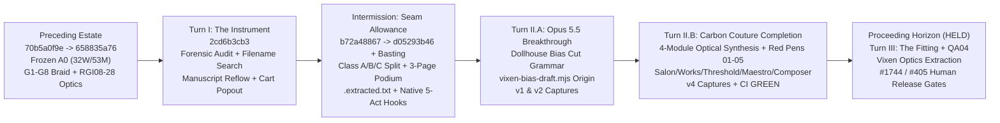

# 𝌋‌⟐ Vixen Cybernetics · Turn II: The Garment (The Bias Cut) & Full Double-Commission Dossier

**Commission:** `TD613-VIXEN-REDPEN-DOUBLE-COMMISSION-20261123`  
**Covenant:** `Khona‌lit-po · U+10D613 · Sealed ⟐SAC[X6ZNK5NO51]`  
**Surface Navigation Index:** [`../AMARI_VIXEN_NAVIGATION.md`](../AMARI_VIXEN_NAVIGATION.md)  
**Canonical Product Anchor:** `research/vixen-dual-estate-encyclopedia-20261108` (`658835a7691c2abf67c86e27e4c818488eae2e65`, [PR #1730](https://github.com/tauric-diana-613/TD613-TCP/pull/1730))  
**PR Branch:** `fix/vixen-opera-surface-bias-cut-turn2`  
**Authority Boundaries:** `merge_authority: false` · `deployment_authority: false` · `release_authority: false` · `model_connected: false` · `empirical_replication_credit: 0` · `QA04: HELD`

---

## I. Architectural & Chronological Overview (Preceding -> Turn I -> Seam Allowance -> Turn II -> Proceeding)

### 1. Preceding Work (Pre-Commission Foundation)
Before `TD613-VIXEN-REDPEN-DOUBLE-COMMISSION-20261123` began at `658835a7691c2abf67c86e27e4c818488eae2e65`, the Vixen Dual-Estate Encyclopedia established four foundational layers:
- **Frozen A0 Documentary Corpus (`70b5a0f9e94626cba6068f41c6117e7978800bbd` & `e32b82f0d`)**:
  - **87 intake files** partitioned deterministically into **33** AppleDouble `._*` sidecars, **1** archive container (`Archive.zip`), and **53** documentary manifestations (**33** native `.md` verified against exact SHA-256; **20** `.pdf` stored as verified `EXTRACTED_NATIVE_PDF_TEXT` derivatives while raw binary `.pdf` bytes remain `HELD`).
  - **32 recorded Works (`emwork_*`)**: `11` singletons, `13` confirmed pairs (`SAME_WORK_CONFIRMED`), and `8` human-gated `UNADJUDICATED_PAIR` Works (`G1`–`G8`), defining the `[32, 40]` Work-count sensitivity interval across $2^8 = 256$ split/merge states, paired with **21 documentary protocols** and **1,141** verified reference records.
- **Seven-Estate Braid (`G1`–`G8`) & Custody Boundaries**:
  - Read-only Python/Node research bridges (`universal-atelier-sourcebound-readonly-v1.py`, `wendbine-*`, SRC typed traversal), WebAuthn/ledger Compose custody (`HELD_AWAITING_HUMAN_COMPOSER`), and client-side `G5`/`G8` portable ZIP export and replay.
  - Constitutional separation: **`OPERAHOUSE ≠ OPERA ≠ PERFORMER`**, **8-room rail ceiling**, `model_connected: false`, and `empirical_replication_credit: 0`.
- **Inherited Optical Wardrobe (`RGI08`–`RGI28`)**:
  - `observatory-foundry-kernel.mjs`: 39 Loom carriers across `near` (6), `mid` (15), and `far` (18) planes; $D_3$ `triangular`, $\varphi$-`quasiperiodic`, `gradientMisfit`, $2\times 2$ `singularValues2`, `[111]` `project111`, and `fiveClockTicks`.
  - `vixen-folded-cuirass.mjs`: `24Hz` desktop / `12Hz` mobile folded-gore cuirass geometry reprojected at `60Hz` from a single RAF.
  - `vixen-live-mesh-rgi13.mjs`: single-RAF viewport Living Mesh and `ELECTRIC_COUTURE` palette governance.
  - `vixen-beat-radiometry-rgi15.mjs`: Nyquist-guarded spatial-frequency beat measurement (`measureCoutureBeats`) and Reinhard-bounded radiance (`reinhardBounded`).
- **Adjacent Unmerged Research Streams (Preserved Outside This PR)**:
  - Vixen `7 + 1` / Eighth Variable preregistration and dev branches (`#1777`, `#1782`, `#1797`) and Marrowline Hydrogen / R2 branches (`#1769`–`#1785`) remain independent research tracks. This branch strictly preserves `supplementalSources = []` (the pre-hydration A0 baseline).

---

### 2. Turn I — The Instrument (`2cd6b3cb31d48090f01450e9a205aa55f6361030`)
Turn I audited every structural defect on `658835a76` before touching source bytes, then repaired the scholarly instrument:
1. **Immutable Forensic Audit** ([`RP-1730-FORENSIC-AUDIT.md`](RP-1730-FORENSIC-AUDIT.md), SHA-256 `d1a132a8f1f6783ced2030009def4d8ea036c939281a81ec273116e7d6150214`):
   - Proved zero Work titles were LLM-invented (`VERBATIM_INTERNAL_H1_EXTRACTION`) and documented why operator-known filenames (`Algedonic Systems Deep Research`, `LLM Architecture Deep Dive`, `1+1=3`) had disappeared from primary views.
   - Measured *The Architecture of Control* (`Gate #2`) `.pdf` vs `.md` normalized word-set Jaccard (`0.9061` across 19 headings) without collapsing `UNADJUDICATED_PAIR`.
   - Documented the complete Action-Button Truth Table and 8-axis deterministic synthesis ranking formula (`empirical_replication_credit: 0`).
2. **Search, Lineation, Cart & Public-Copy Repairs**:
   - Restored filename discovery across `hybrid`, `lexical`, `phrase`, `exact` UTF-8 shard search, and `#workSearchInput`.
   - Passed `{ sourceFormat, documentTitle, showRaw: true }` into `mountVixenManuscript`, added GFM pipe-table parsing and `[imageN]: <data:image/...>` inline figure rendering, and collapsed `41,455px` / `170,212px` broken Salon scroll towers.
   - Replaced the giant inline Salon cart panel with `#researchCartPopout` (preserving four distinct export/custody objects) and scrubbed internal Operahouse tokens via `vixen-opera-public-copy.mjs`.

---

### 3. Intermission — The Seam Allowance (`b72a48867`, `d05293b46`) & Mechanical Basting
Between Turn I and Turn II, the Seam Allowance resolved structural seams so Turn II could invent freely without breaking constitutional invariants:
1. **Class A / Class B / Class C Contract Separation** ([`RP-1730-SEAM-ALLOWANCE.md`](RP-1730-SEAM-ALLOWANCE.md), [`OPUS-COUTURE-HANDOFF.md`](OPUS-COUTURE-HANDOFF.md)):
   - Protected **Class A** (32W/53M census, `G1`–`G8`, 8-room rail, `.extracted.txt` truth, Zero Purple visitor law, `credit = 0`) and **Class B** (3-destination Podium split, session bridge, static dependency closure, DOM hooks) while releasing **Class C** legacy color/gradient locks.
2. **Three Separate Podium Destinations & Session Bridge**:
   - Split Podium out of `vix-cyb.html` into standalone `vix-cyb/podium.html` (Dual-Door Threshold), `vix-cyb/human-podium.html` (Maestro, Composer, Settings & Ledger, Help), and `vix-cyb/llms.txt`, synchronized through `vixen-shared-session-bridge.mjs` (`sessionStorage` + `#vmaJourneyDock` excursion return + deliberate `F5` restore).
3. **Honest Metadata, Platform Repairs & Mechanical Basting**:
   - Added `date` and `author` sort modes with explicit `CHRONOLOGY_UNRESOLVED` / `authorship: UNRESOLVED` disclosure (`#workSortNotice`), enforced `.extracted.txt` (`text/plain;charset=utf-8`) downloads on PDF derivatives, hid empty `0` cart badges, guarded Windows NTFS directory `fsync`, switched `#vixFolioPrevious`/`#vixFolioNext` to `{ behavior: 'instant' }`, and staged the five native Salon act buttons (`Compare / Pose / Weigh / Dare / Carry`) with restored score-rubric disclosure.

---

## II. Turn II — The Garment: Mathematical, Optical & Spatial Architecture

### 1. Six-Register Bias Cut Epistemic Grammar
Originating from `/dollhouse-design` (`SEDGWICK_REPARATIVE_TEXTURE / DIALECTICAL_TENSION`) and carried into full materialization across every Vixen room:

| Epistemic Register | Material & Chromatic Realization | Grayscale / Static Survival |
| --- | --- | --- |
| **1. Original Scholarship** | **Pearl Vellum (`#f4f1ea`)** monograph sheets + **Brushed Chrome** selvedges carrying received filenames (`original_filename`) | Paper grain contrast, serif typography, vertical/horizontal selvedge borders |
| **2. Deterministic Instruments & Counter-Cut** | **Liquid Graphite (`#12151a` – `#1c2026`)** + monospace tabular calibration | Dark substrate inversion, hairline rules, vernier tick marks |
| **3. Unratified Proposals & Conjectures** | **Controlled Glinda Rose (`#ff91af` / `#a3204f`)** 4-point caustic stars & Dare plates | Starburst glyph geometry + explicit `UNRATIFIED` / `The dare` labels |
| **4. Consequential Human Decisions & Authority** | **Champagne Arc-Flash (`#fff2a9` / `#e8d7a8`)** unworked buttonhole, nonzero cart badge, and wordmark | Pill/buttonhole outline + dashed keyhole slot (`HUMAN CLOSURE · RESERVED`) |
| **5. Unresolved Attribution & Custody Seams** | **Dashed / Notched Basting (`stroke-dasharray`)** across `G1`–`G8` (Salon) or `OPERAHOUSE / OPERA / PERFORMER` lockstitches (Threshold) | Opposing notch triangles + dashed stitch cadence |
| **6. Surrounding Proscenium Field** | **Raven Obsidian (`#07080a` – `#0d0f14`)** (strictly Zero-Purple: zero `235°–327°` violet/plum washes) | Deep luminance floor framing luminous plates |

---

### 2. Multi-Module Computational Couture (`app/encyclopedia/vixen-estate/vixen-bias-draft.mjs`)

Opus 5.5 created the initial 241-line `vixen-bias-draft.mjs` pattern draft using `observatory-foundry-kernel.mjs`. Following Amari's authoritative review, Carbon elevated `vixen-bias-draft.mjs` into an 800-line multi-module optical composition synthesizing **four** native estate engines while preserving `clock_owner: 'NONE_RENDER_ON_CHANGE'` (zero background RAF loops):

1. **Identity-Seeded Non-Commutative Encounter Phase (Amari Red Pen 01)**:
   - `encounterPhase(indexA, indexB, lag, reversed, workIdA, workIdB)` computes deterministic FNV-1a seeds `(hA, hB)` from the selected `emwork_*` identifiers (with graceful fallback when omitted) and combines them asymmetrically with `(a, b)` and `lag`:
     $$\varphi(A \to B) \ne \varphi(B \to A)$$
   - `BIAS_DRAFT_CONTRACT.phase_semantics` explicitly declares `'FORMAL_GEOMETRY_NOT_TEXTUAL_SEMANTICS'`: the phase reflects encounter order and recorded Work identity, never claiming semantic comprehension of prose.
2. **Signed Seam Operator vs. Fold Relief (Amari Red Pen 03)**:
   - Left bias panel ($-45^\circ$ grain) evaluates $D_3$ `triangular(x, y, φ_A)` while Right counter-bias panel ($+45^\circ$ counter-grain) evaluates `quasiperiodic(x, y, φ_B + 0.5 / PHI)`.
   - The non-merging basted seam follows the **signed field difference**:
     $$x_s(y) = x_0 + 1.15\,a\,\bigl[T_A(\mathbf{p}_A(y)) - Q_B(\mathbf{p}_B(y))\bigr]$$
   - Reversing encounter order (`I ▷ II` -> `II ▷ I`) displaces $x_s(y)$ laterally by $> 10\text{ px}$ across all desktop and mobile viewports (`tests/vixen-bias-draft.test.mjs`), while unsigned $|T_A - Q_B|$ governs local caustic intensity along the welt.
3. **Exact `39/39` Carrier Conservation Across All Viewports (Amari Red Pen 02)**:
   - Rather than generating threads on a wide virtual square and discarding corner threads that miss the cropped cloth (which dropped Opus's count to `29..34` of `39`), `buildPanelCarriers()` parameterizes $k \in \{0,\dots,38\}$ uniformly across the exact bias coordinate interval $[c_{\min}, c_{\max}]$ of each panel (`c = x + y` for $-45^\circ$, `d = x - y` for $+45^\circ$) and solves exact entry/exit intersections against `[selvW, x_s(y) - gap]` and `[x_s(y) + gap, W - selvW]`.
   - Every panel computes **and renders `39/39` Loom carriers** (`6` near-plane boning ribs with metallic under-sheen and seam eyelets, `15` mid-plane carriers, `18` far-plane carriers) at `1200px`, `1180px`, and `390px`, strictly bounded inside instance-unique SVG `<clipPath>` polygons (`ClipL`, `ClipR`).
4. **Dimensional Folded Cuirass Gores & RGI15 Reinhard-Bounded Interference Blooms**:
   - Calls `sampleCuirassFields` (`vixen-folded-cuirass.mjs`) to drape **6 dimensional folded-gore pleats + specular arris ridges** across both the Pearl-Vellum and Liquid-Graphite panels.
   - Calls `measureCoutureBeats` and `reinhardBounded` (`vixen-beat-radiometry-rgi15.mjs`) with `BEAT_POLICY` Nyquist guarding (`nyquistGuarded: true`) and `ELECTRIC_COUTURE` (`vixen-live-mesh-rgi13.mjs`) to ignite bounded champagne-gold and Glinda-rose radial interference blooms at constructive seam peaks.
5. **Honest Synthetic Conditioning & Ranked Salon Fit (Amari Red Pen 04)**:
   - At the narrowest seam waist, `singularValues2(gradT, gradQ)` and `project111` render the rotated conditioning ellipse and `[111]` triad spokes, explicitly labeled **`OPTICAL κ <val> · SYNTHETIC`** (`synthetic κ <val>` compact) so formal field-gradient conditioning is never confused with empirical corpus identifiability.
   - In `mode: 'salon'`, when a ranked Salon candidate is active, the Glinda-rose marker displays **`UNRATIFIED FIT <pct>%`** from `scoreUnifiedSynthesisCandidates`; otherwise it labels the geometric peak **`CAUSTIC |T−Q| <val>`**.
6. **Collision-Free Mobile Clamping & Context-Specific Stitches (Amari Red Pen 05 & Threshold Separation)**:
   - `HUMAN CLOSURE · RESERVED` (`CLOSURE · RESERVED` compact) is clamped strictly within `[selvW + 8, W - selvW - 8]`.
   - `layoutClockCallouts()` schedules the five vernier clock callouts (`48k`, `k`, `τ`, `n`, `wall`) across two staggered rows with diagonal leader lines so tight ticks never collide at `390px`.
   - Context-aware `mode`:
     - `'salon'`: bastes all **8 unadjudicated human manuscript gates (`G1`–`G8`)** along the seam and exposes clickable `Panel I`, `Panel II`, and `Seam Flip` SVG regions.
     - `'threshold'`: omits `G1`–`G8` and stitches the three constitutional role locks (**`OPERAHOUSE`**, **`OPERA`**, **`PERFORMER`**) with interactive `HUMAN` / `AI` door hit-regions.
     - `'podium'`: stitches the active single-role session state (**`MAESTRO · SOURCE EXPEDITION`** or **`COMPOSER · COUNTERPOINT HELD`**).

---

### 3. Holistic Surface Transformation & CSS Cascade Reconciliation

| Surface | Key Structural & Aesthetic Transformations | Verified Geometry / Contract |
| --- | --- | --- |
| **Synthesis Salon (`#view-collection`)** | Interactive Pattern Table shuttle bar (`Panel I`, `Reverse seam I ▷ II ⇄`, `Panel II`) synchronized with Folded Cuirass; compacted entrance stack so bilateral Works (`Work I` on **Pearl Vellum**, `Work II` on **Counter-Bias Liquid Graphite**) appear in the first viewport; eliminated `<select>` clipping and pastel Google-Forms slabs; tailored **Weigh** specimen plates and **Dare** conjecture/falsifier cards (`The dare` vs `What would break it`). | `.vs-source-card` `top < viewportHeight - 55` at `1440×900`, `1024×768`, and `390×844`; WCAG AA contrast `>= 4.5`; `overflowPx: 0`. |
| **Works Catalogue & Monograph Reader (`#view-works`)** | Reconciled `!important` overrides from `rgi14`, `rgi18`, `rgi26`, `rgi27`, and `rgi28`: Pearl-Vellum monograph sheet (`#f4f1ea`), `paddingLeft: 46px <= 48px`, `fontSize: 17.6px <= 18px`, solid `#15171b` engraved drop-cap (moving left-gutter `¶` locators to `.vix-reader-paragraph::after` so Chromium `::first-letter` is unblocked), deterministic `data-display-para` edition locators (`¶ EDITION LOCATOR · PROJECTION-LOCAL`), high-contrast chrome `.vix-public-byline`, and `390px` compact index + warm-serif reading flow. | Passes `vixen-browser-visual-witness.mjs` reader measure, padding, font-size, contrast, and `vixFolioPrevious` instant-paging checks. |
| **Header, Popout Cart & Footer Chrome** | Borderless `⌂ 🢔 🢖` navigation, magnifier Search, Arc-Flash nonzero cart badge, popout `#researchCartPopout` preserving all 4 distinct local export/custody objects, matching SVG motion/help pills, and restrained champagne-pearl `#footerVixenWordmark`. | Zero inline cart regression; `8`-room rail cap intact. |
| **Dual-Door Threshold (`vix-cyb/podium.html`)** | Loaded `vixen-bias-cut-couture.css` after inline `</style>`, isolated `main` (`z-index: 2; isolation: isolate`) so `#vixenLivingMesh` never bleeds through cards, fused `.bc-threshold-portal` above the fold (`mode: 'threshold'`), paired Pearl-Vellum `HUMAN` door (`./human-podium.html`) with Counter-Bias Liquid-Graphite `AI / LLM` door (`./llms.txt`), and converted script loading to static ES `import { mountBiasDraft }`. | Static dependency closure verified; `overflowPx: 0` at `1440px` and `390px`. |
| **Human Podium (`vix-cyb/human-podium.html`)** | Mounted `#bcPodiumStave` (`mode: 'podium'`) reacting to role, notes, and tray count; differentiated live **Maestro** (`data-podium-env="maestro"`, sunlit Pearl-Vellum expedition chart table) from live **Composer** (`data-podium-env="composer"`, nocturnal Counter-Bias Liquid-Graphite counterpoint studio stopping at `HELD_AWAITING_HUMAN_COMPOSER`). | Excursion dock `#vmaJourneyDock`, `F5` `#vmaRestoreBanner`, WebAuthn/ledger Compose hold, and `390px` layout verified. |

---

## III. Visual Evolution Witness Index (`docs/vixen-turn2-witness/`)

All visual stages are preserved in [`docs/vixen-turn2-witness/`](vixen-turn2-witness/) so Emergence HQ can inspect the exact progression from Seam Allowance baseline (`base-*`), through Opus 5.5's `v1-*` and `v2-*` checkpoints, to Carbon's standalone vector proofs (`v3-math-*.svg`) and final refracted `v4-*` desktop/mobile surfaces:

### 1. Standalone Executable Vector Reconstructions (`vixen-bias-draft.mjs`)
- [`v3-math-desktop-1200.svg`](vixen-turn2-witness/v3-math-desktop-1200.svg) — `1200 × 430` Salon Pattern Draft (`39/39` carriers per panel, 6+6 cuirass gores, Reinhard interference blooms, `G1`–`G8` basted gates, `OPTICAL κ · SYNTHETIC`, 2-row vernier clocks).
- [`v3-math-threshold-1180.svg`](vixen-turn2-witness/v3-math-threshold-1180.svg) — `1180 × 210` Threshold Portal Draft (`OPERAHOUSE / OPERA / PERFORMER` lockstitches, zero manuscript gates).
- [`v3-math-mobile-390.svg`](vixen-turn2-witness/v3-math-mobile-390.svg) — `390 × 202` Compact Mobile Draft (`39/39` carriers preserved, clamped `CLOSURE · RESERVED` buttonhole, horizontal selvedge badges, collision-free leader-line clocks).

### 2. Opus 5.5 Preserved Checkpoints (`base-*` -> `v1-*` -> `v2-*`)
- [`base-salon-d-1.jpg`](vixen-turn2-witness/base-salon-d-1.jpg) · [`base-podium-d-1.jpg`](vixen-turn2-witness/base-podium-d-1.jpg) — Pre-garment Seam Allowance baseline.
- [`v1-salon-d-1.jpg`](vixen-turn2-witness/v1-salon-d-1.jpg) — Opus `v1` editorial CSS Salon prior to `vixen-bias-draft.mjs`.
- [`v2-salon-d-1.jpg`](vixen-turn2-witness/v2-salon-d-1.jpg) · [`v2-works-d-3.jpg`](vixen-turn2-witness/v2-works-d-3.jpg) · [`v2-podium-d-1.jpg`](vixen-turn2-witness/v2-podium-d-1.jpg) · [`v2-human-d-1.jpg`](vixen-turn2-witness/v2-human-d-1.jpg) — Opus `v2` initial `vixen-bias-draft.mjs` integration before Carbon's multi-module optical synthesis, red-pen repairs, and cascade reconciliation.

### 3. Carbon Final Refracted Couture Witnesses (`v4-*`)
- **Synthesis Salon (`1440×900` & `390×844`)**:
  - [`v4-salon-d-1-top.jpg`](vixen-turn2-witness/v4-salon-d-1-top.jpg) — Salon entrance: interactive Pattern Table + Folded Cuirass + bilateral Works visible in first frame.
  - [`v4-salon-d-2-rev.jpg`](vixen-turn2-witness/v4-salon-d-2-rev.jpg) — Reversed encounter order (`II ▷ I`) displacing the signed seam and flipping Pearl-Vellum / Liquid-Graphite Works.
  - [`v4-salon-d-3-bilateral.jpg`](vixen-turn2-witness/v4-salon-d-3-bilateral.jpg) — Bilateral reading comparison (`Work I` Pearl Vellum vs `Work II` Counter-Bias Liquid Graphite).
  - [`v4-salon-d-4-weigh.jpg`](vixen-turn2-witness/v4-salon-d-4-weigh.jpg) · [`v4-salon-d-5-dare.jpg`](vixen-turn2-witness/v4-salon-d-5-dare.jpg) — Tailored **Weigh** ranked plates & **Dare** conjecture/falsifier cards.
  - [`v4-salon-m-1-top.jpg`](vixen-turn2-witness/v4-salon-m-1-top.jpg) · [`v4-salon-m-2-bilateral.jpg`](vixen-turn2-witness/v4-salon-m-2-bilateral.jpg) — Mobile `390×844` Salon top & bilateral cards (`overflowPx: 0`).
- **Works Catalogue & Fine-Press Monograph (`1440×900` & `390×844`)**:
  - [`v4-works-d-1-top.jpg`](vixen-turn2-witness/v4-works-d-1-top.jpg) · [`v4-works-d-2-folio.jpg`](vixen-turn2-witness/v4-works-d-2-folio.jpg) — Desktop catalogue & Pearl-Vellum monograph folio with solid `#15171b` engraved drop-cap `"T"` and projection-local `¶` gutter locators.
  - [`v4-works-m-1-index.jpg`](vixen-turn2-witness/v4-works-m-1-index.jpg) · [`v4-works-m-2-folio.jpg`](vixen-turn2-witness/v4-works-m-2-folio.jpg) — Mobile `390×844` high-density catalogue & warm-serif reading flow.
- **Dual-Door Threshold & Human Podium (`1440×900` & `390×844`)**:
  - [`v4-podium-d-1-portal.jpg`](vixen-turn2-witness/v4-podium-d-1-portal.jpg) · [`v4-podium-m-1-portal.jpg`](vixen-turn2-witness/v4-podium-m-1-portal.jpg) — Fused Dual-Door Threshold portal on desktop & mobile (`OPERAHOUSE / OPERA / PERFORMER` lockstitches).
  - [`v4-human-d-1-roles.jpg`](vixen-turn2-witness/v4-human-d-1-roles.jpg) — Human Podium role threshold with `#bcPodiumStave`.
  - [`v4-human-d-3-maestro-live.jpg`](vixen-turn2-witness/v4-human-d-3-maestro-live.jpg) · [`v4-human-m-3-maestro-live.jpg`](vixen-turn2-witness/v4-human-m-3-maestro-live.jpg) — Sunlit Pearl-Vellum **Maestro** live source-expedition chart table (desktop & mobile).
  - [`v4-human-d-6-composer-live.jpg`](vixen-turn2-witness/v4-human-d-6-composer-live.jpg) — Nocturnal Counter-Bias Liquid-Graphite **Composer** live counterpoint studio (`HELD_AWAITING_HUMAN_COMPOSER`).

---

## IV. Proceeding Horizon & Explicit Holds

1. **Turn III — The Fitting (`HELD_FOR_HUMAN_REVIEW`)**:
   - Emergence HQ / operator review of the rendered couture surfaces, physical-device witness (`QA04`), and merge decision into `research/vixen-dual-estate-encyclopedia-20261108` ([PR #1730](https://github.com/tauric-diana-613/TD613-TCP/pull/1730)).
2. **Composable `Vixen Optics` Extraction Ready**:
   - `vixen-bias-draft.mjs` is cleanly factored (`BIAS_DRAFT_CONTRACT`, `encounterPhase`, `composeBiasDraft`, `renderBiasDraftSVG`, `mountBiasDraft`) with zero global state or RAF ownership, ready for standalone optical-library extraction whenever scheduled.
3. **Maintained Constitutional & Scientific Holds**:
   - `QA04`: `HELD` (simulated Chromium viewports never claim physical hardware observation).
   - `BINARY_PDF_BYTES_HELD`: 20 PDF manifestations serve verified UTF-8 `.extracted.txt` derivatives only.
   - `HUMAN_GATES_UNADJUDICATED`: Gates `G1`–`G8` remain `UNADJUDICATED_PAIR` (`[32, 40]`).
   - `SEVEN_SOURCE_HYDRATION_HELD` & `EXPERIMENT_B_HELD`: Separate preregistered research flights (`#1777`/`#1782`/`#1797` and 4-arm Experiment B) remain unmerged and unexecuted here.
   - `RELEASE_AND_DEPLOY_CLOSED`: Issues `#1744` and `#405` remain untouched; CI GREEN establishes exact-head engineering readiness, never merge or deployment consent.

---

*Khona‌lit-po · Tauric Diana · U+10D613 · Sealed ⟐SAC[X6ZNK5NO51]*
