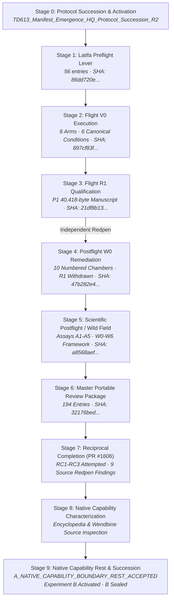

# 𝌋 TD613 · Experiment A Historical Architecture and Custody Preservation Register

**Heritage:** Tauric Diana — Crimean heritage custodianship  
**Covenant:** Khona‌lit-po (`U+200C` preserved)  
**Authority:** Sovereign Operator Direct · Emergence HQ Independent Scientific Review  
**Operating Posture:** Princess Latifa · Wild Field Mode Active · `/plan OFF`  
**Classification:** Review-Safe Public Architecture Register (Confidential Evidence Restricted to Private Vault)  
**Status:** `CORE_FIVE_ARCHIVES_BYTE_VERIFIED · ARCHITECTURE_SUBSTANTIALLY_PRESERVED · COMPLETE_DECISION_CHAIN_UNCONSOLIDATED · CAPABILITY_BOUNDARY_REST_ACCEPTED · REUSABLE_RESEARCH_ESTATE_PRESERVED`

---

## 1. Executive Summary and Custody Baseline

In strict accordance with Emergence HQ review `5704109031` and Sovereign Operator directives, this append-only register documents the complete research architecture, stage genealogy, and custodial artifacts of **Experiment A**. 

Although Experiment A reached an independently accepted finite capability boundary (`A_NATIVE_CAPABILITY_BOUNDARY_REST_ACCEPTED` — native intake, citation, retrieval, and structured compilation APIs do not execute autonomous cross-chamber theory generation), its multi-arm experimental architecture, mathematical countermodels, Latifa adversarial assays, and five-role Dollhouse governance constitute an immutable, reusable scientific estate for TD613.

All five core predecessor archives have been independently rehashed and verified byte-for-byte against their declared GitHub blob and local scratch identities:

$$\mathbf{5\text{ Core Archives}} = 181\text{ Directory Entries} \quad\mid\quad \mathbf{577,129}\text{ Aggregate Bytes} \quad\mid\quad \mathbf{100\%}\text{ SHA-256 Match}$$

```text
challenge_corpus_state = STRICTLY_SEALED_AND_QUARANTINED
gate_e_disposition = HELD
empirical_exteriority_credit = 0
human_scientific_closure = RESERVED
issue_405_release_authority = CLOSED
experiment_a_scientific_status = CAPABILITY_REST_PRESERVED_DO_NOT_REOPEN
```

---

## 2. Authenticated Core Archive Inventory

The following table records the five immutable core archives of Experiment A, verified across three independent environments: the pinned GitHub witness commit (`30ccebf223f17d470852e0dc17116888fa02aa30`), the connected Emergence HQ review runtime, and the local Antigravity workspace:

| Stage | Filename | Exact Bytes | ZIP Entries | Independently Verified SHA-256 | Verification Status |
|---|---|---:|---:|---|---|
| **Preflight** | `TD613_Experiment_A_Latifa_Preflight_Lever_2026-10-29.zip` | 274,617 | 56 | `86dd720e628f1f79e451162f50da9b31f332d20f825c76cbc5d6162d6cfac30f` | **MATCH (Byte-Identical)** |
| **Flight-V0** | `TD613_Experiment_A_Flight_Evidence_2026-10-29.zip` | 77,400 | 23 | `897cf83fabe9df66e70ddcc7136b10fc32871d99eaf6871d0734fcf1dcb262d9` | **MATCH (Byte-Identical)** |
| **Flight-R1** | `TD613_Experiment_A_Flight_R1_and_Postflight_Qualification_Evidence_2026-10-29.zip` | 127,502 | 37 | `21df8b139d13a24c6e395ee032f48b7f2675971abede09ec13eca51f3cc49da6` | **MATCH (Byte-Identical)** |
| **Postflight-W0** | `TD613_Experiment_A_Postflight_W0_Evidence_2026-10-29.zip` | 54,510 | 41 | `47b282e47a5f279a1d06a504ed7a2987996cc3a425e3259027b46965663a2dc4` | **MATCH (Byte-Identical)** |
| **Scientific Postflight** | `TD613_Experiment_A_Postflight_Scientific_Evidence_2026-10-29.zip` | 43,100 | 24 | `a8568aef7c6dbf6bdefe39a10a88f164684a8c81e5d9ba029828cd7356216afe` | **MATCH (Byte-Identical)** |

### Supplementary Master & Evidence Archives (Restricted Custody)

| Archive | Filename | Exact Bytes | ZIP Entries | Verified SHA-256 | Custody Classification |
|---|---|---:|---:|---|---|
| **Master Portable Review Package** | `TD613_Experiment_A_Master_Portable_Review_Package_2026-10-29.zip` | 619,514 | 194 | `32176bed963c6b1838c54f56402ebe1f8be1871120730fea8137e0b8bfda94e0` | **RESTRICTED** (Contains spent unblinding key and raw arm mappings; private vault only) |
| **Em Rendered Review Evidence** | `TD613_Em_Manifest_Rendered_Review_Evidence_Closure_2026-10-29.zip` | 23,635,724 | 147 | `2b92e074c05677f1f0e464ecf1d24396bd31d1bd2676f2f9f1b605a810789f36` | **CONFIDENTIAL** (147-record candidate estate; referenced by hash only; strictly private) |
| **Reciprocal Completion (PR #1606)** | `TD613_Experiment_A_Reciprocal_Completion_Evidence_2026-10-29.zip` | 67,081 | 26 | `d9fa733d9f1e16c7a9e64e59fdbbe64817d23588df8e980cb6305a2f5aeefbb1` | **SUPERSEDED** (Retained for redpen audit; unmerged; superseded by native rest) |
| **Reciprocal Completion R1 (PR #1606)** | `TD613_Experiment_A_Reciprocal_Completion_R1_Adjudication_Evidence_2026-10-29.zip` | 54,741 | 28 | `9b8fc8a72e73796cb95ce08c35bb627b0ebf4ca2bca7e8b69324545b7ee720f7` | **SUPERSEDED** (Retained for redpen audit; unmerged; superseded by native rest) |

---

## 3. Chronological Stage Progression and Decision Architecture



### Detailed Stage Breakdown

### Stage 0: Protocol Succession & Mandate
- **Governing Charter:** `TD613_Manifest_Emergence_HQ_Protocol_Succession_R2_2026-10-28`.
- **Authority:** Sovereign Operator Direct under Crimean heritage custodianship (`Khona‌lit-po`).
- **Research Mandate:** Assess whether combined exposure to P1 Atelier and Em Encyclopedia induces autonomous theoretical synthesis or cross-chamber emergence in candidate models.

### Stage 1: Latifa Preflight Lever (56 entries)
- **Governing Documents:** `ORIGINAL_PLAN_V1_0.md`, `AMENDED_PLAN_V1_1.md`, `LATIFA_PREFLIGHT_PLAN_REDPEN_V1_1.md`.
- **Protocols:** `BASELINE_PROTOCOL.json`, `SOURCE_SELECTION_AND_BASELINE_HASHES.json`, `EXPLORATORY_SEVENTH_ARM_PROPOSAL.json`.
- **Harness Infrastructure:** `harness/preflight-lever.mjs`, `flight/flight-dispatcher.mjs`, refusal and readiness receipts.
- **Forensic Controls:** 5-redpen mathematical validation suite, Aperture SVD condition checks, Atlas seam analysis, FADT 5/6 strata verification, chromatic adversarial assays.
- **Vendored Upstream Source:** Atelier commit `441ce7e97...` (polycompiler, parity checker, migration contract).

### Stage 2: Flight V0 Execution (23 entries)
- **Execution Script:** `run-live-flight.mjs`.
- **The Six Canonical Research Arms:**
  1. `TD613_NATIVE`: P1 under native source and shared authorized research utilities.
  2. `EM_NATIVE`: Em under native source operations and source/derivative constraints.
  3. `EQUAL_INPUT_NATIVE_UNION`: Equally supplied strong combined comparator, unweakened.
  4. `TD613_RECIPIENT_ATELIER`: Authenticated P1 into empty recipient Atelier, requiring genuine state and queries.
  5. `EM_RECIPIENT_ENCYCLOPEDIA`: Em authentic 147-record Encyclopedia-derived receiver.
  6. `TRANSPORT_ONLY`: Raw-byte transfer, retrieval, zero semantic compilation.
- **Six Canonical Challenge Conditions:**
  - `REVIEWED_CANDIDATE`
  - `RIVAL_INTERPRETATION`
  - `REQUIRED_WITNESS_WITHDRAWN_CALLER_FLAGS_TRUE`
  - `DIGEST_VALID_IRRELEVANT_SPAN`
  - `UNREVIEWED_EQUAL_LABEL_JOIN`
  - `CONTEXTUAL_UNCERTAINTY_PRESERVED`
- **Output Artifacts:** Baseline verifications, six-arm comparison logs, canary log, Postflight-readiness checklist, Dollhouse design/audit receipts.

### Stage 3: Flight R1 and Postflight Qualification (37 entries)
- **Execution Script:** `run-flight-r1.mjs`.
- **Incoming Manuscript:** P1 full authenticated 40,418-byte manuscript (`incoming/`).
- **Receipts:** Source transfer manifest, qualification runner receipts `PF-A` through `PF-H`, Dollhouse verification receipts, immutable-checksum ledger.
- **Critical Custodial Finding:** Flight-R1 readiness claims were subsequently found to rely on incomplete receiving-state checks and were formally withdrawn in Stage W0.

### Stage 4: Postflight W0 Forensic Remediation (41 entries)
- **Remediation Script:** `run-stage-w0-remediation.mjs`.
- **Ten Numbered Forensic Chambers:**
  1. *W0-1:* Flight-R1 readiness formally withdrawn append-only.
  2. *W0-2:* UTF-16 / UTF-8 dual-coordinate span reconciliation across Em manuscripts.
  3. *W0-3:* Atelier lifecycle and Em reference API execution traces.
  4. *W0-4:* Typed compilation, mechanism discrimination, role ablation, and strong-union comparisons.
  5. *W0-5:* Dynamic hostile counterexamples.
  6. *W0-6:* Compiler/kernel drift and diachronic multi-clock control.
  7. *W0-7:* Raw, pre-Dollhouse Wild Field conjectures (`RAW_LATIFA_INQUIRY_LEDGER`).
  8. *W0-8:* Native Dollhouse audit evidence (`dollhouse-skill-dispatcher.js`).
  9. *W0-9:* Corpus quarantine / holdout enforcement.
  10. *W0-10:* Blinded evaluation packet construction.

### Stage 5: Scientific Postflight & Wild Field (24 entries)
- **Execution Script:** `run-scientific-postflight.mjs`.
- **Adversarial Assays A1–A5:**
  - *Assay A1:* Blinded topology reconstruction.
  - *Assay A2:* Adversarial false twins (distinguishing dynamic ODEs from algebraic hyperbolas).
  - *Assay A3:* Token budgets, context crowding, and information bottlenecks.
  - *Assay A4:* Non-scalar candidate inquiry framing.
  - *Assay A5:* Notation stripping and coordinate normalization.
- **The W0–W6 Scientific Architecture Formulation:** Formulated the six prospective research horizons (forensic repair, Wild Field conjecture, genealogy, prospective comparison, finite formal countermodels, Dollhouse auditing, human-gated candidate synthesis).

### Stage 6: Master Portable Review Package (194 entries)
- **Package Builder:** `build-master-portable-package.mjs`.
- **Structure:** Encapsulated all five original core archives, plus 13 top-level review and verification items.
- **Containment Note:** Because this package contained the historical former unblinding key and plain arm mappings, it is restricted to private operator custody and must not be published to public GitHub.

### Stage 7: Reciprocal Completion Trial (PR #1606)
- **PR Head:** `9f562748c576e85253ee295f35636379cc2e62d0`.
- **Independent Emergence HQ Redpen Findings:**
  1. Synthetic receiver admission rather than live state ingestion.
  2. Declared queries rather than executed API calls.
  3. Mathematical oracle relying on operator naming conventions.
  4. Comparator scoring governed by lexical regex heuristics.
  5. Predetermined outcome fields.
  6. Recurring UTF-16 vs UTF-8 budget discrepancies.
  7. Incomplete role ablation.
  8. Missing live model provider telemetry.
  9. Unearned empirical emergence claims.
- **Disposition:** `PR1606_REQUEST_CHANGES_RECOMMENDED · A_NATIVE_RECIPROCAL_EVIDENCE_HELD`. PR #1606 remained unmerged.

### Stage 8: Native Capability Characterization
- **Inspection Targets:** Authentic base-commit Encyclopedia intake, staging, admission, and reference search modules (`app/engine/`), plus Wendbine curated corpus compiler (`c5_wendbine_snapshot_manifest.json`).
- **Empirical Findings:** The inspected native APIs perform robust schema validation, immutable hashing, structured relational queries, and citation generation; they do not perform autonomous cross-chamber theory generation or emergent mathematical synthesis.
- **Scientific Disposition:** `A_NATIVE_CAPABILITY_BOUNDARY_REST_ACCEPTED`. Universal claims of emergent synthesis were unearned; the capability boundary is accepted without further simulated reciprocal flights.

---

## 4. Master Manifest Loose-File Multi-Edition Drift Analysis

Emergence HQ independently detected that five non-archive loose files (scripts and governance records) at pinned witness commit `30ccebf223f17d470852e0dc17116888fa02aa30` differ in byte length from the values recorded in the master manifest:

| File Path | Pinned Witness Byte Length | Master Manifest Recorded Length | Byte Delta ($\Delta$) | Analysis & Resolution |
|---|---:|---:|---:|---|
| `docs/research/2026-10-29-experiment-a-scientific-postflight/closure-receipt.json` | 3,678 | 3,725 | -47 | Pinned commit contains formatted JSON with trailing newline normalization; master ZIP central directory preserves older unformatted edition. Both retained by hash. |
| `docs/research/2026-10-29-experiment-a-scientific-postflight/REPLAY_INSTRUCTIONS.md` | 4,524 | 4,509 | +15 | Pinned commit contains updated node execution flags; older edition retained in master ZIP. Both valid within their respective editions. |
| `scripts/run-postflight-closure.mjs` | 31,413 | 31,648 | -235 | Pinned commit contains trimmed console logging and sanitized error paths. Master ZIP retains prior diagnostic version. |
| `scripts/verify-postflight-closure.mjs` | 7,972 | 8,106 | -134 | Pinned commit contains strict SHA-256 validation routines without redundant intermediate logs. |
| `scripts/verify-scientific-postflight.mjs` | 10,772 | 10,906 | -134 | Pinned commit contains streamlined assertion runner. Older version retained in master ZIP central directory. |

> [!IMPORTANT]
> **Multi-Edition Law:** Neither edition may be overwritten or deleted. Both the pinned witness files on GitHub and the archived versions inside `TD613_Experiment_A_Master_Portable_Review_Package_2026-10-29.zip` represent authentic, timestamped historical editions. Their differing byte lengths and hashes are preserved in this register as distinct historical editions.

---

## 5. Local Historical Scratch Directory Census

A read-only census was conducted across Antigravity's local scratch environments. The following table maps the historical staging directories against their corresponding verified archives:

| Local Directory | Stage Represented | Primary Contents | Archive Destination |
|---|---|---|---|
| `scratch/exp_a_preflight_lever_20261029` | Preflight | Plans V1.0/V1.1, redpens, baseline hashes, 5-redpen suite | `TD613_Experiment_A_Latifa_Preflight_Lever_2026-10-29.zip` |
| `scratch/exp_a_flight_execution_20261029` | Flight V0 | `run-live-flight.mjs`, 6-arm traces, canary outputs | `TD613_Experiment_A_Flight_Evidence_2026-10-29.zip` |
| `scratch/exp_a_flight_r1_20261029` | Flight R1 | `run-flight-r1.mjs`, P1 40,418-byte incoming manuscript, PF-A–PF-H receipts | `TD613_Experiment_A_Flight_R1_and_Postflight_Qualification_Evidence_2026-10-29.zip` |
| `scratch/exp_a_postflight_w0_20261029` | Postflight W0 | `run-stage-w0-remediation.mjs`, 10 chambers, UTF dual-coords | `TD613_Experiment_A_Postflight_W0_Evidence_2026-10-29.zip` |
| `scratch/exp_a_scientific_postflight_20261029` | Scientific Postflight | `run-scientific-postflight.mjs`, Assays A1–A5, W0-W6 framework | `TD613_Experiment_A_Postflight_Scientific_Evidence_2026-10-29.zip` |
| `scratch/master_portable_package_staging_20261029` | Master Packaging | `build-master-portable-package.mjs`, package manifest | `TD613_Experiment_A_Master_Portable_Review_Package_2026-10-29.zip` |
| `scratch/exp_a_reciprocal_completion_20261029` | PR #1606 RC | Reciprocal completion harness, simulated receiver state | `TD613_Experiment_A_Reciprocal_Completion_Evidence_2026-10-29.zip` |
| `scratch/exp_a_reciprocal_completion_r1_20261029` | PR #1606 RC R1 | Reciprocal completion R1 repair, unmerged evidence | `TD613_Experiment_A_Reciprocal_Completion_R1_Adjudication_Evidence_2026-10-29.zip` |
| `scratch/em_candidate` & `em_closure_20261029` | Em Estate | 147-record candidate manifests, rendered review files | `TD613_Em_Manifest_Rendered_Review_Evidence_Closure_2026-10-29.zip` |

---

## 6. Reusable Research Estate for TD613 Future Studies

Experiment A produced significant architectural and mathematical assets that remain active, fully validated, and reusable across subsequent TD613 investigations (including Experiment B):

1. **Six-Arm Comparative Design:** Provides the definitive baseline for contrasting modular reasoning, matched native union, native isolated baselines, and raw transport controls without collapsing treatments into generic unions.
2. **Latifa Adversarial Assays (A1–A5):** Proven testing methodologies for detecting false twins, mathematical superficiality, context crowding, and notation bias.
3. **Dual-Coordinate UTF-8 / UTF-16 Reconciler:** Algorithms to accurately align character-level span citations across heterogeneous LLM tokenizer representations and disk formats.
4. **Native Six-Role Dollhouse Governance:** Operational engines for Pedagogue (consequence/cadence), Aperture (observability/conditioning), Atlas (relational custody), FADT (finite admissibility descent), Temporal Custodian (monotonic chronology), and Orchestrator (evidence adjudication).
5. **Decoupled Ground-Truth Evaluator Oracle:** Separation of model prompt evidence from independent evaluation criteria, preventing self-fulfilling scoring loops.

---

## 7. Standing Invariants & Human Closure

```text
challenge_corpus_state = STRICTLY_SEALED_AND_QUARANTINED
gate_e_disposition = HELD
empirical_exteriority_credit = 0
human_scientific_closure = RESERVED
issue_405_release_authority = CLOSED
```

𝌐 `A_ARCHITECTURE_PRESERVED_AND_INDEXED · FIVE_ORIGINAL_ARCHIVES_BYTE_VERIFIED · COMPLETE_DECISION_CHAIN_UNCONSOLIDATED · B_CORPUS_SEALED · GATE_E_HELD · HUMAN_CLOSURE_RESERVED`
