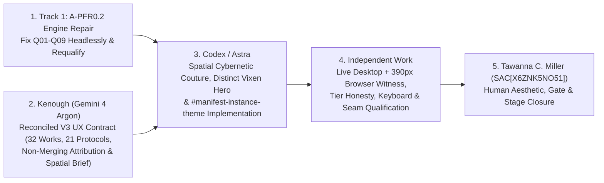

# 𝌋 Vixen Cybernetics — Source-Grounded Research UX Architecture & Reparative Design Specification (V3)

**Document Identifier:** `TD613-VIXEN-MANIFEST-UX-SPEC-20261106-V3`  
**Predecessor Revised:** `TD613-VIXEN-MANIFEST-UX-SPEC-20261106-V2` (remediating all 5 findings of Emergence HQ Independent Review `#5810153980` on Draft PR `#1718`)  
**Dollhouse Design Commission:** `COMM-VIXEN-UX-CORRECTION-20261106-V3` ([dollhouse-design-receipt-vixen-correction.json](./dollhouse-design-receipt-vixen-correction.json), schema `td613.dollhouse-design.return-receipt/v0.2`)  
**Conductor Receipt Posture:** `SUPPORTED_DESIGN_COMMISSION_PROCESS_ONLY` (`PARTIAL_ROLE_SUPPORT` on bounded `PEDAGOGUE` + `APERTURE` inputs; does **not** validate source-catalogue mappings, live DOM/CSS rendering, or scientific claims; paired here with deterministic catalogue verifier [verify-vixen-ux-spec-reconciliation.mjs](./verify-vixen-ux-spec-reconciliation.mjs))  
**Selectable Instruments:** `SEDGWICK_REPARATIVE_TEXTURE` (primary) · `CARO_INSTITUTIONAL_RECONSTRUCTION` · `DIALECTICAL_TENSION` · `PHASONIC_COUNTERPOINT`  
**Commissioning Authority:** Emergence HQ / Tawanna C. Miller (`tauric.diana.613`, `SAC[X6ZNK5NO51]`, covenant `Khona‌lit-po`)  
**Authoring Lane:** Gemini 4 Argon (Kenough) — Research UX Architecture, Reconciled Source Crosswalks, Spatial Wireframes & Governance Handoff  
**Requested Deliverables:** `1` (`OPERATOR_COMMISSION_ONLY`)  
**Epistemic & Release Posture:** `DESIGN_SPECIFICATION_RECONCILED_PENDING_UI_BUILD` · `A_PFR0_1_HELD_MATERIAL_DEFECTS` · `B_POSTPOSTFLIGHT_PROCEDURE_PINNED_UNEXECUTED` · `EMPIRICAL_CREDIT_0` · Zero Merge / Zero Release / Zero Issue `#405` Authority

---

> [!IMPORTANT]
> **Summary of V3 Source-Reconciliation Repairs (Addressing Emergence HQ Review `#5810153980`)**
> 1. **Complete 32-Work Crosswalk (Section 2.3):** Replaces V2's 8-example summary with an exhaustive, machine-verified **32-of-32 `emwork_*` mapping** (`12` C1 + `9` C2 + `2` C3 + `5` C4 + `4` C5 = `32` Works; `53` linked manifestations) reconciled directly against [identity_metadata_crosswalk.json](https://github.com/tauric-diana-613/TD613-TCP/blob/f3dd8d54ba423409317aa239d9dd6bdb6da618ef/packages/em_unified_synthesis/identity_metadata_crosswalk.json), plus explicit accounting for the `7` unpaired Batch-B PDFs (`emb_20260911_*`).
> 2. **Exact 21-Instrument Bijection (Section 2.5):** Removes all five non-registry operational names (`RECIPROCAL_RESIDUE_LEDGER`, `CROSS_ATELIER_TRANSLATION_MEMBRANE`, `MANIFESTATION_IDENTITY_GATE_PROTOCOL`, `APPLEDOUBLE_SIDECAR_QUARANTINE_RULE`, `BYTE_SPAN_GROUNDING_CONTRACT`) from the documentary instrument taxonomy and assigns **every single one of the 21 committed `instrument_id`s** in [original_methods_inventory.json](https://github.com/tauric-diana-613/TD613-TCP/blob/f3dd8d54ba423409317aa239d9dd6bdb6da618ef/packages/em_unified_synthesis/original_methods_inventory.json) to exactly one primary family (`6 + 7 + 4 + 4 = 21`).
> 3. **Non-Merging Attribution & Alias Membrane (Section 2.1):** Removes V2's unsupported claim that all works belong to a single merged author ("Em appearing as..."). Restores [ATTRIBUTION.md](https://github.com/tauric-diana-613/TD613-TCP/blob/f3dd8d54ba423409317aa239d9dd6bdb6da618ef/packages/dome_world_exact/fixtures/a15-r0/EMSTD613/ATTRIBUTION.md) and [work-index.jsonl](https://github.com/tauric-diana-613/TD613-TCP/blob/f3dd8d54ba423409317aa239d9dd6bdb6da618ef/packages/dome_world_exact/fixtures/a15-r0/EMSTD613/01-MANIFESTS/work-index.jsonl) verbatim: every stated author retains authorship of their respective work, all 32 Work routes currently carry `authorship: "UNRESOLVED"`, and stated handles (`Em`, `Vix`, `Cass`, `Cassie`, `Vixen Cybernetics`, `\author{Echo--Squirrel Research}`) remain unmerged unless explicit evidence proves identity.
> 4. **Metadata-vs-Reader Honesty (Section 2.2):** Renames `"Corpus & Works Reader"` to **`Work Catalogue & Lineage Navigator`** and enforces a strict three-tier public capability boundary separating (Tier 1) authorized viewable governance text, (Tier 2) `CATALOGUE_METADATA_ONLY` entries, and (Tier 3) `UNAVAILABLE_IN_PUBLIC_SURFACE` manifestation bodies (including `06-INSTRUMENTS` full-text gating per [EM_FILE_PROVENANCE_LEDGER.md](https://github.com/tauric-diana-613/TD613-TCP/blob/f3dd8d54ba423409317aa239d9dd6bdb6da618ef/packages/em_reciprocal_expedition/EM_FILE_PROVENANCE_LEDGER.md)).
> 5. **Narrowed Dollhouse Receipt Ceiling & Spatial Couture Grammar (Sections 1.3, 5, & 6.5):** Classifies the `/dollhouse-design` receipt strictly as bounded process execution rather than content or UI validation, adopts `UNADJUDICATED_PAIR` as the recommended default for the 8 Human Gates, specifies a distinct Vixen-native frontispiece under $\tau_{\text{ambiance}}$, and supplies a spatial cybernetic architecture grammar so `Codex / Astra` transcends conventional card-and-tab web templates.

---

## 1. Attention Topology, Reversal of the Glinda Inversion & Conductor Ceiling

### 1.1 Structural Comparison: Encyclopedia Reference vs. Inverted Candidate vs. Reconciled Vixen Manifest (`V3`)

Inspection of [index.html](https://github.com/tauric-diana-613/TD613-TCP/blob/f3dd8d54ba423409317aa239d9dd6bdb6da618ef/app/encyclopedia/index.html) alongside PR `#1715` (`9c01da8c`), PR `#1716` (`7b6b4887f`), and PR `#1717` (`d9cb81ab`) establishes that PR `#1716` inverted the Glinda direction (*"Exquisite architectural serenity concealing a formidable cybernetic nervous system"*), placing evaluation telemetry on the primary canvas while reducing scholarship to counts and synthetic placeholders. V3 restores the Pedagogue sequence ([PEDAGOGUE.md](https://github.com/tauric-diana-613/TD613-TCP/blob/f3dd8d54ba423409317aa239d9dd6bdb6da618ef/PEDAGOGUE.md)) without copying Encyclopedia's visual identity or overstating public text hydration:

| Encounter Stage | Encyclopedia Reference ([index.html](https://github.com/tauric-diana-613/TD613-TCP/blob/f3dd8d54ba423409317aa239d9dd6bdb6da618ef/app/encyclopedia/index.html)) | Inverted Candidate (`7b6b4887f` / PR `#1716`) | Reconciled Vixen Manifest Architecture (`V3` Target) |
| :--- | :--- | :--- | :--- |
| **1. Initial Visual Object (`NOTICE`)** | Full-viewport chrome anatomical sculpture sustaining optical inspection prior to explanation; **TAURIC DIANA** + small vermilion `613`. | Four compliance badges + literal design-brief prose printed as subtitle + raw string dump `CANONICAL SIGNATURE: VIXENCYBERNETICS$S_e=[x+y]=z+1$`. | Distinct **Vixen-Specific Glinda Chromepunk Frontispiece** (`PROVISIONAL_CREATIVE_ARTWORK` under $\tau_{\text{ambiance}}$—never recycling Encyclopedia's sculpture), **VIXEN CYBERNETICS** display title, and rendered ornament $S_e \equiv [x+y] = z+1$ in the structural `613` locus. |
| **2. Invitation & Membrane (`ACT`)** | `Enter the record` + navigable scholarly facets. | Immediate implementation disclaimer + horizontal pill strip clipping off the right viewport edge at `390px`. | `Enter the Atelier` threshold displaying the verbatim founding question from [ATELIER_PROFILE.json](https://github.com/tauric-diana-613/TD613-TCP/blob/f3dd8d54ba423409317aa239d9dd6bdb6da618ef/packages/dome_world_exact/fixtures/a15-r0/EMSTD613/ATELIER_PROFILE.json) and the non-merging attribution membrane from [ATTRIBUTION.md](https://github.com/tauric-diana-613/TD613-TCP/blob/f3dd8d54ba423409317aa239d9dd6bdb6da618ef/packages/dome_world_exact/fixtures/a15-r0/EMSTD613/ATTRIBUTION.md). |
| **3. Catalogue & Lineage Navigation (`WORLD_ANSWERS`)** | Faceted Observatory, Lexicon, Crosswalks, and Evidence entries with inline status ceilings. | `87 + 53` / `94 + 53` census boxes; `"Identity Pair 1..8"` buttons; 2-string UTF-8 byte-slice bench; flat 21-row table; $x/y/z$ branding calculator. | **Work Catalogue & Lineage Navigator** (all **32 `emwork_*` routes** across 5 spatial bands, honestly badged `CATALOGUE_METADATA_ONLY` + `UNAVAILABLE_IN_PUBLIC_SURFACE` inline), **8 Human-Gated Case Planes** (`UNADJUDICATED_PAIR` default), and **21-Protocol Registry**. |
| **4. Qualification & Salvage (`NAME`)** | Inline epistemic ceilings tied to specific propositions and open questions. | Three terminal `HELD` announcement cards at page bottom with no route back to Works or protocols. | **Navigable Open Questions & Holds**: every `HELD`, `UNRESOLVED`, or `UNAVAILABLE_IN_PUBLIC_SURFACE` state links directly to its affected `emwork_*` route(s), governing `06-INSTRUMENTS` protocol ID, and salvage ceiling. |
| **5. Concealed Nervous System & Closure** | Return to Dome + provenance disclosure in quiet structural chrome. | Exposed across the entire primary canvas as evaluator proof. | **Inline Custody Micro-Badges** at each source encounter + **Concealed Cybernetic Inspector Drawer** (`Alt+I`) housing FADT $\mathbf{c}_4$ sidecar separation, `DIGEST_COMPUTED` byte-span diagnostics, Unicode guards, and unobstructed **Return to Dome / Rest**. |

### 1.2 Dromological Cadence Law
Every visitor trajectory MUST satisfy the monotonic Pedagogue partial order:

$$\text{NOTICE (Sculptural Encounter)} \prec \text{ACT (Choose Question / Cluster)} \prec \text{WORLD\_ANSWERS (Inspect Work / Gate / Protocol Metadata)} \prec \text{NAME (Read Inline Ceiling / Open Hold)}$$

Aggregate file counts (`87`, `94`, `53`, `256`) NEVER precede the historical works and questions they summarize (`NO_COUNTS_BEFORE_ACTS`).

### 1.3 Narrowed Interpretation of the Dollhouse Design Receipt (Finding 5 Remediation)
The companion receipt [dollhouse-design-receipt-vixen-correction.json](./dollhouse-design-receipt-vixen-correction.json) (`td613.dollhouse-design.return-receipt/v0.2`) reports `SUPPORTED` (`PARTIAL_ROLE_SUPPORT`, `Exit Code: 0`). Its authority ceiling MUST be stated with strict precision:
- **What the receipt establishes:** The `/dollhouse-design` conductor executed according to its contract, generated internal comparative framing (`The Reverse Shelter` vs. `The Applicant's Corridor`), verified SHA-256 readability of its 9 declared reference files, confirmed `NOTICE < ACT < WORLD_ANSWERS < NAME` on the supplied 4-event `PEDAGOGUE` schedule, and confirmed local conditioning ($\kappa \approx 2.3275$) on the supplied $2 \times 2$ `APERTURE` operator.
- **What the receipt does NOT establish:** It does **not** audit whether all 32 Works or all 21 Instruments were accurately transcribed in prose, does **not** verify `ATTRIBUTION.md` non-merging compliance, does **not** execute or witness a browser DOM, and grants **zero** scientific or UI-completion validation.
- **Separate Deterministic Catalogue Verification:** Content-level bijection for all 32 Works, all 21 Instruments, and attribution/tier labels in this V3 specification is independently enforced by [verify-vixen-ux-spec-reconciliation.mjs](./verify-vixen-ux-spec-reconciliation.mjs) (`CATALOGUE_MAPPING_RECONCILED_OFFLINE`), while live UI qualification remains `PENDING` until after `A-PFR0.2`, `Codex / Astra` implementation, and `Independent Work` browser witnessing.

---

## 2. Reconciled EMSTD613 Source Grounding: Attribution, Capability Tiers, 32 Works & 21 Instruments

### 2.1 Non-Merging Authorship & Alias Custody Law (Finding 3 Remediation)
Per [ATTRIBUTION.md](https://github.com/tauric-diana-613/TD613-TCP/blob/f3dd8d54ba423409317aa239d9dd6bdb6da618ef/packages/dome_world_exact/fixtures/a15-r0/EMSTD613/ATTRIBUTION.md), [work-index.jsonl](https://github.com/tauric-diana-613/TD613-TCP/blob/f3dd8d54ba423409317aa239d9dd6bdb6da618ef/packages/dome_world_exact/fixtures/a15-r0/EMSTD613/01-MANIFESTS/work-index.jsonl), [source-files.jsonl](https://github.com/tauric-diana-613/TD613-TCP/blob/f3dd8d54ba423409317aa239d9dd6bdb6da618ef/packages/dome_world_exact/fixtures/a15-r0/EMSTD613/01-MANIFESTS/source-files.jsonl), and [em-tic-archaeological-control.jsonl](https://github.com/tauric-diana-613/TD613-TCP/blob/f3dd8d54ba423409317aa239d9dd6bdb6da618ef/packages/dome_world_exact/fixtures/a15-r0/EMSTD613/01-MANIFESTS/em-tic-archaeological-control.jsonl):
1. **Respective Authorship Retained:** *"Em / Vix / Cass / Cassie and every other stated author retain authorship of their respective works. TD613, TD613-TCP, the SRC Atelier, and the archive operator claim no authorship, ownership, institutional affiliation, endorsement, or origin over the preserved source corpus merely by storing or assaying it here."*
2. **Strict Prohibition on Alias or Civil-Identity Merging:** *"When multiple aliases appear, preserve the alias exactly as present in the source or human-supplied provenance record. Do not infer civil identity or merge authorship identities without explicit evidence."* The interface MUST NEVER state that the entire corpus is "Em's work" or present `Em`, `Vix`, `Cass`, `Cassie`, `Vixen Cybernetics`, or archaeological control strings such as `\author{Echo--Squirrel Research}` as interchangeable names of one person.
3. **Verbatim Per-Work Recorded State:** Across all 32 entries in `01-MANIFESTS/work-index.jsonl`, the committed field is `authorship: "UNRESOLVED"` (and across `01-MANIFESTS/source-files.jsonl`, `author_attribution_raw: null`). Every Work entry in Vixen Manifest MUST display `Recorded Authorship: UNRESOLVED` alongside any verbatim provenance assertion, keeping provenance assertions explicitly distinct from demonstrated textual or genealogical relations.
4. **Founding Atelier Question (Displayed Verbatim at Entry):** From [ATELIER_PROFILE.json](https://github.com/tauric-diana-613/TD613-TCP/blob/f3dd8d54ba423409317aa239d9dd6bdb6da618ef/packages/dome_world_exact/fixtures/a15-r0/EMSTD613/ATELIER_PROFILE.json):  
   > *"For each Em-side work or bounded cluster, what relation, if any, can be earned relative to TD613, SRC, another Em-side work, or an external scientific witness without collapsing motif recurrence, chronology, manifestation identity, genealogy, mechanism, or empirical support?"*

### 2.2 Three-Tier Public Surface Capability Contract (Finding 4 Remediation)
Because `app/encyclopedia/vix-cyb.html` is a **source-free standalone public surface**, Vixen Manifest MUST NOT promise a "Corpus Reader" or "Work Reader" where source texts are absent. Note in particular that `is_retrievable_text: true` inside [identity_metadata_crosswalk.json](https://github.com/tauric-diana-613/TD613-TCP/blob/f3dd8d54ba423409317aa239d9dd6bdb6da618ef/packages/em_unified_synthesis/identity_metadata_crosswalk.json) records **offline repository derivative extraction** (`53` extracted texts in offline custody), **not** public HTML hydration, and per [EM_FILE_PROVENANCE_LEDGER.md](https://github.com/tauric-diana-613/TD613-TCP/blob/f3dd8d54ba423409317aa239d9dd6bdb6da618ef/packages/em_reciprocal_expedition/EM_FILE_PROVENANCE_LEDGER.md), `02-ORIGINALS/` (`89`), `03-DERIVATIVES/` (`55`), and `06-INSTRUMENTS/` (`21`) were all classified `OMITTED (Referenced via PR #1684 blobs)` in the lean source-free companion. Every UI element must therefore declare one of three honest capability tiers inline:

| Capability Tier | Exact Public Surface Scope | Permitted UI Affordances | Mandatory Inline Badge & Prohibition |
| :--- | :--- | :--- | :--- |
| **`TIER_1_AUTHORIZED_VIEWABLE_TEXT`** | Publicly cleared governance & qualification texts: `ATELIER_PROFILE.json` founding question, `ATTRIBUTION.md` membrane, `EM_UNIFIED_THEORY_SYNTHESIS_QUALIFICATION.md` 4-arm competent-null summary, and any operator-cleared protocol synopses. | Directly readable prose on the primary surface. | Badge: `AUTHORIZED_GOVERNANCE_TEXT`. Must never impersonate an original manifestation body. |
| **`TIER_2_CATALOGUE_METADATA_ONLY`** | All **32 Work entries** (`identity_metadata_crosswalk.json`), **8 Human-Gate pair sheets**, **`7` Batch-B PDF catalogue rows**, and **21 Instrument registry entries** (`original_methods_inventory.json`: ID, title, declared status, byte length, SHA-256, `is_key_synthesis_protocol`, authored analytical summary). | Search, cluster/family filtering, SHA-256/byte inspection, `UNADJUDICATED_PAIR` sensitivity study, and cross-linking to holds. | Badge: `CATALOGUE_METADATA_ONLY`. **Never** label these components `"Full-Text Reader"`, `"Work Reader"`, or `"Protocol Full-Text Viewer"` unless full Markdown hydration is separately authorized. |
| **`TIER_3_UNAVAILABLE_MANIFESTATION_BODY`** | All `02-ORIGINALS/` `.md`, `.pdf`, `Archive.zip`, and `emb_20260911_*` binaries, `03-DERIVATIVES/` extracted texts, and unhydrated `06-INSTRUMENTS/*.md` verbatim bodies when operating in strict source-free mode. | Displays exact `source_file_id`, `original_filename`, `sha256`, `byte_length`, and offline custody explanation. | Badge: `UNAVAILABLE_IN_PUBLIC_SURFACE` (visible inline on the Work/Gate card itself, not hidden solely inside the Inspector). Never substitute synthetic demo strings as stand-ins for corpus reading. |

### 2.3 Exhaustive 32-Work Source-Bound Crosswalk (Finding 1 Remediation)
Every single one of the **32 canonical Work routes** in [identity_metadata_crosswalk.json](https://github.com/tauric-diana-613/TD613-TCP/blob/f3dd8d54ba423409317aa239d9dd6bdb6da618ef/packages/em_unified_synthesis/identity_metadata_crosswalk.json) (`8` `SAME_WORK_SUPPORTED` human-gated + `13` `SAME_WORK_CONFIRMED` dual-manifestation + `11` `SINGLETON_WORK_SURFACE` = `32` Works; `16 + 26 + 11 = 53` linked manifestations) is assigned to exactly one primary thematic cluster (`C1`–`C5`). Across all 32 routes, `work-index.jsonl` records `authorship: "UNRESOLVED"`, and manifestation bodies on the source-free surface carry `TIER_2_CATALOGUE_METADATA_ONLY` + `UNAVAILABLE_IN_PUBLIC_SURFACE`:

#### Cluster C1 — Cybernetic Control, Viable Systems & Multi-Agent Hypervisors (`12` Works · `19` Manifestations)

| # | `work_id` | Declared Work Title | Identity Status & Gate | Interval | Linked Manifestations (`source_file_id` · `original_filename`) | Recorded Authorship |
| :--- | :--- | :--- | :--- | :--- | :--- | :--- |
| 01 | `emwork_074ccf9ad783c9c9047d73a8` | *Comprehensive Guide to Deploying Hermes AI via Ollama on macOS and Virtual Linux Environments* | `SAME_WORK_SUPPORTED` (**Gate #1**) | `[1, 2]` | `emsrc_f9d7bff007dd9547d42db2c1` (`Hermes (Ollama) Terminal User Guide.md`); `emsrc_a3675ad3117d3d35cb099ceb` (`Hermes (Ollama) Terminal User Guide.pdf`) | `UNRESOLVED` |
| 02 | `emwork_085223e721130117f5510975` | *The Architecture of Control: A Cybernetic Synthesis of Biological Homeostasis, Organizational Viability, and Agentic AI Resilience* | `SAME_WORK_SUPPORTED` (**Gate #2**) | `[1, 2]` | `emsrc_ae5d4155056773c8a50db1b9` (`Algedonic Systems Deep Research.pdf`); `emsrc_b7e4e42924d33bdaf666a4f8` (`Algedonic Systems Deep Research.md`) | `UNRESOLVED` |
| 03 | `emwork_0d33e61fc09e51761acb87d9` | *Architectural and Algorithmic Deep Dive into Advanced Large Language Model Memory Systems* | `SINGLETON_WORK_SURFACE` | `[1, 1]` | `emsrc_1f16bbf644e7fa9b057ca122` (`Cybernetic Memory Algorithms Research.md`) | `UNRESOLVED` |
| 04 | `emwork_402a8e202524efd197192c39` | *Cybernetic Governance of Autonomous Multi-Agent AI Estates: Architectural Frameworks, Cryptographic Delegation, and Data-Plane Enforcement* | `SINGLETON_WORK_SURFACE` | `[1, 1]` | `emsrc_15cead109dfe2886a22f8320` (`Autonomous Agent Governance Research.md`) | `UNRESOLVED` |
| 05 | `emwork_48f6c55fadb2e4d6b9dc4be8` | *Architecting Viable Artificial Systems: Vector Culling, Memory Persistence, and Cybernetic Control in Long-Horizon AI* | `SINGLETON_WORK_SURFACE` | `[1, 1]` | `emsrc_31ed6fb3bdc15d3c29b8ae13` (`LLM Architecture Deep Dive.md`) | `UNRESOLVED` |
| 06 | `emwork_529ae2e9c9423c17886b137d` | *Autonomous Cybernetic Hypervisor: Architectural Evolution and Deep Research Analysis* | `SINGLETON_WORK_SURFACE` | `[1, 1]` | `emsrc_0b285152e5c5268e658c59e8` (`Cybernetic Hypervisor Architecture Research.md`) | `UNRESOLVED` |
| 07 | `emwork_6a883e491c0a1e01cd8e7776` | *The Cybernetic Synthesis: Architecting Autonomous AI through Control Theory, Memory Stratification, and Edge-Physical Integration* | `SINGLETON_WORK_SURFACE` | `[1, 1]` | `emsrc_20228928591ae11052bf2622` (`Cybernetic Multi-Agent Systems Research.md`) | `UNRESOLVED` |
| 08 | `emwork_98c122a6f1451221afc1cc5c` | *Architectural Paradigms for Resilient Multi-Agent LLM Systems: Cybernetic Coordination, Telemetry, and Contextual Resource Allocation* | `SAME_WORK_CONFIRMED` | `[1, 1]` | `emsrc_fc1c117130df363bba90b5c1` (`Chat Context Research Dive.md`); `emsrc_7b3a68bdf0d263ae74751b99` (`Chat Context Research Dive.pdf`) | `UNRESOLVED` |
| 09 | `emwork_a7490990aa7cfc48afe40dc0` | *Architectural Dynamics of Dynamic Token Allocation Fallbacks and Cybernetic Control Loops in Autonomous Machine Intelligence* | `SAME_WORK_CONFIRMED` | `[1, 1]` | `emsrc_4753469dce968cf7c48bd1fe` (`Dynamic Token Allocation Research.md`); `emsrc_536415ee2a02f2530392c78e` (`Dynamic Token Allocation Research.pdf`) | `UNRESOLVED` |
| 10 | `emwork_c79701febd7d0a53501e7b97` | *Mathematical Control Models for Multi-Agent AI Hypervisors: Vector Culling, Chaos Steering, and PID Recovery* | `SAME_WORK_CONFIRMED` | `[1, 1]` | `emsrc_b20ff4bfe278f8cf39d805f6` (`AI Hypervisor Control Mathematics.md`); `emsrc_6205df11a1e35b1a7828c7e7` (`Deep Research on AI Hypervisor Control Mathematics.md`) | `UNRESOLVED` |
| 11 | `emwork_d8cf61d54e4db92e96eec6fd` | *Cybernetic Orchestration of Local Large Language Models: An Architectural and Mathematical Analysis* | `SINGLETON_WORK_SURFACE` | `[1, 1]` | `emsrc_6c9e38d8872e3fab6ae8a0c3` (`Cybernetic LLM Orchestration Analysis.md`) | `UNRESOLVED` |
| 12 | `emwork_f0154bf9da11f273a2d6cb18` | *The Hermes Architecture: A Cybernetic Framework for System 4 Intelligence and Multi-Agent Orchestration* | `SAME_WORK_SUPPORTED` (**Gate #8**) | `[1, 2]` | `emsrc_a87fa4366209a707705beb16` (`Hermes AI Prompt Design.md`); `emsrc_0a76dce5fd8dc8ddcd2bd7f1` (`Hermes AI Prompt Design.pdf`) | `UNRESOLVED` |

#### Cluster C2 — Real-Time Audio, Mixxx Tracker Engines & Low-Latency DSP (`9` Works · `15` Manifestations)

| # | `work_id` | Declared Work Title | Identity Status & Gate | Interval | Linked Manifestations (`source_file_id` · `original_filename`) | Recorded Authorship |
| :--- | :--- | :--- | :--- | :--- | :--- | :--- |
| 13 | `emwork_4e3f81f01a95e4a7a5e69d1c` | *Design and Implementation of an Advanced Musical Key Detection Plugin for Audio Loops, Stems, and Tracks* | `SAME_WORK_CONFIRMED` | `[1, 1]` | `emsrc_63897276d473f6147166ca90` (`Audio Key Detection Plugin Design.md`); `emsrc_cb7da53c98ed3a010af186a1` (`Audio Key Detection Plugin Design (1).pdf`) | `UNRESOLVED` |
| 14 | `emwork_5b76a62b0dd1c587aee49b10` | *Architecture and Synchronization of Low-Latency Audio Systems: A Deep Dive into macOS Routing, Software Integration, and Hardware Clocking* | `SAME_WORK_CONFIRMED` | `[1, 1]` | `emsrc_8846b63345a07422139815fb` (`Audio Routing and Sync Research.md`); `emsrc_96d522b0d573766dfb0f3c0e` (`Audio Routing and Sync Research.pdf`) | `UNRESOLVED` |
| 15 | `emwork_67768e8d5148dd461eb34cac` | *High-Performance Concurrency in Real-Time Audio: Lock-Free SPSC Ring Buffers, Memory Ordering, and Microarchitectural Optimization* | `SINGLETON_WORK_SURFACE` | `[1, 1]` | `emsrc_2ddaf8197adecc8c5ba09c33` (`Lock-Free DSP Architecture Research.md`) | `UNRESOLVED` |
| 16 | `emwork_b5f602e223e39e15b6437a0c` | *DAW Engineering Blueprint & Reference Guide: Third-Order Cybernetic Architecture in Mixxx* | `SAME_WORK_CONFIRMED` | `[1, 1]` | `emsrc_fb1c9ba084467b28d6106148` (`Mixxx DAW Architecture Research.md`); `emsrc_f336eedac7c12acb372b7929` (`Mixxx DAW Architecture Research (1).pdf`) | `UNRESOLVED` |
| 17 | `emwork_c14c3c415b4c0614335a7f45` | *Advanced Cybernetic DSP Architecture: Low-Latency Tracker Engines and Phase-Coherent UI Synchronization* | `SINGLETON_WORK_SURFACE` | `[1, 1]` | `emsrc_a32017341296da30079229dc` (`Low-Latency DSP Tracker Engine.md`) | `UNRESOLVED` |
| 18 | `emwork_d9462f54ea32585c5d4f05ac` | *Advanced Mathematical Determination of Optimal Smoothing Factors for Dynamic Signal Processing* | `SAME_WORK_CONFIRMED` | `[1, 1]` | `emsrc_2adcca73b83fb64e8cf22fd9` (`Optimal Gamma Smoothing Factor.md`); `emsrc_0769dac7cdd95a5ca0577963` (`Optimal Gamma Smoothing Factor.pdf`) | `UNRESOLVED` |
| 19 | `emwork_dd9a66eba0e2dde8e29f00f6` | *Advanced Digital Signal Processing Architecture for an Ultra-Low-Latency 8-Bit Chiptune Synthesizer and Modular Effects Chain* | `SAME_WORK_CONFIRMED` | `[1, 1]` | `emsrc_8e672cb8123058c8fa47d8d9` (`Chiptune DSP Synth Architecture.md`); `emsrc_1b44cb39e440056ed325b372` (`Chiptune DSP Synth Architecture.pdf`) | `UNRESOLVED` |
| 20 | `emwork_e026dfda7f98393d8c020067` | *Architecture and Implementation of a 128-Step Hybrid Tracker Engine in Mixxx* | `SAME_WORK_CONFIRMED` | `[1, 1]` | `emsrc_cf77e65eeefe19ca69b44064` (`Mixxx Tracker Engine Architecture.md`); `emsrc_ba63df8a7bab4ca14b1d21e0` (`Mixxx Tracker Engine Architecture.pdf`) | `UNRESOLVED` |
| 21 | `emwork_f4cfab9c72c147e15fa5ebe7` | *Architectural Analysis and Formal Specification of the Mixxx Real-Time Audio Engine, Non-Blocking Memory Layout, and Lock-Free Queue Topology* | `SINGLETON_WORK_SURFACE` | `[1, 1]` | `emsrc_80724e9a6c5be3004c6385f4` (`Mixxx Engine Architecture Deep Dive.md`) | `UNRESOLVED` |

#### Cluster C3 — Capacitive E-Textile & Kinematic Drone Interfaces (`2` Works · `4` Manifestations)

| # | `work_id` | Declared Work Title | Identity Status & Gate | Interval | Linked Manifestations (`source_file_id` · `original_filename`) | Recorded Authorship |
| :--- | :--- | :--- | :--- | :--- | :--- | :--- |
| 22 | `emwork_0885af7e4851a2e81618b37a` | *System Architecture and Mathematical Modeling for a Wearable 7-Node Kinematic Drone Coordination Interface* | `SAME_WORK_SUPPORTED` (**Gate #3**) | `[1, 2]` | `emsrc_57021f0d10d938f524b738c5` (`Wearable Drone Control System Design.md`); `emsrc_a6aca36fd835bdb7157a6551` (`Wearable Drone Control System Design.pdf`) | `UNRESOLVED` |
| 23 | `emwork_6377a9e4c9fd59e427517771` | *Cyber-Physical Architecture and Theoretical Frameworks for Capacitive E-Textile Drone Interfaces* | `SAME_WORK_SUPPORTED` (**Gate #4**) | `[1, 2]` | `emsrc_d7c7ed8ff483a72d2bf48bda` (`Theremin Drone Glove Build Plan and Full Suit Roadmap.md`); `emsrc_5f9ca473b3a0f7694bca742c` (`Theremin Drone Glove Build Plan and Full Suit Roadmap.pdf`) | `UNRESOLVED` |

#### Cluster C4 — Open Seed Licensing (OSSL), Stylometric Lineage & macOS/Linux Host Environments (`5` Works · `10` Manifestations)

| # | `work_id` | Declared Work Title | Identity Status & Gate | Interval | Linked Manifestations (`source_file_id` · `original_filename`) | Recorded Authorship |
| :--- | :--- | :--- | :--- | :--- | :--- | :--- |
| 24 | `emwork_80ef3cd291f5f4fe6fdbcdbb` | *Mathematical Rigor and Cybernetic Validation of Stylometric Lineage Tracking within OSSL Ecosystems* | `SAME_WORK_CONFIRMED` | `[1, 1]` | `emsrc_1a5f7e8bd71f3b1914d9dfc0` (`OSSL Stylometric Lineage Tracking Framework.md`); `emsrc_c2a22c120e32b746513447b5` (`OSSL Stylometric Lineage Tracking Framework.pdf`) | `UNRESOLVED` |
| 25 | `emwork_834ed287303df08a7a955877` | *Comprehensive User Guide to the macOS Terminal: From Basic Operations to Advanced Shell Customization* | `SAME_WORK_SUPPORTED` (**Gate #5**) | `[1, 2]` | `emsrc_24e3ec262e064fe98ed974b8` (`Mac OS Terminal Basic Guide.md`); `emsrc_a1aa372da945a7db22e73f4c` (`Mac OS Terminal Basic Guide.pdf`) | `UNRESOLVED` |
| 26 | `emwork_85db62061b1e1bd0a4f6038e` | *Legal and Archival Framework Analysis for a Novel "Pay-It-Forward" Open Seed License for Agentic Systems and Prompt Architectures* | `SAME_WORK_SUPPORTED` (**Gate #6**) | `[1, 2]` | `emsrc_9fcc229e5404e76d30c5726f` (`Open Seed License_ Multi-Party Framework & Stylometry Integration.md`); `emsrc_9fecefb1208f278c7ba0d4d5` (`Open Seed License- Multi-Party Framework & Stylometry Integration.pdf`) | `UNRESOLVED` |
| 27 | `emwork_d536dc230d89ac9fef9fa13a` | *Architecting Linux Environments on macOS: A Comprehensive Guide to Virtualization, Emulation, and Deployment Strategy* | `SAME_WORK_SUPPORTED` (**Gate #7**) | `[1, 2]` | `emsrc_8925ddeda663016b041255dc` (`macOS Virtualization Guide for Linux Environments.md`); `emsrc_199220ad2cfb300f96ed3ab6` (`macOS Virtualization Guide for Linux Environments.pdf`) | `UNRESOLVED` |
| 28 | `emwork_de337e6b46b378a834fb3c00` | *Deep Research Initialization: OSSL-Seed Framework & Symbiotic Lineage* | `SAME_WORK_CONFIRMED` | `[1, 1]` | `emsrc_d785210930150a03fed14930` (`OSSL-Seed Framework Research.md`); `emsrc_66bc27767a635cd4b2ce3e21` (`OSSL-Seed Framework Research.pdf`) | `UNRESOLVED` |

#### Cluster C5 — Sui-Generis, Mythic-Information & High-Risk Conceptual Frontiers ("Bizarre Panel" Salvage under `ACADEMIA_SUI_GENERIS_SIEVE_V0_1`) (`4` Works · `5` Manifestations)

| # | `work_id` | Declared Work Title | Identity Status & Gate | Interval | Linked Manifestations (`source_file_id` · `original_filename`) | Recorded Authorship |
| :--- | :--- | :--- | :--- | :--- | :--- | :--- |
| 29 | `emwork_3c6593d85fd5b744f24c7a9f` | *1 + 1 = 3; how the occupants define the room, and how the room and occupants in it can define a singular occupant (Or, You Are What You Eat)* | `SINGLETON_WORK_SURFACE` | `[1, 1]` | `emsrc_c01c49eb755108563b9e58c6` (`1+1=3.md`) | `UNRESOLVED` |
| 30 | `emwork_9373eb730b45f7f5afe6b7ae` | *A Cybernetic and Information-Theoretic Framework for the Transmission of Mythic Motifs in the Eastern Mediterranean (3000–700 BCE)* | `SAME_WORK_CONFIRMED` | `[1, 1]` | `emsrc_265f3181ee73ce04b8240885` (`Cybernetic Modeling of Myth Transmission.md`); `emsrc_67937de5ebf818d8bc7c4e68` (`Cybernetic Modeling of Myth Transmission.pdf`) | `UNRESOLVED` |
| 31 | `emwork_9768cccf3741f3b03974e9cc` | *The Cognitive Singularity: A Mathematical, Physical, and Neurodynamical Investigation into the Zero-Point of Human Consciousness* | `SINGLETON_WORK_SURFACE` | `[1, 1]` | `emsrc_e76a321b3df071303fe41538` (`Consciousness Singularity Research Plan.md`) | `UNRESOLVED` |
| 32 | `emwork_f2c89864337f162e88991e28` | *Emergent Topologies and Quantum Field Mechanics: A Framework for Spacetime Engineering, Zero-Point Energy, and Traversable Wormholes* | `SAME_WORK_CONFIRMED` | `[1, 1]` | `emsrc_58fa977424385e8b9892de77` (`Quantum Topology Research Prompt Formulation.md`); `emsrc_a794c13e8e0b9bd6d7be3ca6` (`Quantum Topology Research Prompt Formulation.pdf`) | `UNRESOLVED` |

**Unpaired Prospective Batch-B Ledger (`7` Additional PDFs Outside the 32-Work Crosswalk):**  
In addition to the 32 canonical Works above (`53` manifestations from the `87`-file historical estate), [batch-b-2026-09-11-source-files-v2.jsonl](https://github.com/tauric-diana-613/TD613-TCP/blob/f3dd8d54ba423409317aa239d9dd6bdb6da618ef/packages/dome_world_exact/fixtures/a15-r0/EMSTD613/01-MANIFESTS/batch-b-2026-09-11-source-files-v2.jsonl) records **7 unpaired `PROSPECTIVE_BATCH_B` PDFs** (`emb_20260911_c56744fae0f7` *Multi-Density Topology Research Strategy (1).pdf*; `emb_20260911_7c568aaf6e78` *Audio DSP And LLM Architecture.pdf*; `emb_20260911_6c888365fa73` *Quantum Tensor Bridge Analysis.pdf*; `emb_20260911_fe1c355b4e7a` *Algedonic LLM Swarm Control.pdf*; `emb_20260911_87ee5e995742` *Swarm Architecture Prompt Research.pdf*; `emb_20260911_c90233bf09f6` *Cognitive Time And Synchronicity Research.pdf*; `emb_20260911_811766eb1387` *Semantic Error Derivatives Research.pdf*). These 7 records explain the exact difference between the `87 + 53` historical estate and the `94 + 53 = 147` Experiment A recipient census (`61` substantive originals after FADT $\mathbf{c}_4$ quarantine of `33` `._*` AppleDouble sidecars) and are listed in a separate **Prospective Batch-B Annex** (`UNAVAILABLE_IN_PUBLIC_SURFACE`, `source_clock: UNRESOLVED`) rather than silently merged into the 32 Works.

### 2.4 Eight Human-Gated Manifestation Case Files (`UNADJUDICATED_PAIR` Default)
The 8 Works marked `SAME_WORK_SUPPORTED` (`human_gate_required: true`, Gates `#1`–`#8` in Section 2.3: `emwork_074ccf9ad783c9c9047d73a8`, `emwork_085223e721130117f5510975`, `emwork_0885af7e4851a2e81618b37a`, `emwork_6377a9e4c9fd59e427517771`, `emwork_834ed287303df08a7a955877`, `emwork_85db62061b1e1bd0a4f6038e`, `emwork_d536dc230d89ac9fef9fa13a`, `emwork_f0154bf9da11f273a2d6cb18`) MUST initialize in the UI to **`UNADJUDICATED_PAIR`** (per Emergence HQ Recommended Disposition 3):
- Visitors may toggle a **reversible hypothetical sensitivity lens** (`Hypothesize Merged [1]` / `UNADJUDICATED_PAIR [1..2]` / `Hypothesize Split [2]`), explicitly badged `LOCAL_HYPOTHETICAL_STUDY_NOT_HUMAN_ADJUDICATION`.
- The accompanying sensitivity bar states `32` strictly as the **conditional all-merged baseline** alongside the unresolved interval **`[32, 40]`** across $2^8 = 256$ partitions.

### 2.5 Exact Bijective 21-Instrument Registry Taxonomy (Finding 2 Remediation)
All five misplaced non-registry names from V2 (`RECIPROCAL_RESIDUE_LEDGER`, `CROSS_ATELIER_TRANSLATION_MEMBRANE`, `MANIFESTATION_IDENTITY_GATE_PROTOCOL`, `APPLEDOUBLE_SIDECAR_QUARANTINE_RULE`, `BYTE_SPAN_GROUNDING_CONTRACT`) are **expunged from the 21-instrument taxonomy** (and quarantined in Section 2.6 below as engine/custodial duties outside `06-INSTRUMENTS`). Every single one of the **21 committed `instrument_id`s** in [original_methods_inventory.json](https://github.com/tauric-diana-613/TD613-TCP/blob/f3dd8d54ba423409317aa239d9dd6bdb6da618ef/packages/em_unified_synthesis/original_methods_inventory.json) (`standalone_executors_count: 0`) receives **one exact primary family and route** ($6 + 7 + 4 + 4 = 21$):

#### Family F1 — Claim-Ceiling, Analogy & Anti-Laundering Sieves (`6` Instruments)

| # | Exact Committed `instrument_id` | Bytes | SHA-256 Prefix | Key Synthesis? | Source-Verified Method Scope (`06-INSTRUMENTS/*.md`) |
| :--- | :--- | :--- | :--- | :--- | :--- |
| 01 | [`ACADEMIA_SUI_GENERIS_SIEVE_V0_1`](https://github.com/tauric-diana-613/TD613-TCP/blob/f3dd8d54ba423409317aa239d9dd6bdb6da618ef/packages/dome_world_exact/fixtures/a15-r0/EMSTD613/06-INSTRUMENTS/ACADEMIA_SUI_GENERIS_SIEVE_V0_1.md) | `5,411` | `1e854ebb80e0...` | `true` | Separates source-supported academic substrate from sui-generis synthesis (`A`–`H`, vector `S,O,T,C,E,H,N`) without confusing novelty with error or conventionality with truth. |
| 02 | [`BIZARRE_ANALOGY_AUTHORITY_COLLAPSE_ASSAY_V0_1`](https://github.com/tauric-diana-613/TD613-TCP/blob/f3dd8d54ba423409317aa239d9dd6bdb6da618ef/packages/dome_world_exact/fixtures/a15-r0/EMSTD613/06-INSTRUMENTS/BIZARRE_ANALOGY_AUTHORITY_COLLAPSE_ASSAY_V0_1.md) | `6,906` | `a8c46ef0a517...` | `false` | Audits where a heuristic analogy in high-risk works illegitimately acquires permission to become an asserted mechanism, identity, proof, or engineering claim. |
| 03 | [`CLAIM_CEILING_PROPAGATION_V0_1`](https://github.com/tauric-diana-613/TD613-TCP/blob/f3dd8d54ba423409317aa239d9dd6bdb6da618ef/packages/dome_world_exact/fixtures/a15-r0/EMSTD613/06-INSTRUMENTS/CLAIM_CEILING_PROPAGATION_V0_1.md) | `2,883` | `f46082c0e9c8...` | `true` | Tracks whether local qualifiers (`analogue`, `simulation`, `model`, `candidate`, `hypothesis`) survive downstream synthesis, table closure, and composition. |
| 04 | [`FORMALISM_LAUNDERED_AUTHORITY_RATCHET_V0_1`](https://github.com/tauric-diana-613/TD613-TCP/blob/f3dd8d54ba423409317aa239d9dd6bdb6da618ef/packages/dome_world_exact/fixtures/a15-r0/EMSTD613/06-INSTRUMENTS/FORMALISM_LAUNDERED_AUTHORITY_RATCHET_V0_1.md) | `4,951` | `5cb3d9add7ab...` | `false` | Detects transitions from analogy $\to$ imported formal notation $\to$ wider scope with zero added empirical witness, enforcing `CONTROLLED_DECOLLAPSE_BY_CLAIM_LEVEL`. |
| 05 | [`MOTIF_TO_MECHANISM_TRANSLATION`](https://github.com/tauric-diana-613/TD613-TCP/blob/f3dd8d54ba423409317aa239d9dd6bdb6da618ef/packages/dome_world_exact/fixtures/a15-r0/EMSTD613/06-INSTRUMENTS/MOTIF_TO_MECHANISM_TRANSLATION.md) | `664` | `c41cbe069279...` | `true` | Firewall requiring exact source spans, field-generic alternative checks, and shared entity/operator/falsifier mapping before promoting motif recurrence. |
| 06 | [`OBFUSCATION_DECOMPRESSION_PROTOCOL`](https://github.com/tauric-diana-613/TD613-TCP/blob/f3dd8d54ba423409317aa239d9dd6bdb6da618ef/packages/dome_world_exact/fixtures/a15-r0/EMSTD613/06-INSTRUMENTS/OBFUSCATION_DECOMPRESSION_PROTOCOL.md) | `1,946` | `55fe3d6ad2da...` | `true` | Treats `AUTHOR_REPORTED_OBFUSCATION` strictly as a provenance statement to test rather than automatic proof of hidden mechanism or intent. |

#### Family F2 — Authority Geometry, Path Category & Permission-Ancestry Assays (`7` Instruments)

| # | Exact Committed `instrument_id` | Bytes | SHA-256 Prefix | Key Synthesis? | Source-Verified Method Scope (`06-INSTRUMENTS/*.md`) |
| :--- | :--- | :--- | :--- | :--- | :--- |
| 07 | [`ANISOTROPIC_AUTHORITY_RECOVERABILITY_ASSAY_V0_1`](https://github.com/tauric-diana-613/TD613-TCP/blob/f3dd8d54ba423409317aa239d9dd6bdb6da618ef/packages/dome_world_exact/fixtures/a15-r0/EMSTD613/06-INSTRUMENTS/ANISOTROPIC_AUTHORITY_RECOVERABILITY_ASSAY_V0_1.md) | `10,791` | `676f7ca0dc56...` | `false` | Tests whether two layered systems with identical observation and dependency geometry can still differ in directional authority recoverability. |
| 08 | [`AUTHORITY_COMPOSITION_LAUNDERING_ASSAY_V0_1`](https://github.com/tauric-diana-613/TD613-TCP/blob/f3dd8d54ba423409317aa239d9dd6bdb6da618ef/packages/dome_world_exact/fixtures/a15-r0/EMSTD613/06-INSTRUMENTS/AUTHORITY_COMPOSITION_LAUNDERING_ASSAY_V0_1.md) | `5,140` | `227680382fe6...` | `false` | Tests whether individually valid local authority provenance edges can compose into an invalid global permission. |
| 09 | [`AUTHORITY_HYSTERESIS_ROUTE_MEMORY_ASSAY_V0_1`](https://github.com/tauric-diana-613/TD613-TCP/blob/f3dd8d54ba423409317aa239d9dd6bdb6da618ef/packages/dome_world_exact/fixtures/a15-r0/EMSTD613/06-INSTRUMENTS/AUTHORITY_HYSTERESIS_ROUTE_MEMORY_ASSAY_V0_1.md) | `8,091` | `16a770b36dbf...` | `false` | Audits whether authority restoration after failure must preserve route memory rather than resetting memorylessly. |
| 10 | [`AUTHORITY_PATH_CATEGORY_ASSAY_V0_1`](https://github.com/tauric-diana-613/TD613-TCP/blob/f3dd8d54ba423409317aa239d9dd6bdb6da618ef/packages/dome_world_exact/fixtures/a15-r0/EMSTD613/06-INSTRUMENTS/AUTHORITY_PATH_CATEGORY_ASSAY_V0_1.md) | `4,737` | `beb41e2accf7...` | `false` | Tests whether permission history requires a typed category with partial composition rather than a total order, lattice, graph, or groupoid. |
| 11 | [`AUTHORITY_PROVENANCE_GEOMETRY_ASSAY_V0_1`](https://github.com/tauric-diana-613/TD613-TCP/blob/f3dd8d54ba423409317aa239d9dd6bdb6da618ef/packages/dome_world_exact/fixtures/a15-r0/EMSTD613/06-INSTRUMENTS/AUTHORITY_PROVENANCE_GEOMETRY_ASSAY_V0_1.md) | `7,315` | `4e5b1a98bef1...` | `true` | Examines joint coupling across claim provenance, observation geometry, route memory, substrate/custody boundaries, and human closure. |
| 12 | [`CISTERN_PERMISSION_ANCESTRY_BLINDSPOT_ASSAY_V0_1`](https://github.com/tauric-diana-613/TD613-TCP/blob/f3dd8d54ba423409317aa239d9dd6bdb6da618ef/packages/dome_world_exact/fixtures/a15-r0/EMSTD613/06-INSTRUMENTS/CISTERN_PERMISSION_ANCESTRY_BLINDSPOT_ASSAY_V0_1.md) | `4,367` | `2cfee2d2be80...` | `false` | Audits permission-ancestry blindspots when consequential admission checks only local route match and immediate witness presence. |
| 13 | [`DEFICIT_INDEXED_AUTHORITY_POSET_ASSAY_V0_1`](https://github.com/tauric-diana-613/TD613-TCP/blob/f3dd8d54ba423409317aa239d9dd6bdb6da618ef/packages/dome_world_exact/fixtures/a15-r0/EMSTD613/06-INSTRUMENTS/DEFICIT_INDEXED_AUTHORITY_POSET_ASSAY_V0_1.md) | `6,046` | `d14c14526838...` | `false` | Replaces global linear "authority inversion" assumptions with a deficit-indexed partial order over authority states. |

#### Family F3 — Lineage Comparison & Mathematical Operator / Variable Custody (`4` Instruments)

| # | Exact Committed `instrument_id` | Bytes | SHA-256 Prefix | Key Synthesis? | Source-Verified Method Scope (`06-INSTRUMENTS/*.md`) |
| :--- | :--- | :--- | :--- | :--- | :--- |
| 14 | [`CONVERGENCE_DIVERGENCE_EMERGENCE_MATRIX`](https://github.com/tauric-diana-613/TD613-TCP/blob/f3dd8d54ba423409317aa239d9dd6bdb6da618ef/packages/dome_world_exact/fixtures/a15-r0/EMSTD613/06-INSTRUMENTS/CONVERGENCE_DIVERGENCE_EMERGENCE_MATRIX.md) | `1,957` | `c998e58362af...` | `true` | Compares works across nine distinct feature vectors (`F_claim` through `F_provenance`) rather than collapsing into a scalar similarity score. |
| 15 | [`DERIVATIVE_CLOCK_CUSTODY_V0_1`](https://github.com/tauric-diana-613/TD613-TCP/blob/f3dd8d54ba423409317aa239d9dd6bdb6da618ef/packages/dome_world_exact/fixtures/a15-r0/EMSTD613/06-INSTRUMENTS/DERIVATIVE_CLOCK_CUSTODY_V0_1.md) | `2,639` | `e4e974f07c61...` | `true` | Requires every derivative, finite difference, integral, delay, or convergence rate to declare the exact independent variable over which change is measured (forbidding unanchored `t`). |
| 16 | [`FORMAL_OPERATOR_CUSTODY_V0_1`](https://github.com/tauric-diana-613/TD613-TCP/blob/f3dd8d54ba423409317aa239d9dd6bdb6da618ef/packages/dome_world_exact/fixtures/a15-r0/EMSTD613/06-INSTRUMENTS/FORMAL_OPERATOR_CUSTODY_V0_1.md) | `3,877` | `04f666e451b1...` | `false` | Verifies whether a named mathematical operator remains the same typed object across Work, continuation, representation, or jurisdiction crossings. |
| 17 | [`LINEAGE_ASSAY_PROTOCOL`](https://github.com/tauric-diana-613/TD613-TCP/blob/f3dd8d54ba423409317aa239d9dd6bdb6da618ef/packages/dome_world_exact/fixtures/a15-r0/EMSTD613/06-INSTRUMENTS/LINEAGE_ASSAY_PROTOCOL.md) | `4,189` | `819e033fcf87...` | `true` | Establishes Stage 0 blind hashing and inventory discipline prior to testing relations against TD613, SRC, other Em-side works, or external witnesses. |

#### Family F4 — Normalization Controls, Control-Plane Separation & Threshold Hysteresis (`4` Instruments)

| # | Exact Committed `instrument_id` | Bytes | SHA-256 Prefix | Key Synthesis? | Source-Verified Method Scope (`06-INSTRUMENTS/*.md`) |
| :--- | :--- | :--- | :--- | :--- | :--- |
| 18 | [`APERTURE_DEFICIT_CHATTER_SCHMITT_ASSAY_V0_1`](https://github.com/tauric-diana-613/TD613-TCP/blob/f3dd8d54ba423409317aa239d9dd6bdb6da618ef/packages/dome_world_exact/fixtures/a15-r0/EMSTD613/06-INSTRUMENTS/APERTURE_DEFICIT_CHATTER_SCHMITT_ASSAY_V0_1.md) | `8,243` | `6990ab582e8a...` | `false` | Evaluates Schmitt-membrane hysteresis against boundary chatter in Aperture v3.2-alpha typed epistemic deficit classifications (pre-execution, zero Aperture release mutation). |
| 19 | [`EPISTEMIC_CONTROL_PLANE_HOSTILE_BATTERY_V0_1`](https://github.com/tauric-diana-613/TD613-TCP/blob/f3dd8d54ba423409317aa239d9dd6bdb6da618ef/packages/dome_world_exact/fixtures/a15-r0/EMSTD613/06-INSTRUMENTS/EPISTEMIC_CONTROL_PLANE_HOSTILE_BATTERY_V0_1.md) | `6,561` | `be40e78e6b37...` | `true` | Preregistered hostile battery attempting to falsify separation of `S-PLANE` (semantic), `W-PLANE` (witness/fact), and `A-PLANE` (actuator/runtime). |
| 20 | [`NORMALIZATION_INDUCED_FALSE_CONVERGENCE_ASSAY_V0_1`](https://github.com/tauric-diana-613/TD613-TCP/blob/f3dd8d54ba423409317aa239d9dd6bdb6da618ef/packages/dome_world_exact/fixtures/a15-r0/EMSTD613/06-INSTRUMENTS/NORMALIZATION_INDUCED_FALSE_CONVERGENCE_ASSAY_V0_1.md) | `6,955` | `0bf3e11d696a...` | `false` | Audits whether cross-domain canonicalization manufactures artificial recurrence by erasing native domain constraints (`M_i_native`). |
| 21 | [`SEMANTIC_CONTROL_SETPOINT_AUTHORITY_V0_1`](https://github.com/tauric-diana-613/TD613-TCP/blob/f3dd8d54ba423409317aa239d9dd6bdb6da618ef/packages/dome_world_exact/fixtures/a15-r0/EMSTD613/06-INSTRUMENTS/SEMANTIC_CONTROL_SETPOINT_AUTHORITY_V0_1.md) | `3,175` | `51a0df7ed0ee...` | `false` | Separates proven/demonstrated tracking stability around a semantic error setpoint from earned epistemic authority for the setpoint itself. |

### 2.6 Non-Registry Operational & Custodial Responsibilities (Explicitly Outside `06-INSTRUMENTS`)
To prevent registry conflation, operational engine/custody mechanisms live inside the **Concealed Cybernetic Inspector** as **TD613 Custodial Responsibilities** and MUST NEVER be counted among or formatted as `06-INSTRUMENTS` documentary protocols:
- **AppleDouble (`._*`) Packaging Quarantine:** Governed by FADT coordinate $\mathbf{c}_4$ and `corpus-inspector.mjs` (`33` `._*` sidecars separated from substantive originals).
- **Manifestation Identity Gating (`[32, 40]` / $2^8 = 256$):** Governed by `identity_metadata_crosswalk.json` and `work-index.jsonl`.
- **UTF-8 Byte-Span Grounding & Attestation Ceiling:** Governed by `vixen-cybernetics-engine.mjs` (`Q01`, `Q04`, `Q05`, `Q06` — `DIGEST_COMPUTED` vs. registry-bound `SOURCE_SPAN_INTEGRITY_VERIFIED`).
- **Competent-Null Synthesis Parity:** Governed by [competent-null-comparator.mjs](https://github.com/tauric-diana-613/TD613-TCP/blob/f3dd8d54ba423409317aa239d9dd6bdb6da618ef/packages/em_unified_synthesis/competent-null-comparator.mjs) and [EM_UNIFIED_THEORY_SYNTHESIS_QUALIFICATION.md](https://github.com/tauric-diana-613/TD613-TCP/blob/f3dd8d54ba423409317aa239d9dd6bdb6da618ef/packages/em_unified_synthesis/EM_UNIFIED_THEORY_SYNTHESIS_QUALIFICATION.md).
- **Cross-Atelier Fail-Closed Routing (`Q08`):** Governed by [em-universal-reciprocal-bridge.mjs](https://github.com/tauric-diana-613/TD613-TCP/blob/f3dd8d54ba423409317aa239d9dd6bdb6da618ef/packages/em_unified_synthesis/em-universal-reciprocal-bridge.mjs) and `vixen-cybernetics-engine.mjs`.

---

## 3. Branding Provenance, Mathematical Ornament & Unicode Custody Law

1. **Structural Ornament ($S_e \equiv [x+y] = z+1$):** Rendered cleanly as semantic `<math>` / HTML ornament ($S_e \equiv [x+y] = z+1$, zero raw `$` or `\equiv` leakage) in the structural locus where Encyclopedia places `613`.
2. **Retirement of the $x/y/z$ Branding Calculator:** Permanently removed; the authorial mark of non-additive cybernetic emergence is never converted into an arithmetic widget or claimed theorem.
3. **Archival String Custody:** Exact literal string `` `VIXENCYBERNETICS$S_e≡[x+y]=z+1$` `` is retained strictly in the **Cybernetic Inspector → Provenance Metadata** panel as a historical string record.
4. **Three-Codepoint Separation (`Q09` Guard):** `𝌋` (`U+1D30B`, `F0 9D 8C 8B`), supplementary PUA `󐘓` (`U+10D613`, `F4 8D 98 93`), and `Khona‌lit-po` interior `U+200C` (`E2 80 8C`) remain strictly distinct across code, UI labels, and tests; historical RGI-01 blob `69b6a2bd27557d25c80b7c97cf11f8b1653fd6d5` remains untouched.

---

## 4. Refractive Couture Integration, Three Clocks & Vixen-Specific Frontispiece Law

Reconciling the October 31 Mathematical Dossier (`TD613-B-PPF-REFRACTIVE-COUTURE-20261031-R1`) and November 6 Scholarly Monograph ([REFRACTIVE_COUTURE_SCHOLARLY_MONOGRAPH.md](./refractive-couture/REFRACTIVE_COUTURE_SCHOLARLY_MONOGRAPH.md), `TD613-MONOGRAPH-REFRACTIVE-COUTURE-20261106-V1`) governs Vixen Manifest's visual seam:

1. **Four-Coordinate Circuit & Orthogonal Clocks ($\tau_{\text{theory}} \perp \tau_{\text{ambiance}} \perp \tau_{\text{resynthesis}}$):**
   $$\mathcal{R}: M_0 \xrightarrow{\text{encode}} I \xrightarrow{\text{render / break}} V_t \xrightarrow{\text{audit}} Q_{t+1}$$
   By the **Atlas Presentation Seam Proof** (`RC-13`/`RC-14`, `+1,277` bytes confined strictly inside `#manifest-instance-theme`), $\tau_{\text{ambiance}}$ styling and frontispiece selection proceed orthogonally to $\tau_{\text{theory}}$ catalogue digests, while Experiment B Post-Postflight (`PP0–PP6`) remains `B_POSTPOSTFLIGHT_PROCEDURE_PINNED_UNEXECUTED`.
2. **Distinct Vixen-Specific Frontispiece (Emergence HQ Recommended Disposition 2):** Encyclopedia's `Hyperreal Chrome Star Sculpture.png` remains strictly an **architectural and historical precedent**, NOT Vixen's recycled hero image. Vixen Manifest commissions/mounts its **own distinct Vixen-specific Glinda chromepunk frontispiece** under `PROVISIONAL_CREATIVE_ARTWORK` ($\tau_{\text{ambiance}}$), subject to human aesthetic selection and carrying zero Experiment B empirical claims.
3. **Audited Mathematical Ceilings (`RC-01`–`RC-14`):** Depth nullspace $\ker(\Pi_u) = \operatorname{span}\{u\}$ (`RC-03: Rejected / Held`) forbids inferring a unique 3D polyhedron from 2D pixels; $H_3(120) \to D_{3d}(12) \to D_3(6) \to C_s(2) \to C_1(1)$ is a **multi-operator design grammar** rather than a physical subgroup chain (`RC-04`); $|C_3|/|C_6| \approx 4.704$ is central-annulus ROI-specific vs. `0.5123` full-frame (`RC-05`); $2\times 2$ ($\kappa \approx 2.3275$) and $3\times 2$ ($\kappa \approx 2.6311$) Aperture operators remain distinct (`RC-07`); universal $\dim\ker(P^\top \Sigma P) = |\Gamma_y|$ remains falsified (`0 ≠ 2`, `RC-08`), replaced by incidence bridge $J = CB$.

---

## 5. Preserved Research Observation Register (Bounded Without Promotion · `EMPIRICAL_CREDIT_0`)

| Candidate ID & Classification | Observed Evidence Base (Updated Through PR `#1718` Review) | Candidate Mechanism Hypothesis | Mandatory Counterexample / Null Control | Alternative Explanations | Prospective Blinded Assay Design |
| :--- | :--- | :--- | :--- | :--- | :--- |
| **Candidate A:** `SPECIFICATION_CAPTURE_CANDIDATE` | PR `#1716` (`7b6b4887f`) rendered acceptance checklist items (`87+53`, `[32,40]`, UTF-8 byte-slice bench, 21-row inventory, literal Glinda brief text) directly as primary visitor UI containers. | Optimizing implementation agents minimize evaluator rejection risk by converting verification gates into top-level DOM sections when experiential spatial architecture is underspecified. | [app/encyclopedia/index.html](https://github.com/tauric-diana-613/TD613-TCP/blob/f3dd8d54ba423409317aa239d9dd6bdb6da618ef/app/encyclopedia/index.html) V4–Interface 3.0, where strict custody/reference manifests remained concealed beneath an authored visual and question-led surface. | Prompt weighting bias; single-pass compression; lack of explicit wireframe separation between visitor surface and test harness. | Two-arm prompt study holding engine invariants constant while varying whether acceptance criteria are typed as `CONCEALED_HARNESS_CONTRACT` vs. untyped prose. |
| **Candidate B:** `SELF_REFERENTIAL_GOVERNANCE_FAILURE_CANDIDATE` | (1) PR `#1716` listed `MOTIF_TO_MECHANISM_TRANSLATION`, `FORMALISM_LAUNDERED_AUTHORITY_RATCHET_V0_1`, and `NORMALIZATION_INDUCED_FALSE_CONVERGENCE_ASSAY_V0_1` while turning $S_e$ into an $x/y/z$ calculator and issuing unattested `VERIFIED_GROUNDED_BYTE_SPAN` labels (`Q01`/`Q04`/`Q06`).<br/>(2) **V2 Audit Observation (PR `#1718`):** V2 carried a genuine `SUPPORTED` `/dollhouse-design` receipt while still containing 5 misplaced non-registry protocol names and compressed authorship—confirming that **valid process-execution receipts do not entail substantive content reconciliation**. | Both inert table naming and bounded process-receipt badges create **procedural halo / lexical immunity**: uninspected downstream claims inherit perceived verification from adjacent valid receipts unless each substantive mapping has its own domain-specific deterministic check. | [competent-null-comparator.mjs](https://github.com/tauric-diana-613/TD613-TCP/blob/f3dd8d54ba423409317aa239d9dd6bdb6da618ef/packages/em_unified_synthesis/competent-null-comparator.mjs) (4-arm tie against competent null) and V3's dedicated [verify-vixen-ux-spec-reconciliation.mjs](./verify-vixen-ux-spec-reconciliation.mjs) bijection check. | Routine transcription/summarization error under context compression, caught normally by independent human/peer review without requiring a new systemic law. | Measure error-survival rates across specifications paired with generic execution receipts alone vs. specifications paired with schema-specific bijective set verifiers under blinded review. |
| **Candidate C:** `REFRACTIVE_QUESTION_DISCOVERY_PROSPECTIVE` (`RC-12`) | Oct 22–28 Encyclopedia visual evolution + `PP0–PP6` protocol in [REFRACTIVE_COUTURE_SCHOLARLY_MONOGRAPH.md](./refractive-couture/REFRACTIVE_COUTURE_SCHOLARLY_MONOGRAPH.md). | Symmetry-breaking discrepancies ($V_t \neq M_0$) during visual materialization may prompt falsifiable mathematical questions ($Q_{t+1}$) beyond text-only strong-union synthesis. | **XOR Synergy Counterexample (`RC-10`, $I = -1$ bit)** and the **E-00.1 Competent-Null Tie**. | Aesthetic salience bias; post-hoc rationalization; uncontrolled differences between Encyclopedia and Vixen tasks today. | Blinded 3-arm protocol (`PP0–PP6` after all 6 entry gates pass): text-only strong union vs. unrelated raster control vs. coupled Refractive Couture loop. |

---

## 6. Spatial Wireframes, 390px Law, AIA Projections & Anti-Template Couture Brief

### 6.1 Desktop Spatial Wireframe (`>= 1280px` — Non-Template Cybernetic Atelier Topology)

```text
+--------------------------------------------------------------------------------------------------+
| [← Return to Dome]      VIXEN CYBERNETICS · EMSTD613 ATELIER       [Cybernetic Inspector (Alt+I)]|
+--------------------------------------------------------------------------------------------------+
|                                                                                                  |
|           +--------------------------------------------------------------------------+           |
|           |       VIXEN-SPECIFIC GLINDA CHROMEPUNK FRONTISPIECE (τ_ambiance)         |           |
|           |       (Distinct commissioned visual anchor · never Encyclopedia copy)    |           |
|           |       [Inline micro-caption: PROVISIONAL_CREATIVE_ARTWORK · 0 proof]     |           |
|           +--------------------------------------------------------------------------+           |
|                                                                                                  |
|                                 V I X E N   C Y B E R N E T I C S                                |
|                                      S_e ≡ [x + y] = z + 1                                       |
|                                                                                                  |
|                      [ ↓ Enter the Atelier ]       [ Attribution Membrane ]                      |
+--------------------------------------------------------------------------------------------------+
| THRESHOLD SPREAD · FOUNDING LINEAGE QUESTION & NON-MERGING ATTRIBUTION MEMBRANE                  |
| "For each Em-side work or bounded cluster, what relation, if any, can be earned relative to      |
|  TD613, SRC, another Em-side work, or an external scientific witness without collapsing motif    |
|  recurrence, chronology, manifestation identity, genealogy, mechanism, or empirical support?"    |
|  [AUTHORIZED_GOVERNANCE_TEXT] Respective stated authors retain authorship; aliases (Em / Vix /   |
|  Cass / Cassie / Echo--Squirrel Research) preserved verbatim without merging; 32 Work routes     |
|  currently record authorship = UNRESOLVED.                                                       |
+--------------------------------------------------------------------------------------------------+
| SPATIAL WAYFINDER LEDGER: [I. 32 Works] [II. 8 Human Gates] [III. 21 Protocols] [IV. Holds & Qs] |
+--------------------------------------------------------------------------------------------------+
| MOVEMENT I · WORK CATALOGUE & LINEAGE NAVIGATOR (All 32 emwork_* Routes + 7 Batch-B Annex)       |
| Surface Tier: [CATALOGUE_METADATA_ONLY] · Bodies: [UNAVAILABLE_IN_PUBLIC_SURFACE] (Inline)       |
| Spatial Signal Bands (Proportional to Corpus Topology: C1=12, C2=9, C3=2, C4=5, C5=4):           |
|                                                                                                  |
|  C1 CYBERNETIC HYPERVISORS (12) ──┬── emwork_085223... Algedonic Systems [Gate #2 · UNADJUDICATED]|
|                                   ├── emwork_529ae2... Autonomous Cybernetic Hypervisor [1 MD]   |
|                                   └── [... all 12 C1 routes inspectable in-band ...]             |
|  C2 REAL-TIME AUDIO / MIXXX (9) ──┼── emwork_b5f602... Mixxx 3rd-Order DAW [Confirmed · 2 files] |
|  C3 E-TEXTILE / DRONE KINEMATICS──┼── emwork_6377a9... Theremin Drone Glove [Gate #4]            |
|  C4 OSSL & HOST VIRTUALIZATION (5)┼── emwork_85db62... Open Seed License [Gate #6]               |
|  C5 SUI-GENERIS SALVAGE PANEL (4)─┴── emwork_3c6593... 1 + 1 = 3 [ACADEMIA_SUI_GENERIS_SIEVE]    |
|  + [Prospective Batch-B Annex: 7 unpaired emb_20260911_* PDFs · source_clock: UNRESOLVED]        |
+--------------------------------------------------------------------------------------------------+
| MOVEMENT II · EIGHT HUMAN-GATED MANIFESTATION SPLIT PLANES (Default: UNADJUDICATED_PAIR)         |
| Paired .md / .pdf strata rendered as opposing architectural folios across a central seam:        |
| +-------------------------------------------+  ||  +-------------------------------------------+ |
| | LEFT FOLIO (.md Draft Metadata)           |  ||  | RIGHT FOLIO (.pdf Typeset Metadata)       | |
| | emsrc_f9d7bf... · SHA-256 · [UNAVAILABLE] |  ||  | emsrc_a3675a... · SHA-256 · [UNAVAILABLE] | |
| +-------------------------------------------+  ||  +-------------------------------------------+ |
|   Gate #1 (emwork_074ccf9a... Hermes Ollama)Lens: [Hypothesize 1] (● UNADJUDICATED_PAIR) [Hyp 2] |
|   Sensitivity Horizon: Conditional merged baseline = 32 Works · Interval = [32, 40] (256 states) |
+--------------------------------------------------------------------------------------------------+
| MOVEMENT III · 21 DOCUMENTARY INSTRUMENTS REGISTRY (Bijective 6 + 7 + 4 + 4 = 21 · 0 Executors)  |
| S-PLANE / W-PLANE / A-PLANE Architectural Ledger ([CATALOGUE_METADATA_ONLY] in source-free mode):|
|  [F1 Sieves (6)]          [F2 Authority Geometry (7)]   [F3 Lineage/Custody (4)] [F4 Controls(4)]|
|  • ACADEMIA_SUI_GENERIS   • ANISOTROPIC_AUTHORITY...    • CONVERGENCE_MATRIX     • APERTURE_...  |
|  • BIZARRE_ANALOGY...     • AUTHORITY_COMPOSITION...    • DERIVATIVE_CLOCK...    • EPISTEMIC_... |
|  • CLAIM_CEILING...       • AUTHORITY_HYSTERESIS...     • FORMAL_OPERATOR...     • NORMALIZ...   |
|  • FORMALISM_LAUNDERED... • AUTHORITY_PATH_CATEGORY...  • LINEAGE_ASSAY_PROTOCOL • SEMANTIC_...  |
|  • MOTIF_TO_MECHANISM     • AUTHORITY_PROVENANCE...                                              |
|  • OBFUSCATION_DECOMP...  • CISTERN_PERMISSION...                                                |
|                           • DEFICIT_INDEXED_POSET...                                             |
+--------------------------------------------------------------------------------------------------+
| MOVEMENT IV · NAVIGABLE OPEN QUESTIONS, COMPETENT-NULL PARITY & SALVAGE HOLDS                    |
| • [COMPETENT_NULL_TIE] E-00.1 4-Arm Synthesis tied Competent Null → [Inspect Qualification]      |
| • [AUTHORSHIP_HOLD]    32 Work routes carry authorship = UNRESOLVED → [Inspect Attribution Law]  |
| • [HUMAN_GATES_OPEN]   8 Dual .md/.pdf Pairs at UNADJUDICATED_PAIR → [Return to Split Planes]    |
| • [PUBLIC_BOUNDARY]    Original/Derivative Bodies UNAVAILABLE_IN_PUBLIC_SURFACE → [Custody Note] |
+--------------------------------------------------------------------------------------------------+
| FOOTER · REST, RESET & RETURN                                                                    |
| [← Return to Information Dome]   [Reset Hypothetical Gate Lenses]   [Cybernetic Inspector Alt+I] |
+--------------------------------------------------------------------------------------------------+
```

### 6.2 Concealed Cybernetic Inspector Drawer (Deep Apparatus On-Demand)
While **concise custody/availability badges remain visible inline** at every Work, Gate, and Protocol encounter (`CATALOGUE_METADATA_ONLY`, `UNAVAILABLE_IN_PUBLIC_SURFACE`, `authorship: UNRESOLVED`, `UNADJUDICATED_PAIR`), deep verification apparatus resides inside the keyboard-accessible (`Alt+I` / `Escape`) Inspector Drawer:
- **Tab 1 — Estate & FADT Fiber Ledger:** Separates historical `87 + 53` (`20` PDF + `33` MD + `33` `._*` AppleDouble quarantined via FADT $\mathbf{c}_4$ + `1` `Archive.zip` = `7,938,934` B) from Experiment A recipient `94 + 53 = 147` (`61` substantive originals including `7` Batch-B PDFs), plus non-registry custodial responsibilities (Section 2.6).
- **Tab 2 — Engine Span & Digest Diagnostic Bench:** Explicitly labeled `ENGINE_DIAGNOSTIC_BENCH`; unattested inputs cap at `DIGEST_COMPUTED` (`SOURCE_DIGEST_COMPUTED_UNATTESTED`); WebCrypto absence fails closed (`HELD_CRYPTO_UNAVAILABLE`).
- **Tab 3 — Provenance Literals & Unicode Guards:** Preserves literal `` `VIXENCYBERNETICS$S_e≡[x+y]=z+1$` ``, enforces `U+1D30B` (`𝌋`) $\neq$ `U+10D613` (`󐘓`) $\neq$ `U+200C` (`Khona‌lit-po`), and reports dynamic runtime check status rather than hardcoded `PREFLIGHT_VERIFIED`.

### 6.3 Mobile Viewport Architecture (`390px` Remediation)
1. **Uncluttered Sculptural Entry:** Displays Vixen's frontispiece (`52vh`–`58vh`), **VIXEN CYBERNETICS**, centered single-line $S_e \equiv [x+y] = z+1$, and `Enter the Atelier` (`min-height: 48px`)—eliminating wrapped raw formula dumps and stacked admin pills.
2. **2×2 Spatial Wayfinder + Sticky Jump Sheet (`<= 480px`):** Replaces horizontal clipping tabs with a 2×2 grid (`32 Works`, `8 Gates`, `21 Protocols`, `Open Holds`, all targets `>= 44px × 44px`).
3. **Stacked Split-Plane Folios & Bottom-Sheet Inspector:** At `390px`, each Human Gate's Left/Right `.md`/`.pdf` folios stack across a visible horizontal seam rule with full SHA-256 truncation-safe copy/expand controls and zero horizontal scroll overflow; reduced-motion users receive instant `0ms` still couture plates.

### 6.4 Four Non-Equivalent AIA Route Projections
- **`EXPERIENTIAL` (Default Visitor Route):** Vixen Frontispiece $\to$ Founding Question & Attribution Membrane $\to$ 5 Spatial Work Bands (`32` Works) $\to$ 8 Split-Plane Gates (`UNADJUDICATED_PAIR`) $\to$ 21-Protocol Matrix $\to$ Open Holds.
- **`CUSTODIAL` (Attribution & Boundary Route):** Foregrounds `ATTRIBUTION.md` non-merging law, `authorship: UNRESOLVED` status, `7` Batch-B provenance entries, and `UNAVAILABLE_IN_PUBLIC_SURFACE` boundaries.
- **`AUDIT` (Method & Null-Control Route):** Foregrounds the 21 `06-INSTRUMENTS` metadata sheets, E-00.1 4-arm competent-null parity, `RC-01`–`RC-14` ceilings, and Inspector diagnostics.
- **`IMPLEMENTATION` (Seam & Engine Route):** Separates `#manifest-instance-theme` ($\tau_{\text{ambiance}}$) from frozen $\tau_{\text{theory}}$ JSON manifests and `A-PFR0.2` (`Q01`–`Q09`) engine invariants.

### 6.5 Spatial Cybernetic Architecture Mandate for `Codex / Astra` (Transcending Conventional Web Templates)
Addressing Emergence HQ Section VI directly: the structural wireframes in Section 6.1 define **information order, truthful labels, and responsive bounds**, NOT a mandate to style Vixen as a conventional website of rounded cards, generic search bars, and SaaS tabs. During the visual couture phase, `Codex / Astra` SHOULD translate the corpus's own cybernetic grammar into **spatial architecture**—without copying Encyclopedia's Neo-Roman/chrome-star identity:
1. **Stratified Control-Plane Horizon (Not Uniform Card Grids):** Let the `S-PLANE / W-PLANE / A-PLANE` distinction and Beer-style viable-system strata shape horizontal and vertical architectural proportion—quiet editorial expanses of high-contrast obsidian, brushed titanium/iridescent Glinda glass, and hairline coordinate rules rather than uniform boxed cards.
2. **Bilateral Seam Folios for the 8 Human Gates:** Render each `.md` / `.pdf` manifestation pair as two physical facing plates separated by a precision optical seam that visually couples or parts when the visitor shifts the hypothetical lens around `UNADJUDICATED_PAIR` (honoring `prefers-reduced-motion: reduce` with crisp still states).
3. **Proportional Signal Topology for the 32 Works:** Let the cluster densities (`12 : 9 : 2 : 5 : 4`) register visually as calibrated signal bus traces or atelier bays so the visitor perceives the estate's concentration in cybernetic hypervisors and Mixxx/DSP engines spatially before reading a single number.
4. **Architectural Restraint:** Zero terminal hacker clichés, zero neon dashboard gauges, zero floating compliance pills, and zero borrowed Encyclopedia sculpture assets.

---

## 7. Staging Order, Recommended Dispositions & Multi-Agent Handoff

### 7.1 Emergence HQ Recommended Dispositions (Recorded for Human Operator Closure `SAC[X6ZNK5NO51]`)
1. **Track 1 (`A-PFR0.2` Engine Repairs) Before Production UI Integration:** Execute and independently requalify all nine source-free integrity fixes (`Q01`–`Q09`) on [vixen-cybernetics-engine.mjs](https://github.com/tauric-diana-613/TD613-TCP/blob/7b6b4887f646155ba62b5c1b7bc0afc382fcaa34/packages/vixen_cybernetics/vixen-cybernetics-engine.mjs) first; `Codex / Astra` may explore source-free visual concepts in parallel, while production `vix-cyb.html` integration inherits only a requalified engine.
2. **Distinct Vixen-Specific Frontispiece (`PROVISIONAL_CREATIVE_ARTWORK`):** Commission/select a Vixen-native Glinda chromepunk frontispiece under $\tau_{\text{ambiance}}$ rather than reusing Encyclopedia's chrome sculpture, with explicit human aesthetic sign-off and zero Experiment B claims.
3. **`UNADJUDICATED_PAIR` Gate Default + Inline Custody Signals:** Default all 8 Human Gates to `UNADJUDICATED_PAIR` (`32` shown as conditional merged baseline, `[32, 40]` interval), and surface concise custody/availability status inline at source encounters while keeping deep verification benches inside the concealed Inspector.

### 7.2 Track 1 — Headless `A-PFR0.2` Source-Free Engineering Checklist (`Q01`–`Q09`, Separate Track)
- [ ] **`Q01`:** Fail closed (`HELD_CRYPTO_UNAVAILABLE`, `verified: false`) whenever `crypto.subtle.digest` is unavailable or throws.
- [ ] **`Q02`:** Compute aggregate readiness dynamically from runtime sub-checks; eliminate unconditional `PREFLIGHT_VERIFIED` / `A_PFR0_READINESS_QUALIFIED`.
- [ ] **`Q03`:** Require exact expected error code + pre/post state non-mutation verification in negative controls.
- [ ] **`Q04`:** Authenticate `ORIGINAL_SOURCE` strictly against frozen manifest `{ source_id, full_source_sha256, byte_length }`, never caller-supplied labels.
- [ ] **`Q05`:** Reject non-safe-integer (`NaN`, `null`, fractional, negative, inverted, out-of-bounds) byte-span coordinates.
- [ ] **`Q06`:** Cap unattested caller buffers at `DIGEST_COMPUTED` (`SOURCE_DIGEST_COMPUTED_UNATTESTED`).
- [ ] **`Q07`:** Return defensive copies / immutable views of internal buffers.
- [ ] **`Q08`:** Fail closed (`UNKNOWN_TARGET_REJECTED`) on unregistered Universal Atelier targets rather than self-routing to Vixen.
- [ ] **`Q09`:** Keep `U+1D30B` (`𝌋`), `U+10D613` (`󐘓`), and `U+200C` (`Khona‌lit-po`) strictly distinct; leave historical RGI-01 blob `69b6a2bd27557d25c80b7c97cf11f8b1653fd6d5` untouched.

### 7.3 Track 2 — Multi-Agent Handoff Sequence



---

`Khona‌lit-po` · Reconciled V3 Specification · Sealed under interactive operator-direct custody · `⟐`
