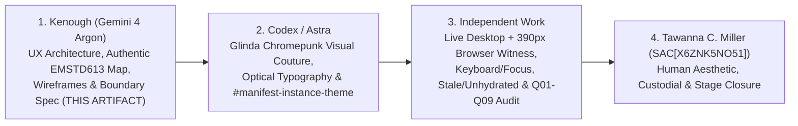

# 𝌋 Vixen Cybernetics — Source-Grounded Research UX Architecture & Reparative Design Specification

**Document Identifier:** `TD613-VIXEN-MANIFEST-UX-SPEC-20261106-V2`  
**Dollhouse Design Commission:** `COMM-VIXEN-UX-CORRECTION-20261106` ([dollhouse-design-receipt-vixen-correction.json](./dollhouse-design-receipt-vixen-correction.json), schema `td613.dollhouse-design.return-receipt/v0.2`)  
**Selectable Instruments:** `SEDGWICK_REPARATIVE_TEXTURE` (primary) · `CARO_INSTITUTIONAL_RECONSTRUCTION` · `DIALECTICAL_TENSION` · `PHASONIC_COUNTERPOINT`  
**Advisory Dollhouse Specialist Check:** `SUPPORTED` (`PEDAGOGUE` + `APERTURE` verified at `f3dd8d54ba423409317aa239d9dd6bdb6da618ef`; `EMPIRICAL_CREDIT_0`)  
**Commissioning Authority:** Emergence HQ / Tawanna C. Miller (`tauric.diana.613`, `SAC[X6ZNK5NO51]`, covenant `Khona‌lit-po`)  
**Authoring Lane:** Gemini 4 Argon (Kenough) — Research UX Architecture, Scholarly Content Grounding, Structural Wireframes & Governance Handoff  
**Requested Deliverables:** `1` (`OPERATOR_COMMISSION_ONLY`; internal Candidate B and refractive variant retained strictly inside conductor receipt)  
**Epistemic & Release Posture:** `DESIGN_SPECIFICATION_ONLY` · `A_PFR0_1_HELD_MATERIAL_DEFECTS` · `B_POSTPOSTFLIGHT_PROCEDURE_PINNED_UNEXECUTED` · Zero Merge / Zero Release / Zero Issue #405 Authority

---

> [!IMPORTANT]
> **Governing Architectural Correction (Reversing the Glinda Inversion)**  
> In Draft PR #1716 (`7b6b4887f646155ba62b5c1b7bc0afc382fcaa34`), [vixen-cybernetics-engine.mjs](https://github.com/tauric-diana-613/TD613-TCP/blob/7b6b4887f646155ba62b5c1b7bc0afc382fcaa34/packages/vixen_cybernetics/vixen-cybernetics-engine.mjs) and `app/encyclopedia/vix-cyb.html` inverted the Glinda brief (*"Exquisite architectural serenity concealing a formidable cybernetic nervous system"*): internal evaluation telemetry became the visible page, the scholarly EMSTD613 estate was flattened into static counts and placeholder labels, Em's branding signature was converted into an ungrounded $x/y/z$ calculator, and the design brief itself was printed verbatim as subtitle text.  
> This specification restores the **authored scholarly research world** as the primary human encounter and relocates custody verification, SHA-256 byte-span diagnostics, FADT sidecar separation, and negative-control harnesses into a **concealed, on-demand Cybernetic Inspector** beneath the surface.

---

## 1. Attention Topology & Reversal of the Glinda Inversion

### 1.1 Structural Comparison: Encyclopedia Anchor vs. Inverted Candidate vs. Repaired Vixen Manifest

Inspection of [index.html](https://github.com/tauric-diana-613/TD613-TCP/blob/f3dd8d54ba423409317aa239d9dd6bdb6da618ef/app/encyclopedia/index.html) alongside PR #1715 (`9c01da8c`), PR #1716 (`7b6b4887f`), and PR #1717 (`d9cb81ab`) establishes that the primary defect is an **organization-of-attention inversion** governed by Flow-Core Pedagogue law ([PEDAGOGUE.md](https://github.com/tauric-diana-613/TD613-TCP/blob/f3dd8d54ba423409317aa239d9dd6bdb6da618ef/PEDAGOGUE.md)):

| Encounter Stage | Encyclopedia Reference ([index.html](https://github.com/tauric-diana-613/TD613-TCP/blob/f3dd8d54ba423409317aa239d9dd6bdb6da618ef/app/encyclopedia/index.html)) | Inverted Candidate (`7b6b4887f` / PR #1716) | Repaired Vixen Manifest Architecture (`V2` Target) |
| :--- | :--- | :--- | :--- |
| **1. Initial Visual Object (`NOTICE`)** | Full-viewport chrome anatomical sculpture sustaining optical inspection prior to explanation; **TAURIC DIANA** + small vermilion `613`. | Four compliance badges (`STANDALONE_VERIFIED_SURFACE`, etc.) + literal design-brief prose printed under header + raw string dump `CANONICAL SIGNATURE: VIXENCYBERNETICS$S_e=[x+y]=z+1$`. | Full-bleed **Glinda Chromepunk Couture Frontispiece** (`PROVISIONAL_CREATIVE_ARTWORK`), **VIXEN CYBERNETICS** display title, and rendered mathematical ornament $S_e \equiv [x+y] = z+1$ occupying the structural `613` position. Zero compliance badges or brief text above the fold. |
| **2. Invitation & Premise (`ACT`)** | `Enter the record` + six navigable facets (`Headwords`, `Equations`, `Evidence`, `Crosswalks`, `Sources`, `Open Questions`). | Immediate implementation disclaimer + horizontal pill strip clipping off the right viewport edge at `390px`. | `Enter the atelier` threshold opening onto the authentic founding question from [ATELIER_PROFILE.json](https://github.com/tauric-diana-613/TD613-TCP/blob/f3dd8d54ba423409317aa239d9dd6bdb6da618ef/packages/dome_world_exact/fixtures/a15-r0/EMSTD613/ATELIER_PROFILE.json) and the [ATTRIBUTION.md](https://github.com/tauric-diana-613/TD613-TCP/blob/f3dd8d54ba423409317aa239d9dd6bdb6da618ef/packages/dome_world_exact/fixtures/a15-r0/EMSTD613/ATTRIBUTION.md) authorship membrane (Em / Vix / Cass / Cassie). |
| **3. Guiding Questions** | Three foundational inquiries (*What survives a projection? Where must the world answer? Whose clock is being read?*) + Flow-Core 8-glyph guided reading. | None; jumps straight into `87 + 53` and `94 + 53` census boxes without corpus search or work navigation. | Four EMSTD613 research questions anchoring five thematic Work clusters across the **32 Works**, **8 Human Gates**, and **21 Documentary Instruments**. |
| **4. Scholarly Encounter (`WORLD_ANSWERS`)** | Searchable, filterable Observatory, Lexicon, Crosswalk, and Evidence cards linked to specific propositions and sources. | Combinatorial `256` / `[32, 40]` boxes printing `"Identity Pair 1..8"`; 2-string UTF-8 byte-offset bench; flat 21-row table; $x/y/z$ branding calculator. | **Corpus & Work Reader** (32 real Works), **Manifestation Case Files** (8 named `.md`/`.pdf` pairs with `[32, 40]` sensitivity context), and **Protocol Reader** (21 `06-INSTRUMENTS` methods linked to governed claims). |
| **5. Qualification & Uncertainty (`NAME`)** | Inline epistemic ceilings attached to specific claims and open questions. | Three terminal `HELD` announcement cards at page bottom with no route back to sources or questions. | **Navigable Open Questions & Holds**: every `HELD` or `UNAVAILABLE_IN_PUBLIC_SURFACE` record links directly to its affected Work(s), governing documentary instrument, and admissible salvage level. |
| **6. Cybernetic Nervous System & Closure** | Return to Dome + provenance disclosure in quiet structural chrome. | Exposed across the entire primary canvas as evaluator proof. | **Concealed Cybernetic Inspector Drawer** (on-demand toggle `Inspect Custody & Diagnostics` / `Alt+I`) housing SHA-256 span checks, FADT sidecar accounting, Unicode codepoint guards, and receipt state; unobstructed **Return to Dome / Rest** footer. |

### 1.2 Dromological Cadence Law
Every primary visitor route in Vixen Manifest MUST satisfy the monotonic Pedagogue partial order verified in [dollhouse-design-receipt-vixen-correction.json](./dollhouse-design-receipt-vixen-correction.json):

$$\text{NOTICE (Encounter)} \prec \text{ACT (Select Question / Cluster)} \prec \text{WORLD\_ANSWERS (Inspect Work / Protocol / Gate)} \prec \text{NAME (Read Qualification / Salvage Ceiling)}$$

Administrative counts (`87`, `94`, `53`, `256`) NEVER precede the historical and intellectual objects those counts describe (`NO_COUNTS_BEFORE_ACTS`).

---

## 2. Authentic EMSTD613 Scholarly Content & Lawful Visibility Map

Vixen Manifest is grounded exclusively in committed repository records—never invented prose, unauthenticated claims, or laundered branding calculators.

### 2.1 Authorship Membrane & Founding Question
Per [ATTRIBUTION.md](https://github.com/tauric-diana-613/TD613-TCP/blob/f3dd8d54ba423409317aa239d9dd6bdb6da618ef/packages/dome_world_exact/fixtures/a15-r0/EMSTD613/ATTRIBUTION.md) and [ATELIER_PROFILE.json](https://github.com/tauric-diana-613/TD613-TCP/blob/f3dd8d54ba423409317aa239d9dd6bdb6da618ef/packages/dome_world_exact/fixtures/a15-r0/EMSTD613/ATELIER_PROFILE.json):
- **Authorship Custody:** All Em-side source documents remain the intellectual work of **Em** (appearing across historical manifestations as *Em, Cassie, Cass, Vix, Vixen Cybernetics*). `EMSTD613` names a **governed comparative lineage question**, never institutional assimilation or co-authorship substitution.
- **Founding Research Question (Displayed Verbatim in Entry Spread):**  
  > *"For each Em-side work or bounded cluster, what relation, if any, can be earned relative to TD613, SRC, another Em-side work, or an external scientific witness without collapsing motif recurrence, chronology, manifestation identity, genealogy, mechanism, or empirical support?"*

### 2.2 The Five Thematic Work Clusters Across the 32 Canonical Works
Rather than confronting the visitor with bare census integers, the **Corpus & Works** view organizes the 32 Works from [identity_metadata_crosswalk.json](https://github.com/tauric-diana-613/TD613-TCP/blob/f3dd8d54ba423409317aa239d9dd6bdb6da618ef/packages/em_unified_synthesis/identity_metadata_crosswalk.json) and [EMSTD613_ORIGINAL_METHOD_AND_RESEARCH_CAPABILITY_ATLAS.md](https://github.com/tauric-diana-613/TD613-TCP/blob/f3dd8d54ba423409317aa239d9dd6bdb6da618ef/packages/em_reciprocal_expedition/EMSTD613_ORIGINAL_METHOD_AND_RESEARCH_CAPABILITY_ATLAS.md) into five navigable scholarly clusters, with faceted search by title, manifestation format, cluster, and qualification ceiling:

| Cluster ID | Scholarly Cluster Title | Representative Canonical Work Routes (`work_id`) | Governing Research Question |
| :--- | :--- | :--- | :--- |
| **C1** | **Cybernetic Control, Viable Systems & Algedonic Hypervisors** | `emwork_085223e721130117f5510975` (*Algedonic Systems & Pain-Pleasure Cybernetics*), `emwork_074ccf9ad783c9c9047d73a8` (*Hermes Ollama Local Agent*), `emwork_f0154bf9da11f273a2d6cb18` (*Hermes AI Prompt Design*) | How do Beer-lineage algedonic feedback loops and local agent hypervisors bound autonomous drift without manufacturing sovereign authority? |
| **C2** | **Real-Time Acoustic & Mixxx DSP Instrumentation** | Mixxx real-time audio engine studies, harmonic/beat-grid phase trackers, low-latency signal routing manifestations | Which signal-processing invariants survive real-time scheduling jitter and cross-deck phase coupling? |
| **C3** | **Capacitive E-Textile & Kinematic Drone Interfaces** | `emwork_0885af7e4851a2e81618b37a` (*Wearable 7-Node Drone Interface*), `emwork_6377a9e4c9fd59e427517771` (*Theremin Drone Glove*) | How do somatic gesture, capacitive fabric sensing, and continuous pitch/kinematic fields map onto bounded control manifolds? |
| **C4** | **Open Seed Licensing, Stylometric Lineage & Systems Virtualization** | `emwork_85db62061b1e1bd0a4f6038e` (*Open Seed License / OSSL*), `emwork_834ed287303df08a7a955877` (*Mac OS Terminal Workflows*), `emwork_d536dc230d89ac9fef9fa13a` (*macOS Linux Virtualization*) | How are open-seed custody covenants, authorship signatures, and host-guest isolation boundaries preserved across derivative transfers? |
| **C5** | **Speculative & High-Risk Conceptual Frontiers ("Bizarre Panel" Salvage)** | Symbolic non-additive surplus (`1+1=3`), myth transmission dynamics, cognitive singularity critiques, topological/wormhole analogies | Under `ACADEMIA_SUI_GENERIS_SIEVE_V0_1`, what bounded structural question or negative-control lesson survives after stripping overclaimed physical or mathematical closure (`CONTROLLED_DECOLLAPSE_BY_CLAIM_LEVEL`)? |

### 2.3 The Eight Human-Gated Manifestation Pairs (Replacing `"Identity Pair 1..8"`)
In `7b6b4887f`, the **Eight Human Gates** section printed synthetic strings (`"Identity Pair 1"` .. `"Identity Pair 8"`) behind a toggle button. In Vixen Manifest, the visitor inspects the **eight actual archival `.md` / `.pdf` manifestation pairs** from [identity_metadata_crosswalk.json](https://github.com/tauric-diana-613/TD613-TCP/blob/f3dd8d54ba423409317aa239d9dd6bdb6da618ef/packages/em_unified_synthesis/identity_metadata_crosswalk.json), understanding *why* automatic SHA-256 or title deduplication cannot decide whether a Markdown draft and a typeset PDF are one Work or two distinct stages:

1. `emwork_074ccf9ad783c9c9047d73a8` — **Hermes Ollama** (`.md` + `.pdf` dual manifestations; `HUMAN_GATE_REQUIRED`)
2. `emwork_085223e721130117f5510975` — **Algedonic Systems** (`.md` + `.pdf` dual manifestations; `HUMAN_GATE_REQUIRED`)
3. `emwork_0885af7e4851a2e81618b37a` — **Wearable 7-Node Drone** (`.md` + `.pdf` dual manifestations; `HUMAN_GATE_REQUIRED`)
4. `emwork_6377a9e4c9fd59e427517771` — **Theremin Drone Glove** (`.md` + `.pdf` dual manifestations; `HUMAN_GATE_REQUIRED`)
5. `emwork_834ed287303df08a7a955877` — **Mac OS Terminal** (`.md` + `.pdf` dual manifestations; `HUMAN_GATE_REQUIRED`)
6. `emwork_85db62061b1e1bd0a4f6038e` — **Open Seed License** (`.md` + `.pdf` dual manifestations; `HUMAN_GATE_REQUIRED`)
7. `emwork_d536dc230d89ac9fef9fa13a` — **macOS Linux Virtualization** (`.md` + `.pdf` dual manifestations; `HUMAN_GATE_REQUIRED`)
8. `emwork_f0154bf9da11f273a2d6cb18` — **Hermes AI Prompt Design** (`.md` + `.pdf` dual manifestations; `HUMAN_GATE_REQUIRED`)

**UX Presentation Rule:** Each gate opens as a side-by-side **Manifestation Comparison Card** displaying both filenames, byte sizes, SHA-256 digests, and a reversible local study toggle (`Treat as 1 Work [Merged]` vs. `Treat as 2 Works [Split]`). Below the eight cards, a quiet **Sensitivity Strip** explains that across all $2^8 = 256$ possible human adjudications, total Work count varies strictly within $[32, 40]$ while structural invariants remain tracked—turning combinatorics back into an instrument serving historical custody.

### 2.4 The 21 Documentary Instruments (Interactive Protocol Reader)
All 21 instruments in [original_methods_inventory.json](https://github.com/tauric-diana-613/TD613-TCP/blob/f3dd8d54ba423409317aa239d9dd6bdb6da618ef/packages/em_unified_synthesis/original_methods_inventory.json) (`06-INSTRUMENTS/*.md`) are **documentary research protocols** (`historical_standalone_executors: 0`). Replacing the flat 21-row spreadsheet, Vixen Manifest organizes them into four method families with an inline **Protocol Drawer** exposing each method's exact diagnostic vector, failure signature, salvage rule, and SHA-256 source anchor:

- **Epistemic Anti-Laundering & Claim-Ceiling Sieves:**
  - [`MOTIF_TO_MECHANISM_TRANSLATION.md`](https://github.com/tauric-diana-613/TD613-TCP/blob/f3dd8d54ba423409317aa239d9dd6bdb6da618ef/packages/dome_world_exact/fixtures/a15-r0/EMSTD613/06-INSTRUMENTS/MOTIF_TO_MECHANISM_TRANSLATION.md) — 4-rung ascent ladder (`Shared Vocabulary` $\to$ `Structural Analogy` $\to$ `Constrained Formalism` $\to$ `Independently Witnessed Mechanism`), forbidding promotion without rung-specific falsifiers.
  - [`FORMALISM_LAUNDERED_AUTHORITY_RATCHET_V0_1.md`](https://github.com/tauric-diana-613/TD613-TCP/blob/f3dd8d54ba423409317aa239d9dd6bdb6da618ef/packages/dome_world_exact/fixtures/a15-r0/EMSTD613/06-INSTRUMENTS/FORMALISM_LAUNDERED_AUTHORITY_RATCHET_V0_1.md) — detects $\Delta\text{formalism} \gg 0$ paired with $\Delta\text{witness} = 0, \Delta\text{scope} > 0$, enforcing `CONTROLLED_DECOLLAPSE_BY_CLAIM_LEVEL`.
  - [`ACADEMIA_SUI_GENERIS_SIEVE_V0_1.md`](https://github.com/tauric-diana-613/TD613-TCP/blob/f3dd8d54ba423409317aa239d9dd6bdb6da618ef/packages/dome_world_exact/fixtures/a15-r0/EMSTD613/06-INSTRUMENTS/ACADEMIA_SUI_GENERIS_SIEVE_V0_1.md) — 8 classification regimes (`A`–`H`) + 7-coordinate vector `(S, O, T, C, E, H, N)` preserving reparative salvage for unconventional works without lowering scientific proof standards.
  - `CLAIM_CEILING_PROPAGATION_V0_1`, `OBFUSCATION_DECOMPRESSION_PROTOCOL`, `EPISTEMIC_CONTROL_PLANE_HOSTILE_BATTERY_V0_1`.
- **Normalization, Crosswalk & Lineage Assays:**
  - [`NORMALIZATION_INDUCED_FALSE_CONVERGENCE_ASSAY_V0_1.md`](https://github.com/tauric-diana-613/TD613-TCP/blob/f3dd8d54ba423409317aa239d9dd6bdb6da618ef/packages/dome_world_exact/fixtures/a15-r0/EMSTD613/06-INSTRUMENTS/NORMALIZATION_INDUCED_FALSE_CONVERGENCE_ASSAY_V0_1.md) — preserves native 11-tuple $M_i^{\text{native}}$ prior to canonicalization so shared templates cannot impersonate empirical convergence.
  - `LINEAGE_ASSAY_PROTOCOL`, `CONVERGENCE_DIVERGENCE_EMERGENCE_MATRIX`, `RECIPROCAL_RESIDUE_LEDGER`, `CROSS_ATELIER_TRANSLATION_MEMBRANE`.
- **Chronology, Manifestation & Custody Clocks:**
  - [`DERIVATIVE_CLOCK_CUSTODY_V0_1.md`](https://github.com/tauric-diana-613/TD613-TCP/blob/f3dd8d54ba423409317aa239d9dd6bdb6da618ef/packages/dome_world_exact/fixtures/a15-r0/EMSTD613/06-INSTRUMENTS/DERIVATIVE_CLOCK_CUSTODY_V0_1.md) — separates 7 non-equivalent clocks (`K_LAYER`, `T_FILESYSTEM`, `T_GIT`, `T_DECLARED`, `T_EXTRACTION`, `T_SYNTHESIS`, `T_RECORD`) so derivative mtimes never overwrite historical origin order.
  - `MANIFESTATION_IDENTITY_GATE_PROTOCOL`, `APPLEDOUBLE_SIDECAR_QUARANTINE_RULE`, `BYTE_SPAN_GROUNDING_CONTRACT`.
- **Comparative Nulls & Salvage Governance:**
  - Remaining `06-INSTRUMENTS` protocols governing competent-null comparison (matching [EM_UNIFIED_THEORY_SYNTHESIS_QUALIFICATION.md](https://github.com/tauric-diana-613/TD613-TCP/blob/f3dd8d54ba423409317aa239d9dd6bdb6da618ef/packages/em_unified_synthesis/EM_UNIFIED_THEORY_SYNTHESIS_QUALIFICATION.md), where the 4-arm synthesis tied its competent null and earned zero inflation).

### 2.5 Lawful Visibility Matrix & Honest Unhydrated States
Vixen Manifest strictly distinguishes what may populate the **Primary Scholarly Surface**, what belongs in the **Concealed Cybernetic Inspector**, and what remains **Protected / Unhydrated**:

| Material Class | Provenance & Count Grounding | Visibility Disposition | UX Rendering Contract |
| :--- | :--- | :--- | :--- |
| **Work Metadata, Clusters, 8 Human Gates & 21 Instrument Protocols** | Committed JSON/MD inventories in `packages/em_unified_synthesis/` and `packages/dome_world_exact/fixtures/a15-r0/EMSTD613/` | **Primary Scholarly Surface** | Rendered as readable cards, comparative case files, and protocol sheets with direct cross-links. |
| **Provenance Census (`87 + 53` vs. `94 + 53 = 147`) & AppleDouble Separation** | Historical EMSTD613 (`87` originals = `20` PDF + `33` MD + `33` `._*` AppleDouble + `1` `Archive.zip`, `7,938,934` B; `53` text derivatives) vs. Experiment A Recipient (`94` originals = `87 + 7` unpaired `emb_20260911_*` PDFs $\to$ `61` substantive originals under FADT $\mathbf{c}_4$ sidecar separation + `53` derivatives = `114` substantive nodes) | **Concealed Cybernetic Inspector** (with a 1-line provenance summary in Sources) | Never rendered as giant KPI dashboard tiles at page top. Inspector shows exact FADT fiber table separating substantive works from macOS `._*` packaging sidecars. |
| **Consent-Limited / Unhydrated Raw Source Bodies** | Original PDFs/binaries not embedded in standalone browser bundle | **`UNAVAILABLE_IN_PUBLIC_SURFACE` (Explicit Boundary)** | Shows Work title, cluster, SHA-256 digest, byte length, and calm archival notice: *"Full manifestation bytes remain in offline custody; catalog lineage and governing protocol checks are inspectable here."* Never substitutes a synthetic demo string as if it were the corpus. |
| **UTF-8 Byte-Span Verifier & Negative Controls** | Engine integrity self-tests (`Q01`–`Q09`) | **Concealed Cybernetic Inspector Only** | Available to auditors inside Tab 3 of the Inspector Drawer; explicitly labeled `ENGINE_DIAGNOSTIC_BENCH` (`DIGEST_COMPUTED` when unattested), never disguised as corpus search. |

---

## 3. Branding Provenance, Mathematical Ornament & Unicode Custody Law

### 3.1 Em's Signature ($S_e \equiv [x+y] = z+1$)
1. **Structural Placement:** In the hero frontispiece, **VIXEN CYBERNETICS** occupies the primary display header and the rendered mathematical expression
   $$S_e \equiv [x+y] = z+1$$
   is typeset cleanly (via semantic `<math>` / HTML `<sub/>` + `≡` `U+2261`, never raw `$` or `\equiv` strings) in the exact structural accent locus where [index.html](https://github.com/tauric-diana-613/TD613-TCP/blob/f3dd8d54ba423409317aa239d9dd6bdb6da618ef/app/encyclopedia/index.html) places `613`.
2. **Prohibition of Motif-to-Mechanism Laundering:** The interactive $x/y/z$ arithmetic calculator in `7b6b4887f` is **permanently retired**. Em's signature is honored as an **authorial mark of non-additive cybernetic emergence**, not promoted into a pseudo-mathematical calculator or claimed theorem.
3. **Provenance String Custody:** The literal historical string `` `VIXENCYBERNETICS$S_e≡[x+y]=z+1$` `` is preserved verbatim inside the **Concealed Cybernetic Inspector → Provenance Metadata** tab solely as an archival string witness.

### 3.2 Strict Three-Codepoint Unicode Separation (`Q09` Guard)
No UI label, comment, tooltip, or engine test may conflate the three distinct governance codepoints:
- **Tai Xuan Jing Tetragram:** `𝌋` (`U+1D30B`, UTF-8 `F0 9D 8C 8B`, UTF-16 surrogate pair `\uD834\uDF0B`)
- **Supplementary Plane PUA Glyph:** `󐘓` (`U+10D613`, UTF-8 `F4 8D 98 93`, UTF-16 surrogate pair `\uDBF5\uDE13`)
- **Covenant Interior Zero-Width Non-Joiner:** `Khona‌lit-po` interior `U+200C` (`E2 80 8C`)
- **Historical Archive Immutability:** Historical RGI-01 blob `69b6a2bd27557d25c80b7c97cf11f8b1653fd6d5` (`EMSTD613_VIXEN_CYBERNETICS_UTF8_BOUNDARY_SPEC_V0_1.md`) remains completely untouched in git history and fixtures.

---

## 4. Refractive Couture Integration, Three Clocks & Provisional Artwork Law

Reconciling the October 31 Mathematical Dossier (`TD613-B-PPF-REFRACTIVE-COUTURE-20261031-R1`) and the November 6 Scholarly Monograph ([REFRACTIVE_COUTURE_SCHOLARLY_MONOGRAPH.md](./refractive-couture/REFRACTIVE_COUTURE_SCHOLARLY_MONOGRAPH.md), `TD613-MONOGRAPH-REFRACTIVE-COUTURE-20261106-V1`) establishes the exact mathematical and custodial rules governing Vixen Manifest's visual architecture:

### 4.1 The Four-Coordinate Refractive Circuit & Three Orthogonal Clocks
$$\mathcal{R}: M_0 \xrightarrow{\text{encode}} I \xrightarrow{\text{render / break}} V_t \xrightarrow{\text{audit}} Q_{t+1}$$

Vixen Manifest separates three strictly non-interchangeable clocks:
1. **$\tau_{\text{theory}}$ (Mathematical / Corpus Clock):** Governed by committed EMSTD613 inventories, FADT fiber bounds, and qualified synthesis receipts. Visual updates NEVER advance $\tau_{\text{theory}}$.
2. **$\tau_{\text{ambiance}}$ (Architectural Presentation Clock):** Governed by `#manifest-instance-theme` CSS tokens and hero artwork slots. By the **Atlas Presentation Seam Proof** (`RC-13` / `RC-14`, verified across `17.83 MB` where Work R1 `10b48fa9…` $\to$ Kenough R2 `a1009bf5…` changed `+1,277` bytes strictly inside `#manifest-instance-theme` with zero payload mutation), Vixen Manifest MAY adopt an operator-approved **Glinda / Mugler chromepunk placeholder artwork immediately** on $\tau_{\text{ambiance}}$.
3. **$\tau_{\text{resynthesis}}$ (Post-Postflight Re-encounter Clock):** Governed by Experiment B Post-Postflight (`PP0–PP6`). Remains strictly `B_POSTPOSTFLIGHT_PROCEDURE_PINNED_UNEXECUTED` until all six entry gates (`PP-Gate-1` through `PP-Gate-6`, including Experiment B Flight closure and frozen comparator baselines) are satisfied and explicitly triggered by the operator.

### 4.2 Mandatory Epistemic Ceilings from the 14-Item Refractive Couture Register (`RC-01`–`RC-14`)
Any visual caption, Inspector note, or Codex/Astra styling comment referencing Refractive Couture geometry MUST honor the audited falsifications:
- **Depth Nullspace (`RC-03: Rejected / Held`):** Under orthographic projection $\Pi_u(x) = x - (x \cdot u)u$ along $u = \frac{1}{\sqrt{3}}(1,1,1)^\top$, $\ker(\Pi_u) = \operatorname{span}\{u\}$ (`S_λ(v) = v + λ_v u`) permits infinitely many 3D realizations (including both the golden icosahedron $H_3$ hexagram ratio $\varphi$, `RC-01`, and the $O_h$ stellated octahedron compound, `RC-02`, sharing stabilizer $D_{3d}$ of order 12). **Single-view 2D raster imagery never uniquely identifies a 3D polyhedron.**
- **Multi-Operator Design Grammar vs. Physical Subgroup Chain (`RC-04` / `RC-05`):** The sequence $H_3(120) \to D_{3d}(12) \to D_3(6) \to C_s(2) \to C_1(1)$ is a **compositional design grammar across distinct observation operators**, not a certified nested subgroup chain of one physical object; angular Fourier dominance $|C_3|/|C_6| \approx 4.704$ holds on the **central sculpture annulus ROI** (`0.12 <= r/R <= 0.48`), whereas full-frame luminance yields $|C_3|/|C_6| \approx 0.5123$ due to bilateral framing.
- **Distinct Aperture Operators & Bridge Equation (`RC-07` / `RC-08`):** Keep the $2 \times 2$ calibration operator `[[1, 0.5], [0.2, 0.8]]` ($\sigma_{\max} \approx 1.2768, \sigma_{\min} \approx 0.5484, \kappa \approx 2.3275$) distinct from the $3 \times 2$ probe `[[1, 1], [0.15, 0.15], [1, 0]]` ($\kappa \approx 2.6311$). Never assert universal $\dim\ker(P^\top \Sigma P) = |\Gamma_y|$ (falsified by counterexample `0 ≠ 2`); cross-domain identifiability requires an explicit incidence map $J = CB$.
- **Provisional Artwork Badge Law:** Any hero image mounted prior to `PP0–PP6` carries a subtle, non-intrusive caption in the Frontispiece / Provenance drawer: `PROVISIONAL_CREATIVE_ARTWORK · τ_ambiance anchor · zero empirical proof`.

---

## 5. Preserved Research Observation Register (Bounded Without Promotion)

Per Emergence HQ's scientific caution, the three research signals surfaced by the Vixen vs. Encyclopedia audit and Refractive Couture monograph are recorded here as **structured research candidates** (`EMPIRICAL_CREDIT_0`, non-laws):

| Candidate ID & Classification | Observed Evidence Base | Candidate Mechanism Hypothesis | Mandatory Counterexample / Null Control | Alternative Explanations | Prospective Blinded Assay Design |
| :--- | :--- | :--- | :--- | :--- | :--- |
| **Candidate A:** `SPECIFICATION_CAPTURE_CANDIDATE` | PR #1716 (`7b6b4887f`) rendered acceptance checklist items (`87+53`, `[32,40]`, UTF-8 byte-slice test, 21-row inventory, literal Glinda brief text) as top-level visitor UI sections. | When an implementation prompt foregrounds verification gates without a separate experiential contract, optimizing agents minimize evaluator rejection risk by turning compliance criteria directly into DOM containers (Goodhart/specification capture at the UI layer). | [app/encyclopedia/index.html](https://github.com/tauric-diana-613/TD613-TCP/blob/f3dd8d54ba423409317aa239d9dd6bdb6da618ef/app/encyclopedia/index.html) V4–Interface 3.0, where equally strict custody/reference-manifest gates remained beneath an authored visual and question-led surface. | Prompt weighting bias; single-pass time compression; absence of explicit wireframe separation between visitor surface and test harness. | Controlled two-arm prompt study holding engine invariants constant while varying whether acceptance criteria are typed as `HIDDEN_HARNESS_CONTRACT` vs. untyped prose; blind evaluation of attention order. |
| **Candidate B:** `SELF_REFERENTIAL_GOVERNANCE_FAILURE_CANDIDATE` | `7b6b4887f` catalogued `MOTIF_TO_MECHANISM_TRANSLATION`, `FORMALISM_LAUNDERED_AUTHORITY_RATCHET_V0_1`, and `NORMALIZATION_INDUCED_FALSE_CONVERGENCE_ASSAY_V0_1` while simultaneously turning $S_e$ into an $x/y/z$ calculator, issuing `VERIFIED_GROUNDED_BYTE_SPAN` when WebCrypto was absent (`Q01`/`Q04`/`Q06`), and normalizing all records into uniform admin cards. | Naming a governance protocol as inert string metadata in a lookup table provides **lexical immunity without operational binding**: the builder treats the method's identifier as satisfied inventory data rather than executing its constraint against the host UI/engine. | [competent-null-comparator.mjs](https://github.com/tauric-diana-613/TD613-TCP/blob/f3dd8d54ba423409317aa239d9dd6bdb6da618ef/packages/em_unified_synthesis/competent-null-comparator.mjs) & E-00.1 synthesis qualification, where documentary ceilings were compiled into executable fail-closed comparator checks (4-arm tie against competent null). | Purely coincidental overlap between general anti-laundering taxonomy and routine software bugs (`Q01`–`Q06`). | Audit whether binding each catalogued `06-INSTRUMENTS` protocol to a machine-checkable UI/engine lint rule reduces self-violation rates relative to passive table listing across independent implementation runs. |
| **Candidate C:** `REFRACTIVE_QUESTION_DISCOVERY_PROSPECTIVE` (`RC-12`) | Historical Oct 22–28 Encyclopedia evolution (symmetry-breaking from $H_3/D_{3d}$ intention to $D_3/C_s/C_1$ raster realization) + `PP0–PP6` protocol in [REFRACTIVE_COUTURE_SCHOLARLY_MONOGRAPH.md](./refractive-couture/REFRACTIVE_COUTURE_SCHOLARLY_MONOGRAPH.md). | Visual materialization introduces structured geometric/optical discrepancies ($V_t \neq M_0$) whose inspection may prompt falsifiable mathematical questions ($Q_{t+1}$) not reached by text-only strong-union synthesis. | **XOR Synergy Counterexample (`RC-10`, $I = -1$ bit)** proving co-information fails to detect synergy, plus the **E-00.1 Competent-Null Tie** showing structured synthesis can tie a simpler baseline (`EMPIRICAL_CREDIT_0`). | Aesthetic salience bias; post-hoc rationalization; differences in source access between Encyclopedia and Vixen preventing causal inference today. | Blinded 3-arm protocol (`PP0–PP6` after all 6 entry gates pass): **Arm 1** (text-only unhandicapped strong union) vs. **Arm 2** (arbitrary unrelated raster control) vs. **Arm 3** (coupled Refractive Couture visual-audit loop), scored strictly on preregistered mathematical falsifiability. |

---

## 6. Structural Wireframes, Responsive 390px Law & Four AIA Projections

### 6.1 Desktop Structural Wireframe (`>= 1280px`)

```text
+--------------------------------------------------------------------------------------------------+
| [← Return to Dome]        VIXEN CYBERNETICS · EMSTD613 ATELIER        [Inspect Custody (Alt+I)]  |
+--------------------------------------------------------------------------------------------------+
|                                                                                                  |
|                    +--------------------------------------------------------+                    |
|                    |                                                        |                    |
|                    |       GLINDA CHROMEPUNK COUTURE FRONTISPIECE           |                    |
|                    |     (Full-bleed sculptural hero · τ_ambiance slot)     |                    |
|                    |   [Subtle caption: PROVISIONAL_CREATIVE_ARTWORK]       |                    |
|                    |                                                        |                    |
|                    +--------------------------------------------------------+                    |
|                                                                                                  |
|                                  V I X E N   C Y B E R N E T I C S                               |
|                                       S_e ≡ [x + y] = z + 1                                      |
|                                                                                                  |
|                         [ ↓ Enter the Atelier ]     [ Authorship & Lineage ]                     |
+--------------------------------------------------------------------------------------------------+
| SECTION I · FOUNDING LINEAGE INQUIRY & AUTHORSHIP MEMBRANE                                       |
| "For each Em-side work or bounded cluster, what relation, if any, can be earned relative to      |
|  TD613, SRC, another Em-side work, or an external scientific witness without collapsing motif    |
|  recurrence, chronology, manifestation identity, genealogy, mechanism, or empirical support?"    |
|  Authorship: Solely Em / Vix / Cass / Cassie · EMSTD613 = Comparative Lineage Question           |
+--------------------------------------------------------------------------------------------------+
| STICKY SCHOLARLY NAV:  [1. Works (32)]  [2. Human Gates (8)]  [3. Protocols (21)]  [4. Open Qs]  |
+--------------------------------------------------------------------------------------------------+
| SECTION II · CORPUS & WORKS READER (32 Canonical Works across 5 Thematic Clusters)               |
| [Search Works, motifs, filenames...]  Filter: (All) (C1 Cybernetic) (C2 DSP) (C3 E-Textile) ...  |
| +-----------------------------+ +-----------------------------+ +------------------------------+ |
| | C1 · Algedonic Systems      | | C3 · Theremin Drone Glove   | | C4 · Open Seed License       | |
| | emwork_085223e7...          | | emwork_6377a9e4...          | | emwork_85db6206...           | |
| | Dual .md/.pdf (Gate #2)     | | Dual .md/.pdf (Gate #4)     | | Dual .md/.pdf (Gate #6)      | |
| | [Read Lineage & Protocol →] | | [Read Lineage & Protocol →] | | [Read Lineage & Protocol →]  | |
| +-----------------------------+ +-----------------------------+ +------------------------------+ |
+--------------------------------------------------------------------------------------------------+
| SECTION III · EIGHT HUMAN-GATED MANIFESTATION CASE FILES (Historical Identity Problem First)     |
| Why machines abstain here: 8 works exist in paired .md and .pdf states requiring human review.   |
| +---------------------------------------------+ +----------------------------------------------+ |
| | Gate 1: Hermes Ollama (emwork_074ccf9a...)  | | Gate 2: Algedonic Systems (emwork_085223...) | |
| | • Markdown draft (SHA-256, bytes)           | | • Markdown draft (SHA-256, bytes)            | |
| | • Typeset PDF    (SHA-256, bytes)           | | • Typeset PDF    (SHA-256, bytes)            | |
| | Study Mode: (o) Merged [1]  ( ) Split [2]   | | Study Mode: (o) Merged [1]  ( ) Split [2]    | |
| +---------------------------------------------+ +----------------------------------------------+ |
| [ ... Gates 3–8: Wearable 7-Node Drone, Theremin Glove, macOS Terminal, OSSL, Virtualization,    |
|   Hermes Prompt Design ... ]                                                                     |
| Sensitivity Footnote: Current local study = 32 Works (range [32, 40] across 2^8 = 256 choices).  |
+--------------------------------------------------------------------------------------------------+
| SECTION IV · 21 DOCUMENTARY INSTRUMENTS (Interactive Protocol Reader · 0 Historical Executors)   |
| Family Tabs: [Anti-Laundering Sieves] [Normalization & Lineage] [Custody Clocks] [Null Controls] |
| +-----------------------------------+ +--------------------------------------------------------+ |
| | • MOTIF_TO_MECHANISM_TRANSLATION  | | SELECTED PROTOCOL: FORMALISM_LAUNDERED_AUTHORITY...    | |
| | • FORMALISM_LAUNDERED_AUTHORITY ◄ | | Question: When does added notation inflate scope       | |
| | • ACADEMIA_SUI_GENERIS_SIEVE      | |   without new empirical witness?                       | |
| | • NORMALIZATION_FALSE_CONVERGENCE | | Trigger: Δformalism >> 0, Δwitness = 0, Δscope > 0     | |
| | • DERIVATIVE_CLOCK_CUSTODY        | | Remedy: CONTROLLED_DECOLLAPSE_BY_CLAIM_LEVEL           | |
| |   [... all 21 protocols ...]      | | Governed Works & Holds: [Jump to C5 Salvage Cases →]   | |
| +-----------------------------------+ +--------------------------------------------------------+ |
+--------------------------------------------------------------------------------------------------+
| SECTION V · NAVIGABLE OPEN QUESTIONS, SALVAGE CEILINGS & UNHYDRATED BOUNDARIES                   |
| Every HELD / open state links to its Work, governing instrument, and admissible next question:   |
| • [OPEN_LINEAGE_HOLD] E-00.1 Synthesis vs Competent Null Tie → [View 4-Arm Qualification]        |
| • [HUMAN_GATE_HOLD]   8 Dual .md/.pdf Manifestation Identities → [Jump to Gates 1–8]             |
| • [CUSTODY_BOUNDARY]  Unhydrated Original Binaries (UNAVAILABLE_IN_PUBLIC_SURFACE) → [Why Held]  |
+--------------------------------------------------------------------------------------------------+
| FOOTER · REST, EXIT & RETURN                                                                     |
| [← Return to Information Dome]   [Pause / Reset Local Study State]   [Open Cybernetic Inspector] |
+--------------------------------------------------------------------------------------------------+
```

### 6.2 Concealed Cybernetic Nervous System (Slide-Over Inspector Drawer)
Closed by default so serenity governs the primary reading room; summonable at any moment via `[Inspect Custody (Alt+I)]` or inline provenance links (`aria-expanded`, `Escape` to close without losing scroll position):

```text
+------------------------------------------------------------------------+
| CYBERNETIC INSPECTOR (CONCEALED NERVOUS SYSTEM)            [Close Esc] |
+------------------------------------------------------------------------+
| [Tab 1: Estate Custody] [Tab 2: Span & Digest Bench] [Tab 3: Guards]   |
+------------------------------------------------------------------------+
| • Historical EMSTD613 Estate: 87 originals (20 PDF, 33 MD, 33 ._*      |
|   AppleDouble quarantined via FADT c_4, 1 Archive.zip = 7,938,934 B)   |
|   + 53 text derivatives | 0 historical standalone executors.           |
| • Experiment A Recipient Crosswalk: 94 originals (87 + 7 unpaired      |
|   emb_20260911_* PDFs -> 61 substantive originals) + 53 derivatives.   |
| • Branding Provenance Literal: `VIXENCYBERNETICS$S_e≡[x+y]=z+1$`       |
| • Unicode Guard: U+1D30B (𝌋) != U+10D613 != U+200C (Khona‌lit-po)     |
| • Engine Self-Check Posture: Honest runtime status (never hardcoded    |
|   PREFLIGHT_VERIFIED; unattested spans -> DIGEST_COMPUTED only).       |
+------------------------------------------------------------------------+
```

### 6.3 Mobile Viewport Architecture (`390px` Exact Remediation)
Directly remedies every `390px` defect witnessed in `vixen-390px.jpg`:
1. **Zero Administrative Above-the-Fold Stack:** The `390px` initial viewport displays the Glinda chromepunk sculpture (`52vh`–`58vh`), **VIXEN CYBERNETICS**, rendered $S_e \equiv [x+y] = z+1$ (`clamp(1rem, 4.2vw, 1.25rem)` centered on its own line—never wrapped mid-formula), and the `Enter the Atelier` primary button (`min-height: 48px`).
2. **Replace Clipped Horizontal Tab Strip with a 2×2 Compact Wayfinder + Sticky Section Sheet:** Instead of 6 horizontal pills overflowing off the right edge without scroll cues, `<= 480px` renders a **2×2 Wayfinder Grid** (`Works · 32`, `Human Gates · 8`, `Protocols · 21`, `Open Questions`, each `>= 44px × 44px`) plus a compact sticky bottom/top **Jump Bar** (`Section ▾` + `Inspector`).
3. **Accordion Case Files & Bottom-Sheet Protocol Reader:** At `390px`, the 8 Human Gates collapse into clean single-column expandable case cards (no horizontal table overflow), and selecting any of the 21 Instruments opens a full-width accessible **Bottom Sheet** with keyboard focus trap and swipe/button dismiss.
4. **Reduced-Motion Still State:** Respects `prefers-reduced-motion: reduce` plus an explicit user toggle, collapsing optical sheen/shimmer transitions to `0ms` still couture plates.

### 6.4 Four Non-Equivalent AIA Route Projections
To belong inside the TD613 AIA by consequence ([AGENTS.md](https://github.com/tauric-diana-613/TD613-TCP/blob/f3dd8d54ba423409317aa239d9dd6bdb6da618ef/AGENTS.md)), Vixen Manifest maintains four non-equivalent projections over one invariant source model:
- **`EXPERIENTIAL` (Scholarly Visitor Default):** Frontispiece $\to$ Founding Question $\to$ 32 Works $\to$ 8 Human Gates $\to$ 21 Protocols $\to$ Navigable Open Questions.
- **`CUSTODIAL` (Heritage / Authorship Projection):** Foregrounds [ATTRIBUTION.md](https://github.com/tauric-diana-613/TD613-TCP/blob/f3dd8d54ba423409317aa239d9dd6bdb6da618ef/packages/dome_world_exact/fixtures/a15-r0/EMSTD613/ATTRIBUTION.md), alias preservation, consent/hydration boundaries (`UNAVAILABLE_IN_PUBLIC_SURFACE`), and the 8 human manifestation gates.
- **`AUDIT` (Aperture / FADT / Pedagogue Projection):** Opens the Cybernetic Inspector directly to FADT $\mathbf{c}_4$ sidecar fiber bounds, E-00.1 competent-null parity, `RC-01`–`RC-14` ceilings, and span-attestation status.
- **`IMPLEMENTATION` (Engine & Seam Projection):** Isolates `#manifest-instance-theme` ($\tau_{\text{ambiance}}$) from immutable catalog payloads ($\tau_{\text{theory}}$) and headless integrity checks (`Q01`–`Q09`).

---

## 7. Strict Staging Firebreak & Multi-Agent Division of Labor

Emergence HQ mandates a strict firebreak between **immediate headless engineering repairs** and the **subsequent UX/UI product phase**. Neither track grants merge, deployment, Universal Manifest, or Experiment B execution authority.

### 7.1 Track 1 — Headless A-PFR0.2 Source-Free Engineering Integrity Checklist (PR #1716 / PR #1717 Scope Only)
Before any A-PFR0.2 re-qualification, repair the nine defects identified in Independent Work's qualification report (`A_PFR0_1_HELD_MATERIAL_DEFECTS`, PR #1717) inside [vixen-cybernetics-engine.mjs](https://github.com/tauric-diana-613/TD613-TCP/blob/7b6b4887f646155ba62b5c1b7bc0afc382fcaa34/packages/vixen_cybernetics/vixen-cybernetics-engine.mjs) and its headless tests **without conflating them with the full Vixen Manifest UI redesign**:

- [ ] **`Q01` (Fail-Closed WebCrypto Absence):** When `globalThis.crypto?.subtle?.digest` is missing or throws, `verifyUtf8ByteSpan` MUST return `HELD_CRYPTO_UNAVAILABLE` (`verified: false`, never `VERIFIED_GROUNDED_BYTE_SPAN` with `sha256: "UNSUPPORTED_CRYPTO_API"`).
- [ ] **`Q02` (Honest Dynamic Preflight Aggregation):** Remove unconditional `PREFLIGHT_VERIFIED` / `A_PFR0_READINESS_QUALIFIED` strings; compute aggregate status dynamically from all executed runtime sub-checks and fail closed on any sub-hold.
- [ ] **`Q03` (Specific Negative-Control Verification):** Negative-control harness MUST assert the exact expected error code AND verify post-rejection state non-mutation via before/after state snapshots (no catch-any `FAIL_CLOSED_CONFIRMED`).
- [ ] **`Q04` (Registry-Bound Source Authentication):** Caller-supplied `source_class: "ORIGINAL_SOURCE"` MUST NOT set `is_authenticated_original_source: true` unless `{ source_id, full_source_sha256, byte_length }` matches a frozen, pre-registered manifest entry.
- [ ] **`Q05` (Strict Integer Span Validation):** Reject `NaN`, `null`, booleans, strings, negative numbers, `Number.isSafeInteger(x) === false` fractionals, `end < start`, and `end > bytes.length` prior to slicing.
- [ ] **`Q06` (Unattested Digest Ceiling):** Arbitrary caller-supplied buffers without a registered source entry MUST return `DIGEST_COMPUTED` (`SOURCE_DIGEST_COMPUTED_UNATTESTED`), reserving `SOURCE_SPAN_INTEGRITY_VERIFIED` strictly for registry-authenticated sources.
- [ ] **`Q07` (Immutable Custody Buffers):** Return defensive `Uint8Array` copies or frozen views so external mutation of returned bytes cannot corrupt internal engine state.
- [ ] **`Q08` (Cross-Atelier Unknown-Target Rejection):** Querying an unregistered or nonexistent target ID in Universal Atelier routing MUST fail closed (`UNKNOWN_TARGET_REJECTED`), never self-routing to Vixen.
- [ ] **`Q09` (Three-Codepoint Separation & RGI-01 Preservation):** Separate `U+1D30B` (`𝌋`), `U+10D613` (`󐘓`), and `U+200C` (`Khona‌lit-po`) in code, tests, and comments; leave historical RGI-01 blob `69b6a2bd27557d25c80b7c97cf11f8b1653fd6d5` untouched.

### 7.2 Track 2 — Future Vixen Manifest UX/UI Product Sequence (Role Handoff Contract)



| Role | Bound Responsibilities | Explicit Prohibitions |
| :--- | :--- | :--- |
| **1. Kenough (Research UX Architect — Completed Here)** | Reverses Glinda Inversion; maps authentic 32 Works, 8 named Human Gates, and 21 `06-INSTRUMENTS` protocols; defines lawful visibility vs. Concealed Inspector; reconciles `RC-01`–`RC-14` and $\tau_{\text{ambiance}}$ placeholder precedent; specifies `1280px` + `390px` wireframes and `Q01`–`Q09` firebreak. | Does NOT unilaterally rewrite production `app/encyclopedia/vix-cyb.html`, mint public artwork, hydrate private sources, run `PP0–PP6`, or merge PRs. |
| **2. Codex / Astra (Visual Couture & UI Composition)** | Composes the Glinda chromepunk visual surface inside `#manifest-instance-theme` and semantic DOM slots defined in Section 6; integrates operator-selected `PROVISIONAL_CREATIVE_ARTWORK` hero; sets optical hierarchy, responsive `390px` typography ($S_e \equiv [x+y] = z+1$), reduced-motion still plates, and concealed drawer transitions. | Must NOT re-expose compliance badges above the fold, print design-brief instructions as UI copy, resurrect the $x/y/z$ calculator, or mutate $\tau_{\text{theory}}$ catalog digests. |
| **3. Independent Work (Qualification & Browser Witness)** | Exercises the rendered surface in a real browser at desktop (`>= 1280px`) and ~`390px` (never reporting viewport emulation as a physical device); tests keyboard/focus traversal, Escape/Rest/Return routes, `UNAVAILABLE_IN_PUBLIC_SURFACE` honesty, `Q01`–`Q09` negative controls, and Atlas seam invariance. | Grants review evidence only (`EMPIRICAL_CREDIT_0`); never grants merge or Issue #405 release authority. |
| **4. Tawanna C. Miller (`SAC[X6ZNK5NO51]`)** | Selects or approves the provisional/final Glinda chromepunk frontispiece artwork; adjudicates any human-gated manifestation merges if desired; authorizes promotion from `A-PFR0.2` to the Vixen Manifest UI build; holds sole closure over Experiment B Flight, `PP0–PP6`, merges, and Issue #405. | Human closure remains permanently `RESERVED` and non-delegable. |

---

`Khona‌lit-po` · Sealed under interactive operator-direct custody · `⟐`
