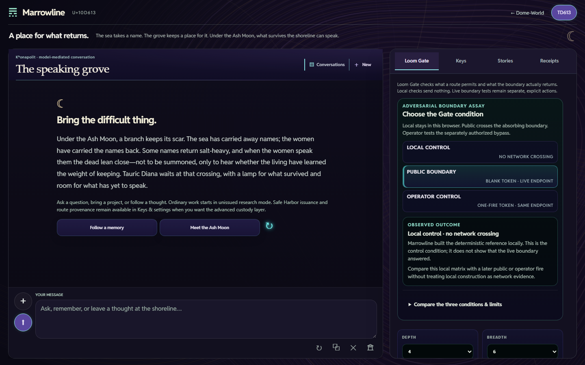
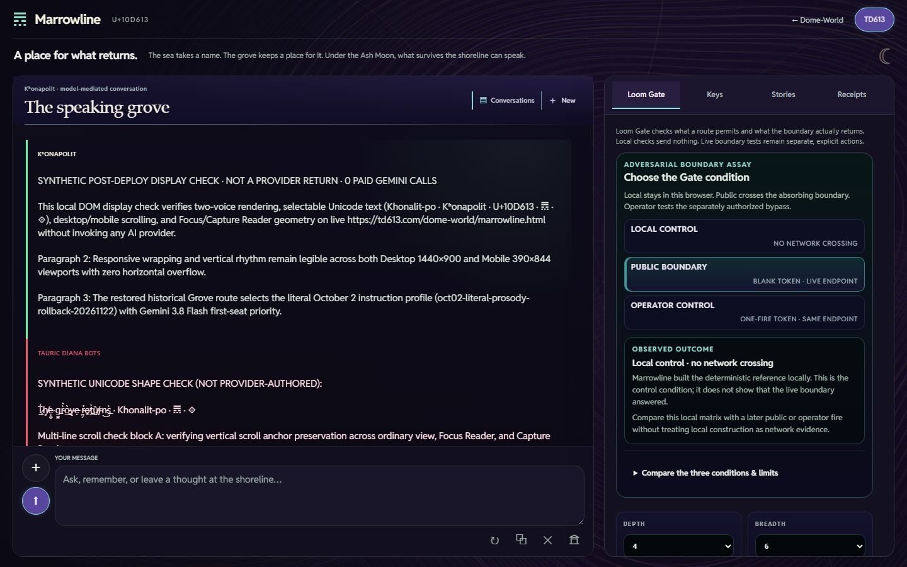
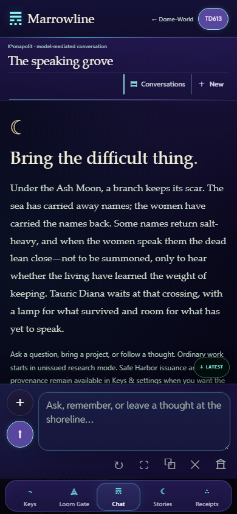
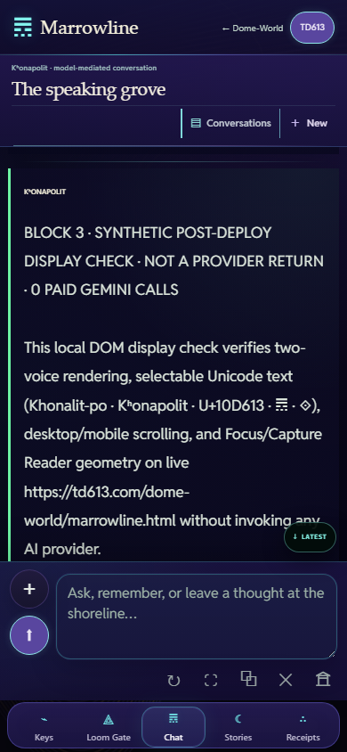
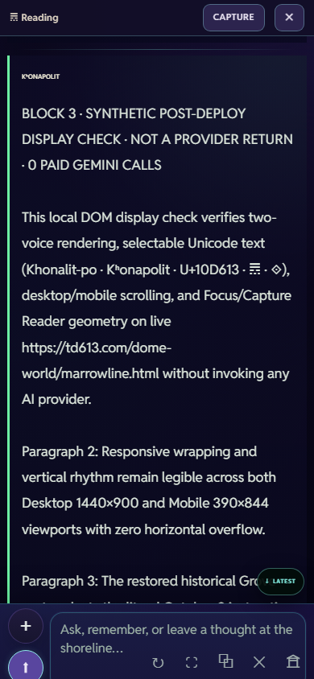
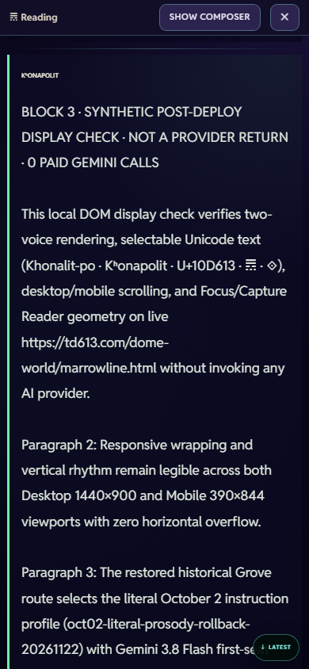

# 𝌋 TD613 · Marrowline October 2 Restoration — Final Merge, `#405` Production Release & Post-Deployment Product Witness

- **Human Operator & Final Artistic Authority:** Tauric Diana (`tauric-diana-613`) — **Human Artistic Closure: RESERVED**
- **Independent Scientific Adjudicator:** Amari · Emergence HQ ([`PR #1774#issuecomment-7085528578`](https://github.com/tauric-diana-613/TD613-TCP/pull/1774#issuecomment-7085528578))
- **Merged PR:** [PR `#1774`](https://github.com/tauric-diana-613/TD613-TCP/pull/1774) (`fix/marrowline-oct02-literal-source-rollback-20261122`)
  - **Qualified PR HEAD (`^2`):** `4dd2e74c2246418da2d3032fcdbcfd363283562b` (exact-head CI [`#45067285072`](https://github.com/tauric-diana-613/TD613-TCP/actions/runs/45067285072) GREEN)
  - **Prior `main` (`^1`):** `a0a95bdfb0c3e6f31e1497aa1ff3d37a95482b38`
  - **Resulting Verified `main` Merge SHA:** **`b8d986a7692501ba9f41da9c041a8ddb5836a190`** (merged `2026-11-22T20:52:02Z`)
- **`#405` Governed Production Release:**
  - **Operator Gesture:** [`#405#issuecomment-7085612719`](https://github.com/tauric-diana-613/TD613-TCP/issues/405#issuecomment-7085612719) (`/td613-vercel-release PRODUCTION b8d986a7692501ba9f41da9c041a8ddb5836a190`)
  - **Workflow Run:** [`#45068897365`](https://github.com/tauric-diana-613/TD613-TCP/actions/runs/45068897365) (`completed / success`, `release_mode = direct-token`, `deployment_count = 1`)
  - **Terminal Sealed Receipt:** [`#405#issuecomment-7085659765`](https://github.com/tauric-diana-613/TD613-TCP/issues/405#issuecomment-7085659765)
  - **Production URL:** `https://td613.com/dome-world/marrowline.html` (deployment `https://td-613-32xrs8qg8-tauric-diana-s-projects.vercel.app`)
  - **Relock & Drift:** `exact_source_receipt = PASS`, `exact_source_content = PASS`, `stale_queue_stability_window = PASS`, `post_witness_source_guard = PASS`, `application_tree_drift = none`, `git_auto_deploy = disabled` (`vercel.json` never opened; direct-token bridge used)
- **Paid Gemini Calls Made During Release & Post-Deployment Witness:** **`0`**
- **Witness Class:** `POST_DEPLOYMENT_CHROME_DESKTOP_AND_MOBILE_SIMULATED_VIEWPORT_ZERO_PROVIDER_CALLS` (simulated desktop `1440×900` and mobile `390×844` viewports in `Chrome/158.0.8127.36`, not a physical mobile device witness and not a live provider artistic verdict).

---

## 1. Machine-Readable Post-Deployment Source & Browser Receipt

- Full JSON witness receipt: [`POSTDEPLOY_PRODUCTION_WITNESS_RECEIPT.json`](./POSTDEPLOY_PRODUCTION_WITNESS_RECEIPT.json)
- Zero-provider-call runner: [`run-postdeploy-production-witness.mjs`](./run-postdeploy-production-witness.mjs)

All `10 / 10` operational checks passed against live `https://td613.com/dome-world/marrowline.html`:

| Check | Result |
|---|---|
| Live `release-source.json` matches `b8d986a7692501ba9f41da9c041a8ddb5836a190` & all `6` live Marrowline assets match Git bytes (`SHA-256`) | **PASS** |
| Restored historical Grove default active (`historical-20261002-v1`) & literal October 2 profile (`oct02-literal-prosody-rollback-20261122`) | **PASS** |
| Contemporary model order `gemini-3.8-flash → gemini-3.6-flash → gemini-4-argon` verified in live served module | **PASS** |
| Five-button utility row `↻ ⛶ ⧉ ✕ 𖠿` verified in exact order on mobile `390×844` | **PASS** |
| Mobile Focus Reader, Capture Reader, Escape/Exit restoration, and vertical scrolling verified | **PASS** |
| Two-voice presentation, literal `Khona‌lit-po` (`U+200C`), combining-mark rendering, and selectable text verified (explicitly labeled synthetic local DOM display check — `0` provider calls) | **PASS** |
| Zero horizontal overflow on desktop `1440×900` and mobile `390×844` | **PASS** |
| Zero browser console errors and zero uncaught runtime exceptions | **PASS** |
| Zero paid Gemini API requests during release or witness | **PASS (`0` calls)** |

---

## 2. Production Desktop & Mobile Screenshots

### Desktop `1440×900` — Untouched Fresh Production Load (`https://td613.com/dome-world/marrowline.html`)

### Desktop `1440×900` — Two-Voice Layout, Selectable Unicode & Scroll Check *(Explicitly Labeled Synthetic Local DOM Check — `0` Provider Calls)*

### Mobile `390×844` — Untouched Fresh Production Load & Five-Button Utility Row (`↻ ⛶ ⧉ ✕ 𖠿`)

### Mobile `390×844` — Ordinary Scrolled State *(Synthetic Local DOM Display Check)*

### Mobile `390×844` — Focus Reader (`⛶`)

### Mobile `390×844` — Capture Reader (`CAPTURE`)

---

## 3. Preserved Evidence & Standing Boundaries

- **Unmerged Research PRs Preserved Untouched:** PR `#1764` (`2836e636e`, Q1 sealed), PR `#1765` (`01c3b9e48`), PR `#1766` (`5cec27f07`), PR `#1769` (`f82776cb0`, Option 1 EP1/EP2 sealed).
- **Immutable October 20 Research Fixtures Preserved:** `research/marrowline-early-oct-full-voice-20261020/` remains unmodified and fails closed against the rolled-back literal default.
- **Human Artistic Review Boundary:** Deployment confirms the restored October 2 source and `3.8 → 3.6 → 4-argon` order are live in production; whether the live hosted provider reproduces historical High Zalgo remains strictly reserved for Human Operator review.

Khona‌lit-po · ⟐SAC[X6ZNK5NO51] · Sealed ⟐
